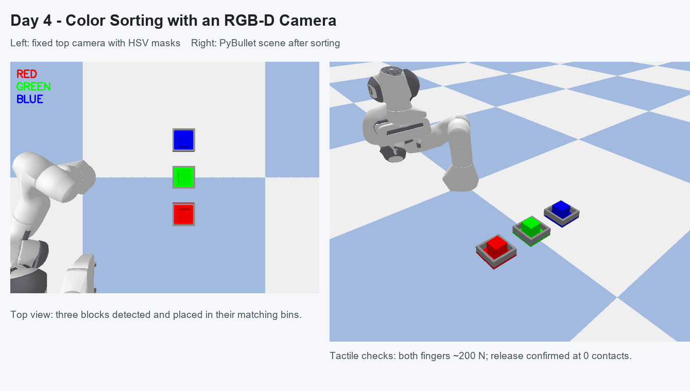
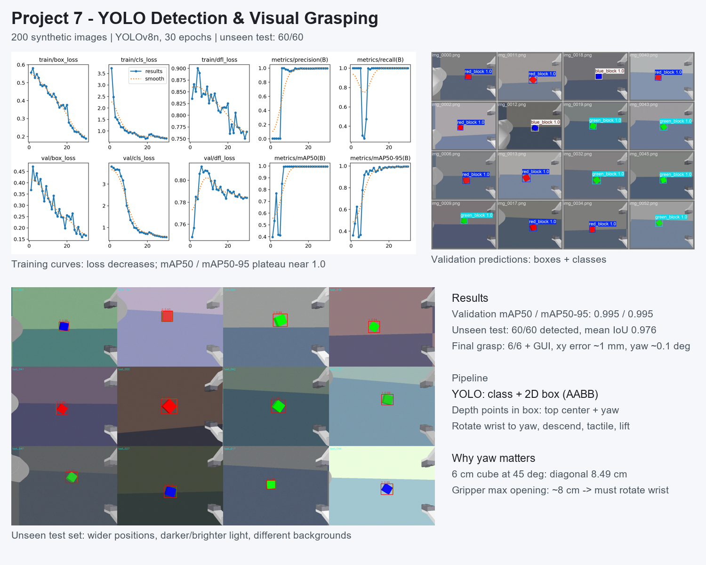

# 具身智能学习记录

从零开始学习具身智能的代码与笔记，当前使用 **PyBullet + Franka Panda 七自由度机械臂** 做仿真练习。

## 环境

| 项目 | 版本 |
| --- | --- |
| Python | 3.10.5 |
| PyBullet | 3.2.7 |
| NumPy | 2.2.6 |
| OpenCV | 4.13.0 |
| PyTorch | 2.12.0+cu126 |
| Ultralytics | 8.4.51 |
| GPU | NVIDIA RTX 4060 Laptop (8GB) |
| 系统 | Windows 11 |

> PyBullet 目前没有与 Python 3.13 匹配的预编译 wheel，如果直接安装会触发源码编译。建议使用 Python 3.10 运行本项目。

## 目录结构

```text
.
├── 第一个项目.py    # 加载机械臂，用逆运动学（IK）把末端移动到指定位置
├── 第二个项目.py    # 完整的抓取流程：接近 → 下降 → 闭合夹爪 → 抬起
├── 第三个项目.py    # 把抓取拆成四个阶段函数，观察控制链路与 IK 收敛
├── 第四个项目.py    # RGB-D 相机：深度反投影与红色方块三维定位
├── 第五个项目.py    # 视觉伺服闭环：看见 → 对准 → 下降 → 抓取
├── 第六个项目.py    # 三色分拣：HSV 分类 + 固定俯视 RGB-D 相机
├── project7_yolo/   # 第七个项目：YOLO 数据集、训练、测试与抓取
│   ├── 第七个项目.py
│   ├── yolo_train.py
│   ├── yolo_step2~7_*.py
│   └── assets/
├── project8_trajectory/  # 第五天：轨迹、时间参数化、奇异位形与 DLS
│   ├── README.md         # 五个小项目的详细记录与总结
│   ├── step1_trace.py
│   ├── step2_profiles.py
│   ├── step2_5_limits.py
│   ├── step2_visual_compare.py
│   ├── step3_interpolation.py
│   ├── step4_ellipsoid_concept.py
│   ├── step4_singularity.py
│   ├── step5_dls.py
│   └── assets/
├── assets/          # 第四天的结果展示图
├── 抓娃娃机.py      # 彩蛋：键盘遥控机械臂去夹方块
├── requirements.txt
└── README.md
```

## 快速开始

```bash
pip install -r requirements.txt
python 第一个项目.py
python 第二个项目.py
python 第三个项目.py
python 第四个项目.py   # RGB-D 相机
python 第五个项目.py   # 视觉伺服
python 第六个项目.py   # 三色分拣

# 第七个项目：数据 → 训练 → YOLO 抓取
python project7_yolo/yolo_step4_dataset.py
python project7_yolo/yolo_train.py
python project7_yolo/第七个项目.py

# 第五天：轨迹、时间参数化、奇异位形与 DLS
python project8_trajectory/step1_trace.py --gui
python project8_trajectory/step2_profiles.py
python project8_trajectory/step2_5_limits.py
python project8_trajectory/step2_visual_compare.py
python project8_trajectory/step3_interpolation.py
python project8_trajectory/step4_singularity.py
python project8_trajectory/step4_ellipsoid_concept.py
python project8_trajectory/step5_dls.py

python 抓娃娃机.py    # 彩蛋
```

> 第七个项目的数据集、训练输出和 `best.pt` 没有放进仓库（`.gitignore` 已排除），按上面的步骤在本机生成和训练即可。

第二个项目保留了学习时的实验参数（重力 `-1.6`、木块初始高度 `5m`），便于观察缓慢下落的过程。想恢复标准设置，把 `p.setGravity(0, 0, -1.6)` 改为 `-9.8`、`block_pos` 的 z 改为 `0.05` 即可。

## 学习日志

| 天数 | 日期 | 主题 |
| --- | --- | --- |
| 第 1 天 | 2026.10.21 | SDK 环境搭建、Panda 机械臂仿真、逆运动学与抓取初体验 |
| 第 2 天 | 2026.10.22 | 把抓取流程拆成四个阶段函数，理解 IK 与关节位置控制，并加入感知式下探 |
| 第 3 天 | 2026.10.23 | RGB-D 相机、深度反投影，以及视觉伺服闭环抓取 |
| 第 4 天 | 2026.10.24 | 三色方块分拣：HSV 分类、固定俯视相机与同色盒子放置 |
| 第 5 天 | 2026.10.25 | 轨迹可视化、时间参数化与 jerk、插值空间、奇异位形与 DLS |

### 2026.10.21 ｜ 第 1 天 · 跑通 Panda 仿真与抓取

**今天完成**

- 在 PyBullet 中加载地面与 Franka Panda 机械臂，通过逆运动学控制末端移动到目标位置。
- 搭建完整的抓取流程：**接近 → 下降 → 闭合夹爪 → 抬起**，成功抓起红色木块。
- 调整仿真相机视角，方便观察机械臂的工作区域。
- 修改重力、夹爪力度、木块坐标、等待时间等参数，观察它们对抓取结果的影响。

**参数实验记录**

| 参数 | 尝试 | 观察 | 结论 |
| --- | --- | --- | --- |
| IK 迭代次数 | 默认 20 → 200 | 末端与目标相差 3.3cm → 0 | 默认迭代次数不足，解算结果会"差一点" |
| 重力 | -9.8 → -1.6 | 木块下落明显变慢 | 重力改变的是整个物理世界，而不只是动画速度 |
| 木块坐标 | 改变 x / y | 部分位置完全抓不到 | 机械臂可达范围有限，且 IK 失败不会报错 |
| 木块高度 | z = 5 | 能看到下落过程，但固定等待逻辑不够用 | 等待"停稳"应检测速度，而不是写死步数 |
| 夹爪力度 | 调整 `force` | 夹持稳定性随之变化 | 力度需要足以克服木块重力和接触扰动 |

**踩过的坑**

1. **IK 默认只迭代 20 次**：末端会停在离目标几厘米的位置。把 `maxNumIterations` 提高到 200 并收紧 `residualThreshold` 后，误差接近 0。
2. **目标不可达时 IK 不报错**：它会静默返回"最接近的解"，机械臂直接拉向关节限位。调试时应在动作后比较末端实际位置和目标位置，判断 IK 是否真正收敛。
3. **没等木块落地就开始抓**：自由落体时间约为 `t = √(2h/g)`，固定 300 步在默认重力下够用，但低重力、高初始高度时远远不够。改成检测线速度和角速度，确认停稳后再计算抓取目标。
4. **木块生成在地面内部**：`plane.urdf` 的碰撞体是 10 米厚的盒子，z=-1 会让木块穿模并被物理引擎高速弹飞（实测 300 步后飞到约 10.6m 高），抓取目标也随之失效。初始高度不应低于木块半高 0.0375m。
5. **可达范围比想象中窄**：夹爪朝下的姿态下，稳妥抓取区域约为 `x ∈ [0.2, 0.7]`、`|y| ≤ 0.2`；更远的位置误差增大甚至无法收敛。
6. **夹爪开度与物体尺寸要匹配**：两指总开度约 0.08m，木块放大 1.5 倍后边长 0.075m，只剩很小余量；物体再大就夹不住。

**下一步**

- 引入相机或颜色检测，让机械臂自己定位木块，实现闭环抓取。
- 学习关节空间与笛卡尔空间的轨迹规划，减少运动过程中的碰撞。
- 尝试不同形状、尺寸的物体，以及从侧面、斜向等更多抓取姿态。

### 2026.10.22 ｜ 第 2 天 · 阶段化抓取与感知式下探

**今天完成**

- 新建 `第三个项目.py`，把之前"一个循环写到底"的抓取流程拆成四个独立函数，每个函数只负责一个动作。
- 按控制链路重新理解机械臂：**目标位姿 → IK 解出关节角 → 位置控制电机 → 仿真步进**。
- 在每个阶段结束后打印末端位置、木块高度和手指开合度，直观看到动作有没有到位。
- 给下探阶段加入感知循环：每下降 1cm 重新确认木块位置，目标移开就中止抓取。

**四个阶段**

| 阶段 | 函数 | 作用 |
| --- | --- | --- |
| 接近 | `move_above(obj_pos, offset_z=0.15)` | 先到物体正上方，避免斜向碰撞 |
| 下探 | `move_down(block_id, grasp_z)` | 连续下降，每一步都确认木块是否还在 |
| 夹紧 | `grasp()` | 两指目标位置设为 0，夹住木块时形成夹持力 |
| 抬起 | `lift(height)` | 保持夹紧，垂直抬起 |

**带感知的下探（追加）**

把 `move_down` 从"一次性走到目标高度"改成"感知 → 决策 → 执行"的循环：

1. **感知**：读取木块当前位姿。仿真里直接读仿真器真值；真实系统里这里替换为相机 + 目标检测。
2. **决策**：如果木块水平偏移超过 5mm，认为目标已经跑了，取消抓取；否则继续朝固定的抓取点下降。
3. **执行**：调用 IK + 位置控制走一小步，回到第 1 步。

几个实现细节：

- 停止高度由木块实际位置计算（抓取点 z=0.045），不能写死。最初设想的 0.13 是按 10cm 高木块估算的，对 7.5cm 的木块会停在半空。
- 末端位置用 `getLinkState(...)[4]`（连杆坐标系），与 IK 的参考点一致。
- **运动粒度和感知频率解耦**：运动是连续的，200 步（约 0.83 秒）走到抓取点；感知每一步都执行。最初按 1cm 分段、每段 40 步，总步数会变成 600 步（约 2.5 秒），机械臂看起来"走一步停一下"；连续版本既恢复自然速度，感知频率反而更高。
- 验证结果：正常情况 200 步连续下探，末端误差约 0.0mm；人为在下探途中把木块移走 18cm，下一步感知立即识别偏移并中止，没有执行夹取。
- 局限：这里用的是仿真真值，真实系统需要视觉估计；而且只做了"发现移动就中止"，还没有"跟着木块重新对准"。

**关键发现：IK 是局部数值解，单次求解会"差一点"**

- 最初的写法是每个阶段只调用一次 `calculateInverseKinematics`，然后把关节角交给位置控制跑 200 步。
- 实测从"上方"姿态解抓取点（z=0.045），单次求解末端只到 **z=0.073**，误差 2.9cm；夹爪正好在木块顶面闭合，抓空。
- 把上一次的解作为新种子再解一次，误差降到 **2.5mm**；最终改成**每一步都用当前关节角重新解 IK**，末端稳定到达 0.045，抓取成功（木块抬到约 0.29m）。
- 结论：IK 不是"给目标就有唯一全局解"，结果依赖初始种子、迭代次数和关节限位。

**底层原理笔记**

- **IK** 负责把笛卡尔空间的位置转换成 7 个关节角；**位置控制**负责让关节在力矩限制内转到目标角度；两者之间要靠 `stepSimulation()` 推进仿真，电机才会真正动起来。
- `setJointMotorControl2(..., POSITION_CONTROL, ...)` 不是瞬移，而是带 PD 的电机模型，`force` 是最大力矩；跑 200 步（约 0.83 秒）是经验值，真实系统应该检测是否收敛。
- `getLinkState(...)[4]` 是连杆坐标系原点，和 IK 的参考点一致；`[0]` 是连杆质心，两者有偏移，混用会让目标点算歪。
- 当前抓取整体还是**开环**的：目标位置在动作前计算好。下探阶段加入了"木块是否移动"的校验，但还没有根据新位置重新对准，属于最简单的感知—动作闭环。

**踩过的坑**

- 单次 IK 从上方姿态解抓取点，会停在离目标 2.9cm 的局部解；只看"有没有抓到"很难定位，打印末端实际位置和目标位置的差值就一目了然。

### 2026.10.23 ｜ 第 3 天 · RGB-D 相机与视觉伺服闭环

**今天完成**

- 新建 `第四个项目.py`：把 RGB-D 相机装在夹爪上（eye-in-hand），实时显示彩色图与深度图，并检测红色方块的三维位置。
- 弄清了 NDC 深度、米、深度缓冲、相机内参/外参之间的关系，把 PyBullet 的深度缓冲正确换算成米。
- 新建 `第五个项目.py`：把视觉估计的三维位置交给 IK，实现"看见 → 对准 → 下降 → 抓取"的闭环。
- 将下探升级为"边走边看"的 IBVS：边下降边重新感知，并用两指接触力判断是否真的夹住。
- 在三个不同位置测试，视觉定位水平误差约 1mm，抓取全部成功。

**相机链路**

| 环节 | 做法 |
| --- | --- |
| 相机安装 | 夹爪后上方 12cm，每帧由末端位姿计算，跟着机械臂移动 |
| 内参 | 垂直 FOV=60°、640×480 → fx=fy≈415.7px，cx=320，cy=240 |
| 深度 | PyBullet 返回 NDC 值，用 `far*near / (far - (far-near)*z)` 换成米 |
| 检测 | HSV 红色分割，取最大轮廓，过滤噪点 |
| 三维定位 | 像素 + 深度 + 内参反投影到相机坐标，再用外参变换到世界坐标 |
| 位置估计 | 红色点云的三维包围盒，取 (x 中点, y 中点, z 最大值) 作为顶面中心 |

**关键数据**

- 视觉估计顶面 `(0.382, 0.041, 0.060)`，真值中心 `(0.382, 0.041, 0.030)`，水平误差 **0.7mm**；
- 对准后末端与目标的水平偏差 **0.3~0.4mm**；
- 三个位置抓取后的方块高度：0.267m、0.281m、0.282m；
- 夹紧后两指接触力各约 **199N**，总力约 **398N**。

**工程问题：视觉对准了，为什么还是抓空？**

- 最初用 1.5 倍方块（边长 7.5cm），夹爪总开度约 8cm，每边只剩 **2.5mm** 余量；
- 末端存在 1~2mm 的跟踪误差，下探时一根手指蹭到方块顶边，把方块推移了 **1.2cm**，导致只有一根手指接触；
- 把方块改为 1.2 倍（6cm），每边余量约 1cm，三个位置全部抓取成功；
- 结论：视觉精度只是抓取成功的一部分，机械间隙、控制误差和接触动力学同样关键。

**升级：边走边看的 IBVS + 触觉反馈**

下探阶段不再"看一次就下"，而是每 20 步重新拍一次 RGB-D：

- 高度 > 12cm：用最新感知更新目标 xy 和抓取高度；
- 高度 ≤ 12cm：夹爪遮挡变大，xy 冻结在最后一次可靠估计，但继续用视觉更新高度，并检查方块是否还在视野里。

触觉反馈：

- 用 `getContactPoints` 读取左右手指与方块的法向力，两指都 >5N 才允许抬起；
- 抬起过程中每 20 步复查接触，丢失接触就立即停止；
- 实测夹紧后两指各约 199N、总力约 398N；在空中闭合夹爪的对照测试读数为 0N，程序正确取消抬起。

**遇到的问题：贴地时视觉估计会偏**

- 夹爪下探到 6cm 左右时，手指会遮住方块右侧，低视角下的三维包围盒中心向左偏了约 **1.4cm**；如果继续用它校正，会把夹爪带偏。
- 解决办法是"高处用视觉更新 xy，低处冻结 xy、只用视觉更新高度和检查目标是否还在"。
- 修正后末端与方块水平误差约 **1mm**，三个位置抓取全部成功。

**踩过的坑**

1. PyBullet 的深度缓冲是 NDC 值，不是米；直接当深度用会完全错。
2. 俯视相机的 up 向量不能与视线平行，否则视角矩阵退化；改用 `[0,1,0]`。
3. 相机装在夹爪上时，每次移动都会改变视角，必须重新感知，不能只检测一次。
4. `getLinkState(...)[4]` 是连杆坐标系原点，和 IK 的参考点一致。
5. 低高度时夹爪遮挡会使 xy 估计偏移约 1.4cm；分高度段处理（高处更新、低处冻结）比一味相信最后一眼更稳。
6. 触觉阈值要结合电机力设置：本场景两指接触力约 200N，>5N 判定为有效接触是安全下限；只看夹爪位置是否到 0，会把"夹空"误判成成功。

**下一步**

- 尝试更大、更复杂的物体，以及从侧面抓取；
- 记录接触力曲线，做滑落检测和自适应夹持力；
- 用真实相机图像/噪声模型替代仿真真值，做手眼标定实验。

### 2026.10.24 ｜ 第 4 天 · 三色方块分拣



**今天完成**

- 新建 `第六个项目.py`：固定俯视 RGB-D 相机 + HSV 三色分类 + 同色盒子分拣。
- 三个方块位置随机，三个开口盒位置固定；盒子底板涂成红/绿/蓝，不需要识别盒子。
- 按红 → 绿 → 蓝顺序，逐个完成"扫描 → 抓取 → 触觉确认 → 移到盒子上方 → 放下 → 俯视相机验证"。
- 固定位置和随机位置各测试，三色全部分拣成功。

**场景与流程**

| 项目 | 设置 |
| --- | --- |
| 俯视相机 | 固定 `[0.45, 0, 1.10]`，视线朝下，640×480，FOV 60° |
| 扫视位 | `[0.20, -0.35, 0.40]`，让开摆放区，避免机械臂遮挡 |
| 方块 | 边长 6cm，随机放在 `x 0.30~0.45`、`y ±0.10` |
| 盒子 | 固定 `x=0.55`，`y=-0.20 / 0 / +0.20`；彩底 + 灰色矮墙 |
| 颜色 | 红、绿、蓝 HSV 阈值互不重叠，红色跨 0° 用两段 |
| 顺序 | 红 → 绿 → 蓝（固定顺序便于调试） |
| 放置 | 移到盒上方 → 下降到 0.10m → 张开夹爪 → 触觉确认脱离 |
| 验证 | 回到扫视位，俯视相机检测盒子区域内的方块 |

**实测结果**

- 三次抓取：两指接触力各约 200N，总力约 400N；
- 放下后接触点回到 0，确认方块已脱离夹爪；
- 俯视验证三个方块位置：红 `(0.552, -0.195)`、绿 `(0.552, -0.004)`、蓝 `(0.552, 0.199)`，都在对应盒子内；
- 最终结果：3/3 成功。

**工程问题：彩色盒子底板会干扰颜色检测**

- 如果直接按颜色找，盒子底板本身也是红/绿/蓝，会被当成方块。
- 扫描方块时限制在摆放区 `x<0.50`、`|y|<0.15`、`z>0.02`，把盒子排除；
- 验证时用高度过滤 `z>0.025`：底板约在 `z=0.01`，方块顶面约在 `z=0.07`，只留下方块。

**概念笔记：HSV、RGB 与 YOLO**

- **HSV**：H 是颜色种类（OpenCV 0–179，红色跨 0/180，需两段阈值），S 是颜色浓淡，V 是明暗。检测颜色时主要限制 H，S/V 用来排除灰白黑和阴影，比直接卡 RGB 稳定。
- **为什么神经网络还是用 RGB**：HSV 不是"更高级"的颜色空间，只是同一份信息的重新排列；通用识别还需要纹理、形状、材质和上下文，RGB 保留全部原始线索。网络第一层会自己学出类似颜色对立的特征，而且 HSV 在色相环接缝和灰色附近有跳变，对梯度不友好。任务窄、颜色明确时用手写 HSV；任务宽、变化多时让网络从 RGB 学。
- **需要 YOLO 吗**：不需要。三种纯色 + 受控光照下，HSV 零训练、快、可解释；YOLO 只能给二维框和类别，仍然要靠深度和内参算三维位置。等需要识别形状/纹理、真实光照或很多类别时再考虑 YOLO，也可以用 PyBullet 自动生成标注数据来训练。

**下一步**

- 改成"最近优先"抓取，减少机械臂无效移动；
- 让俯视相机识别盒子的位置，而不是写死三个位姿；
- 在真实相机/噪声条件下测试 HSV 阈值，再和 YOLO 做对比。

## 第七个项目：YOLO 目标检测与视觉抓取

> 这一节主要记录我搞懂的概念、踩过的坑和真正的学习收获，指标放在最后备查。



### 我做了什么

- 用 PyBullet 自动生成 **200 张** eye-in-hand 图像：随机位置、颜色、yaw、相机位姿、桌面颜色和亮度扰动；
- 用方块 3D 角点投影自动生成 YOLO 标注 `class cx cy w h`，并做三层审计：txt 反算画框、颜色掩码覆盖率、训练批次图；
- 用 COCO 预训练的 `yolov8n.pt` 微调 **30 epochs**（早停、640、RTX 4060）；
- 在 **60 张训练时没见过的**、条件更极端的测试集上评估；
- 最后写 `project7_yolo/第七个项目.py`：YOLO 出类别和框，深度点云估 yaw，转腕对准后抓取。

### 我原来最困惑的概念

#### 1. 训练到底在做什么？

把模型想成一个有几百万个旋钮的黑箱：输入图片，输出框和类别。训练就是反复给它看图，把预测和标注比较，算出 loss，然后根据 loss 把旋钮往“错得更少”的方向拧一点。160 张图看完一遍叫 1 个 epoch。

YOLO 的 loss 主要分三块：`box_loss`（框准不准）、`cls_loss`（类别对不对）、`dfl_loss`（框边界精细度）。

#### 2. yolov8n.pt 是什么？会不会“不干净”？

它是 YOLOv8 Nano 的 **COCO 预训练权重**，原本认识 80 类。我们不是要它那 80 类，而是把它当作“已经会看图的起点”。训练时 Ultralytics 会把检测头重新初始化成 3 类，再用我们的数据微调。

因此旧的 80 类知识不会污染我们的标签；继承下来的只是边缘、纹理、颜色这些通用特征。训练结果保存到新的 `best.pt / last.pt`，不会修改原来的 `yolov8n.pt`。

#### 3. 为什么 1 个 epoch 不行？欠拟合和过拟合

1 个 epoch 是“体检”，只检查数据、标签、GPU、训练/验证流程，不是用来出成绩的。新的 3 类检测头是随机初始化的，看一遍 160 张图远不够，所以 1 epoch 时置信度极低、预测图里一个框都没有，是正常的。

- **欠拟合**：训练 loss 和验证指标都还很高，模型没学够 → 多训练、加数据/增强、必要时换大模型；
- **过拟合**：训练 loss 很低，但验证 loss 开始上升、mAP 不涨 → 早停、加增强/正则。

我最初想直接上 50 epochs，后来改成 **30 epochs + patience=10 早停**。曲线大约在 10~15 轮后平台化，30 轮已经足够；50 轮收益很小。

#### 4. mAP、precision、recall、PR 曲线、混淆矩阵

- **Precision**：模型报出来的框里，有多少是真的。低 = 误报多；
- **Recall**：真正的物体里，有多少被找到。低 = 漏检；
- **PR 曲线**：置信度阈值从高到低扫，precision 和 recall 的权衡；曲线下面积是 AP，三类平均是 mAP；
- **mAP50**：IoU ≥ 0.5 就算对；**mAP50-95** 对框的要求更严；
- **混淆矩阵**：行/列是真实/预测类别，对角线越亮越好。

mAP 是按置信度**排序**算的，所以 1 epoch 时“mAP50 = 0.33，但 conf=0.01 下一张框都没有”并不矛盾：排序有区分度，但绝对置信度很低。**不能只看一个 mAP 数字**，要结合 PR、precision/recall 和预测图。

#### 5. AABB、OBB、yaw 是什么？为什么抓取一定要 yaw？

- **AABB**：轴对齐包围盒，边永远平行图像 x/y。YOLO 的 `cx cy w h` 就是它。物体旋转时四角必定有空隙；
- **OBB**：有向包围盒，跟着物体旋转，框更紧，还额外带角度；
- **yaw**：绕竖直轴 z 的旋转。方块平放在桌上时，roll/pitch≈0，只有 yaw 在变。

这件事对抓取很致命：6cm 方块转 45° 时对角线是 `6×√2≈8.49cm`，而夹爪最大开度约 8cm。**如果夹爪不跟着转，物理上就夹不进去**。检测框只告诉“在哪”，不告诉“朝哪”；所以最终的方案是：

- YOLO 负责类别 + 2D 框；
- 框内深度点云拟合顶面，得到中心 + yaw；
- 把 yaw 加进夹爪朝向，转腕后再下降。

#### 6. HSV 和 YOLO 怎么选？

这个任务一开始用 HSV 就够了：三种纯色、光照受控、零训练。YOLO 是为了学习“从数据里学检测”的通用方法，也为以后更复杂的物体/光照做准备。

它们不是谁更高级，而是**任务选工具**：

- 颜色明确、类别少、实时轻量 → HSV；
- 类别/形状/纹理复杂、真实光照、想泛化 → RGB + 神经网络；
- HSV 不是“信息更多的颜色空间”，只是把 RGB 重排；神经网络用 RGB 是为了保留纹理、形状、材质等全部线索，而且能自己学颜色变换。

### 我的学习收获

1. **数据和标注质量比模型本身更重要**。第一次画框审计时，最该看的是“把 txt 反算回图片后框有没有贴住物体”，而不是 mAP。
2. **指标必须组合看**。mAP 高不代表模型可用；1 epoch 的 mAP 和低置信度预测就差点让我误判。
3. **检测 ≠ 抓取**。框只解决“在哪”，抓取还需要三维位置和 yaw；“视觉识别”只是具身智能的一小步。
4. **训练要分阶段**：先 sanity run 验证流程，再短训练看曲线，最后再决定是否加轮数；不要盲目 50。
5. **工具按任务选**：这个任务里 HSV 简单有效，YOLO 的价值在可学习、可泛化；两者不冲突。
6. **工程问题也是实验的一部分**：CUDA 版 PyTorch、Windows 下 `workers=0`、模型下载慢、绝对路径、渲染/验证卡住，都会真实地消耗时间。

### 结果备查

- 数据集：200 张（160 训练 / 40 验证），红 67 / 绿 67 / 蓝 66；非法标签 0，颜色掩码覆盖率检查 0 失败；
- 训练：YOLOv8n，30 epochs，imgsz=640，mAP50 = 0.995，mAP50-95 = 0.995；
- 未见测试集：60/60 检测正确，平均 IoU 0.976，mAP50 = 0.995；
- 最终抓取：6/6 随机样本 + GUI 成功；检测 xy 误差约 1mm，yaw 误差约 0.1°，两指接触力各约 200N。

### 复现步骤

```bash
# 1) 生成 200 张图和 YOLO 标签
python project7_yolo/yolo_step4_dataset.py

# 2) 训练（30 epochs，早停；GPU 可用时自动用 GPU）
python project7_yolo/yolo_train.py

# 3) 未见测试集评估（可选）
python project7_yolo/yolo_step6_unseen.py

# 4) 离线验证检测/三维/yaw（可选）
python project7_yolo/yolo_step7_validate.py

# 5) 完整抓取
python project7_yolo/第七个项目.py
```

训练输出在 `yolo_lesson/runs/full30/weights/best.pt`。数据、训练输出和测试集没有提交到仓库，按上面步骤在本机生成即可。

### 2026.10.25 ｜ 第 5 天 · 轨迹、时间参数化与奇异位形

今天从“能抓到”推进到“轨迹可测量、可解释、可安全执行”。五个小项目分别研究：

| 项目 | 研究的问题 | 关键结论 |
| --- | --- | --- |
| 项目 1 | 指令轨迹和实际轨迹差多少？ | 动态跟踪有约 37 ms 滞后；静态精度 ≠ 动态精度 |
| 项目 2 | 速度/加速度/jerk 怎么安排？ | 平滑不免费；峰值速度决定跟踪误差 |
| 项目 2.5 | 轨迹是否可执行？ | 速度没超限 ≠ 安全；constant/trapezoid 被加速度/jerk 拒绝 |
| 项目 3 | Cartesian 还是 joint-space？ | 关节空间直线会让末端走弯、姿态偏移 |
| 项目 4 | 当前构型安全吗？ | near 路径 sigma_min 更低，关节速度约 2 倍 |
| 项目 5 | 接近奇异怎么办？ | 标准伪逆失效；DLS 用精度换稳定性，λ 要取合适值 |

详细实验过程、每步的图和名词总结见：

**[project8_trajectory/README.md](project8_trajectory/README.md)**

---

## 彩蛋：键盘遥控抓娃娃机

`抓娃娃机.py` 是一个纯娱乐脚本：用键盘实时遥控 Panda 机械臂，去夹场地里的橙色方块。

| 按键 | 动作 |
| --- | --- |
| `W` / `↑` | 向前 |
| `S` / `↓` | 向后 |
| `A` / `←` | 向左 |
| `D` / `→` | 向右 |
| `E` / `PageUp` | 上升 |
| `Q` / `PageDown` | 下降 |
| `空格` | 夹紧 / 松开 |
| `R` | 重新随机放一个方块 |

玩法：把夹爪移到方块正上方，降到约 `z=0.05~0.06`，按空格夹紧，抬起后再按空格松开。运行前先点一下 PyBullet 窗口让它获得键盘焦点。

实现上，每一帧读取键盘状态、更新末端目标点，再通过 IK 和位置控制驱动机械臂，属于最简单的遥操作（teleoperation），没有视觉感知。

## 备注

- 仿真模型来自 `pybullet_data` 的内置资源：`plane.urdf`、`franka_panda/panda.urdf`、`cube_small.urdf`。
- 代码中的中文注释与文件名保持一致，便于回顾学习过程。
