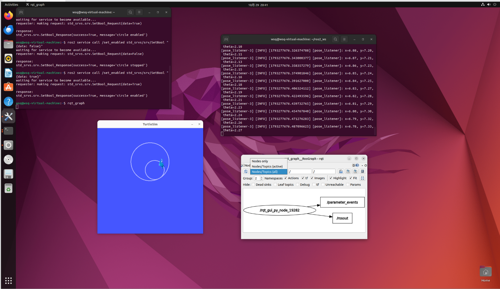
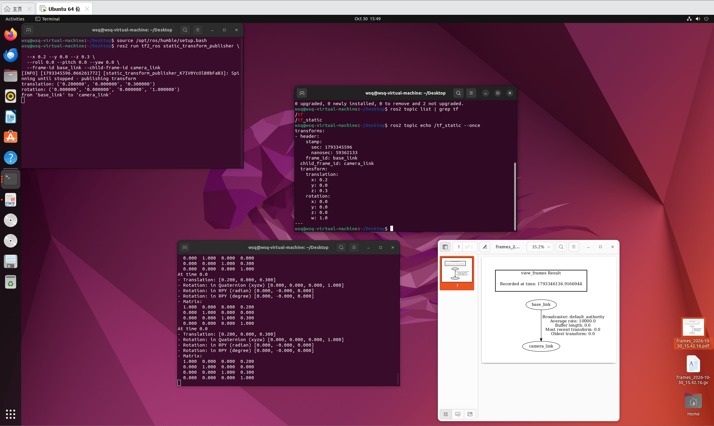
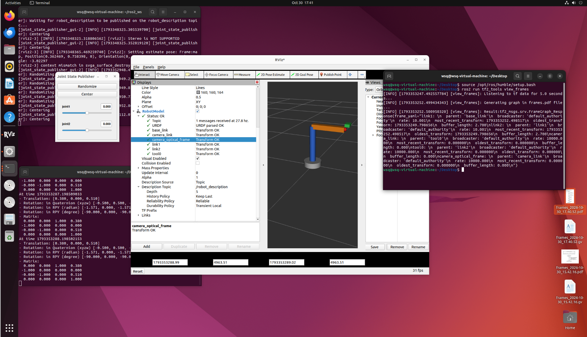
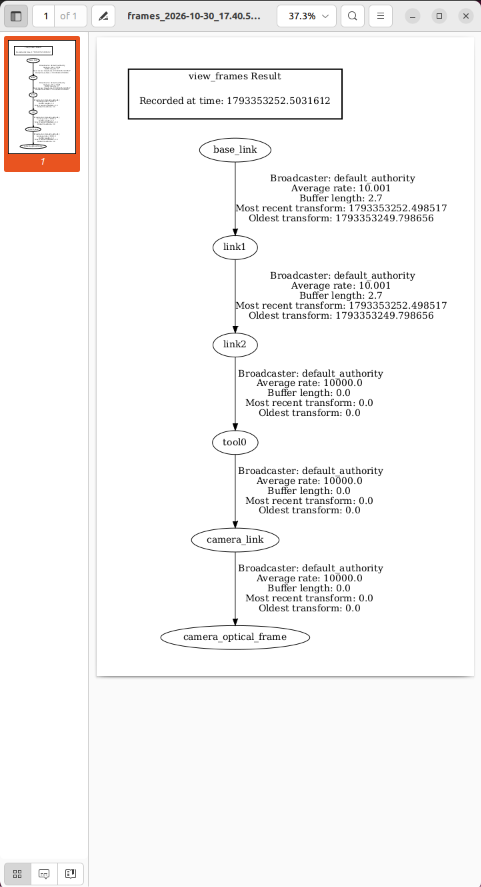
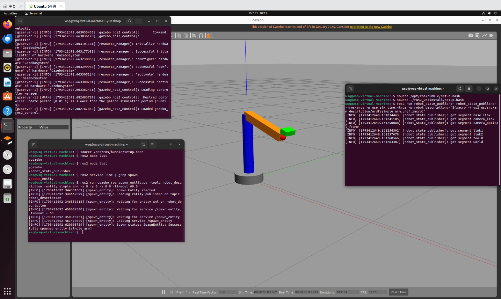
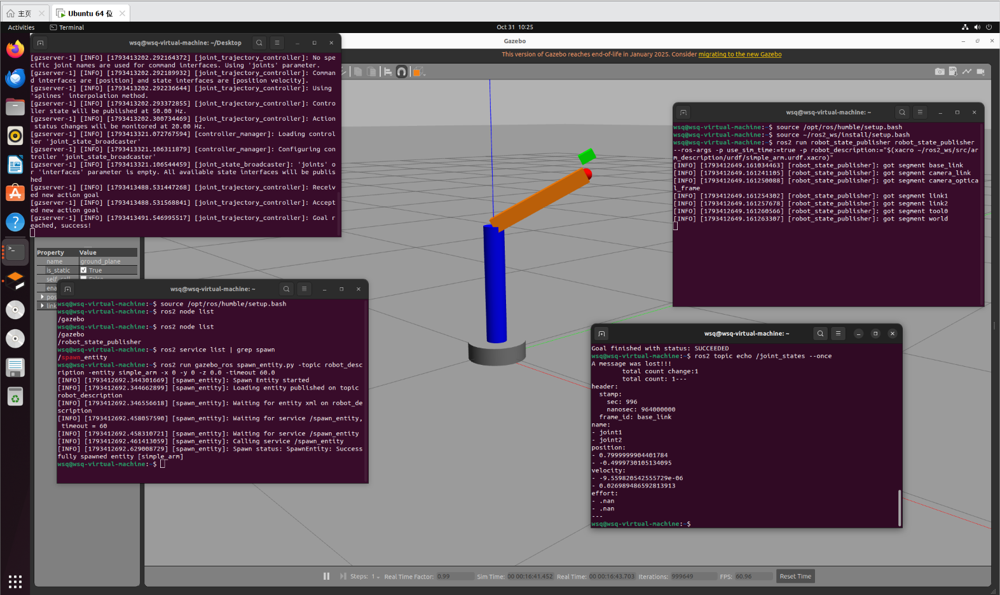
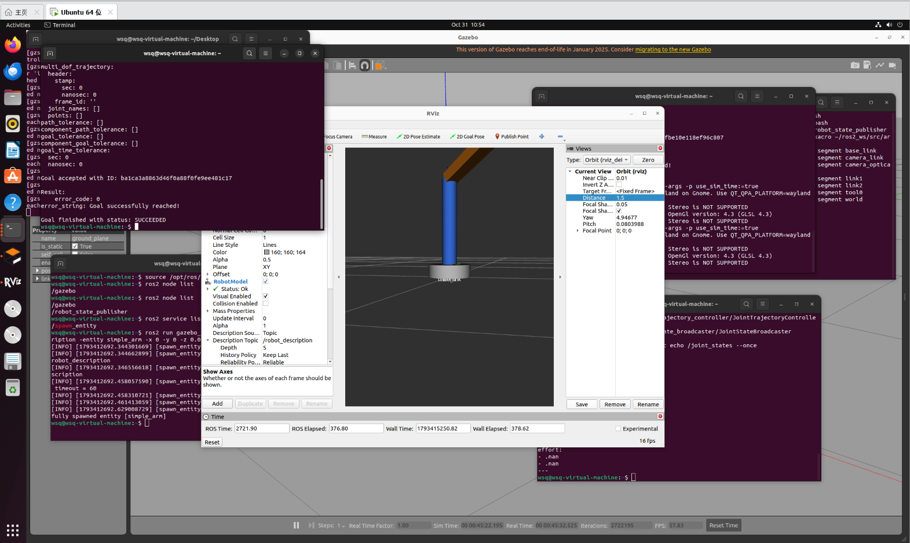

# 具身智能学习记录

从零开始学习具身智能的代码与笔记，当前使用 **PyBullet + Franka Panda 七自由度机械臂** 做仿真练习；第 7 天起进入 **ROS2 Humble + Ubuntu 22.04**，学习机器人系统、TF、Gazebo 和控制器。

## 环境

| 项目 | 版本 |
| --- | --- |
| Python | 3.10.5 |
| PyBullet | 3.2.7 |
| NumPy | 2.2.6 |
| OpenCV | 4.13.0 |
| PyTorch | 2.12.0+cu126 |
| Ultralytics | 8.4.51 |
| GPU | NVIDIA RTX 4060 Laptop (8GB) |
| 系统 | Windows 11 |

> PyBullet 目前没有与 Python 3.13 匹配的预编译 wheel，如果直接安装会触发源码编译。建议使用 Python 3.10 运行本项目。

## 目录结构

```text
.
├── 第一个项目.py    # 加载机械臂，用逆运动学（IK）把末端移动到指定位置
├── 第二个项目.py    # 完整的抓取流程：接近 → 下降 → 闭合夹爪 → 抬起
├── 第三个项目.py    # 把抓取拆成四个阶段函数，观察控制链路与 IK 收敛
├── 第四个项目.py    # RGB-D 相机：深度反投影与红色方块三维定位
├── 第五个项目.py    # 视觉伺服闭环：看见 → 对准 → 下降 → 抓取
├── 第六个项目.py    # 三色分拣：HSV 分类 + 固定俯视 RGB-D 相机
├── project7_yolo/         # 第七个项目：YOLO 数据集、训练、测试与抓取
│   ├── 第七个项目.py
│   ├── yolo_train.py
│   ├── yolo_step2~7_*.py
│   └── assets/
├── project8_trajectory/   # 第五天：轨迹、时间参数化、奇异位形与 DLS
│   ├── README.md
│   ├── step1_trace.py
│   ├── step2_profiles.py
│   ├── step2_5_limits.py
│   ├── step2_visual_compare.py
│   ├── step3_interpolation.py
│   ├── step4_ellipsoid_concept.py
│   ├── step4_singularity.py
│   ├── step5_dls.py
│   └── assets/
├── project9_draw_circle/  # 第六天：画圆、可操作度地图与自适应调速
│   ├── README.md
│   ├── step1_circle.py
│   ├── step2_circle_timing.py
│   ├── step3_adaptive_circle.py
│   ├── step4_gui_compare.py
│   ├── step5_three_arms_gui.py
│   ├── step6_trails_only_gui.py
│   ├── screenshot_util.py
│   └── assets/
├── project10_ros2/        # 第七~九天：ROS2 Humble 环境、节点与工程化
│   ├── README.md
│   ├── assets/
│   └── ros2_ws/src/turtle_control/
│       ├── package.xml
│       ├── setup.py
│       ├── setup.cfg
│       ├── resource/turtle_control
│       ├── launch/turtle_demo.launch.py
│       └── turtle_control/
│           ├── __init__.py
│           ├── turtle_circle.py
│           └── pose_listener.py
├── project11_ros2_tf/      # 第 10 天：TF2、URDF 与 RViz
│   ├── README.md
│   ├── assets/
│   └── ros2_ws/src/arm_description/
│       ├── package.xml
│       ├── CMakeLists.txt
│       ├── launch/display.launch.py
│       └── urdf/simple_arm.urdf.xacro
├── project12_ros2_gazebo/ # 第 11 天：Gazebo + ros2_control
│   ├── README.md
│   ├── assets/
│   └── ros2_ws/src/arm_description/
│       ├── package.xml
│       ├── CMakeLists.txt
│       ├── config/controllers.yaml
│       └── urdf/simple_arm.urdf.xacro
├── assets/                # 第四天的结果展示图
├── 抓娃娃机.py           # 彩蛋：键盘遥控机械臂去夹方块
├── requirements.txt
└── README.md
```

## 快速开始

```bash
# 0) Python 3.10 环境
pip install -r requirements.txt

# 第 1~4 天：PyBullet / RGB-D / 视觉伺服 / 三色分拣
python 第一个项目.py
python 第二个项目.py
python 第三个项目.py
python 第四个项目.py
python 第五个项目.py
python 第六个项目.py

# 第七个项目：数据 → 训练 → YOLO 抓取
python project7_yolo/yolo_step4_dataset.py
python project7_yolo/yolo_train.py
python project7_yolo/第七个项目.py

# 第五天：轨迹、时间参数化、奇异位形与 DLS
python project8_trajectory/step1_trace.py --gui
python project8_trajectory/step2_profiles.py
python project8_trajectory/step2_5_limits.py   # 依赖 step2 生成的 summary
python project8_trajectory/step2_visual_compare.py
python project8_trajectory/step3_interpolation.py
python project8_trajectory/step4_singularity.py
python project8_trajectory/step4_ellipsoid_concept.py
python project8_trajectory/step5_dls.py

# 第六天：画圆、可操作度地图与自适应调速
python project9_draw_circle/step1_circle.py --gui
python project9_draw_circle/step2_circle_timing.py
python project9_draw_circle/step3_adaptive_circle.py
python project9_draw_circle/step4_gui_compare.py
python project9_draw_circle/step5_three_arms_gui.py
python project9_draw_circle/step6_trails_only_gui.py

# 第七~九天：ROS2（在 Ubuntu 22.04 + ROS2 Humble 虚拟机中运行）
cd project10_ros2/ros2_ws
source /opt/ros/humble/setup.bash
colcon build --symlink-install
source install/setup.bash
ros2 launch turtle_control turtle_demo.launch.py

# 另开终端进入 project10_ros2/ros2_ws 后，再 source install/setup.bash，
# 然后可以继续测试参数和服务：
# ros2 param set /turtle_circle linear_speed 1.0
# ros2 service call /turtle_circle/set_enabled std_srvs/srv/SetBool "{data: false}"
# ros2 service call /turtle_circle/set_enabled std_srvs/srv/SetBool "{data: true}"
cd ../..

# 第 10 天：TF2 / URDF / RViz（Ubuntu 22.04 + ROS2 Humble）
cd project11_ros2_tf/ros2_ws
source /opt/ros/humble/setup.bash
colcon build --symlink-install
source install/setup.bash
ros2 launch arm_description display.launch.py

# 首次打开 RViz：
# Fixed Frame 改成 base_link
# Add → RobotModel
# Add → TF
# Description Topic = /robot_description，Durability Policy = Transient Local
cd ../..

# 第 11 天：Gazebo + ros2_control（Ubuntu 22.04 + ROS2 Humble）
# 完整多终端步骤见 project12_ros2_gazebo/README.md
cd project12_ros2_gazebo/ros2_ws
source /opt/ros/humble/setup.bash
colcon build --symlink-install
source install/setup.bash
cd ../..

python 抓娃娃机.py    # 彩蛋
```

> ROS2 部分需要在 Ubuntu 22.04 + ROS2 Humble 虚拟机中运行；Windows 端主要负责 PyBullet 实验。
>
> 第七个项目的数据集、训练输出和 `best.pt` 没有放进仓库（`.gitignore` 已排除），按上面的步骤在本机生成和训练即可。
>
> `personal journal/`、`yolo_lesson/`、`runs/` 和训练权重属于本机实验素材/生成物，不进入仓库。

第二个项目保留了学习时的实验参数（重力 `-1.6`、木块初始高度 `5m`），便于观察缓慢下落的过程。想恢复标准设置，把 `p.setGravity(0, 0, -1.6)` 改为 `-9.8`、`block_pos` 的 z 改为 `0.05` 即可。

## 学习日志

| 天数 | 日期 | 主题 |
| --- | --- | --- |
| 第 1 天 | 2026.10.21 | SDK 环境搭建、Panda 机械臂仿真、逆运动学与抓取初体验 |
| 第 2 天 | 2026.10.22 | 把抓取流程拆成四个阶段函数，理解 IK 与关节位置控制，并加入感知式下探 |
| 第 3 天 | 2026.10.23 | RGB-D 相机、深度反投影，以及视觉伺服闭环抓取 |
| 第 4 天 | 2026.10.24 | 三色方块分拣：HSV 分类、固定俯视相机与同色盒子放置 |
| 第 5 天 | 2026.10.25 | 轨迹可视化、时间参数化与 jerk、插值空间、奇异位形与 DLS |
| 第 6 天 | 2026.10.26 | 画圆小项目：可操作度地图、自适应调速与三种速度分配对比 |
| 第 7 天 | 2026.10.27 | ROS2 环境选型、VMware/Ubuntu 方案与 `turtle_control` 包骨架（进行中） |
| 第 8 天 | 2026.10.28 | 完成 ROS2 Humble、talker/listener、turtlesim 与自定义发布/订阅节点 |
| 第 9 天 | 2026.10.29 | ROS2 工程化：参数、服务和 launch；面试理论补充 SLAM/TF/多传感器/FK-IK |
| 第 10 天 | 2026.10.30 | ROS2 周 Day 2：TF2、URDF/xacro、robot_state_publisher、RViz 与完整 TF 树 |
| 第 11 天 | 2026.10.31 | ROS2 周 Day 3：Gazebo 物理仿真、ros2_control 硬件接口、轨迹控制器与 RViz 同步 |

### 2026.10.21 ｜ 第 1 天 · 跑通 Panda 仿真与抓取

**今天完成**

- 在 PyBullet 中加载地面与 Franka Panda 机械臂，通过逆运动学控制末端移动到目标位置。
- 搭建完整的抓取流程：**接近 → 下降 → 闭合夹爪 → 抬起**，成功抓起红色木块。
- 调整仿真相机视角，方便观察机械臂的工作区域。
- 修改重力、夹爪力度、木块坐标、等待时间等参数，观察它们对抓取结果的影响。

**参数实验记录**

| 参数 | 尝试 | 观察 | 结论 |
| --- | --- | --- | --- |
| IK 迭代次数 | 默认 20 → 200 | 末端与目标相差 3.3cm → 0 | 默认迭代次数不足，解算结果会"差一点" |
| 重力 | -9.8 → -1.6 | 木块下落明显变慢 | 重力改变的是整个物理世界，而不只是动画速度 |
| 木块坐标 | 改变 x / y | 部分位置完全抓不到 | 机械臂可达范围有限，且 IK 失败不会报错 |
| 木块高度 | z = 5 | 能看到下落过程，但固定等待逻辑不够用 | 等待"停稳"应检测速度，而不是写死步数 |
| 夹爪力度 | 调整 `force` | 夹持稳定性随之变化 | 力度需要足以克服木块重力和接触扰动 |

**踩过的坑**

1. **IK 默认只迭代 20 次**：末端会停在离目标几厘米的位置。把 `maxNumIterations` 提高到 200 并收紧 `residualThreshold` 后，误差接近 0。
2. **目标不可达时 IK 不报错**：它会静默返回"最接近的解"，机械臂直接拉向关节限位。调试时应在动作后比较末端实际位置和目标位置，判断 IK 是否真正收敛。
3. **没等木块落地就开始抓**：自由落体时间约为 `t = √(2h/g)`，固定 300 步在默认重力下够用，但低重力、高初始高度时远远不够。改成检测线速度和角速度，确认停稳后再计算抓取目标。
4. **木块生成在地面内部**：`plane.urdf` 的碰撞体是 10 米厚的盒子，z=-1 会让木块穿模并被物理引擎高速弹飞（实测 300 步后飞到约 10.6m 高），抓取目标也随之失效。初始高度不应低于木块半高 0.0375m。
5. **可达范围比想象中窄**：夹爪朝下的姿态下，稳妥抓取区域约为 `x ∈ [0.2, 0.7]`、`|y| ≤ 0.2`；更远的位置误差增大甚至无法收敛。
6. **夹爪开度与物体尺寸要匹配**：两指总开度约 0.08m，木块放大 1.5 倍后边长 0.075m，只剩很小余量；物体再大就夹不住。

**下一步**

- 引入相机或颜色检测，让机械臂自己定位木块，实现闭环抓取。
- 学习关节空间与笛卡尔空间的轨迹规划，减少运动过程中的碰撞。
- 尝试不同形状、尺寸的物体，以及从侧面、斜向等更多抓取姿态。

### 2026.10.22 ｜ 第 2 天 · 阶段化抓取与感知式下探

**今天完成**

- 新建 `第三个项目.py`，把之前"一个循环写到底"的抓取流程拆成四个独立函数，每个函数只负责一个动作。
- 按控制链路重新理解机械臂：**目标位姿 → IK 解出关节角 → 位置控制电机 → 仿真步进**。
- 在每个阶段结束后打印末端位置、木块高度和手指开合度，直观看到动作有没有到位。
- 给下探阶段加入感知循环：每下降 1cm 重新确认木块位置，目标移开就中止抓取。

**四个阶段**

| 阶段 | 函数 | 作用 |
| --- | --- | --- |
| 接近 | `move_above(obj_pos, offset_z=0.15)` | 先到物体正上方，避免斜向碰撞 |
| 下探 | `move_down(block_id, grasp_z)` | 连续下降，每一步都确认木块是否还在 |
| 夹紧 | `grasp()` | 两指目标位置设为 0，夹住木块时形成夹持力 |
| 抬起 | `lift(height)` | 保持夹紧，垂直抬起 |

**带感知的下探（追加）**

把 `move_down` 从"一次性走到目标高度"改成"感知 → 决策 → 执行"的循环：

1. **感知**：读取木块当前位姿。仿真里直接读仿真器真值；真实系统里这里替换为相机 + 目标检测。
2. **决策**：如果木块水平偏移超过 5mm，认为目标已经跑了，取消抓取；否则继续朝固定的抓取点下降。
3. **执行**：调用 IK + 位置控制走一小步，回到第 1 步。

几个实现细节：

- 停止高度由木块实际位置计算（抓取点 z=0.045），不能写死。最初设想的 0.13 是按 10cm 高木块估算的，对 7.5cm 的木块会停在半空。
- 末端位置用 `getLinkState(...)[4]`（连杆坐标系），与 IK 的参考点一致。
- **运动粒度和感知频率解耦**：运动是连续的，200 步（约 0.83 秒）走到抓取点；感知每一步都执行。最初按 1cm 分段、每段 40 步，总步数会变成 600 步（约 2.5 秒），机械臂看起来"走一步停一下"；连续版本既恢复自然速度，感知频率反而更高。
- 验证结果：正常情况 200 步连续下探，末端误差约 0.0mm；人为在下探途中把木块移走 18cm，下一步感知立即识别偏移并中止，没有执行夹取。
- 局限：这里用的是仿真真值，真实系统需要视觉估计；而且只做了"发现移动就中止"，还没有"跟着木块重新对准"。

**关键发现：IK 是局部数值解，单次求解会"差一点"**

- 最初的写法是每个阶段只调用一次 `calculateInverseKinematics`，然后把关节角交给位置控制跑 200 步。
- 实测从"上方"姿态解抓取点（z=0.045），单次求解末端只到 **z=0.073**，误差 2.9cm；夹爪正好在木块顶面闭合，抓空。
- 把上一次的解作为新种子再解一次，误差降到 **2.5mm**；最终改成**每一步都用当前关节角重新解 IK**，末端稳定到达 0.045，抓取成功（木块抬到约 0.29m）。
- 结论：IK 不是"给目标就有唯一全局解"，结果依赖初始种子、迭代次数和关节限位。

**底层原理笔记**

- **IK** 负责把笛卡尔空间的位置转换成 7 个关节角；**位置控制**负责让关节在力矩限制内转到目标角度；两者之间要靠 `stepSimulation()` 推进仿真，电机才会真正动起来。
- `setJointMotorControl2(..., POSITION_CONTROL, ...)` 不是瞬移，而是带 PD 的电机模型，`force` 是最大力矩；跑 200 步（约 0.83 秒）是经验值，真实系统应该检测是否收敛。
- `getLinkState(...)[4]` 是连杆坐标系原点，和 IK 的参考点一致；`[0]` 是连杆质心，两者有偏移，混用会让目标点算歪。
- 当前抓取整体还是**开环**的：目标位置在动作前计算好。下探阶段加入了"木块是否移动"的校验，但还没有根据新位置重新对准，属于最简单的感知—动作闭环。

**踩过的坑**

- 单次 IK 从上方姿态解抓取点，会停在离目标 2.9cm 的局部解；只看"有没有抓到"很难定位，打印末端实际位置和目标位置的差值就一目了然。

### 2026.10.23 ｜ 第 3 天 · RGB-D 相机与视觉伺服闭环

**今天完成**

- 新建 `第四个项目.py`：把 RGB-D 相机装在夹爪上（eye-in-hand），实时显示彩色图与深度图，并检测红色方块的三维位置。
- 弄清了 NDC 深度、米、深度缓冲、相机内参/外参之间的关系，把 PyBullet 的深度缓冲正确换算成米。
- 新建 `第五个项目.py`：把视觉估计的三维位置交给 IK，实现"看见 → 对准 → 下降 → 抓取"的闭环。
- 将下探升级为"边走边看"的 IBVS：边下降边重新感知，并用两指接触力判断是否真的夹住。
- 在三个不同位置测试，视觉定位水平误差约 1mm，抓取全部成功。

**相机链路**

| 环节 | 做法 |
| --- | --- |
| 相机安装 | 夹爪后上方 12cm，每帧由末端位姿计算，跟着机械臂移动 |
| 内参 | 垂直 FOV=60°、640×480 → fx=fy≈415.7px，cx=320，cy=240 |
| 深度 | PyBullet 返回 NDC 值，用 `far*near / (far - (far-near)*z)` 换成米 |
| 检测 | HSV 红色分割，取最大轮廓，过滤噪点 |
| 三维定位 | 像素 + 深度 + 内参反投影到相机坐标，再用外参变换到世界坐标 |
| 位置估计 | 红色点云的三维包围盒，取 (x 中点, y 中点, z 最大值) 作为顶面中心 |

**关键数据**

- 视觉估计顶面 `(0.382, 0.041, 0.060)`，真值中心 `(0.382, 0.041, 0.030)`，水平误差 **0.7mm**；
- 对准后末端与目标的水平偏差 **0.3~0.4mm**；
- 三个位置抓取后的方块高度：0.267m、0.281m、0.282m；
- 夹紧后两指接触力各约 **199N**，总力约 **398N**。

**工程问题：视觉对准了，为什么还是抓空？**

- 最初用 1.5 倍方块（边长 7.5cm），夹爪总开度约 8cm，每边只剩 **2.5mm** 余量；
- 末端存在 1~2mm 的跟踪误差，下探时一根手指蹭到方块顶边，把方块推移了 **1.2cm**，导致只有一根手指接触；
- 把方块改为 1.2 倍（6cm），每边余量约 1cm，三个位置全部抓取成功；
- 结论：视觉精度只是抓取成功的一部分，机械间隙、控制误差和接触动力学同样关键。

**升级：边走边看的 IBVS + 触觉反馈**

下探阶段不再"看一次就下"，而是每 20 步重新拍一次 RGB-D：

- 高度 > 12cm：用最新感知更新目标 xy 和抓取高度；
- 高度 ≤ 12cm：夹爪遮挡变大，xy 冻结在最后一次可靠估计，但继续用视觉更新高度，并检查方块是否还在视野里。

触觉反馈：

- 用 `getContactPoints` 读取左右手指与方块的法向力，两指都 >5N 才允许抬起；
- 抬起过程中每 20 步复查接触，丢失接触就立即停止；
- 实测夹紧后两指各约 199N、总力约 398N；在空中闭合夹爪的对照测试读数为 0N，程序正确取消抬起。

**遇到的问题：贴地时视觉估计会偏**

- 夹爪下探到 6cm 左右时，手指会遮住方块右侧，低视角下的三维包围盒中心向左偏了约 **1.4cm**；如果继续用它校正，会把夹爪带偏。
- 解决办法是"高处用视觉更新 xy，低处冻结 xy、只用视觉更新高度和检查目标是否还在"。
- 修正后末端与方块水平误差约 **1mm**，三个位置抓取全部成功。

**踩过的坑**

1. PyBullet 的深度缓冲是 NDC 值，不是米；直接当深度用会完全错。
2. 俯视相机的 up 向量不能与视线平行，否则视角矩阵退化；改用 `[0,1,0]`。
3. 相机装在夹爪上时，每次移动都会改变视角，必须重新感知，不能只检测一次。
4. `getLinkState(...)[4]` 是连杆坐标系原点，和 IK 的参考点一致。
5. 低高度时夹爪遮挡会使 xy 估计偏移约 1.4cm；分高度段处理（高处更新、低处冻结）比一味相信最后一眼更稳。
6. 触觉阈值要结合电机力设置：本场景两指接触力约 200N，>5N 判定为有效接触是安全下限；只看夹爪位置是否到 0，会把"夹空"误判成成功。

**下一步**

- 尝试更大、更复杂的物体，以及从侧面抓取；
- 记录接触力曲线，做滑落检测和自适应夹持力；
- 用真实相机图像/噪声模型替代仿真真值，做手眼标定实验。

### 2026.10.24 ｜ 第 4 天 · 三色方块分拣


**今天完成**

- 新建 `第六个项目.py`：固定俯视 RGB-D 相机 + HSV 三色分类 + 同色盒子分拣。
- 三个方块位置随机，三个开口盒位置固定；盒子底板涂成红/绿/蓝，不需要识别盒子。
- 按红 → 绿 → 蓝顺序，逐个完成"扫描 → 抓取 → 触觉确认 → 移到盒子上方 → 放下 → 俯视相机验证"。
- 固定位置和随机位置各测试，三色全部分拣成功。

**场景与流程**

| 项目 | 设置 |
| --- | --- |
| 俯视相机 | 固定 `[0.45, 0, 1.10]`，视线朝下，640×480，FOV 60° |
| 扫视位 | `[0.20, -0.35, 0.40]`，让开摆放区，避免机械臂遮挡 |
| 方块 | 边长 6cm，随机放在 `x 0.30~0.45`、`y ±0.10` |
| 盒子 | 固定 `x=0.55`，`y=-0.20 / 0 / +0.20`；彩底 + 灰色矮墙 |
| 颜色 | 红、绿、蓝 HSV 阈值互不重叠，红色跨 0° 用两段 |
| 顺序 | 红 → 绿 → 蓝（固定顺序便于调试） |
| 放置 | 移到盒上方 → 下降到 0.10m → 张开夹爪 → 触觉确认脱离 |
| 验证 | 回到扫视位，俯视相机检测盒子区域内的方块 |

**实测结果**

- 三次抓取：两指接触力各约 200N，总力约 400N；
- 放下后接触点回到 0，确认方块已脱离夹爪；
- 俯视验证三个方块位置：红 `(0.552, -0.195)`、绿 `(0.552, -0.004)`、蓝 `(0.552, 0.199)`，都在对应盒子内；
- 最终结果：3/3 成功。

**工程问题：彩色盒子底板会干扰颜色检测**

- 如果直接按颜色找，盒子底板本身也是红/绿/蓝，会被当成方块。
- 扫描方块时限制在摆放区 `x<0.50`、`|y|<0.15`、`z>0.02`，把盒子排除；
- 验证时用高度过滤 `z>0.025`：底板约在 `z=0.01`，方块顶面约在 `z=0.07`，只留下方块。

**概念笔记：HSV、RGB 与 YOLO**

- **HSV**：H 是颜色种类（OpenCV 0–179，红色跨 0/180，需两段阈值），S 是颜色浓淡，V 是明暗。检测颜色时主要限制 H，S/V 用来排除灰白黑和阴影，比直接卡 RGB 稳定。
- **为什么神经网络还是用 RGB**：HSV 不是"更高级"的颜色空间，只是同一份信息的重新排列；通用识别还需要纹理、形状、材质和上下文，RGB 保留全部原始线索。网络第一层会自己学出类似颜色对立的特征，而且 HSV 在色相环接缝和灰色附近有跳变，对梯度不友好。任务窄、颜色明确时用手写 HSV；任务宽、变化多时让网络从 RGB 学。
- **需要 YOLO 吗**：不需要。三种纯色 + 受控光照下，HSV 零训练、快、可解释；YOLO 只能给二维框和类别，仍然要靠深度和内参算三维位置。等需要识别形状/纹理、真实光照或很多类别时再考虑 YOLO，也可以用 PyBullet 自动生成标注数据来训练。

**下一步**

- 改成"最近优先"抓取，减少机械臂无效移动；
- 让俯视相机识别盒子的位置，而不是写死三个位姿；
- 在真实相机/噪声条件下测试 HSV 阈值，再和 YOLO 做对比。

## 第七个项目：YOLO 目标检测与视觉抓取

> 这一节主要记录我搞懂的概念、踩过的坑和真正的学习收获，指标放在最后备查。


### 我做了什么

- 用 PyBullet 自动生成 **200 张** eye-in-hand 图像：随机位置、颜色、yaw、相机位姿、桌面颜色和亮度扰动；
- 用方块 3D 角点投影自动生成 YOLO 标注 `class cx cy w h`，并做三层审计：txt 反算画框、颜色掩码覆盖率、训练批次图；
- 用 COCO 预训练的 `yolov8n.pt` 微调 **30 epochs**（早停、640、RTX 4060）；
- 在 **60 张训练时没见过的**、条件更极端的测试集上评估；
- 最后写 `project7_yolo/第七个项目.py`：YOLO 出类别和框，深度点云估 yaw，转腕对准后抓取。

### 我原来最困惑的概念

#### 1. 训练到底在做什么？

把模型想成一个有几百万个旋钮的黑箱：输入图片，输出框和类别。训练就是反复给它看图，把预测和标注比较，算出 loss，然后根据 loss 把旋钮往“错得更少”的方向拧一点。160 张图看完一遍叫 1 个 epoch。

YOLO 的 loss 主要分三块：`box_loss`（框准不准）、`cls_loss`（类别对不对）、`dfl_loss`（框边界精细度）。

#### 2. yolov8n.pt 是什么？会不会“不干净”？

它是 YOLOv8 Nano 的 **COCO 预训练权重**，原本认识 80 类。我们不是要它那 80 类，而是把它当作“已经会看图的起点”。训练时 Ultralytics 会把检测头重新初始化成 3 类，再用我们的数据微调。

因此旧的 80 类知识不会污染我们的标签；继承下来的只是边缘、纹理、颜色这些通用特征。训练结果保存到新的 `best.pt / last.pt`，不会修改原来的 `yolov8n.pt`。

#### 3. 为什么 1 个 epoch 不行？欠拟合和过拟合

1 个 epoch 是“体检”，只检查数据、标签、GPU、训练/验证流程，不是用来出成绩的。新的 3 类检测头是随机初始化的，看一遍 160 张图远不够，所以 1 epoch 时置信度极低、预测图里一个框都没有，是正常的。

- **欠拟合**：训练 loss 和验证指标都还很高，模型没学够 → 多训练、加数据/增强、必要时换大模型；
- **过拟合**：训练 loss 很低，但验证 loss 开始上升、mAP 不涨 → 早停、加增强/正则。

我最初想直接上 50 epochs，后来改成 **30 epochs + patience=10 早停**。曲线大约在 10~15 轮后平台化，30 轮已经足够；50 轮收益很小。

#### 4. mAP、precision、recall、PR 曲线、混淆矩阵

- **Precision**：模型报出来的框里，有多少是真的。低 = 误报多；
- **Recall**：真正的物体里，有多少被找到。低 = 漏检；
- **PR 曲线**：置信度阈值从高到低扫，precision 和 recall 的权衡；曲线下面积是 AP，三类平均是 mAP；
- **mAP50**：IoU ≥ 0.5 就算对；**mAP50-95** 对框的要求更严；
- **混淆矩阵**：行/列是真实/预测类别，对角线越亮越好。

mAP 是按置信度**排序**算的，所以 1 epoch 时“mAP50 = 0.33，但 conf=0.01 下一张框都没有”并不矛盾：排序有区分度，但绝对置信度很低。**不能只看一个 mAP 数字**，要结合 PR、precision/recall 和预测图。

#### 5. AABB、OBB、yaw 是什么？为什么抓取一定要 yaw？

- **AABB**：轴对齐包围盒，边永远平行图像 x/y。YOLO 的 `cx cy w h` 就是它。物体旋转时四角必定有空隙；
- **OBB**：有向包围盒，跟着物体旋转，框更紧，还额外带角度；
- **yaw**：绕竖直轴 z 的旋转。方块平放在桌上时，roll/pitch≈0，只有 yaw 在变。

这件事对抓取很致命：6cm 方块转 45° 时对角线是 `6×√2≈8.49cm`，而夹爪最大开度约 8cm。**如果夹爪不跟着转，物理上就夹不进去**。检测框只告诉“在哪”，不告诉“朝哪”；所以最终的方案是：

- YOLO 负责类别 + 2D 框；
- 框内深度点云拟合顶面，得到中心 + yaw；
- 把 yaw 加进夹爪朝向，转腕后再下降。

#### 6. HSV 和 YOLO 怎么选？

这个任务一开始用 HSV 就够了：三种纯色、光照受控、零训练。YOLO 是为了学习“从数据里学检测”的通用方法，也为以后更复杂的物体/光照做准备。

它们不是谁更高级，而是**任务选工具**：

- 颜色明确、类别少、实时轻量 → HSV；
- 类别/形状/纹理复杂、真实光照、想泛化 → RGB + 神经网络；
- HSV 不是“信息更多的颜色空间”，只是把 RGB 重排；神经网络用 RGB 是为了保留纹理、形状、材质等全部线索，而且能自己学颜色变换。

### 我的学习收获

1. **数据和标注质量比模型本身更重要**。第一次画框审计时，最该看的是“把 txt 反算回图片后框有没有贴住物体”，而不是 mAP。
2. **指标必须组合看**。mAP 高不代表模型可用；1 epoch 的 mAP 和低置信度预测就差点让我误判。
3. **检测 ≠ 抓取**。框只解决“在哪”，抓取还需要三维位置和 yaw；“视觉识别”只是具身智能的一小步。
4. **训练要分阶段**：先 sanity run 验证流程，再短训练看曲线，最后再决定是否加轮数；不要盲目 50。
5. **工具按任务选**：这个任务里 HSV 简单有效，YOLO 的价值在可学习、可泛化；两者不冲突。
6. **工程问题也是实验的一部分**：CUDA 版 PyTorch、Windows 下 `workers=0`、模型下载慢、绝对路径、渲染/验证卡住，都会真实地消耗时间。

### 结果备查

- 数据集：200 张（160 训练 / 40 验证），红 67 / 绿 67 / 蓝 66；非法标签 0，颜色掩码覆盖率检查 0 失败；
- 训练：YOLOv8n，30 epochs，imgsz=640，mAP50 = 0.995，mAP50-95 = 0.995；
- 未见测试集：60/60 检测正确，平均 IoU 0.976，mAP50 = 0.995；
- 最终抓取：6/6 随机样本 + GUI 成功；检测 xy 误差约 1mm，yaw 误差约 0.1°，两指接触力各约 200N。

### 复现步骤

```bash
# 1) 生成 200 张图和 YOLO 标签
python project7_yolo/yolo_step4_dataset.py

# 2) 训练（30 epochs，早停；GPU 可用时自动用 GPU）
python project7_yolo/yolo_train.py

# 3) 未见测试集评估（可选）
python project7_yolo/yolo_step6_unseen.py

# 4) 离线验证检测/三维/yaw（可选）
python project7_yolo/yolo_step7_validate.py

# 5) 完整抓取
python project7_yolo/第七个项目.py
```

训练输出在 `yolo_lesson/runs/full30/weights/best.pt`。数据、训练输出和测试集没有提交到仓库，按上面步骤在本机生成即可。

### 2026.10.25 ｜ 第 5 天 · 轨迹、时间参数化与奇异位形

今天从“能抓到”推进到“轨迹可测量、可解释、可安全执行”。五个小项目分别研究：

| 项目 | 研究的问题 | 关键结论 |
| --- | --- | --- |
| 项目 1 | 指令轨迹和实际轨迹差多少？ | 动态跟踪有约 37 ms 滞后；静态精度 ≠ 动态精度 |
| 项目 2 | 速度/加速度/jerk 怎么安排？ | 平滑不免费；峰值速度决定跟踪误差 |
| 项目 2.5 | 轨迹是否可执行？ | 速度没超限 ≠ 安全；constant/trapezoid 被加速度/jerk 拒绝 |
| 项目 3 | Cartesian 还是 joint-space？ | 关节空间直线会让末端走弯、姿态偏移 |
| 项目 4 | 当前构型安全吗？ | near 路径 sigma_min 更低，关节速度约 2 倍 |
| 项目 5 | 接近奇异怎么办？ | 标准伪逆失效；DLS 用精度换稳定性，λ 要取合适值 |

详细实验过程、每步的图和名词总结见：

**[project8_trajectory/README.md](project8_trajectory/README.md)**

---

### 2026.10.26 ｜ 第 6 天 · 画圆、可操作度地图与自适应调速

用一小时把前几天的 IK、时间规划、Jacobian 和可操作度串成一个小项目：让 Panda 在空中画圆，并比较三种速度分配。

| 方法 | 最大误差 | 平均误差 | 最大关节速度 |
| --- | ---: | ---: | ---: |
| constant | 4.23 mm | 2.45 mm | 0.72 rad/s |
| min-jerk | 5.12 mm | 2.45 mm | 0.88 rad/s |
| adaptive | 4.06 mm | 2.45 mm | **0.38 rad/s** |

三种方法总时间都是 8 s。adaptive 在 `sigma_min` 低的扇区自动减速，弱区关节速度从 0.72 降到 0.28 rad/s，弱区误差从 4.2 mm 降到 1.9 mm；代价是强区被加速、误差转移。

完整实验、图和“为什么 min-jerk 看起来最快但并没有提前到达”的解释见：

**[project9_draw_circle/README.md](project9_draw_circle/README.md)**

---

### 2026.10.27 ｜ 第 7 天 · ROS2 环境选型与项目骨架

从 PyBullet 单脚本转向 ROS2 机器人系统，今天主要定路线和搭骨架：

- 选择 **Ubuntu 22.04 + ROS2 Humble + VMware** 的入门环境；
- 规划虚拟机、Ubuntu 安装、VMware Tools 和快照流程；
- 新建 `turtle_control` ROS2 Python 包骨架；
- 设定下一步目标：发布 `/turtle1/cmd_vel`、订阅 `/turtle1/pose`。

> 当时状态：环境搭建进行中；ROS2 安装和 turtlesim 验证留到第 8 天。

详细环境方案和代码见：

**[project10_ros2/README.md](project10_ros2/README.md)**

---

### 2026.10.28 ｜ 第 8 天 · 完成 ROS2 环境与第一个节点

今天没有开新的大块内容，任务就是把第 7 天清单里剩下的部分做完：

- 完成 Ubuntu 22.04.5 虚拟机、VMware Tools 和快照；
- 安装 ROS2 Humble；
- 跑通官方 talker/listener；
- 跑通 turtlesim；
- 编译并运行 `turtle_control`：
  - 发布 `/turtle1/cmd_vel` 让海龟画圆；
  - 订阅 `/turtle1/pose` 打印位姿。

### 官方 talker / listener 验证


### turtlesim + 自己的节点


### 遇到的坑

- `raw.githubusercontent.com` 被拒绝：改用 `keyserver.ubuntu.com` 下载密钥，并切换到清华 ROS2 镜像；
- `turtle_teleop_key` 快速按键会触发 turtlesim 的 `Rotation goal received before a previous goal finished` 警告，不影响运行；
- 启动 turtlesim 时的 Wayland 提示是环境警告，不影响话题通信。

> 状态：✅ ROS2 通信、turtlesim 和自定义发布/订阅节点全部跑通。

详细环境方案、代码和错误记录见：

**[project10_ros2/README.md](project10_ros2/README.md)**

---

### 2026.10.29 ｜ 第 9 天 · ROS2 工程化与面试理论补充

前两天的 ROS2 重点是“节点能通信”；今天把它升级成“可配置、可控制、可一键启动”的 ROS2 应用：

- 给 `turtle_circle` 增加参数：`linear_speed`、`angular_speed`、`publish_rate`；
- 增加 `std_srvs/SetBool` 服务，运行时暂停/恢复画圆；
- 写 launch 文件，一条命令启动 turtlesim、发布节点和订阅节点；
- 用 `ros2 param`、`ros2 service`、`ros2 node list`、`rqt_graph` 观察系统；
- 排查了服务名 `/set_enabled` 与 `/turtle_circle/set_enabled` 的区别，以及“海龟停了但位姿监听还在打印”的状态流现象。

#### rqt_graph 看什么？



`rqt_graph` 是 ROS2 的**计算图查看器**，不是数据查看器：

- 椭圆/节点：ROS2 节点；
- 节点之间的连线：话题；
- 箭头方向：谁发布、谁订阅；
- 可以用过滤器和刷新，快速看命名空间、话题名是否接错。

这张截图里 Node Graph 还没显示出节点（截图时 launch 可能已经停了，或者没有点刷新）。  
正常启动 `turtle_demo.launch.py` 后，应该能看到类似：

```text
/turtle_circle  --/turtle1/cmd_vel-->  /turtlesim
/turtlesim      --/turtle1/pose----->  /pose_listener
```

它适合排查“节点有没有起来、话题名字对不对、谁在订阅”，
但看不到消息内容；看内容要用 `ros2 topic echo`，看频率用 `ros2 topic hz`。

#### 今天和前两天有什么进展？

| 天数 | 重点 | 能力变化 |
| --- | --- | --- |
| 第 7 天 | 环境选型、虚拟机、包骨架 | 知道 ROS2 要解决什么问题 |
| 第 8 天 | 发布者/订阅者 | 两个节点可以互相通信 |
| 第 9 天 | 参数、服务、launch、系统观察 | 节点可以运行时配置、远程控制、一键启动 |

这对应到真机和 VLA：

- **参数**：以后调速度、限位、控制增益、模型路径，不改代码；
- **服务**：以后做使能、急停、校准、模式切换；
- **launch**：以后一键拉起相机、检测、策略、控制器；
- **状态话题**：机器人静止时状态仍在持续发布，VLA 需要持续读取；
- **rqt_graph**：系统出问题时，先看谁连谁。

详细实验和代码：

**[project10_ros2/README.md](project10_ros2/README.md)**

---

### 2026.10.30 ｜ 第 10 天 · ROS2 周 Day 2：TF2、URDF 与 RViz

第 9 天解决的是“节点之间怎么传消息”；今天解决的是“消息里的位置到底在哪个坐标系”。

今天的机械臂不再靠 PyBullet 引擎直接摆姿态，而是：

```text
URDF/xacro 描述结构
+ /joint_states 提供关节角
+ robot_state_publisher 做正运动学
= TF2 中一棵实时更新的坐标树
```

#### 今天搭的 TF 树

```text
base_link
  └── joint1（revolute，绕 z）
        link1
          └── joint2（revolute，绕 y）
                link2
                  └── tool_joint（fixed）
                        tool0
                          └── camera_joint（fixed）
                                camera_link
                                  └── camera_optical_joint（fixed）
                                        camera_optical_frame
```

- 前两段是动态关节，关节角一变，TF 就变；
- 后面三段是固定关节，局部变换不变，但会跟着整条手臂运动；
- `camera_link` 是 ROS 机体坐标系，`camera_optical_frame` 是相机光学坐标系。

#### 1. 先手动造一条 TF 边

先不写 URDF，用 `static_transform_publisher` 手动发布：

```text
base_link → camera_link
```

再用 `tf2_echo` 查询：

```bash
ros2 run tf2_ros tf2_echo base_link camera_link
```



这一步理解了：

- translation 是相对坐标；
- `tf2_echo A B` 查的是 **B 相对 A** 的位姿；
- `view_frames` 生成的 PDF 是静态拓扑图，不会显示实时运动。

#### 2. URDF + robot_state_publisher + RViz

用 `arm_description` 包描述一个简化机械臂：

```text
base_link → link1 → link2 → tool0 → camera_link → camera_optical_frame
```

启动：

```bash
ros2 launch arm_description display.launch.py
```



在 RViz 里：

- `Fixed Frame` 改成 `base_link`；
- Add → RobotModel；
- Add → TF，勾选 Show Names / Show Axes；
- 拖动 `joint1`、`joint2`，模型和坐标轴一起动。

这一步看懂了：

- `robot_state_publisher` 的本质就是正运动学；
- 滑条窗口的 `/joint_states` 是输入，`/tf` 是输出；
- 相机 frame 固定在 `tool0` 上，所以局部变换不变，全局变换随关节变化。

#### 3. 完整 TF 树



`view_frames` 生成：

```text
base_link
  └── link1
        └── link2
              └── tool0
                    └── camera_link
                          └── camera_optical_frame
```

#### 4. 一条真实的 `tf2_echo` 输出

查询 `base_link → camera_optical_frame`，会看到：

```text
At time 1793354463.198479610
- Translation: [0.380, 0.000, 0.510]
- Rotation: in Quaternion (xyzw) [-0.500, 0.500, -0.500, 0.500]
- Rotation: in RPY (radian) [-1.571, 0.000, -1.571]
- Rotation: in RPY (degree) [-90.000, 0.000, -90.000]
- Matrix:
  0.000  0.000  1.000  0.380
 -1.000  0.000  0.000  0.000
 -0.000 -1.000  0.000  0.510
  0.000  0.000  0.000  1.000
```

这条输出同时给了三种旋转表示：

```text
Quaternion：适合存储和插值
RPY：适合人看
4×4 Matrix：适合做乘法
```

矩阵的前三列是相机光学坐标系的三个轴在 `base_link` 中的方向：

```text
光学 x → base 的 -y
光学 y → base 的 -z
光学 z → base 的 +x
```

最后一列是相机原点在 base 中的位置：

```text
(0.380, 0.000, 0.510) 米
```

所以相机正前方 1 米的点：

```text
p_optical = (0, 0, 1)
p_base    = (1.380, 0, 0.510)
```

这就是 RGB-D 反投影后，把目标点从相机坐标转成机器人坐标的那一步。

#### 5. 为什么拖关节时坐标这样变？

- `joint1` 绕 z 轴，是水平面内的 yaw，所以 x/y 变化，z 不变；
- `joint2` 绕 y 轴，是 x-z 平面内的 pitch，所以 z 变化最明显，x 也会变化；
- 相机固定在 `tool0` 上：`tool0 → camera_link` 永远不变，`base_link → camera_link` 随关节变化。

#### 今天遇到的坑

1. **`file not found: 'xacro'`**
   launch 调用了 `xacro`，但没装包。解决：
   ```bash
   sudo apt install -y ros-humble-xacro
   ```

2. **RViz 的 Fixed Frame 默认是 `map`**
   我们的树根是 `base_link`，所以报 `Fixed Frame [map] does not exist`。

3. **RobotModel 报 `Error subscribing: Empty topic name`**
   只设置 `Description Source: Topic` 不够，还要明确填：
   ```text
   Description Topic: /robot_description
   ```

4. **QoS 不匹配**
   `robot_state_publisher` 用 **Transient Local** 发布 `/robot_description`；RViz 如果用默认 `Volatile`，就会错过启动时只发一次的 URDF。

5. **RViz 里什么都看不到**
   RViz 第一次打开是空场景，需要手动 Add RobotModel 和 TF；机械臂只有约 0.5 米，还要把 `Distance` 从 10 调到 1.5。

#### 和真机、VLA 的关系

| 今天学的 | 真机/VLA 中的用途 |
| --- | --- |
| URDF/xacro | 描述真实机械臂、夹爪、相机安装位置 |
| `robot_state_publisher` | 用编码器关节角计算所有 link 的实时位姿 |
| TF2 | 查询相机、末端、底座之间的变换 |
| `camera_optical_frame` | 真实相机驱动和手眼标定的标准坐标约定 |
| `tf2_echo` | 排查“相机看到的目标到底在机器人哪个位置” |

真实相机装在夹爪上时：

```text
camera → hand：固定，来自手眼标定
hand → base：随关节运动变化
```

VLA 模型看到的是图像坐标系，输出的动作要在机器人坐标系执行，中间必须靠 TF 做翻译。

详细代码、完整复现步骤和 4×4 矩阵解释见：

**[project11_ros2_tf/README.md](project11_ros2_tf/README.md)**

---

### 2026.10.31 ｜ 第 11 天 · ROS2 周 Day 3：Gazebo + ros2_control

第 10 天解决的是“机器人在哪”：

```text
URDF + /joint_states  →  TF 树  →  RViz
```

今天解决的是“机器人怎么被控制”：

```text
轨迹控制器 → ros2_control → Gazebo 物理引擎 → 关节状态 → TF/RViz
```

#### 今天的数据流

```text
joint_trajectory_controller
        │ 位置命令
        ▼
controller_manager
        │
        ▼
ros2_control hardware interface
        │
        ▼
Gazebo joints（重力、碰撞、惯性）
        │ 实际状态
        ▼
joint_state_broadcaster
        │ /joint_states
        ▼
robot_state_publisher
        │ /tf
        ▼
RViz
```

#### 1. 模型进入 Gazebo

先给 `simple_arm` 补上 Gazebo 需要的物理属性：

- 每个 link 的 `inertial`：质量、质心、转动惯量；
- `world → base_link` 固定关节：防止整条手臂被重力推倒；
- 关节阻尼：减少无控制器时的剧烈摆动；
- `ros2_control` 硬件接口：`joint1`、`joint2` 的位置命令和位置/速度状态；
- `gazebo_ros2_control` 插件：把 Gazebo 关节接到 `ros2_control`。

把模型生成到 Gazebo 用：

```text
spawn_entity.py
```

它读取 `/robot_description`，再调用 Gazebo 的 `/spawn_entity` 服务，把 URDF 变成仿真世界里的模型。



截图里确认到：

```text
ros2 node list        → /gazebo, /robot_state_publisher
ros2 service list     → /spawn_entity
spawn_entity.py       → Successfully spawned entity [simple_arm]
GazeboSystem          → 初始化、配置、激活成功
```

#### 2. 两个控制器让关节动起来

今天的两个控制器分工：

| 控制器 | 作用 |
| --- | --- |
| `joint_state_broadcaster` | 读取 Gazebo 关节状态，发布 `/joint_states` |
| `joint_trajectory_controller` | 接收轨迹，向关节写位置命令 |

它们必须分别启动。`controllers.yaml` 只是声明，不会自动启动所有控制器。

发一条轨迹：

```bash
ros2 action send_goal /joint_trajectory_controller/follow_joint_trajectory control_msgs/action/FollowJointTrajectory "
trajectory:
  joint_names: [joint1, joint2]
  points:
    - positions: [0.0, 0.0]
      time_from_start: {sec: 0, nanosec: 0}
    - positions: [0.8, -0.5]
      time_from_start: {sec: 3, nanosec: 0}
"
```



截图里确认到：

```text
Goal finished with status: SUCCEEDED
/joint_states:
  joint1 ≈ 0.7999999
  joint2 ≈ -0.4999973
```

说明从 action → controller → hardware interface → Gazebo 的命令链是通的。

#### 3. Gazebo 与 RViz 同步



RViz 里机械臂的姿态和 Gazebo 一致，说明状态链也通了：

```text
Gazebo 实际关节状态
→ joint_state_broadcaster
→ /joint_states
→ robot_state_publisher
→ /tf
→ RViz
```

这一步验证的不只是“关节有没有名字”，还包括：

- `/joint_states` 的关节名和 URDF 一致；
- `joint1` 的 yaw、`joint2` 的 pitch 方向一致；
- `base_link → link1 → link2 → tool0 → camera_link` 的 TF 完整；
- 相机 frame 跟着末端运动；
- 仿真时间和 TF 时间戳同步。

#### 今天踩过的坑

1. **`spawn_entity.py` 一直等 `/robot_description`**
   RSP 没启动，或者没有正确发布话题。先检查：
   ```bash
   ros2 topic list | grep robot_description
   ```

2. **一直等 `/spawn_entity`**
   Gazebo 的 ROS factory 插件没加载，或者连接到了残留的 Gazebo 实例。
   正常 `ros2 node list` 必须有 `/gazebo`。

3. **只有一个控制器 active**
   `spawner` 一次只启动一个控制器。`joint_state_broadcaster` 和 `joint_trajectory_controller` 要分别 spawn。

4. **`/dynamic_joint_states` 多出来**
   ros2_control 的通用关节状态格式，不是错误；TF/RViz 使用 `/joint_states`。

5. **`effort: nan`**
   Gazebo 硬件接口没有提供 effort 状态接口，位置控制不需要它。

6. **控制器更新周期警告**
   控制器 100 Hz、Gazebo 1000 Hz，属于正常警告。

7. **RViz 关闭后配置丢失**
   关闭时如果提示保存 `default.rviz`，点 Save，下次启动会自动恢复布局。

#### 三天进展对比

| 天数 | 重点 | 能力变化 |
| --- | --- | --- |
| 第 9 天 | 参数、服务、launch | 节点可配置、可控制、可一键启动 |
| 第 10 天 | TF2、URDF、RViz | 机器人知道每个零件在哪个坐标系 |
| 第 11 天 | Gazebo、ros2_control、轨迹控制器 | 关节能被物理仿真和控制器真正驱动 |

#### 和真机、VLA 的关系

今天最重要的抽象是：

```text
控制器不变
硬件接口可替换
```

以后换真机时：

```text
GazeboSystem 插件
        ↓ 替换
厂商硬件接口 / ros2_control 驱动
```

`joint_trajectory_controller`、`/joint_states`、TF 和 `/tf` 的结构尽量保持不变。

VLA 输出的是高层动作或动作块，最终仍然要经过：

```text
动作 → 轨迹/控制器 → ros2_control → 真实关节
```

详细代码、多终端复现步骤和踩坑记录见：

**[project12_ros2_gazebo/README.md](project12_ros2_gazebo/README.md)**

---

## 面试理论补充

以下不是“背定义”，而是以后做真机和 VLA 会反复遇到的基础。

### 1. 什么是 SLAM？未来会在哪用到？

**SLAM = Simultaneous Localization and Mapping，同时定位与建图。**

机器人在未知环境里一边移动，一边：

```text
用传感器估计自己在哪（定位）
同时把周围环境建成地图（建图）
```

典型输入：LiDAR、相机、IMU、轮式里程计。  
典型输出：机器人位姿轨迹 + 环境地图。

**未来用在哪：**

- 移动机器人/AGV 在未知室内导航；
- 移动机械臂的底盘定位；
- 无人机、AR/VR、巡检机器人；
- 移动 VLA：需要全局地图和空间记忆时。

**注意：** 固定底座的 Panda 做桌面抓取，通常**不需要 SLAM**。  
你需要的是手眼标定 + TF + 目标检测；SLAM 主要解决“机器人在环境里的全局位姿”。

简单学习路径：

1. ROS2 的 TF2、坐标系、URDF；
2. 轮式里程计/IMU 基础；
3. 2D LiDAR SLAM：`slam_toolbox` + Gazebo；
4. 视觉 SLAM：RTAB-Map / ORB-SLAM3；
5. 后端优化、回环检测、EKF/因子图融合；
6. 真机标定和多传感器时间同步。

### 2. 相机装在机械臂上，怎么确认相机的运动轨迹？

核心公式：

```text
T_base_cam = T_base_ee(q) * T_ee_cam
```

- `T_ee_cam`：相机相对末端的安装变换，通过**手眼标定**得到；
- `T_base_ee(q)`：由关节角 + 正运动学得到；
- 两者相乘，就是相机在世界/基座坐标下的位姿。

所以相机轨迹不需要靠 SLAM 猜，机械臂本身就是一条高精度的“编码器轨迹”。  
具体做法：

- `joint_states` 发布关节角；
- `robot_state_publisher` + URDF 计算末端位姿；
- TF2 查询 `base_link → camera_link`；
- 用棋盘格/AprilTag 验证标定；
- 注意图像和关节角的时间戳同步。

VLA 里，检测到的目标在相机坐标系；要先用这个变换转到机器人坐标系，才能给 MoveIt2 或控制器。

### 3. 两个传感器频率不一致怎么处理？比如 1000 Hz 和 60 Hz

**不要强行让 1000 Hz 的控制循环等 60 Hz 的相机。**

常见做法：

- 高频控制（1000 Hz）在自己的循环里跑，使用“最新可用”的相机结果；
- 慢传感器（60 Hz）用回调更新共享缓存；
- 每条消息带时间戳；
- 对需要配对的相机+IMU，用 `message_filters` 的近似时间同步；
- 控制端对慢数据做零阶保持或插值；
- 用 EKF/UKF/因子图做多传感器融合；
- 监控延迟、队列和丢帧，避免控制被慢节点阻塞。

VLA 也是类似结构：策略可能 5~10 Hz 输出动作块，底层控制器仍然高频执行；中间需要安全层和动作缓冲。

### 4. 正逆运动学学习路径，掌握到什么程度够用？

建议按这个顺序：

1. 旋转矩阵、四元数、齐次变换；
2. 连杆、关节、URDF、DH 参数/指数积；
3. 二连杆 FK，再推到 Panda 的串联链；
4. 雅可比矩阵：关节速度 → 末端速度；
5. 数值 IK：牛顿法、伪逆、阻尼最小二乘；
6. 奇异位形、关节限位、冗余和多解；
7. 用 PyBullet/KDL/MoveIt2 做工程实现，并验证残差。

**“基础够用”的标准：**

- 能手推简单二/三连杆的正运动学；
- 能解释 Jacobian 和奇异位形；
- 能实现或调用数值 IK，并检查位置/姿态误差；
- 能处理关节限位、多解和局部收敛；
- 不需要背 Panda 的闭式解，但要知道库的假设和失败模式。

理论每天补 15~20 分钟即可，最好用你现在的 Panda 仿真做例子，而不是只看公式。

---

## 彩蛋：键盘遥控抓娃娃机

`抓娃娃机.py` 是一个纯娱乐脚本：用键盘实时遥控 Panda 机械臂，去夹场地里的橙色方块。

| 按键 | 动作 |
| --- | --- |
| `W` / `↑` | 向前 |
| `S` / `↓` | 向后 |
| `A` / `←` | 向左 |
| `D` / `→` | 向右 |
| `E` / `PageUp` | 上升 |
| `Q` / `PageDown` | 下降 |
| `空格` | 夹紧 / 松开 |
| `R` | 重新随机放一个方块 |

玩法：把夹爪移到方块正上方，降到约 `z=0.05~0.06`，按空格夹紧，抬起后再按空格松开。运行前先点一下 PyBullet 窗口让它获得键盘焦点。

实现上，每一帧读取键盘状态、更新末端目标点，再通过 IK 和位置控制驱动机械臂，属于最简单的遥操作（teleoperation），没有视觉感知。

## 备注

- 仿真模型来自 `pybullet_data` 的内置资源：`plane.urdf`、`franka_panda/panda.urdf`、`cube_small.urdf`。
- 代码中的中文注释与文件名保持一致，便于回顾学习过程。
