# 具身智能学习记录

从零开始学习具身智能的代码与笔记，当前使用 **PyBullet + Franka Panda 七自由度机械臂** 做仿真练习；第 7 天起进入 **ROS2 Humble + Ubuntu 22.04**，学习机器人系统、TF、Gazebo、MoveIt2 和控制器。

> 最新 demo：[Day 34 腕部相机 PBVS 闭环](https://www.bilibili.com/video/BV1Qgyfz1EJd/)（未剪辑；只含单帧检测 + 已有标定 + 5/5 闭环，不含 15 姿态手眼标定重跑）

## 学习方式

这个仓库以“原始记录 + 用户反思 + Claude 编辑”为主，不是 AI 代写学习总结。

- 原始命令、报错、截图和困惑放在 [learning_journal/](learning_journal/README.md)；
- 学习分工、术语卡、故障演练和完成标准见 [LEARNING_PROTOCOL.md](LEARNING_PROTOCOL.md)；
- 项目 README 中的整理内容只是二次编辑，原始证据保留在 `learning_journal/`。

## 环境

| 项目 | 版本 |
| --- | --- |
| Python | 3.10.5 |
| PyBullet | 3.2.7 |
| NumPy | 2.2.6 |
| OpenCV | 4.13.0 |
| PyTorch | 2.12.0+cu126 |
| Ultralytics | 8.4.51 |
| GPU | NVIDIA RTX 4060 Laptop (8GB) |
| 系统 | Windows 11 |

> PyBullet 目前没有与 Python 3.13 匹配的预编译 wheel，如果直接安装会触发源码编译。建议使用 Python 3.10 运行本项目。

## 目录结构

```text
.
├── LEARNING_PROTOCOL.md   # 学习分工、术语卡、故障演练与完成标准
├── learning_journal/      # 用户原始记录、反思与截图
├── 第一个项目.py    # 加载机械臂，用逆运动学（IK）把末端移动到指定位置
├── 第二个项目.py    # 完整的抓取流程：接近 → 下降 → 闭合夹爪 → 抬起
├── 第三个项目.py    # 把抓取拆成四个阶段函数，观察控制链路与 IK 收敛
├── 第四个项目.py    # RGB-D 相机：深度反投影与红色方块三维定位
├── 第五个项目.py    # 视觉伺服闭环：看见 → 对准 → 下降 → 抓取
├── 第六个项目.py    # 三色分拣：HSV 分类 + 固定俯视 RGB-D 相机
├── project7_yolo/         # 第七个项目：YOLO 数据集、训练、测试与抓取
│   ├── 第七个项目.py
│   ├── yolo_train.py
│   ├── yolo_step2~7_*.py
│   └── assets/
├── project8_trajectory/   # 第五天：轨迹、时间参数化、奇异位形与 DLS
│   ├── README.md
│   ├── step1_trace.py
│   ├── step2_profiles.py
│   ├── step2_5_limits.py
│   ├── step2_visual_compare.py
│   ├── step3_interpolation.py
│   ├── step4_ellipsoid_concept.py
│   ├── step4_singularity.py
│   ├── step5_dls.py
│   └── assets/
├── project9_draw_circle/  # 第六天：画圆、可操作度地图与自适应调速
│   ├── README.md
│   ├── step1_circle.py
│   ├── step2_circle_timing.py
│   ├── step3_adaptive_circle.py
│   ├── step4_gui_compare.py
│   ├── step5_three_arms_gui.py
│   ├── step6_trails_only_gui.py
│   ├── screenshot_util.py
│   └── assets/
├── project10_ros2/        # 第七~九天：ROS2 Humble 环境、节点与工程化
│   ├── README.md
│   ├── assets/
│   └── ros2_ws/src/turtle_control/
│       ├── package.xml
│       ├── setup.py
│       ├── setup.cfg
│       ├── resource/turtle_control
│       ├── launch/turtle_demo.launch.py
│       └── turtle_control/
│           ├── __init__.py
│           ├── turtle_circle.py
│           └── pose_listener.py
├── project11_ros2_tf/      # 第 10 天：TF2、URDF 与 RViz
│   ├── README.md
│   ├── assets/
│   └── ros2_ws/src/arm_description/
│       ├── package.xml
│       ├── CMakeLists.txt
│       ├── launch/display.launch.py
│       └── urdf/simple_arm.urdf.xacro
├── project12_ros2_gazebo/ # 第 11 天：Gazebo + ros2_control
│   ├── README.md
│   ├── assets/
│   └── ros2_ws/src/arm_description/
│       ├── package.xml
│       ├── CMakeLists.txt
│       ├── config/controllers.yaml
│       └── urdf/simple_arm.urdf.xacro
├── project13_ros2_moveit/ # 第 12 天：MoveIt2 规划、避障与接口
│   ├── README.md
│   └── assets/
├── project14_ros2_perception/ # 第 13 天：虚拟 RGB-D 相机与 ROS2 视觉检测
│   ├── README.md
│   ├── assets/
│   └── ros2_ws/src/vision_demo/
│       ├── package.xml
│       ├── setup.py
│       ├── setup.cfg
│       ├── resource/vision_demo
│       └── vision_demo/
│           ├── __init__.py
│           ├── synthetic_camera.py
│           └── detector_node.py
├── project15_ros2_closed_loop/ # 第 14 天：感知 → MoveIt2 → 执行闭环
│   ├── README.md
│   ├── assets/
│   └── ros2_ws/src/vision_demo/
│       ├── package.xml
│       ├── setup.py
│       ├── setup.cfg
│       ├── launch/perception_task.launch.py
│       ├── resource/vision_demo
│       └── vision_demo/
│           ├── __init__.py
│           ├── synthetic_camera.py
│           ├── detector_node.py
│           └── task_node.py
├── project16_ros2_vla_bridge/ # 第 15–35 天：VLA/真机桥接、队列、安全层、Panda Gazebo、视觉抓放、A3、腕部相机、ChArUco 手眼标定、腕部视觉抓放与 20 次鲁棒性
│   ├── README.md
│   ├── CODE_WALKTHROUGH.md
│   ├── QUEUE_DAY19.md
│   ├── REAL_ROBOT_ROADMAP.md
│   ├── assets/
│   ├── scripts/test_state_timeout.sh
│   └── ros2_ws/src/vla_bridge/
│       ├── package.xml
│       ├── setup.py
│       ├── setup.cfg
│       ├── resource/vla_bridge
│       ├── launch/real_controller_demo.launch.py
│       ├── rviz/real_controller_view.rviz
│       └── vla_bridge/
│           ├── __init__.py
│           ├── mock_policy.py
│           ├── safety_filter.py
│           ├── safe_executor.py
│           ├── queue_probe.py
│           └── mock_trajectory_server.py
├── project17_vla_learning/ # 第 36 天起：VLA / Video Action Model 入门
│   ├── README.md
│   ├── notes/             # 每周 pipeline / 问题 / 结论
│   ├── references/        # LingBot-VA、mimic-video 官方入口
│   ├── toy_idm/           # 相邻帧 → 动作的 CPU/GPU 小实验
│   └── assets/
├── assets/                # 第四天的结果展示图
├── 抓娃娃机.py           # 彩蛋：键盘遥控机械臂去夹方块
├── requirements.txt
└── README.md
```

## 快速开始

```bash
# 0) Python 3.10 环境
pip install -r requirements.txt

# 第 1~4 天：PyBullet / RGB-D / 视觉伺服 / 三色分拣
python 第一个项目.py
python 第二个项目.py
python 第三个项目.py
python 第四个项目.py
python 第五个项目.py
python 第六个项目.py

# 第七个项目：数据 → 训练 → YOLO 抓取
python project7_yolo/yolo_step4_dataset.py
python project7_yolo/yolo_train.py
python project7_yolo/第七个项目.py

# 第五天：轨迹、时间参数化、奇异位形与 DLS
python project8_trajectory/step1_trace.py --gui
python project8_trajectory/step2_profiles.py
python project8_trajectory/step2_5_limits.py   # 依赖 step2 生成的 summary
python project8_trajectory/step2_visual_compare.py
python project8_trajectory/step3_interpolation.py
python project8_trajectory/step4_singularity.py
python project8_trajectory/step4_ellipsoid_concept.py
python project8_trajectory/step5_dls.py

# 第六天：画圆、可操作度地图与自适应调速
python project9_draw_circle/step1_circle.py --gui
python project9_draw_circle/step2_circle_timing.py
python project9_draw_circle/step3_adaptive_circle.py
python project9_draw_circle/step4_gui_compare.py
python project9_draw_circle/step5_three_arms_gui.py
python project9_draw_circle/step6_trails_only_gui.py

# 第七~九天：ROS2（在 Ubuntu 22.04 + ROS2 Humble 虚拟机中运行）
cd project10_ros2/ros2_ws
source /opt/ros/humble/setup.bash
colcon build --symlink-install
source install/setup.bash
ros2 launch turtle_control turtle_demo.launch.py

# 另开终端进入 project10_ros2/ros2_ws 后，再 source install/setup.bash，
# 然后可以继续测试参数和服务：
# ros2 param set /turtle_circle linear_speed 1.0
# ros2 service call /turtle_circle/set_enabled std_srvs/srv/SetBool "{data: false}"
# ros2 service call /turtle_circle/set_enabled std_srvs/srv/SetBool "{data: true}"
cd ../..

# 第 10 天：TF2 / URDF / RViz（Ubuntu 22.04 + ROS2 Humble）
cd project11_ros2_tf/ros2_ws
source /opt/ros/humble/setup.bash
colcon build --symlink-install
source install/setup.bash
ros2 launch arm_description display.launch.py

# 首次打开 RViz：
# Fixed Frame 改成 base_link
# Add → RobotModel
# Add → TF
# Description Topic = /robot_description，Durability Policy = Transient Local
cd ../..

# 第 11 天：Gazebo + ros2_control（Ubuntu 22.04 + ROS2 Humble）
# 完整多终端步骤见 project12_ros2_gazebo/README.md
cd project12_ros2_gazebo/ros2_ws
source /opt/ros/humble/setup.bash
colcon build --symlink-install
source install/setup.bash
cd ../..

# 第 12 天：MoveIt2（Ubuntu 22.04 + ROS2 Humble）
sudo apt install -y ros-humble-moveit ros-humble-moveit-resources-panda-moveit-config
source /opt/ros/humble/setup.bash
ros2 launch moveit_resources_panda_moveit_config demo.launch.py
# RViz: Displays → Add → MotionPlanning（它是 Display，不是 Panel）

# 第 13 天：ROS2 感知（完整多终端步骤见 project14_ros2_perception/README.md）
cd project14_ros2_perception/ros2_ws
source /opt/ros/humble/setup.bash
colcon build --symlink-install
source install/setup.bash
# 终端 1
ros2 run vision_demo synthetic_camera
# 终端 2
ros2 run vision_demo detector_node
# 终端 3
ros2 run tf2_ros static_transform_publisher --x 0.5 --y 0.0 --z 0.5 --roll -1.5708 --pitch 0.0 --yaw -1.5708 --frame-id base_link --child-frame-id camera_optical_frame
# 可视化：rqt_image_view + rviz2
cd ../..

# 第 14 天：感知 → MoveIt2 闭环
# 先启动 MoveIt2 demo（终端 A）
source /opt/ros/humble/setup.bash
ros2 launch moveit_resources_panda_moveit_config demo.launch.py

# 编译并用 launch 启动闭环（终端 B）
cd project15_ros2_closed_loop/ros2_ws
source /opt/ros/humble/setup.bash
colcon build --symlink-install
source install/setup.bash
ros2 launch vision_demo perception_task.launch.py

# 可选：录制闭环数据（终端 C）
mkdir -p ~/bags
ros2 bag record -o ~/bags/closed_loop /camera/image_raw /camera/depth/image_raw /vision/detections /vision/target_pose /tf /tf_static /joint_states
cd ../..

# 第 15 天：VLA/真机桥接骨架（每个新终端都要先 source）
cd project16_ros2_vla_bridge/ros2_ws
source /opt/ros/humble/setup.bash
colcon build --symlink-install
source install/setup.bash
# 终端 1
ros2 run vla_bridge mock_trajectory_server
# 终端 2
ros2 run vla_bridge mock_policy
# 终端 3
ros2 run vla_bridge safety_filter
# 终端 4
ros2 run vla_bridge safe_executor
cd ../..

# 第 16 天：把 mock 执行器换成 Gazebo 真控制器（详见项目 README）
cd ~/ros2_ws
source /opt/ros/humble/setup.bash
colcon build --symlink-install --packages-select arm_description vla_bridge
source install/setup.bash
ros2 launch vla_bridge real_controller_demo.launch.py

# 第 21 天：安全停止体检（保持上面 launch 运行，另开终端）
cd ~/embodied-ai-learning
python3 project16_ros2_vla_bridge/scripts/stop_probe.py

# 第 22 天：分析急停过渡（不需要 Gazebo）
python3 project16_ros2_vla_bridge/scripts/analyze_stop.py

# 第 23 天：Panda + mock hardware（不需要 Gazebo）
ros2 launch vla_bridge panda_mock_hardware_demo.launch.py
# 另开终端
python3 ~/embodied-ai-learning/project16_ros2_vla_bridge/scripts/panda_wave.py

# 第 23 天：Panda 7 关节完整安全链路
ros2 launch vla_bridge panda_full_chain_demo.launch.py

# 第 30 天：Panda 视觉抓放闭环（详见项目 README 第 30 节）
cd ~/ros2_ws
source /opt/ros/humble/setup.bash
colcon build --symlink-install --packages-select vla_bridge
source install/setup.bash
ros2 launch vla_bridge panda_moveit_gazebo.launch.py

# 另开终端
source ~/ros2_ws/install/setup.bash
ros2 run vla_bridge panda_pick

# 第 30 天：A3 随机位置试验（--publish 会自动推送报告到 experiments/）
python3 ~/embodied-ai-learning/project16_ros2_vla_bridge/scripts/panda_pick_trials.py \
  --trials 20 --seed 0 --publish

# 第 36 天起：VLA / Video Action Model 入门（先读 project17_vla_learning/README.md）
python 抓娃娃机.py    # 彩蛋
```

> ROS2 部分需要在 Ubuntu 22.04 + ROS2 Humble 虚拟机中运行；Windows 端主要负责 PyBullet 实验。
>
> 第七个项目的数据集、训练输出和 `best.pt` 没有放进仓库（`.gitignore` 已排除），按上面的步骤在本机生成和训练即可。
>
> `personal journal/`、`yolo_lesson/`、`runs/` 和训练权重属于本机实验素材/生成物，不进入仓库。

第二个项目保留了学习时的实验参数（重力 `-1.6`、木块初始高度 `5m`），便于观察缓慢下落的过程。想恢复标准设置，把 `p.setGravity(0, 0, -1.6)` 改为 `-9.8`、`block_pos` 的 z 改为 `0.05` 即可。

## 学习日志

| 天数 | 日期 | 主题 |
| --- | --- | --- |
| Day&nbsp;1 | 2026.10.21 | SDK 环境搭建、Panda 机械臂仿真、逆运动学与抓取初体验 |
| Day&nbsp;2 | 2026.10.22 | 把抓取流程拆成四个阶段函数，理解 IK 与关节位置控制，并加入感知式下探 |
| Day&nbsp;3 | 2026.10.23 | RGB-D 相机、深度反投影，以及视觉伺服闭环抓取 |
| Day&nbsp;4 | 2026.10.24 | 三色方块分拣：HSV 分类、固定俯视相机与同色盒子放置 |
| Day&nbsp;5 | 2026.10.25 | 轨迹可视化、时间参数化与 jerk、插值空间、奇异位形与 DLS |
| Day&nbsp;6 | 2026.10.26 | 画圆小项目：可操作度地图、自适应调速与三种速度分配对比 |
| Day&nbsp;7 | 2026.10.27 | ROS2 环境选型、VMware/Ubuntu 方案与 `turtle_control` 包骨架（进行中） |
| Day&nbsp;8 | 2026.10.28 | 完成 ROS2 Humble、talker/listener、turtlesim 与自定义发布/订阅节点 |
| Day&nbsp;9 | 2026.10.29 | ROS2 工程化：参数、服务和 launch；面试理论补充 SLAM/TF/多传感器/FK-IK |
| Day&nbsp;10 | 2026.10.30 | ROS2 周 Day 2：TF2、URDF/xacro、robot_state_publisher、RViz 与完整 TF 树 |
| Day&nbsp;11 | 2026.10.31 | ROS2 周 Day 3：Gazebo 物理仿真、ros2_control 硬件接口、轨迹控制器与 RViz 同步 |
| Day&nbsp;12 | 2026.11.01 | ROS2 周 Day 4：MoveIt2 规划与执行、碰撞盒避障、PlanningScene 与 action/service/topic 接口 |
| Day&nbsp;13 | 2026.11.02 | ROS2 周 Day 5：虚拟 RGB-D 相机、cv_bridge、message_filters、目标检测、TF 与 RViz 3D marker |
| Day&nbsp;14 | 2026.11.03 | ROS2 周 Day 6：感知 → MoveIt2 闭环、MoveGroup action、launch 与 rosbag |
| Day&nbsp;15 | 2026.11.04 | ROS2 周 Day 7：VLA/真机桥接、安全层、动作接口与 mock 执行链 |
| Day&nbsp;16 | 2026.11.05 | ROS2 周 Day 8：把 mock 执行器换成 Gazebo `joint_trajectory_controller` |
| Day&nbsp;17 | 2026.11.06 | ROS2 周 Day 9：执行栈接口盘点、仿真/真机替换表与真机准备路线 |
| Day&nbsp;18 | 2026.11.07 | ROS2 周 Day 10：`safe_executor` 动作队列、丢最旧未执行块与统计日志 |
| Day&nbsp;19 | 2026.11.08 | ROS2 周 Day 11：队列容量与动作时间对齐、A/B 队列深度对比 |
| Day&nbsp;20 | 2026.11.09 | ROS2 周 Day 12：状态超时、watchdog 取消与安全恢复 |
| Day&nbsp;21 | 2026.11.10 | ROS2 周 Day 13：安全停止体检、`/joint_states.velocity` 交叉验证与停止曲线 |
| Day&nbsp;22 | 2026.11.11 | ROS2 周 Day 14：急停过渡量化、减速度计算与理想减速对比 |
| Day&nbsp;23 | 2026.11.12 | ROS2 周 Day 15：速度翻倍后的停止时间对比；真机接口层 mock hardware 去 Gazebo；Panda 7 关节完整链路跑通 |
| Day&nbsp;24 | 2026.11.14 | ROS2 周 Day 16：Panda 进 Gazebo；桌面场景、RGB-D 检测；MoveIt2 接入与 RViz 参数冲突 |
| Day&nbsp;25 | 2026.11.15 | ROS2 周 Day 17：Panda 初始位姿、planning scene、MoveIt2 pre-grasp 与 `/move_action` |
| Day&nbsp;26 | 2026.11.16 | ROS2 周 Day 18：最小抓取流程 `panda_pick`、失败复盘与夹爪/物体双重验证 |
| Day&nbsp;27 | 2026.11.17 | ROS2 周 Day 19：侧向抓取、MoveIt 目标采样失败与 IK/姿态诊断 |
| Day&nbsp;28 | 2026.11.18 | ROS2 周 Day 20：固定方块控制变量、effort 夹爪、笛卡尔下降/抬升与摩擦不足 |
| Day&nbsp;29 | 2026.11.19 | ROS2 周 Day 21：link attach 打通 Gazebo 抓取；固定关节合并与 panda_link7 |
| Day&nbsp;30 | 2026.11.20 | ROS2 周 Day 22：视觉抓放闭环；放置点碰撞、稀疏轨迹弧线与 attach 超时 |
| Day&nbsp;31 | 2026.11.21 | ROS2 周 Day 23：A3 20 次试验、报告自动化、bbox→顶面质心与径向比例诊断 |
| Day&nbsp;32 | 2026.11.22 | ROS2 周 Day 24：顶面检测回归、K 检查、腕部相机与手眼标定条件 |
| Day&nbsp;33 | 2026.11.23 | ROS2 周 Day 25：ChArUco 标定板、640×480 腕部相机、纹理 UV 修复、瞄准式姿态采样与 15/15 全板采集 |
| Day&nbsp;34 | 2026.11.24 | ROS2 周 Day 26：手眼标定冻结、腕部方块检测 2.90 mm、PBVS 5/5 闭环 2.41 mm；腕部视觉抓放 5/5，放置 1.0 mm；[B 站 demo](https://www.bilibili.com/video/BV1Qgyfz1EJd/) |
| Day&nbsp;35 | 2026.11.25 | ROS2 周 Day 27：腕部视觉抓放扩大范围 20/20，approach 1.99 mm，place 1.1 mm；0.20 m 低质量 3 次由 0.30 m 目标兜底 |

### 2026.10.21 ｜ 第 1 天 · 跑通 Panda 仿真与抓取

**今天完成**

- 在 PyBullet 中加载地面与 Franka Panda 机械臂，通过逆运动学控制末端移动到目标位置。
- 搭建完整的抓取流程：**接近 → 下降 → 闭合夹爪 → 抬起**，成功抓起红色木块。
- 调整仿真相机视角，方便观察机械臂的工作区域。
- 修改重力、夹爪力度、木块坐标、等待时间等参数，观察它们对抓取结果的影响。

**参数实验记录**

| 参数 | 尝试 | 观察 | 结论 |
| --- | --- | --- | --- |
| IK 迭代次数 | 默认 20 → 200 | 末端与目标相差 3.3cm → 0 | 默认迭代次数不足，解算结果会"差一点" |
| 重力 | -9.8 → -1.6 | 木块下落明显变慢 | 重力改变的是整个物理世界，而不只是动画速度 |
| 木块坐标 | 改变 x / y | 部分位置完全抓不到 | 机械臂可达范围有限，且 IK 失败不会报错 |
| 木块高度 | z = 5 | 能看到下落过程，但固定等待逻辑不够用 | 等待"停稳"应检测速度，而不是写死步数 |
| 夹爪力度 | 调整 `force` | 夹持稳定性随之变化 | 力度需要足以克服木块重力和接触扰动 |

**踩过的坑**

1. **IK 默认只迭代 20 次**：末端会停在离目标几厘米的位置。把 `maxNumIterations` 提高到 200 并收紧 `residualThreshold` 后，误差接近 0。
2. **目标不可达时 IK 不报错**：它会静默返回"最接近的解"，机械臂直接拉向关节限位。调试时应在动作后比较末端实际位置和目标位置，判断 IK 是否真正收敛。
3. **没等木块落地就开始抓**：自由落体时间约为 `t = √(2h/g)`，固定 300 步在默认重力下够用，但低重力、高初始高度时远远不够。改成检测线速度和角速度，确认停稳后再计算抓取目标。
4. **木块生成在地面内部**：`plane.urdf` 的碰撞体是 10 米厚的盒子，z=-1 会让木块穿模并被物理引擎高速弹飞（实测 300 步后飞到约 10.6m 高），抓取目标也随之失效。初始高度不应低于木块半高 0.0375m。
5. **可达范围比想象中窄**：夹爪朝下的姿态下，稳妥抓取区域约为 `x ∈ [0.2, 0.7]`、`|y| ≤ 0.2`；更远的位置误差增大甚至无法收敛。
6. **夹爪开度与物体尺寸要匹配**：两指总开度约 0.08m，木块放大 1.5 倍后边长 0.075m，只剩很小余量；物体再大就夹不住。

**下一步**

- 引入相机或颜色检测，让机械臂自己定位木块，实现闭环抓取。
- 学习关节空间与笛卡尔空间的轨迹规划，减少运动过程中的碰撞。
- 尝试不同形状、尺寸的物体，以及从侧面、斜向等更多抓取姿态。

### 2026.10.22 ｜ 第 2 天 · 阶段化抓取与感知式下探

**今天完成**

- 新建 `第三个项目.py`，把之前"一个循环写到底"的抓取流程拆成四个独立函数，每个函数只负责一个动作。
- 按控制链路重新理解机械臂：**目标位姿 → IK 解出关节角 → 位置控制电机 → 仿真步进**。
- 在每个阶段结束后打印末端位置、木块高度和手指开合度，直观看到动作有没有到位。
- 给下探阶段加入感知循环：每下降 1cm 重新确认木块位置，目标移开就中止抓取。

**四个阶段**

| 阶段 | 函数 | 作用 |
| --- | --- | --- |
| 接近 | `move_above(obj_pos, offset_z=0.15)` | 先到物体正上方，避免斜向碰撞 |
| 下探 | `move_down(block_id, grasp_z)` | 连续下降，每一步都确认木块是否还在 |
| 夹紧 | `grasp()` | 两指目标位置设为 0，夹住木块时形成夹持力 |
| 抬起 | `lift(height)` | 保持夹紧，垂直抬起 |

**带感知的下探（追加）**

把 `move_down` 从"一次性走到目标高度"改成"感知 → 决策 → 执行"的循环：

1. **感知**：读取木块当前位姿。仿真里直接读仿真器真值；真实系统里这里替换为相机 + 目标检测。
2. **决策**：如果木块水平偏移超过 5mm，认为目标已经跑了，取消抓取；否则继续朝固定的抓取点下降。
3. **执行**：调用 IK + 位置控制走一小步，回到第 1 步。

几个实现细节：

- 停止高度由木块实际位置计算（抓取点 z=0.045），不能写死。最初设想的 0.13 是按 10cm 高木块估算的，对 7.5cm 的木块会停在半空。
- 末端位置用 `getLinkState(...)[4]`（连杆坐标系），与 IK 的参考点一致。
- **运动粒度和感知频率解耦**：运动是连续的，200 步（约 0.83 秒）走到抓取点；感知每一步都执行。最初按 1cm 分段、每段 40 步，总步数会变成 600 步（约 2.5 秒），机械臂看起来"走一步停一下"；连续版本既恢复自然速度，感知频率反而更高。
- 验证结果：正常情况 200 步连续下探，末端误差约 0.0mm；人为在下探途中把木块移走 18cm，下一步感知立即识别偏移并中止，没有执行夹取。
- 局限：这里用的是仿真真值，真实系统需要视觉估计；而且只做了"发现移动就中止"，还没有"跟着木块重新对准"。

**关键发现：IK 是局部数值解，单次求解会"差一点"**

- 最初的写法是每个阶段只调用一次 `calculateInverseKinematics`，然后把关节角交给位置控制跑 200 步。
- 实测从"上方"姿态解抓取点（z=0.045），单次求解末端只到 **z=0.073**，误差 2.9cm；夹爪正好在木块顶面闭合，抓空。
- 把上一次的解作为新种子再解一次，误差降到 **2.5mm**；最终改成**每一步都用当前关节角重新解 IK**，末端稳定到达 0.045，抓取成功（木块抬到约 0.29m）。
- 结论：IK 不是"给目标就有唯一全局解"，结果依赖初始种子、迭代次数和关节限位。

**底层原理笔记**

- **IK** 负责把笛卡尔空间的位置转换成 7 个关节角；**位置控制**负责让关节在力矩限制内转到目标角度；两者之间要靠 `stepSimulation()` 推进仿真，电机才会真正动起来。
- `setJointMotorControl2(..., POSITION_CONTROL, ...)` 不是瞬移，而是带 PD 的电机模型，`force` 是最大力矩；跑 200 步（约 0.83 秒）是经验值，真实系统应该检测是否收敛。
- `getLinkState(...)[4]` 是连杆坐标系原点，和 IK 的参考点一致；`[0]` 是连杆质心，两者有偏移，混用会让目标点算歪。
- 当前抓取整体还是**开环**的：目标位置在动作前计算好。下探阶段加入了"木块是否移动"的校验，但还没有根据新位置重新对准，属于最简单的感知—动作闭环。

**踩过的坑**

- 单次 IK 从上方姿态解抓取点，会停在离目标 2.9cm 的局部解；只看"有没有抓到"很难定位，打印末端实际位置和目标位置的差值就一目了然。

### 2026.10.23 ｜ 第 3 天 · RGB-D 相机与视觉伺服闭环

**今天完成**

- 新建 `第四个项目.py`：把 RGB-D 相机装在夹爪上（eye-in-hand），实时显示彩色图与深度图，并检测红色方块的三维位置。
- 弄清了 NDC 深度、米、深度缓冲、相机内参/外参之间的关系，把 PyBullet 的深度缓冲正确换算成米。
- 新建 `第五个项目.py`：把视觉估计的三维位置交给 IK，实现"看见 → 对准 → 下降 → 抓取"的闭环。
- 将下探升级为"边走边看"的 IBVS：边下降边重新感知，并用两指接触力判断是否真的夹住。
- 在三个不同位置测试，视觉定位水平误差约 1mm，抓取全部成功。

**相机链路**

| 环节 | 做法 |
| --- | --- |
| 相机安装 | 夹爪后上方 12cm，每帧由末端位姿计算，跟着机械臂移动 |
| 内参 | 垂直 FOV=60°、640×480 → fx=fy≈415.7px，cx=320，cy=240 |
| 深度 | PyBullet 返回 NDC 值，用 `far*near / (far - (far-near)*z)` 换成米 |
| 检测 | HSV 红色分割，取最大轮廓，过滤噪点 |
| 三维定位 | 像素 + 深度 + 内参反投影到相机坐标，再用外参变换到世界坐标 |
| 位置估计 | 红色点云的三维包围盒，取 (x 中点, y 中点, z 最大值) 作为顶面中心 |

**关键数据**

- 视觉估计顶面 `(0.382, 0.041, 0.060)`，真值中心 `(0.382, 0.041, 0.030)`，水平误差 **0.7mm**；
- 对准后末端与目标的水平偏差 **0.3~0.4mm**；
- 三个位置抓取后的方块高度：0.267m、0.281m、0.282m；
- 夹紧后两指接触力各约 **199N**，总力约 **398N**。

**工程问题：视觉对准了，为什么还是抓空？**

- 最初用 1.5 倍方块（边长 7.5cm），夹爪总开度约 8cm，每边只剩 **2.5mm** 余量；
- 末端存在 1~2mm 的跟踪误差，下探时一根手指蹭到方块顶边，把方块推移了 **1.2cm**，导致只有一根手指接触；
- 把方块改为 1.2 倍（6cm），每边余量约 1cm，三个位置全部抓取成功；
- 结论：视觉精度只是抓取成功的一部分，机械间隙、控制误差和接触动力学同样关键。

**升级：边走边看的 IBVS + 触觉反馈**

下探阶段不再"看一次就下"，而是每 20 步重新拍一次 RGB-D：

- 高度 > 12cm：用最新感知更新目标 xy 和抓取高度；
- 高度 ≤ 12cm：夹爪遮挡变大，xy 冻结在最后一次可靠估计，但继续用视觉更新高度，并检查方块是否还在视野里。

触觉反馈：

- 用 `getContactPoints` 读取左右手指与方块的法向力，两指都 >5N 才允许抬起；
- 抬起过程中每 20 步复查接触，丢失接触就立即停止；
- 实测夹紧后两指各约 199N、总力约 398N；在空中闭合夹爪的对照测试读数为 0N，程序正确取消抬起。

**遇到的问题：贴地时视觉估计会偏**

- 夹爪下探到 6cm 左右时，手指会遮住方块右侧，低视角下的三维包围盒中心向左偏了约 **1.4cm**；如果继续用它校正，会把夹爪带偏。
- 解决办法是"高处用视觉更新 xy，低处冻结 xy、只用视觉更新高度和检查目标是否还在"。
- 修正后末端与方块水平误差约 **1mm**，三个位置抓取全部成功。

**踩过的坑**

1. PyBullet 的深度缓冲是 NDC 值，不是米；直接当深度用会完全错。
2. 俯视相机的 up 向量不能与视线平行，否则视角矩阵退化；改用 `[0,1,0]`。
3. 相机装在夹爪上时，每次移动都会改变视角，必须重新感知，不能只检测一次。
4. `getLinkState(...)[4]` 是连杆坐标系原点，和 IK 的参考点一致。
5. 低高度时夹爪遮挡会使 xy 估计偏移约 1.4cm；分高度段处理（高处更新、低处冻结）比一味相信最后一眼更稳。
6. 触觉阈值要结合电机力设置：本场景两指接触力约 200N，>5N 判定为有效接触是安全下限；只看夹爪位置是否到 0，会把"夹空"误判成成功。

**下一步**

- 尝试更大、更复杂的物体，以及从侧面抓取；
- 记录接触力曲线，做滑落检测和自适应夹持力；
- 用真实相机图像/噪声模型替代仿真真值，做手眼标定实验。

### 2026.10.24 ｜ 第 4 天 · 三色方块分拣

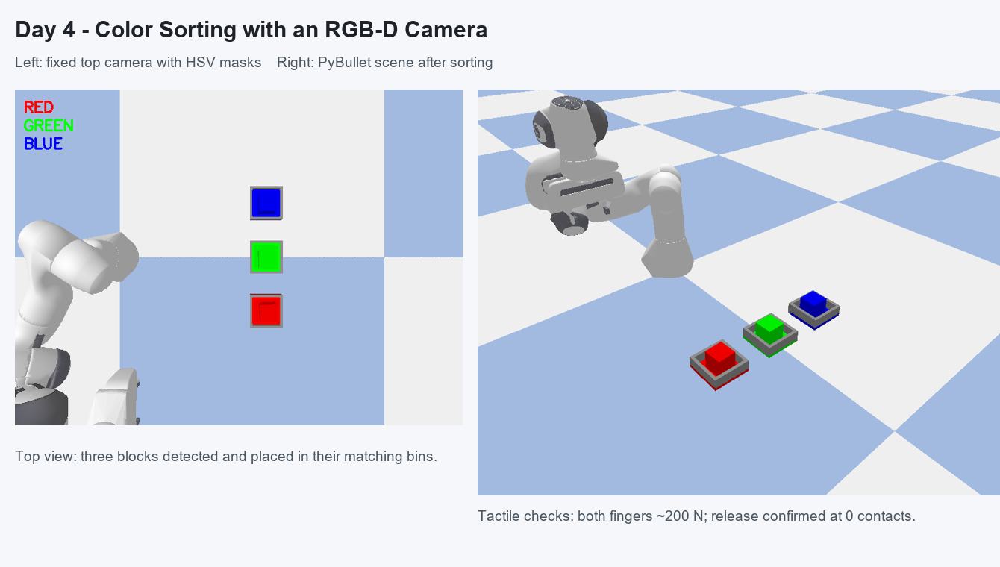

**今天完成**

- 新建 `第六个项目.py`：固定俯视 RGB-D 相机 + HSV 三色分类 + 同色盒子分拣。
- 三个方块位置随机，三个开口盒位置固定；盒子底板涂成红/绿/蓝，不需要识别盒子。
- 按红 → 绿 → 蓝顺序，逐个完成"扫描 → 抓取 → 触觉确认 → 移到盒子上方 → 放下 → 俯视相机验证"。
- 固定位置和随机位置各测试，三色全部分拣成功。

**场景与流程**

| 项目 | 设置 |
| --- | --- |
| 俯视相机 | 固定 `[0.45, 0, 1.10]`，视线朝下，640×480，FOV 60° |
| 扫视位 | `[0.20, -0.35, 0.40]`，让开摆放区，避免机械臂遮挡 |
| 方块 | 边长 6cm，随机放在 `x 0.30~0.45`、`y ±0.10` |
| 盒子 | 固定 `x=0.55`，`y=-0.20 / 0 / +0.20`；彩底 + 灰色矮墙 |
| 颜色 | 红、绿、蓝 HSV 阈值互不重叠，红色跨 0° 用两段 |
| 顺序 | 红 → 绿 → 蓝（固定顺序便于调试） |
| 放置 | 移到盒上方 → 下降到 0.10m → 张开夹爪 → 触觉确认脱离 |
| 验证 | 回到扫视位，俯视相机检测盒子区域内的方块 |

**实测结果**

- 三次抓取：两指接触力各约 200N，总力约 400N；
- 放下后接触点回到 0，确认方块已脱离夹爪；
- 俯视验证三个方块位置：红 `(0.552, -0.195)`、绿 `(0.552, -0.004)`、蓝 `(0.552, 0.199)`，都在对应盒子内；
- 最终结果：3/3 成功。

**工程问题：彩色盒子底板会干扰颜色检测**

- 如果直接按颜色找，盒子底板本身也是红/绿/蓝，会被当成方块。
- 扫描方块时限制在摆放区 `x<0.50`、`|y|<0.15`、`z>0.02`，把盒子排除；
- 验证时用高度过滤 `z>0.025`：底板约在 `z=0.01`，方块顶面约在 `z=0.07`，只留下方块。

**概念笔记：HSV、RGB 与 YOLO**

- **HSV**：H 是颜色种类（OpenCV 0–179，红色跨 0/180，需两段阈值），S 是颜色浓淡，V 是明暗。检测颜色时主要限制 H，S/V 用来排除灰白黑和阴影，比直接卡 RGB 稳定。
- **为什么神经网络还是用 RGB**：HSV 不是"更高级"的颜色空间，只是同一份信息的重新排列；通用识别还需要纹理、形状、材质和上下文，RGB 保留全部原始线索。网络第一层会自己学出类似颜色对立的特征，而且 HSV 在色相环接缝和灰色附近有跳变，对梯度不友好。任务窄、颜色明确时用手写 HSV；任务宽、变化多时让网络从 RGB 学。
- **需要 YOLO 吗**：不需要。三种纯色 + 受控光照下，HSV 零训练、快、可解释；YOLO 只能给二维框和类别，仍然要靠深度和内参算三维位置。等需要识别形状/纹理、真实光照或很多类别时再考虑 YOLO，也可以用 PyBullet 自动生成标注数据来训练。

**下一步**

- 改成"最近优先"抓取，减少机械臂无效移动；
- 让俯视相机识别盒子的位置，而不是写死三个位姿；
- 在真实相机/噪声条件下测试 HSV 阈值，再和 YOLO 做对比。

## 第七个项目：YOLO 目标检测与视觉抓取

> 这一节主要记录我搞懂的概念、踩过的坑和真正的学习收获，指标放在最后备查。

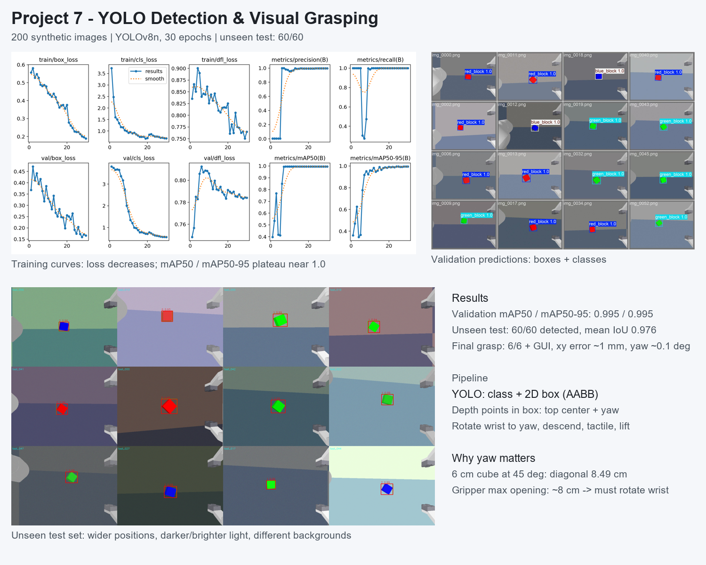

### 我做了什么

- 用 PyBullet 自动生成 **200 张** eye-in-hand 图像：随机位置、颜色、yaw、相机位姿、桌面颜色和亮度扰动；
- 用方块 3D 角点投影自动生成 YOLO 标注 `class cx cy w h`，并做三层审计：txt 反算画框、颜色掩码覆盖率、训练批次图；
- 用 COCO 预训练的 `yolov8n.pt` 微调 **30 epochs**（早停、640、RTX 4060）；
- 在 **60 张训练时没见过的**、条件更极端的测试集上评估；
- 最后写 `project7_yolo/第七个项目.py`：YOLO 出类别和框，深度点云估 yaw，转腕对准后抓取。

### 我原来最困惑的概念

#### 1. 训练到底在做什么？

把模型想成一个有几百万个旋钮的黑箱：输入图片，输出框和类别。训练就是反复给它看图，把预测和标注比较，算出 loss，然后根据 loss 把旋钮往“错得更少”的方向拧一点。160 张图看完一遍叫 1 个 epoch。

YOLO 的 loss 主要分三块：`box_loss`（框准不准）、`cls_loss`（类别对不对）、`dfl_loss`（框边界精细度）。

#### 2. yolov8n.pt 是什么？会不会“不干净”？

它是 YOLOv8 Nano 的 **COCO 预训练权重**，原本认识 80 类。我们不是要它那 80 类，而是把它当作“已经会看图的起点”。训练时 Ultralytics 会把检测头重新初始化成 3 类，再用我们的数据微调。

因此旧的 80 类知识不会污染我们的标签；继承下来的只是边缘、纹理、颜色这些通用特征。训练结果保存到新的 `best.pt / last.pt`，不会修改原来的 `yolov8n.pt`。

#### 3. 为什么 1 个 epoch 不行？欠拟合和过拟合

1 个 epoch 是“体检”，只检查数据、标签、GPU、训练/验证流程，不是用来出成绩的。新的 3 类检测头是随机初始化的，看一遍 160 张图远不够，所以 1 epoch 时置信度极低、预测图里一个框都没有，是正常的。

- **欠拟合**：训练 loss 和验证指标都还很高，模型没学够 → 多训练、加数据/增强、必要时换大模型；
- **过拟合**：训练 loss 很低，但验证 loss 开始上升、mAP 不涨 → 早停、加增强/正则。

我最初想直接上 50 epochs，后来改成 **30 epochs + patience=10 早停**。曲线大约在 10~15 轮后平台化，30 轮已经足够；50 轮收益很小。

#### 4. mAP、precision、recall、PR 曲线、混淆矩阵

- **Precision**：模型报出来的框里，有多少是真的。低 = 误报多；
- **Recall**：真正的物体里，有多少被找到。低 = 漏检；
- **PR 曲线**：置信度阈值从高到低扫，precision 和 recall 的权衡；曲线下面积是 AP，三类平均是 mAP；
- **mAP50**：IoU ≥ 0.5 就算对；**mAP50-95** 对框的要求更严；
- **混淆矩阵**：行/列是真实/预测类别，对角线越亮越好。

mAP 是按置信度**排序**算的，所以 1 epoch 时“mAP50 = 0.33，但 conf=0.01 下一张框都没有”并不矛盾：排序有区分度，但绝对置信度很低。**不能只看一个 mAP 数字**，要结合 PR、precision/recall 和预测图。

#### 5. AABB、OBB、yaw 是什么？为什么抓取一定要 yaw？

- **AABB**：轴对齐包围盒，边永远平行图像 x/y。YOLO 的 `cx cy w h` 就是它。物体旋转时四角必定有空隙；
- **OBB**：有向包围盒，跟着物体旋转，框更紧，还额外带角度；
- **yaw**：绕竖直轴 z 的旋转。方块平放在桌上时，roll/pitch≈0，只有 yaw 在变。

这件事对抓取很致命：6cm 方块转 45° 时对角线是 `6×√2≈8.49cm`，而夹爪最大开度约 8cm。**如果夹爪不跟着转，物理上就夹不进去**。检测框只告诉“在哪”，不告诉“朝哪”；所以最终的方案是：

- YOLO 负责类别 + 2D 框；
- 框内深度点云拟合顶面，得到中心 + yaw；
- 把 yaw 加进夹爪朝向，转腕后再下降。

#### 6. HSV 和 YOLO 怎么选？

这个任务一开始用 HSV 就够了：三种纯色、光照受控、零训练。YOLO 是为了学习“从数据里学检测”的通用方法，也为以后更复杂的物体/光照做准备。

它们不是谁更高级，而是**任务选工具**：

- 颜色明确、类别少、实时轻量 → HSV；
- 类别/形状/纹理复杂、真实光照、想泛化 → RGB + 神经网络；
- HSV 不是“信息更多的颜色空间”，只是把 RGB 重排；神经网络用 RGB 是为了保留纹理、形状、材质等全部线索，而且能自己学颜色变换。

### 我的学习收获

1. **数据和标注质量比模型本身更重要**。第一次画框审计时，最该看的是“把 txt 反算回图片后框有没有贴住物体”，而不是 mAP。
2. **指标必须组合看**。mAP 高不代表模型可用；1 epoch 的 mAP 和低置信度预测就差点让我误判。
3. **检测 ≠ 抓取**。框只解决“在哪”，抓取还需要三维位置和 yaw；“视觉识别”只是具身智能的一小步。
4. **训练要分阶段**：先 sanity run 验证流程，再短训练看曲线，最后再决定是否加轮数；不要盲目 50。
5. **工具按任务选**：这个任务里 HSV 简单有效，YOLO 的价值在可学习、可泛化；两者不冲突。
6. **工程问题也是实验的一部分**：CUDA 版 PyTorch、Windows 下 `workers=0`、模型下载慢、绝对路径、渲染/验证卡住，都会真实地消耗时间。

### 结果备查

- 数据集：200 张（160 训练 / 40 验证），红 67 / 绿 67 / 蓝 66；非法标签 0，颜色掩码覆盖率检查 0 失败；
- 训练：YOLOv8n，30 epochs，imgsz=640，mAP50 = 0.995，mAP50-95 = 0.995；
- 未见测试集：60/60 检测正确，平均 IoU 0.976，mAP50 = 0.995；
- 最终抓取：6/6 随机样本 + GUI 成功；检测 xy 误差约 1mm，yaw 误差约 0.1°，两指接触力各约 200N。

### 复现步骤

```bash
# 1) 生成 200 张图和 YOLO 标签
python project7_yolo/yolo_step4_dataset.py

# 2) 训练（30 epochs，早停；GPU 可用时自动用 GPU）
python project7_yolo/yolo_train.py

# 3) 未见测试集评估（可选）
python project7_yolo/yolo_step6_unseen.py

# 4) 离线验证检测/三维/yaw（可选）
python project7_yolo/yolo_step7_validate.py

# 5) 完整抓取
python project7_yolo/第七个项目.py
```

训练输出在 `yolo_lesson/runs/full30/weights/best.pt`。数据、训练输出和测试集没有提交到仓库，按上面步骤在本机生成即可。

### 2026.10.25 ｜ 第 5 天 · 轨迹、时间参数化与奇异位形

今天从“能抓到”推进到“轨迹可测量、可解释、可安全执行”。五个小项目分别研究：

| 项目 | 研究的问题 | 关键结论 |
| --- | --- | --- |
| 项目 1 | 指令轨迹和实际轨迹差多少？ | 动态跟踪有约 37 ms 滞后；静态精度 ≠ 动态精度 |
| 项目 2 | 速度/加速度/jerk 怎么安排？ | 平滑不免费；峰值速度决定跟踪误差 |
| 项目 2.5 | 轨迹是否可执行？ | 速度没超限 ≠ 安全；constant/trapezoid 被加速度/jerk 拒绝 |
| 项目 3 | Cartesian 还是 joint-space？ | 关节空间直线会让末端走弯、姿态偏移 |
| 项目 4 | 当前构型安全吗？ | near 路径 sigma_min 更低，关节速度约 2 倍 |
| 项目 5 | 接近奇异怎么办？ | 标准伪逆失效；DLS 用精度换稳定性，λ 要取合适值 |

详细实验过程、每步的图和名词总结见：

**[project8_trajectory/README.md](project8_trajectory/README.md)**

---

### 2026.10.26 ｜ 第 6 天 · 画圆、可操作度地图与自适应调速

用一小时把前几天的 IK、时间规划、Jacobian 和可操作度串成一个小项目：让 Panda 在空中画圆，并比较三种速度分配。

| 方法 | 最大误差 | 平均误差 | 最大关节速度 |
| --- | ---: | ---: | ---: |
| constant | 4.23 mm | 2.45 mm | 0.72 rad/s |
| min-jerk | 5.12 mm | 2.45 mm | 0.88 rad/s |
| adaptive | 4.06 mm | 2.45 mm | **0.38 rad/s** |

三种方法总时间都是 8 s。adaptive 在 `sigma_min` 低的扇区自动减速，弱区关节速度从 0.72 降到 0.28 rad/s，弱区误差从 4.2 mm 降到 1.9 mm；代价是强区被加速、误差转移。

完整实验、图和“为什么 min-jerk 看起来最快但并没有提前到达”的解释见：

**[project9_draw_circle/README.md](project9_draw_circle/README.md)**

---

### 2026.10.27 ｜ 第 7 天 · ROS2 环境选型与项目骨架

从 PyBullet 单脚本转向 ROS2 机器人系统，今天主要定路线和搭骨架：

- 选择 **Ubuntu 22.04 + ROS2 Humble + VMware** 的入门环境；
- 规划虚拟机、Ubuntu 安装、VMware Tools 和快照流程；
- 新建 `turtle_control` ROS2 Python 包骨架；
- 设定下一步目标：发布 `/turtle1/cmd_vel`、订阅 `/turtle1/pose`。

> 当时状态：环境搭建进行中；ROS2 安装和 turtlesim 验证留到第 8 天。

详细环境方案和代码见：

**[project10_ros2/README.md](project10_ros2/README.md)**

---

### 2026.10.28 ｜ 第 8 天 · 完成 ROS2 环境与第一个节点

今天没有开新的大块内容，任务就是把第 7 天清单里剩下的部分做完：

- 完成 Ubuntu 22.04.5 虚拟机、VMware Tools 和快照；
- 安装 ROS2 Humble；
- 跑通官方 talker/listener；
- 跑通 turtlesim；
- 编译并运行 `turtle_control`：
  - 发布 `/turtle1/cmd_vel` 让海龟画圆；
  - 订阅 `/turtle1/pose` 打印位姿。

### 官方 talker / listener 验证

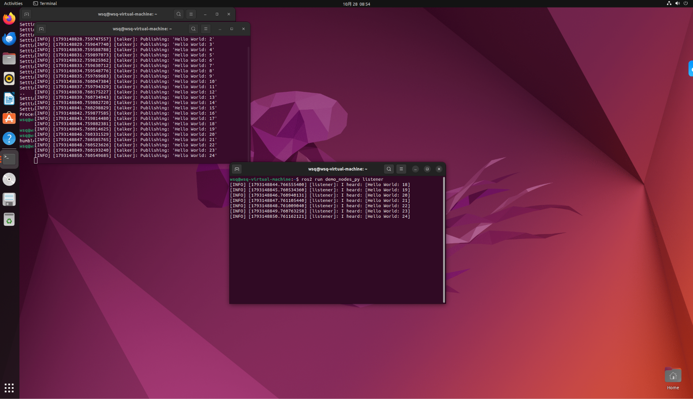

### turtlesim + 自己的节点

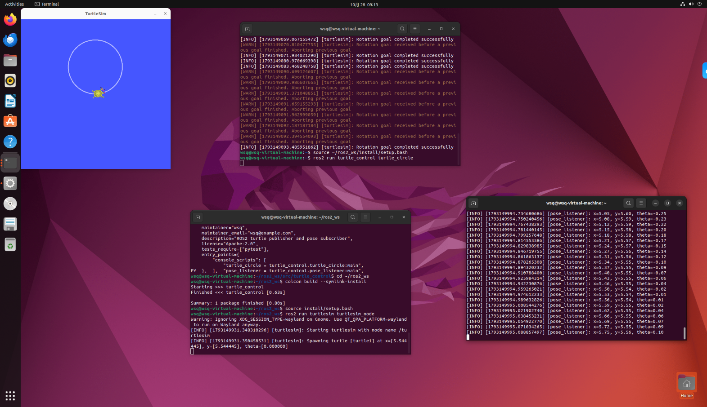

### 遇到的坑

- `raw.githubusercontent.com` 被拒绝：改用 `keyserver.ubuntu.com` 下载密钥，并切换到清华 ROS2 镜像；
- `turtle_teleop_key` 快速按键会触发 turtlesim 的 `Rotation goal received before a previous goal finished` 警告，不影响运行；
- 启动 turtlesim 时的 Wayland 提示是环境警告，不影响话题通信。

> 状态：✅ ROS2 通信、turtlesim 和自定义发布/订阅节点全部跑通。

详细环境方案、代码和错误记录见：

**[project10_ros2/README.md](project10_ros2/README.md)**

---

### 2026.10.29 ｜ 第 9 天 · ROS2 工程化与面试理论补充

前两天的 ROS2 重点是“节点能通信”；今天把它升级成“可配置、可控制、可一键启动”的 ROS2 应用：

- 给 `turtle_circle` 增加参数：`linear_speed`、`angular_speed`、`publish_rate`；
- 增加 `std_srvs/SetBool` 服务，运行时暂停/恢复画圆；
- 写 launch 文件，一条命令启动 turtlesim、发布节点和订阅节点；
- 用 `ros2 param`、`ros2 service`、`ros2 node list`、`rqt_graph` 观察系统；
- 排查了服务名 `/set_enabled` 与 `/turtle_circle/set_enabled` 的区别，以及“海龟停了但位姿监听还在打印”的状态流现象。

#### rqt_graph 看什么？

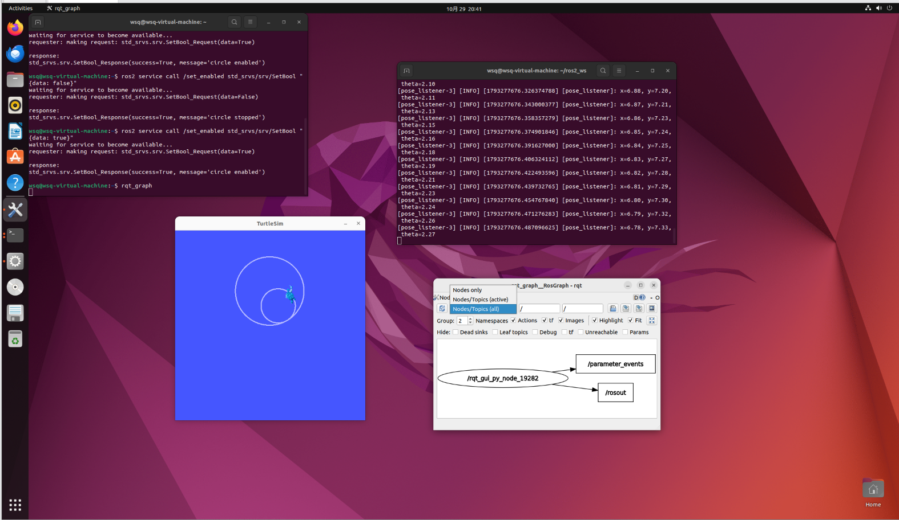

`rqt_graph` 是 ROS2 的**计算图查看器**，不是数据查看器：

- 椭圆/节点：ROS2 节点；
- 节点之间的连线：话题；
- 箭头方向：谁发布、谁订阅；
- 可以用过滤器和刷新，快速看命名空间、话题名是否接错。

这张截图里 Node Graph 还没显示出节点（截图时 launch 可能已经停了，或者没有点刷新）。  
正常启动 `turtle_demo.launch.py` 后，应该能看到类似：

```text
/turtle_circle  --/turtle1/cmd_vel-->  /turtlesim
/turtlesim      --/turtle1/pose----->  /pose_listener
```

它适合排查“节点有没有起来、话题名字对不对、谁在订阅”，
但看不到消息内容；看内容要用 `ros2 topic echo`，看频率用 `ros2 topic hz`。

#### 今天和前两天有什么进展？

| 天数 | 重点 | 能力变化 |
| --- | --- | --- |
| 第7天 | 环境选型、虚拟机、包骨架 | 知道 ROS2 要解决什么问题 |
| 第8天 | 发布者/订阅者 | 两个节点可以互相通信 |
| 第9天 | 参数、服务、launch、系统观察 | 节点可以运行时配置、远程控制、一键启动 |

这对应到真机和 VLA：

- **参数**：以后调速度、限位、控制增益、模型路径，不改代码；
- **服务**：以后做使能、急停、校准、模式切换；
- **launch**：以后一键拉起相机、检测、策略、控制器；
- **状态话题**：机器人静止时状态仍在持续发布，VLA 需要持续读取；
- **rqt_graph**：系统出问题时，先看谁连谁。

详细实验和代码：

**[project10_ros2/README.md](project10_ros2/README.md)**

---

### 2026.10.30 ｜ 第 10 天 · ROS2 周 Day 2：TF2、URDF 与 RViz

第 9 天解决的是“节点之间怎么传消息”；今天解决的是“消息里的位置到底在哪个坐标系”。

今天的机械臂不再靠 PyBullet 引擎直接摆姿态，而是：

```text
URDF/xacro 描述结构
+ /joint_states 提供关节角
+ robot_state_publisher 做正运动学
= TF2 中一棵实时更新的坐标树
```

#### 今天搭的 TF 树

```text
base_link
  └── joint1（revolute，绕 z）
        link1
          └── joint2（revolute，绕 y）
                link2
                  └── tool_joint（fixed）
                        tool0
                          └── camera_joint（fixed）
                                camera_link
                                  └── camera_optical_joint（fixed）
                                        camera_optical_frame
```

- 前两段是动态关节，关节角一变，TF 就变；
- 后面三段是固定关节，局部变换不变，但会跟着整条手臂运动；
- `camera_link` 是 ROS 机体坐标系，`camera_optical_frame` 是相机光学坐标系。

#### 1. 先手动造一条 TF 边

先不写 URDF，用 `static_transform_publisher` 手动发布：

```text
base_link → camera_link
```

再用 `tf2_echo` 查询：

```bash
ros2 run tf2_ros tf2_echo base_link camera_link
```

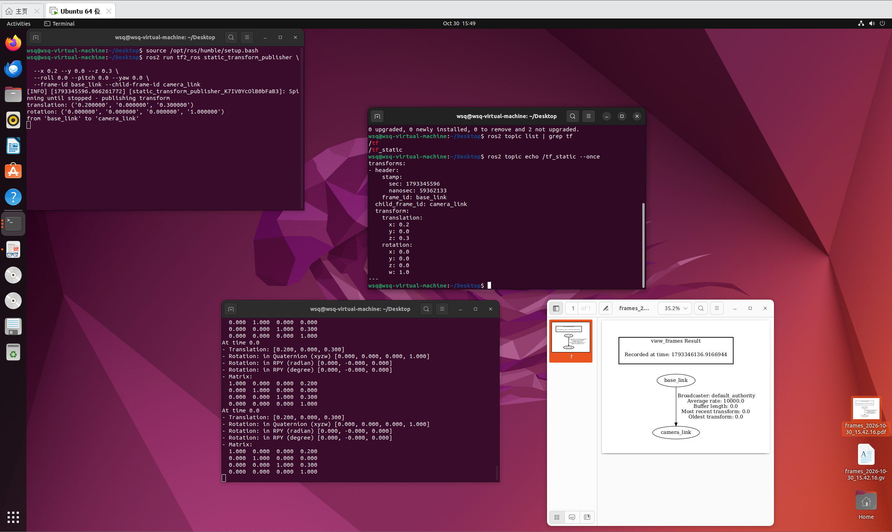

这一步理解了：

- translation 是相对坐标；
- `tf2_echo A B` 查的是 **B 相对 A** 的位姿；
- `view_frames` 生成的 PDF 是静态拓扑图，不会显示实时运动。

#### 2. URDF + robot_state_publisher + RViz

用 `arm_description` 包描述一个简化机械臂：

```text
base_link → link1 → link2 → tool0 → camera_link → camera_optical_frame
```

启动：

```bash
ros2 launch arm_description display.launch.py
```

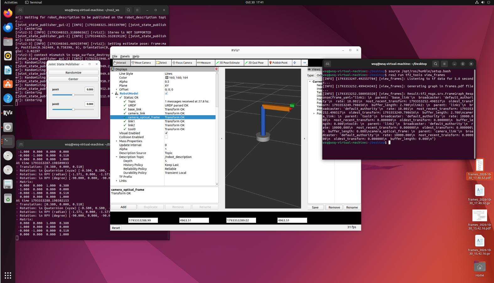

在 RViz 里：

- `Fixed Frame` 改成 `base_link`；
- Add → RobotModel；
- Add → TF，勾选 Show Names / Show Axes；
- 拖动 `joint1`、`joint2`，模型和坐标轴一起动。

这一步看懂了：

- `robot_state_publisher` 的本质就是正运动学；
- 滑条窗口的 `/joint_states` 是输入，`/tf` 是输出；
- 相机 frame 固定在 `tool0` 上，所以局部变换不变，全局变换随关节变化。

#### 3. 完整 TF 树

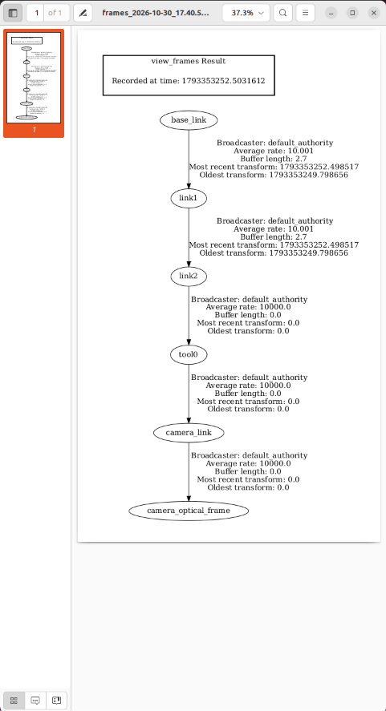

`view_frames` 生成：

```text
base_link
  └── link1
        └── link2
              └── tool0
                    └── camera_link
                          └── camera_optical_frame
```

#### 4. 一条真实的 `tf2_echo` 输出

查询 `base_link → camera_optical_frame`，会看到：

```text
At time 1793354463.198479610
- Translation: [0.380, 0.000, 0.510]
- Rotation: in Quaternion (xyzw) [-0.500, 0.500, -0.500, 0.500]
- Rotation: in RPY (radian) [-1.571, 0.000, -1.571]
- Rotation: in RPY (degree) [-90.000, 0.000, -90.000]
- Matrix:
  0.000  0.000  1.000  0.380
 -1.000  0.000  0.000  0.000
 -0.000 -1.000  0.000  0.510
  0.000  0.000  0.000  1.000
```

这条输出同时给了三种旋转表示：

```text
Quaternion：适合存储和插值
RPY：适合人看
4×4 Matrix：适合做乘法
```

矩阵的前三列是相机光学坐标系的三个轴在 `base_link` 中的方向：

```text
光学 x → base 的 -y
光学 y → base 的 -z
光学 z → base 的 +x
```

最后一列是相机原点在 base 中的位置：

```text
(0.380, 0.000, 0.510) 米
```

所以相机正前方 1 米的点：

```text
p_optical = (0, 0, 1)
p_base    = (1.380, 0, 0.510)
```

这就是 RGB-D 反投影后，把目标点从相机坐标转成机器人坐标的那一步。

#### 5. 为什么拖关节时坐标这样变？

- `joint1` 绕 z 轴，是水平面内的 yaw，所以 x/y 变化，z 不变；
- `joint2` 绕 y 轴，是 x-z 平面内的 pitch，所以 z 变化最明显，x 也会变化；
- 相机固定在 `tool0` 上：`tool0 → camera_link` 永远不变，`base_link → camera_link` 随关节变化。

#### 今天遇到的坑

1. **`file not found: 'xacro'`**
   launch 调用了 `xacro`，但没装包。解决：
   ```bash
   sudo apt install -y ros-humble-xacro
   ```

2. **RViz 的 Fixed Frame 默认是 `map`**
   我们的树根是 `base_link`，所以报 `Fixed Frame [map] does not exist`。

3. **RobotModel 报 `Error subscribing: Empty topic name`**
   只设置 `Description Source: Topic` 不够，还要明确填：
   ```text
   Description Topic: /robot_description
   ```

4. **QoS 不匹配**
   `robot_state_publisher` 用 **Transient Local** 发布 `/robot_description`；RViz 如果用默认 `Volatile`，就会错过启动时只发一次的 URDF。

5. **RViz 里什么都看不到**
   RViz 第一次打开是空场景，需要手动 Add RobotModel 和 TF；机械臂只有约 0.5 米，还要把 `Distance` 从 10 调到 1.5。

#### 和真机、VLA 的关系

| 今天学的 | 真机/VLA 中的用途 |
| --- | --- |
| URDF/xacro | 描述真实机械臂、夹爪、相机安装位置 |
| `robot_state_publisher` | 用编码器关节角计算所有 link 的实时位姿 |
| TF2 | 查询相机、末端、底座之间的变换 |
| `camera_optical_frame` | 真实相机驱动和手眼标定的标准坐标约定 |
| `tf2_echo` | 排查“相机看到的目标到底在机器人哪个位置” |

真实相机装在夹爪上时：

```text
camera → hand：固定，来自手眼标定
hand → base：随关节运动变化
```

VLA 模型看到的是图像坐标系，输出的动作要在机器人坐标系执行，中间必须靠 TF 做翻译。

详细代码、完整复现步骤和 4×4 矩阵解释见：

**[project11_ros2_tf/README.md](project11_ros2_tf/README.md)**

---

### 2026.10.31 ｜ 第 11 天 · ROS2 周 Day 3：Gazebo + ros2_control

第 10 天解决的是“机器人在哪”：

```text
URDF + /joint_states  →  TF 树  →  RViz
```

今天解决的是“机器人怎么被控制”：

```text
轨迹控制器 → ros2_control → Gazebo 物理引擎 → 关节状态 → TF/RViz
```

#### 今天的数据流

```text
joint_trajectory_controller
        │ 位置命令
        ▼
controller_manager
        │
        ▼
ros2_control hardware interface
        │
        ▼
Gazebo joints（重力、碰撞、惯性）
        │ 实际状态
        ▼
joint_state_broadcaster
        │ /joint_states
        ▼
robot_state_publisher
        │ /tf
        ▼
RViz
```

#### 1. 模型进入 Gazebo

先给 `simple_arm` 补上 Gazebo 需要的物理属性：

- 每个 link 的 `inertial`：质量、质心、转动惯量；
- `world → base_link` 固定关节：防止整条手臂被重力推倒；
- 关节阻尼：减少无控制器时的剧烈摆动；
- `ros2_control` 硬件接口：`joint1`、`joint2` 的位置命令和位置/速度状态；
- `gazebo_ros2_control` 插件：把 Gazebo 关节接到 `ros2_control`。

把模型生成到 Gazebo 用：

```text
spawn_entity.py
```

它读取 `/robot_description`，再调用 Gazebo 的 `/spawn_entity` 服务，把 URDF 变成仿真世界里的模型。

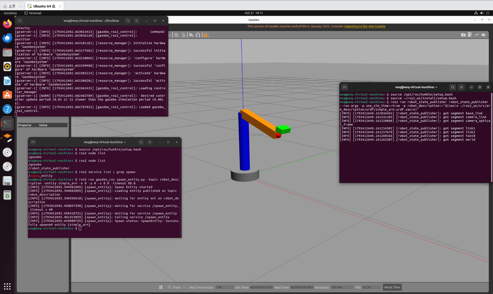

截图里确认到：

```text
ros2 node list        → /gazebo, /robot_state_publisher
ros2 service list     → /spawn_entity
spawn_entity.py       → Successfully spawned entity [simple_arm]
GazeboSystem          → 初始化、配置、激活成功
```

#### 2. 两个控制器让关节动起来

今天的两个控制器分工：

| 控制器 | 作用 |
| --- | --- |
| `joint_state_broadcaster` | 读取 Gazebo 关节状态，发布 `/joint_states` |
| `joint_trajectory_controller` | 接收轨迹，向关节写位置命令 |

它们必须分别启动。`controllers.yaml` 只是声明，不会自动启动所有控制器。

发一条轨迹：

```bash
ros2 action send_goal /joint_trajectory_controller/follow_joint_trajectory control_msgs/action/FollowJointTrajectory "
trajectory:
  joint_names: [joint1, joint2]
  points:
    - positions: [0.0, 0.0]
      time_from_start: {sec: 0, nanosec: 0}
    - positions: [0.8, -0.5]
      time_from_start: {sec: 3, nanosec: 0}
"
```

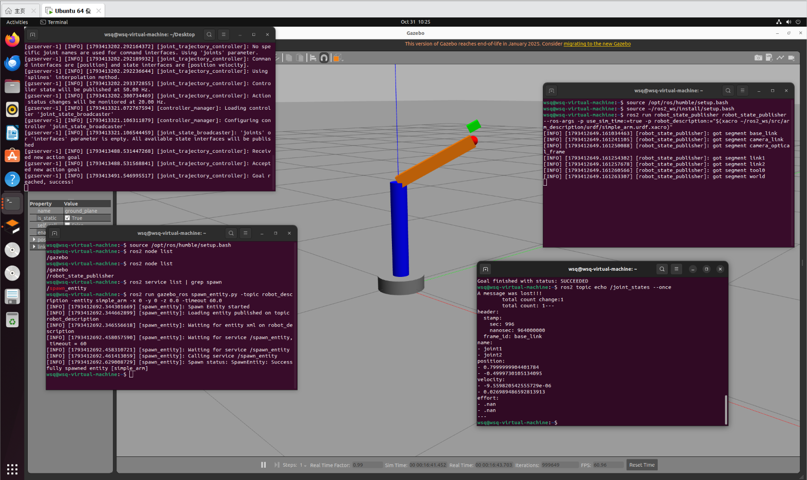

截图里确认到：

```text
Goal finished with status: SUCCEEDED
/joint_states:
  joint1 ≈ 0.7999999
  joint2 ≈ -0.4999973
```

说明从 action → controller → hardware interface → Gazebo 的命令链是通的。

#### 3. Gazebo 与 RViz 同步

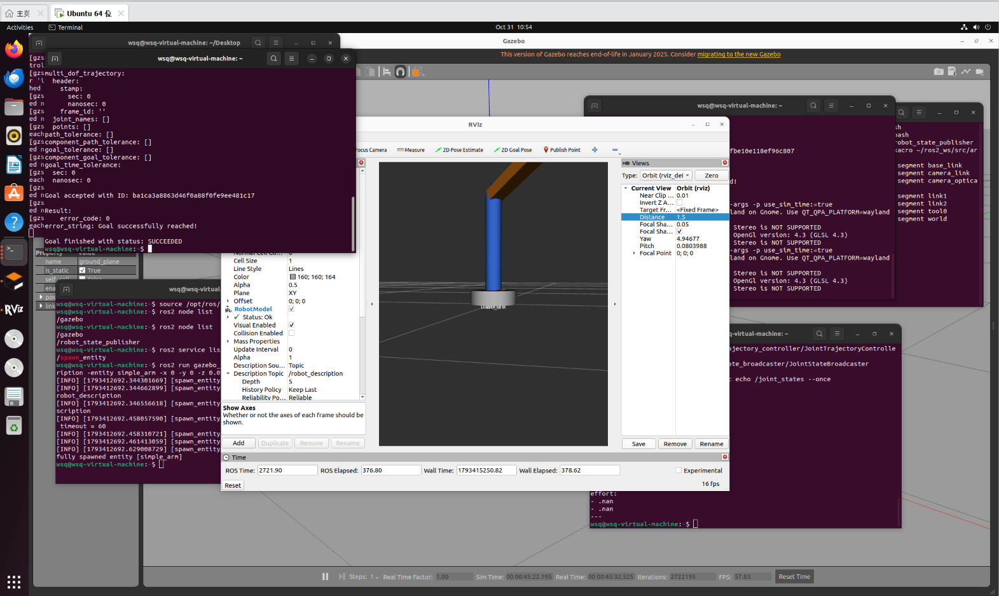

RViz 里机械臂的姿态和 Gazebo 一致，说明状态链也通了：

```text
Gazebo 实际关节状态
→ joint_state_broadcaster
→ /joint_states
→ robot_state_publisher
→ /tf
→ RViz
```

这一步验证的不只是“关节有没有名字”，还包括：

- `/joint_states` 的关节名和 URDF 一致；
- `joint1` 的 yaw、`joint2` 的 pitch 方向一致；
- `base_link → link1 → link2 → tool0 → camera_link` 的 TF 完整；
- 相机 frame 跟着末端运动；
- 仿真时间和 TF 时间戳同步。

#### 今天踩过的坑

1. **`spawn_entity.py` 一直等 `/robot_description`**
   RSP 没启动，或者没有正确发布话题。先检查：
   ```bash
   ros2 topic list | grep robot_description
   ```

2. **一直等 `/spawn_entity`**
   Gazebo 的 ROS factory 插件没加载，或者连接到了残留的 Gazebo 实例。
   正常 `ros2 node list` 必须有 `/gazebo`。

3. **只有一个控制器 active**
   `spawner` 一次只启动一个控制器。`joint_state_broadcaster` 和 `joint_trajectory_controller` 要分别 spawn。

4. **`/dynamic_joint_states` 多出来**
   ros2_control 的通用关节状态格式，不是错误；TF/RViz 使用 `/joint_states`。

5. **`effort: nan`**
   Gazebo 硬件接口没有提供 effort 状态接口，位置控制不需要它。

6. **控制器更新周期警告**
   控制器 100 Hz、Gazebo 1000 Hz，属于正常警告。

7. **RViz 关闭后配置丢失**
   关闭时如果提示保存 `default.rviz`，点 Save，下次启动会自动恢复布局。

#### 三天进展对比

| 天数 | 重点 | 能力变化 |
| --- | --- | --- |
| 第9天 | 参数、服务、launch | 节点可配置、可控制、可一键启动 |
| 第10天 | TF2、URDF、RViz | 机器人知道每个零件在哪个坐标系 |
| 第11天 | Gazebo、ros2_control、轨迹控制器 | 关节能被物理仿真和控制器真正驱动 |

#### 和真机、VLA 的关系

今天最重要的抽象是：

```text
控制器不变
硬件接口可替换
```

以后换真机时：

```text
GazeboSystem 插件
        ↓ 替换
厂商硬件接口 / ros2_control 驱动
```

`joint_trajectory_controller`、`/joint_states`、TF 和 `/tf` 的结构尽量保持不变。

VLA 输出的是高层动作或动作块，最终仍然要经过：

```text
动作 → 轨迹/控制器 → ros2_control → 真实关节
```

详细代码、多终端复现步骤和踩坑记录见：

**[project12_ros2_gazebo/README.md](project12_ros2_gazebo/README.md)**

---

### 2026.11.01 ｜ 第 12 天 · ROS2 周 Day 4：MoveIt2 规划与避障

第 11 天解决的是：

```text
给定一条关节轨迹，怎么让 Gazebo 里的关节执行
```

今天解决的是：

```text
给定一个目标，机器人应该走哪条轨迹才安全、不碰撞、关节不超限
```

#### MoveIt2 不是控制器

```text
IK：知道目标位姿
MoveIt2：规划一条无碰撞路径
joint_trajectory_controller：执行轨迹
Gazebo / 真机：物理世界
```

今天用官方 Panda demo，执行器是 fake controller，所以机械臂只在 RViz 里动；规划概念和接口与后面接 Gazebo/真机一致。

#### 数据和接口链路

```text
RViz 设置目标
        ↓
/move_action（moveit_msgs/action/MoveGroup）
        ↓
move_group 规划、避障、检查关节限位
        ↓
/panda_arm_controller/follow_joint_trajectory
        ↓
控制器执行
```

添加障碍物：

```text
RViz Scene Objects
        ↓
/apply_planning_scene
        ↓
/monitored_planning_scene
        ↓
碰撞检测 + 重新规划
```

#### 1. 第一次规划与执行

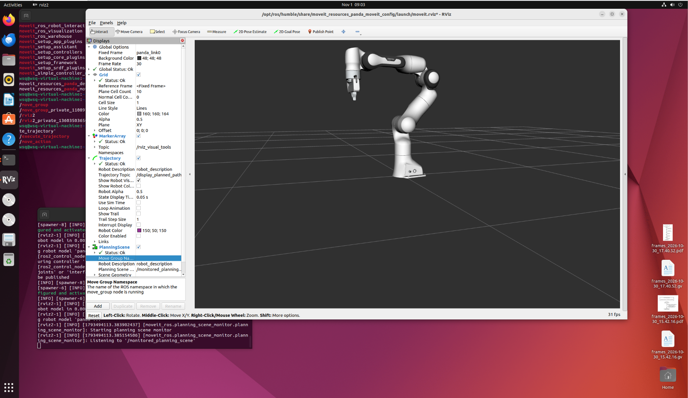

关键操作：

```text
Planning Group: panda_arm
Start State: Current
Goal State: <random valid>
Plan → 预览轨迹
Execute → 执行
```

`Plan` 只计算轨迹，`Execute` 才把轨迹交给控制器。

#### 2. 加障碍物后的避障规划

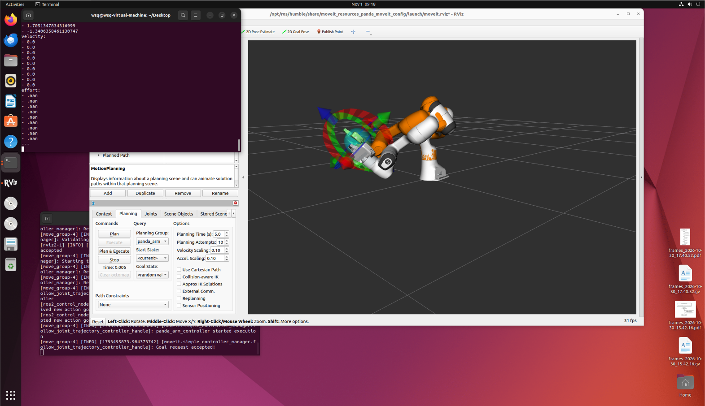

在 `Scene Objects` 里加一个 Box，它会成为 PlanningScene 中的 Collision Object。先 Plan 看路径，再 Execute。

#### 3. 碰撞盒与避障结果

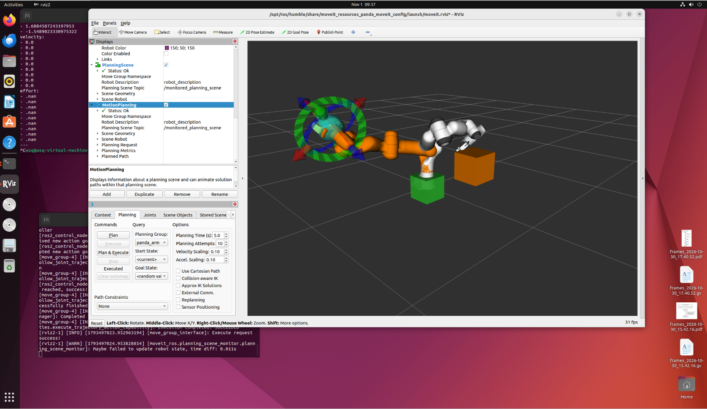

截图里：

```text
绿色/橙色盒子 = Collision Objects
机械臂绕开盒子
Execute request success
```

`Maybe failed to update robot state, time diff 0.011s` 是 RViz 时序警告，不是执行失败。

#### 4. 为什么避障路径很扭曲

默认 OMPL 采样规划器（如 RRTConnect）只保证：

```text
无碰撞 + 满足关节限位
```

Panda 是 7 自由度冗余机械臂，同一末端位姿有多组关节解；加上规划是在关节空间里进行的，所以末端路径可能弯曲、绕行甚至看起来别扭。

```text
路径扭曲 ≠ 失败
路径穿模 = 失败
```

想更自然可以换 RRT*、PRM、CHOMP/STOMP、Pilz LIN/PTP，或使用 Cartesian Path。

#### 5. 今天确认的接口

Actions：

```text
/move_action
/execute_trajectory
/panda_arm_controller/follow_joint_trajectory
/panda_hand_controller/gripper_cmd
```

Services：

```text
/compute_ik
/apply_planning_scene
/get_planning_scene
```

Topics：

```text
/monitored_planning_scene
/planning_scene
/planning_scene_world
/joint_states
/dynamic_joint_states
/robot_description
```

`ros2 action info /move_action` 显示：

```text
Action clients: /rviz2
Action servers: /move_group
```

说明 RViz 发 goal，`move_group` 负责规划；规划结果再通过 `follow_joint_trajectory` 交给控制器。

#### 6. 今天踩的坑

1. **MotionPlanning 找不到**
   在 Humble 里它是 `rviz_common::Display`，不是 Panel。
   正确入口：`Displays → Add → MotionPlanning`，不是 `Panels → Add New Panel`。

2. **`ros2 action info` 不显示 Action type**
   类型用 `ros2 action list -t` 看。

3. **规划失败**
   常见原因是 Start State 与障碍物碰撞、目标在障碍物内部或不可达。

4. **路径扭曲**
   采样规划器 + 7 自由度冗余，属于正常；只检查是否碰撞。

5. **这个 demo 没有物理**
   MoveIt demo 用 fake controller，只在 RViz 动；接 Gazebo 是后续工作。

#### 和真机、VLA 的关系

```text
VLA 高层目标
        ↓
MoveIt2 规划
        ↓
轨迹
        ↓
控制器
        ↓
真机
```

`/apply_planning_scene` 是感知系统把障碍物送进规划场景的入口；`/compute_ik` 是目标位姿到关节角的入口；`/move_action` 是高层任务到运动规划的入口。

详细安装、规划步骤、接口表和踩坑记录见：

**[project13_ros2_moveit/README.md](project13_ros2_moveit/README.md)**

---

### 2026.11.01 ｜ 延伸记录：中韩具身智能合作大会

今天去听了中韩具身智能合作大会，主要想了解一些比较前沿的技术和应用。记录几个比较有感触的点。

#### 1. 数据采集仍然是难点

企业基本不会主动提数据的可用率，但都在尝试不同的采集路线：

- **凡拓的第一视角行为数据**：介于纯视频学习和人工采集之间，扩展性和多样性比较均衡；
- **另一家企业的纯视频方案**：用 AI 从视频中提取人的动作和轨迹，建立 3D 骨骼模型，理论上可能提高准确度，但企业没有给出具体数据；
- **目前的常见组合**：视频数据和人工数据结合，针对不同动作要求动态调整比例。

我的感受是：数据不是“有就行”，可用率、覆盖度、采集成本才是关键。

#### 2. 行业还在早期，头部公司强调全阶段闭环

这个行业确实还处在比较前沿、发展比较混乱的阶段，但一些头部企业比较注重全阶段闭环：

```text
数据采集 → 模型训练 → 部署真机
软件 → 硬件
机器人的大脑 → 灵巧手
```

每个节点都有自主研发的尝试，而不是只做其中一段。

#### 3. 很多应用还不成熟

现在不少机器人应用还比较早期，比如地铁站里只能做语音服务的机器人，或者跳舞机器人，生活中起到的作用感觉还是以娱乐为主。

会好奇什么时候能真正看到机器人进入家家户户。工业方面也有实际应用，比如拧螺丝等，但这次暂时没有仔细了解。

---

### 2026.11.02 ｜ 第 13 天 · ROS2 周 Day 5：感知接入 ROS2

今天先用一个**虚拟 RGB-D 相机源**把感知链路跑通，再考虑接 Gazebo 相机或真实相机。

#### 工程思想：先用已知答案验证链路，再把链路引入真实场景

这次最直接的收获不是某个 API，而是一种工程方法：

```text
已知目标真值
        ↓
合成 RGB + 深度
        ↓
cv_bridge → 检测 → 深度反投影 → vision_msgs
        ↓
比较检测结果和真值
        ↓
确认链路完整后，再替换成 Gazebo / 真实相机
```

虚拟相机里的红色目标位置是我们自己设的：

```text
x = 0.15 * sin(t)
y = 0.04 * cos(t)
z = 1.0
```

所以检测节点输出的 `x/y/z` 是对是错，可以直接和真值对比，不需要靠肉眼猜。

这带来的好处是问题定位很清楚：

| 现象 | 优先怀疑 |
| --- | --- |
| 没有图像 | 话题名、QoS、驱动、节点是否启动 |
| 图像有但检测不到 | HSV/模型、编码、预处理 |
| 检测到但 3D 坐标不对 | 内参、深度编码、反投影公式 |
| 3D 坐标对但机器人位置不对 | TF、坐标系方向、时间同步 |

这不是“伪造结果”，而是给感知链路做一套**带 ground truth 的测试夹具**：

```text
先保证链路在可控输入下正确
再引入真实传感器的噪声、畸变、延迟和标定误差
```

这比一上来就接真实相机、同时面对驱动、标定、光照、网络、算法问题要可控得多。

#### 1. 虚拟 RGB-D 相机

虚拟相机以 320×240、10 Hz 发布：

```text
/camera/image_raw
/camera/depth/image_raw
/camera/camera_info
```

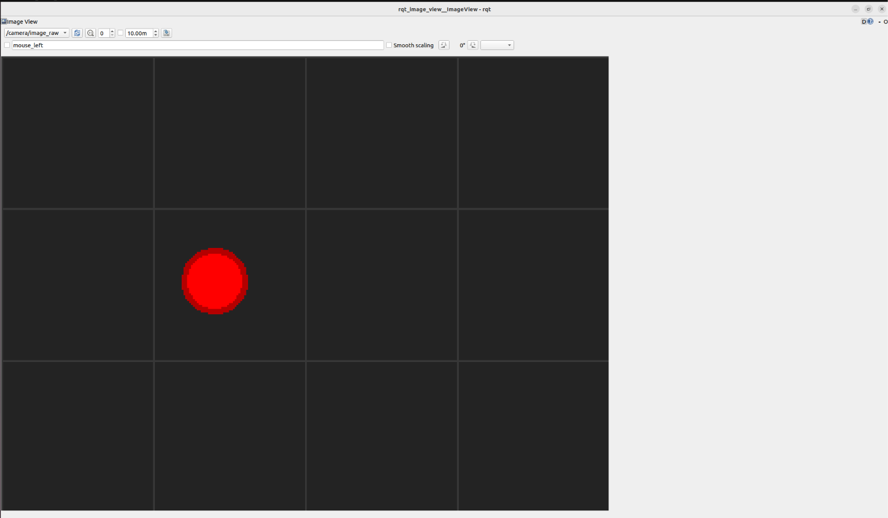

深度不是普通灰度图，而是 `32FC1` 米制深度：

```text
背景约 2.0 m
红色目标约 1.0 m
```

#### 2. 检测节点

检测节点用：

```text
message_filters.ApproximateTimeSynchronizer
cv_bridge
HSV 阈值
深度中位数
针孔相机反投影
```

发布：

```text
/vision/detections       → vision_msgs/Detection3DArray
/vision/debug_image      → 带检测框的图像
/vision/target_pose      → base_link 下的 PoseStamped
/vision/target_marker    → RViz 红色球
```

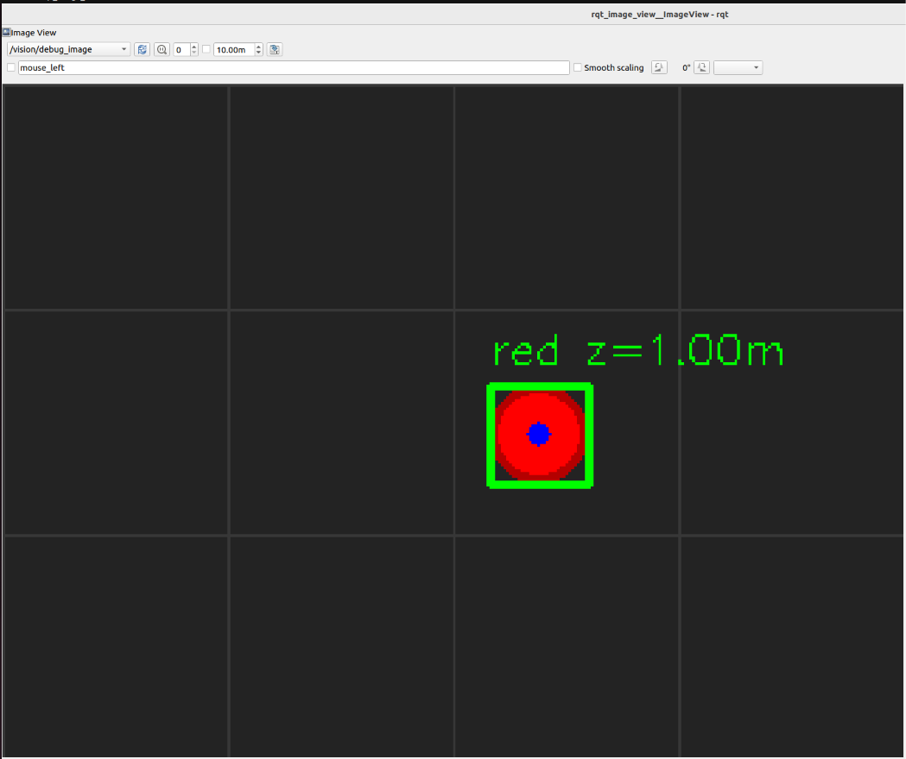

#### 3. TF 转到 base_link

相机检测结果在：

```text
camera_optical_frame
```

通过静态 TF 转到：

```text
base_link
```

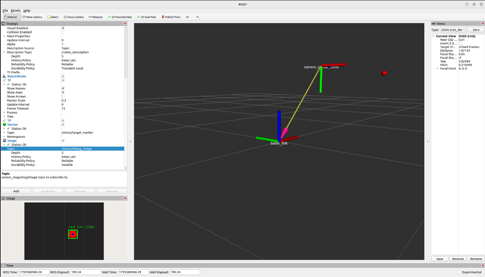

RViz 里同时能看到：

- base_link 坐标轴；
- camera_optical_frame 坐标轴；
- base_link 下的红色目标球；
- debug 图像里的绿色检测框。

#### 4. 今天踩的坑

| 现象 | 原因 | 解决 |
| --- | --- | --- |
| `image_raw` 只有约 1 Hz | 640×480 大消息在 VM/DDS 背压 | 降到 320×240 |
| `ObjectHypothesis` 没有 `id` | Humble 字段名是 `class_id` | 改字段 |
| rqt 下拉框为空 | 话题列表没有自动刷新 | 命令行直接指定话题 |
| 深度图看起来不正常 | `32FC1` 不是 8 位灰度图 | 看数值或用 RViz/色图 |
| 没有 TF | 检测点无法转到 base_link | 发布静态 TF |
| 相机内参字段很多 | 除了 K 还有 D/R/P/ROI/binning | 按 CameraInfo 完整理解 |

#### 5. 小感慨：找到适合自己的学习方式

这次还有一个很个人的收获：

> 找到适合自己的学习方式，感觉真是太棒了。视觉型学习者需要看到图片才能更好理解，所以我把这一点写进 memory，让后续任务尽量用 GUI、图像和 RViz 来验证，而不是只看命令行数字。

这次先看到虚拟相机拍出的图，再看到绿色检测框，最后看到 RViz 里的 3D 目标，整条链路就变得很直观。

#### 今日结果

```text
虚拟相机 10 Hz
检测框稳定框住红色目标
深度反投影 z ≈ 1.0 m
TF 转换到 base_link
RViz marker 与 debug 图像同步
```

详细代码、复现步骤和踩坑记录见：

**[project14_ros2_perception/README.md](project14_ros2_perception/README.md)**

---

### 2026.11.03 ｜ 第 14 天 · ROS2 周 Day 6：感知 → MoveIt2 闭环

第 13 天已经能输出：

```text
/vision/target_pose
```

今天把这个目标真正交给 MoveIt2：

```text
虚拟 RGB-D 相机
        ↓
detector_node
        ↓
/vision/target_pose（base_link）
        ↓
task_node
        ↓
/move_action（MoveGroup action）
        ↓
move_group 规划
        ↓
Panda fake controller
        ↓
RViz 中执行到目标
```

#### 闭环结果

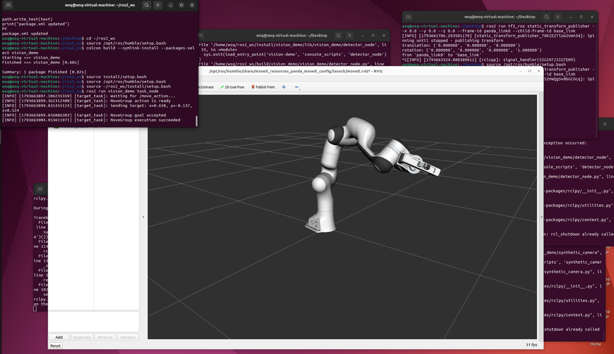

目标约为：

```text
x ≈ 0.650 m
y ≈ -0.137 m
z ≈ 0.525 m
```

`task_node` 日志：

```text
Sending target: x=0.650, y=-0.137, z=0.525
MoveGroup goal accepted
MoveGroup execution succeeded
```

这说明：

```text
视觉检测 → target_pose
→ MoveGroup action
→ 规划
→ Panda 执行
```

的软件闭环已经通了。

#### 关键实现

`task_node` 做三件事：

1. 订阅 `/vision/target_pose`；
2. 构造 `moveit_msgs/action/MoveGroup` 的位置约束；
3. 发送到 `/move_action`，等待执行结果。

关键参数：

```text
group_name: panda_arm
link_name: panda_link8
position tolerance: 0.03 m
planning attempts: 10
allowed planning time: 5 s
```

位置约束的 frame 使用 `panda_link0`，通过：

```text
panda_link0 → base_link（identity）
```

和感知的 `base_link` 对齐。

#### 今天踩的坑

1. **目标 x=1.3，Panda 不可达**
   因为相机深度图像素值还硬编码为 1.0。
   改成 `cv2.circle(depth, ..., z, -1)` 后，目标变成 x≈0.65。

2. **相机安装位置和目标深度要匹配工作空间**
   从原来的：

   ```text
   相机 x=0.5，目标深度=1.0
   ```

   调整为：

   ```text
   相机 x=0.3，目标深度=0.35
   ```

   目标才进入 Panda 约 0.85 m 的可达范围。

3. **TF 启动顺序**
   detector 比 static TF 先启动时会刷：

   ```text
   base_link does not exist
   camera_optical_frame does not exist
   ```

   先启动 TF，再启动 detector 即可。

4. **`moveit_commander` 缺失**
   没有强行安装，而是直接使用：

   ```text
   /move_action
   moveit_msgs/action/MoveGroup
   ```

   这也更接近底层接口。

5. **位置约束不等于姿态约束**
   今天只约束末端位置，没有约束末端姿态；MoveIt 可以自由选择可行的末端方向。

#### launch 和 rosbag

今天把感知、TF、任务节点收进一个 launch：

```bash
ros2 launch vision_demo perception_task.launch.py
```

MoveIt2 demo 需要提前启动。

launch 会自动打开一个 `vision_view` RViz，里面预先配置好：

```text
Image: /vision/debug_image
Marker: /vision/target_marker
TF
Grid
```

另一个 MoveIt RViz 显示 Panda 和规划；两个窗口并排，就能同时看到“照片里的目标”和“机械臂朝它移动”。

rosbag 录制：

```bash
ros2 bag record -o ~/bags/closed_loop /camera/image_raw /camera/depth/image_raw /vision/detections /vision/target_pose /tf /tf_static /joint_states
```

实测结果：

```text
launch：一次启动 5 个进程
MoveGroup：goal accepted → execution succeeded
rosbag：289.7 MiB，253.84 s，32027 条消息
```

rosbag 包含：

```text
/camera/image_raw       528
/camera/depth/image_raw 528
/vision/detections      525
/vision/target_pose     525
/joint_states           25366
/tf                     4552
/tf_static              3
```

#### 和真机、VLA 的关系

今天的闭环抽象是：

```text
感知：目标位置
        ↓
任务层：MoveGroup goal
        ↓
MoveIt2：规划
        ↓
控制器 / 真机：执行
```

以后换真机时，视觉、TF、MoveGroup goal 都保留，只替换 fake controller 和硬件接口。

VLA 的高层目标也可以复用这条链路：

```text
VLA 输出目标 → MoveGroup 规划 → 控制器 → 真机
```

详细代码、launch、rosbag 命令和踩坑记录见：

**[project15_ros2_closed_loop/README.md](project15_ros2_closed_loop/README.md)**

---

### 2026.11.04 ｜ 第 15 天 · ROS2 周 Day 7：VLA / 真机桥接骨架

前 14 天主要在做仿真闭环：

```text
TF → Gazebo → ros2_control → MoveIt2 → 感知 → 规划 → 执行
```

今天补的是“策略到执行器”的中间层：

```text
Mock Policy
    ↓ /policy/action_raw
Safety Filter
    ↓ /policy/action_safe
Safe Executor
    ↓ /task/execute_trajectory
Mock Trajectory Server
```

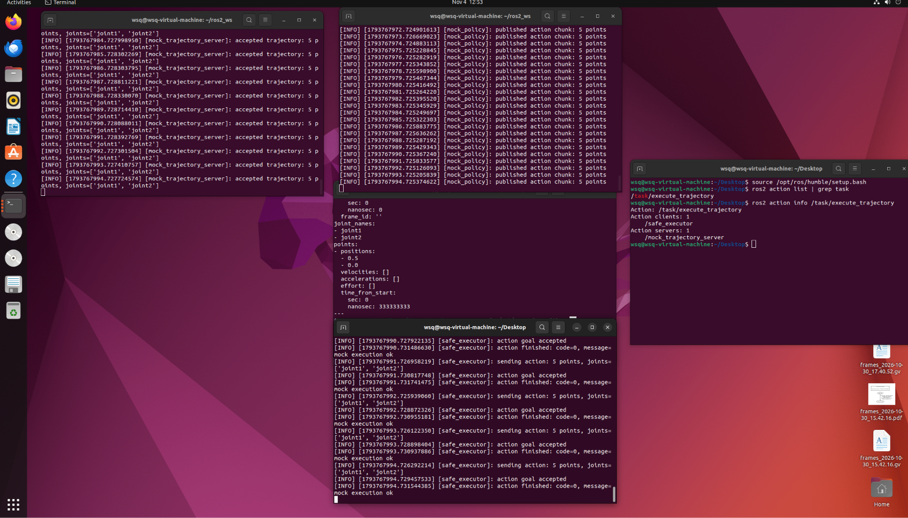

#### 神经系统的类比

Day 13/14 更像“感知 → 中枢”：

```text
相机 → 检测 → target_pose → MoveIt2 规划
```

Day 15 更像“中枢 → 外周”的下行通路：

```text
策略动作 → 安全层 → 动作接口 → 执行器
```

安全层可以类比为脊髓反射或保护性抑制：

```text
越界动作 → 限位
过快动作 → 时间缩放
超时无新动作 → watchdog
```

但这**还不是完整的神经闭环**，因为：

```text
policy 是 mock，不读图像
executor 后面是 mock action server
没有真实关节执行
没有执行后的反馈回到策略
```

完整闭环应该是：

```text
感知 → 策略 → 安全 → 执行 → 传感器反馈 → 策略
```

今天完成的是其中“中枢到外周”的软件命令链。

#### 安全层做了什么

1. 关节名校验；
2. position 数量校验；
3. 关节位置 clamp：

   ```text
   [5.0, -8.0] → [2.967, -2.0]
   ```

4. 速度限制：

   ```text
   v = Δposition / Δt
   ```

   超速时整体缩放 `time_from_start`：

   ```text
   0.5 rad / 0.1 s = 5 rad/s
   → time scaled x3.33
   ```

5. watchdog：

   ```text
   watchdog: no new action
   watchdog reset
   ```

#### 动作接口

`/task/execute_trajectory` 使用标准：

```text
control_msgs/action/FollowJointTrajectory
```

`ros2 action info`：

```text
Action clients: /safe_executor
Action servers: /mock_trajectory_server
```

`mock_trajectory_server` 接受 5 点轨迹并返回：

```text
action finished: code=0, message=mock execution ok
```

#### 重要环境规则：source

每个新终端：

```bash
source /opt/ros/humble/setup.bash
```

```bash
source ~/ros2_ws/install/setup.bash
```

每次重新编译后：

```bash
source ~/ros2_ws/install/setup.bash
```

规则：

```text
source 只更新当前终端
不会重启已运行节点
新终端必须 source
重新编译后要重新 source
改了代码的节点必须重启
```

#### 今天完成了吗

核心学习内容完成了：

```text
mock policy
+ safety filter
+ 速度/位置限制
+ action 接口
+ mock 执行链
```

但还不能称为完整 VLA 或真机闭环：

```text
没有真实 VLA 模型
没有真实控制器
没有真实执行反馈
```

所以更准确的名字是：

```text
VLA / 真机桥接骨架
```

详细代码、测试命令、日志和限制见：

**[project16_ros2_vla_bridge/README.md](project16_ros2_vla_bridge/README.md)**

---

### 2026.11.05 ｜ 第 16 天 · ROS2 周 Day 8：mock 执行器 → 真控制器

第 15 天的最后一段是假的：

```text
policy → safety → safe_executor → mock_trajectory_server
```

`mock_trajectory_server` 收到轨迹后只打印日志并返回成功，关节不动。

今天把最后一段替换成 Gazebo 里真正的 ros2_control 控制器：

```text
policy → safety → safe_executor
→ joint_trajectory_controller
→ ros2_control
→ Gazebo 关节
→ /joint_states
→ TF / RViz
```

#### mock 和真控制器的区别

| 对比项 | mock server | 真控制器 |
| --- | --- | --- |
| 接收轨迹 | ✅ | ✅ |
| 驱动关节 | ❌ | ✅ |
| 返回成功 | 立刻假成功 | 执行后返回 |
| 关节状态变化 | ❌ | ✅ |
| 上真机复用 | ❌ | ✅ 换硬件插件即可 |

所以今天换的是：

```text
Gazebo 里的真控制器
不是物理机械臂
```

#### 今天新增的工程内容

```text
safe_executor 的 action_name 可配置
默认连接 /joint_trajectory_controller/follow_joint_trajectory
mock_policy 改为 1 秒动作块 + 1.2 秒发送周期
新增 real_controller_demo.launch.py
新增默认 RViz 配置（RobotModel + TF + Grid）
保留 mock_trajectory_server 作为对照
```

#### 验证目标

```text
joint_state_broadcaster active
joint_trajectory_controller active
safe_executor 成为 action client
Gazebo 中 simple_arm 真实运动
/joint_states 的 joint1 / joint2 变化
RViz 与 Gazebo 同步
```

#### 实测结果

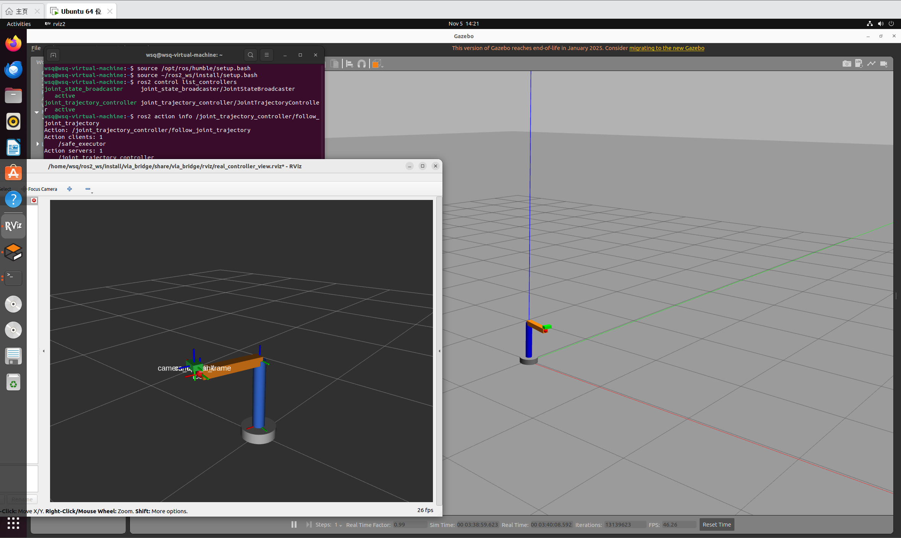

两个控制器均为 active：

```text
joint_state_broadcaster     joint_state_broadcaster/JointStateBroadcaster          active
joint_trajectory_controller joint_trajectory_controller/JointTrajectoryController  active
```

`safe_executor` 已经连到控制器：

```text
Action clients: 1
    /safe_executor
Action servers: 1
    /joint_trajectory_controller
```

控制器实际执行了轨迹：

```text
Received new action goal
Accepted new action goal
Goal reached, success!
action finished: code=0, message=Goal successfully reached!
```

安全层输出：

```text
data: 'ok: 5 points'
```

Gazebo 与 RViz 中的手臂同步摆动，说明：

```text
policy → safety → safe_executor
→ joint_trajectory_controller
→ ros2_control
→ Gazebo 关节
→ /joint_states
→ TF / RViz
```

这条执行链已经从“假成功”变成了真实驱动。

详细命令、代码结构和排错步骤见：

**[project16_ros2_vla_bridge/README.md](project16_ros2_vla_bridge/README.md)**

今天的逐段代码解析、以及与第 15 天的逐项对比见：

**[project16_ros2_vla_bridge/CODE_WALKTHROUGH.md](project16_ros2_vla_bridge/CODE_WALKTHROUGH.md)**

---

### 2026.11.06 ｜ 第 17 天 · ROS2 周 Day 9：真机接口盘点

今天没有继续加功能，而是先回答一个更基础的问题：

```text
这条仿真执行链里，哪些能直接搬到真机？
哪些必须替换？
```

#### 当前节点

```text
/controller_manager
/gazebo
/gazebo_ros2_control
/joint_state_broadcaster
/joint_trajectory_controller
/mock_policy
/robot_state_publisher
/rviz
/safe_executor
/safety_filter
```

#### 当前执行 action

```text
/joint_trajectory_controller/follow_joint_trajectory
control_msgs/action/FollowJointTrajectory
```

#### 当前硬件接口

```text
command interfaces
    joint1/position [available] [claimed]
    joint2/position [available] [claimed]

state interfaces
    joint1/position
    joint1/velocity
    joint2/position
    joint2/velocity
```

`claimed` 表示 command interface 已经被 `joint_trajectory_controller` 占用。

#### 仿真专用 vs 真机可复用

| 接口 | 仿真专用？ | 真机处理 |
| --- | --- | --- |
| `/gazebo` | ✅ | 移除 |
| `/gazebo_ros2_control` | ✅ | 换厂商硬件插件 |
| `GazeboSystem` | ✅ | 换真机硬件接口 |
| `/clock` | ✅ | 关闭 `use_sim_time` |
| `spawn_entity.py` | ✅ | 真机不需要 |
| `controller_manager` | ❌ | 保留 |
| `joint_state_broadcaster` | ❌ | 保留 |
| `joint_trajectory_controller` | ❌ | 保留 |
| `FollowJointTrajectory` action | ❌ | 保留 |
| `/joint_states` | ❌ | 由真机编码器提供 |
| URDF / TF / RSP | ❌ | 换成真机模型 |
| `/policy/*`、安全层、执行器 | ❌ | 保留并重调参数 |

#### 三个真机风险

```text
1. 状态会过期：
   broadcaster 停止后，safety_filter 仍可能拿旧位置做判断。

2. 时间会失真：
   真机没有 /clock，use_sim_time=true 会让时钟、watchdog、TF 异常。

3. 动作会抢占：
   执行中直接切换新轨迹会造成速度突变和碰撞风险。
```

下一步要改执行层：

```text
动作队列
状态超时
watchdog 保持位置
```

一周路线、完整接口输出和找老师的问题清单见：

**[project16_ros2_vla_bridge/REAL_ROBOT_ROADMAP.md](project16_ros2_vla_bridge/REAL_ROBOT_ROADMAP.md)**

---

### 2026.11.07 ｜ 第 18 天 · ROS2 周 Day 10：动作队列

原来的 `safe_executor` 有一个问题：

```text
正在执行轨迹时
新动作到来
busy=True → 直接丢弃
```

第 15 天的 mock 链路里问题不明显；接上真控制器后，如果策略发得比执行快，就会丢动作，可能造成运动不连续。

今天的改动：

```text
当前执行的块：不打断
未执行的块：放进 pending 队列
队列满：丢掉最旧的未执行块
当前块执行完：从队列取下一块
记录 queued / executed / dropped
```

> 下面是 Day 18 初版的 pending-only 代码；第 19 天已改成
> `max_in_flight`（active + pending），当前代码见 Day 19 小节和项目 README 14.10。

关键代码：

```python
from collections import deque

self.declare_parameter("max_queue_size", 2)
self.max_queue_size = max(
    1,
    int(self.get_parameter("max_queue_size").value),
)

self.pending = deque()
self.busy = False
```

队列满时：

```python
if len(self.pending) >= self.max_queue_size:
    dropped = self.pending.popleft()
    self.dropped_count += 1
    self.get_logger().warn(
        f"queue full, dropped oldest pending action "
        f"({len(dropped.points)} points)"
    )
```

取下一个执行：

```python
def start_next(self):
    if self.busy or not self.pending:
        return

    msg = self.pending.popleft()
    self.busy = True
    goal = FollowJointTrajectory.Goal()
    goal.trajectory = msg
```

今天先做“顺序拼接”语义：

```text
chunk 1 → chunk 2 → chunk 3
队列满丢最旧未执行块
不取消正在执行的块
```

如果以后策略每次输出“完整重规划”，旧 pending 已经过时，可以改成：

```text
清空 pending，只执行最新计划
```

这两者不能混用，否则容易造成动作跳变。

#### 实测日志

```text
[safe_executor] queued action: 5 points, pending=2, busy=True
[safe_executor] queue full, dropped oldest pending action (5 points)
[safe_executor] queued action: 5 points, pending=2, busy=True

[joint_trajectory_controller] Goal reached, success!
[safe_executor] action finished: code=0, message=Goal successfully reached!

[safe_executor] stats: queued=741, executed=724, dropped=14
```

统计关系：

```text
queued = executed + dropped + in_flight
741 = 724 + 14 + 3
```

其中 3 条是日志打印时仍在途的动作：

```text
1 条正在执行
2 条在 pending 队列
```

这证明了：

```text
队列确实在串行执行
队列满时确实丢最旧未执行块
控制器确实执行完成
```

但也暴露了真机问题：

```text
队列深度 2 + 当前执行 1 条
→ 最坏可能带来约 2～3 秒延迟
```

仿真里只是“卡一下”，真机上可能是对移动目标反应变慢、避障不及时。  
Day 19 已完成动作时间戳/年龄检查和 A/B 队列深度对比。

#### 术语澄清：pending 不包含 active

```text
pending = 还没开始执行的动作块
active  = 当前正在执行的那一条
Day 18 初版的 max_queue_size 只限制 pending
第 19 天已改为 max_in_flight = active + pending
```

所以“完整重规划时清空 pending”不等于取消正在执行的轨迹。  
如果连 active 也要放弃，必须单独做受控停止或取消当前 goal。

Day 18 初版 `max_queue_size=2` 只限制 pending，所以总在途可以是：

```text
1 条 active + 2 条 pending = 3 条
```

另一种定义是：

```text
active + pending 最多 2 条
```

两种定义会改变延迟和测试结果。这个问题先记录，代码暂不改，详见项目 README 第 14.10 节。

#### 隔离测试

之前的压力测试同时有 `mock_policy` 和测试 publisher，结果不干净。  
现在可以关闭 `mock_policy`：

```bash
ros2 launch vla_bridge real_controller_demo.launch.py start_mock_policy:=false
```

另开终端只运行一个测试源：

```bash
ros2 run vla_bridge queue_probe
```

它会连续发送不同目标的短轨迹，用来单独验证队列的 `queued / dropped / executed`。

#### 隔离测试发现：时间戳被队列延迟“吃掉”

实测结果：

```text
queued=8, executed=8, dropped=0
```

没有丢动作，但每条动作实际执行时间明显短于设定的 0.6 秒：

| 动作 | 排队延迟 | 实际执行 | 总和 |
| --- | ---: | ---: | ---: |
| #2 | 0.451 s | 0.155 s | 0.606 s |
| #3 | 0.455 s | 0.153 s | 0.608 s |
| #4 | 0.358 s | 0.252 s | 0.610 s |

原因是轨迹头部的 `header.stamp` 是发布时的时间，排队越久，
控制器认为轨迹已经过去的时间越多，只剩更短的时间执行剩余部分。

这比“丢动作”更隐蔽：

```text
路径没变
但执行时间被压缩
实际速度可能高于规划值
```

所以下一步不是继续调队列，而是做动作时间对齐：

```text
age = now - header.stamp
age 太大 → 丢弃过期动作
发送前重新对齐 header.stamp 与 time_from_start
```

详细分析见项目 README 第 14.11 节。

完整代码、设计取舍和测试见：

**[project16_ros2_vla_bridge/README.md](project16_ros2_vla_bridge/README.md) 第 14–22 节**

> 第 18 天分两天完成：Day 18 完成队列代码、隔离测试和时间压缩定位；Day 19 完成容量语义对比和动作时间对齐；Day 20 完成状态超时、watchdog 取消与恢复。

---

### 2026.11.08 ｜ 第 19 天 · ROS2 周 Day 11：队列容量与动作时间对齐

今天先把两个规则定清楚，并把 `safe_executor` 改成可配置的总在途限制。

#### 两种队列容量

```text
A. pending-only：
   1 条 active + 2 条 pending = 总在途 3 条

B. total in-flight：
   1 条 active + 1 条 pending = 总在途 2 条
```

| 对比项 | A：pending-only | B：total in-flight |
| --- | --- | --- |
| 优点 | 丢动作少、计划连续 | 延迟短、动作新鲜 |
| 缺点 | 延迟长、动作更旧 | 压力下丢动作更多 |
| 适合 | 静态目标 | 真机、动态目标 |

8 条动作、0.25 秒到达、每条 0.6 秒时：

| 容量定义 | 执行 | 丢弃 |
| --- | --- | --- |
| A：pending 最多 2 | 1, 2, 4, 7, 8 | 3, 5, 6 |
| B：总在途最多 2 | 1, 3, 5, 8 | 2, 4, 6, 7 |

真机推荐 B，不是因为它丢得少，而是因为：

```text
丢一个旧动作
比执行一个过期动作更安全
```

A 丢得少，但可能把旧计划执行到更晚；B 丢得多，但丢掉的是尚未执行的旧计划。

#### 当前实现

```text
safe_executor 参数：max_in_flight
默认 2 = B
设为 3 = 近似 A
```

launch 参数：

```text
max_in_flight:=2
max_in_flight:=3
```

#### 动作过期怎么处理

题目：

```text
动作总时长 0.6 秒
队列里等了 0.5 秒
只剩 0.1 秒
执行剩下的 0.1 秒，还是丢弃？
```

答案：

```text
默认丢弃
```

因为原样执行剩下的 0.1 秒意味着：

```text
路径被压缩到 1/6 时间
实际速度可能变成原计划的 6 倍
```

只有满足这些条件时，才可以重新对齐后执行：

```text
目标是静态的
路径仍然有效
当前状态与轨迹起点接近
重新计时后速度不超限
```

不能把旧轨迹原样压缩执行。

#### 为什么控制器会自动压缩

`header.stamp` 是轨迹的绝对起点，`time_from_start` 是每个点相对起点的偏移：

```text
header.stamp = 0.0
point.time_from_start = 0.6
→ 控制器认为 0.6 秒后到达目标
```

如果动作排队 0.45 秒才发出，控制器看到：

```text
当前时间已经是 0.45
只剩 0.15 秒
```

它不是暂停计时，而是按时间表执行剩余部分，所以轨迹被压缩。

#### 时间对齐已实现

`safe_executor` 出队时：

```text
age = now - header.stamp
age >= 轨迹总时长 → 丢弃
age > max_action_age → 丢弃
否则 → header.stamp = now，再发送
```

新增参数：

```text
max_action_age = 0.5 秒
```

修复前 B 实测：

```text
queued=8, executed=5, dropped=3
```

执行 5 条不是容量失效，而是控制器把旧时间戳当成起点，动作被压缩执行，队列更快排空。

修复后：

```text
time aligned: age=0.200s, duration=0.600s
time aligned: age=0.100s, duration=0.600s

queued=8, executed=4, dropped=4
```

实际执行时间：

```text
#1: 0.606 s
#3: 0.560 s
#6: 0.557 s
#8: 0.560 s
```

动作恢复到接近完整的 0.6 秒，B 的 4 执行 / 4 丢弃才真正体现出来。

为了比较 A/B，日志现在分开统计：

```text
capacity_dropped = 容量满导致
age_dropped      = 动作太旧导致
dropped          = 两者之和
```

关系：

```text
queued = executed + dropped + in_flight
dropped = capacity_dropped + age_dropped
```

这样不会把“丢包”和“过期”混在一起。

#### A/B 实测对比

相同条件：

```text
max_action_age=0.5
queue_probe 发 8 条
每条 duration=0.6
```

| 指标 | B：max_in_flight=2 | A：max_in_flight=3 |
| --- | ---: | ---: |
| queued | 8 | 8 |
| executed | 4 | 4 |
| capacity_dropped | 4 | 3 |
| age_dropped | 0 | 1 |
| dropped 总数 | 4 | 4 |
| 观测 age | 0～0.1 s | 0.3～0.7 s |

A 最后一次 stats 显示 `dropped=3`，但紧接着有：

```text
expired action: age=0.700s, duration=0.600s, drop
```

所以最终 A 是：

```text
executed=4
dropped=4 = 3 capacity + 1 age
```

结论：

```text
A 多存的一条没有多执行
它等到 age=0.7s > duration=0.6s，被过期规则丢掉
A 只是把一次容量丢包换成了过期丢包
同时动作整体更旧
```

当前 `max_action_age=0.5` 下，B 更好：

```text
执行数量一样
动作更新鲜
延迟更低
```

放宽 `max_action_age` 后 A 可能多执行，但会更旧，这是“新鲜度 vs 连续性”的取舍。

#### 术语：动作年龄

```text
age = now - header.stamp
```

它不是“执行了多久”，而是：

```text
动作从生成出来，到现在已经等了多久
```

包括队列等待、传输延迟和回调调度。

区分：

```text
duration：轨迹设计走多久
age：动作已经等了多久
```

如果：

```text
duration = 0.6 秒
age      = 0.7 秒
```

说明还没开始执行就已经过期。

本次 A/B 对比：

```text
B 的 age：0.0～0.1 秒
A 的 age：0.3～0.7 秒
A 最后一条 age=0.7s > duration=0.6s，被丢弃
```

动作年龄衡量的是**新鲜度**，不是执行时间。

#### 状态超时

`joint_state_broadcaster` 停止后，`/joint_states` 不再更新；如果安全层继续用最后一次关节位置，就会拿旧状态做判断。

`safety_filter` 新增：

```text
state_timeout = 0.5 秒
```

规则：

```text
/joint_states 超时 → 状态无效 → 拒绝新动作
```

此时 `/policy/safety_status` 会发布：

```text
drop: stale state
```

正常恢复后打印：

```text
joint state restored
```

launch 参数：

```text
state_timeout:=0.5
```

#### Watchdog 与故障取消

之前 watchdog 只报警：

```text
watchdog: no new action
```

现在 `safe_executor` 订阅 `/policy/safety_status`，收到故障后：

```text
清空 pending
取消正在执行的 active goal
阻止新的动作进入
```

三种机制不同：

| 机制 | 触发条件 | 日志 | 结果 |
| --- | --- | --- | --- |
| 动作危险 | 位置越界、速度超限 | `clamped` / `time scaled` | 修改或丢弃动作 |
| 状态超时 | `/joint_states` 不更新 | `drop: stale state` | 拒绝动作、取消当前轨迹 |
| 策略断流 | 2 秒没有新动作 | `watchdog: no new action` | 取消当前轨迹 |

测试 1 是第三种：动作本身不危险，状态也正常，只是策略 2 秒没有继续发动作。

测试状态超时时要隔离变量，否则默认 2 秒 watchdog 会先取消 5 秒轨迹：

```text
watchdog_timeout:=30.0
state_timeout:=0.5
```

这样只有 `/joint_states` 断流会触发安全停止。

实测状态断流：

```text
SAFETY STOP: state stale, clear pending
cancel active trajectory
Canceling active action goal
action canceled by safety stop
stats: canceled=1
```

说明状态超时确实取消了正在执行的慢速长轨迹。自动化脚本已改成 20 秒单轨迹 + 单条恢复动作，不再混入上一关的 queue_probe 压力测试。

恢复后：

```text
joint state restored
safety recovered, accepting actions again
```

恢复动作能重新执行，恢复链路验证通过。  
注意：隔离测试只发一条短恢复轨迹，不再用 `queue_probe`；`queue_probe` 属于队列压力测试，不能拿来验证状态恢复。

启动阶段新增 `startup_grace=2.0s`，避免安全层比 `/joint_states` 先启动时误报 stale。

如果 watchdog 已触发，只有 `state: ok` 还不够，因为策略可能仍在断流。  
现在只要状态正常、新的动作到达，`safe_executor` 就把这视为策略恢复并解除阻塞，避免恢复动作被时序问题误丢。

故障状态：

```text
watchdog: no new action
drop: stale state
```

恢复状态：

```text
watchdog reset
state: ok
```

只有状态和策略都恢复后，才重新接受动作。

关键动作：

```python
def enter_safety_stop(self, reason):
    self.safety_blocked = True
    self.pending.clear()
    self.cancel_active()
```

```python
def cancel_active(self):
    if self.active_goal_handle is None:
        return
    self.cancel_requested = True
    self.active_goal_handle.cancel_goal_async()
```

策略断流实测：

```text
[watchdog] watchdog: no new action
[safe_executor] SAFETY STOP: policy watchdog, clear pending
[safe_executor] cancel active trajectory
[joint_trajectory_controller] Got request to cancel goal
[joint_trajectory_controller] Canceling active action goal
```

控制器取消成功也会返回：

```text
action finished: code=0, message=
```

所以统计区分：

```text
executed = 正常完成
canceled = 被安全取消
failed   = 失败
```

#### 今天的三句话

```text
队列容量要明确是否包含 active
动作年龄比动作数量更危险
过期动作默认丢弃，重新对齐是例外
```

完整时间线和解答见：

**[project16_ros2_vla_bridge/QUEUE_DAY19.md](project16_ros2_vla_bridge/QUEUE_DAY19.md)**

---

### 2026.11.09 ｜ 第 20 天 · ROS2 周 Day 12：状态超时、watchdog 取消与恢复

队列部分结束后，今天只验证一件事：

```text
状态断流时，安全层能不能中断当前动作
状态恢复后，能不能重新接受动作
```

这一天刻意不碰队列压力测试。

#### 先隔离变量

如果保持默认 `watchdog_timeout=2.0`，20 秒慢轨迹会在 2 秒后被策略 watchdog 取消，
看起来像“状态超时”，其实是另一个故障。所以测试启动参数固定为：

```text
start_mock_policy:=false
state_timeout:=0.5
watchdog_timeout:=60.0
max_in_flight:=2
max_action_age:=0.5
```

`watchdog_timeout` 拉长到 60 秒，保证只有 `/joint_states` 断流会触发安全停止。

#### 测试脚本只保留一个故障

脚本：

```text
project16_ros2_vla_bridge/scripts/test_state_timeout.sh
```

顺序：

```text
1. 发一条 20 秒慢速轨迹
2. 等 5 秒
3. 停 joint_state_broadcaster
4. 等 5 秒
5. 恢复 broadcaster
6. 等 3 秒
7. 发一条 2 秒短恢复轨迹
```

这里没有 `queue_probe`。`queue_probe` 是上一关的 8 条队列压力测试，
混进来会同时改变队列深度、动作年龄和故障时序，实验就不干净了。

脚本支持只打印命令、不动机器人：

```bash
DRY_RUN=1 bash ~/embodied-ai-learning/project16_ros2_vla_bridge/scripts/test_state_timeout.sh
```

`bash -n` 和 `DRY_RUN=1` 已通过；VM 里的正式实跑仍待执行。
此前用旧测试已经观察到取消和恢复日志，但旧脚本混入了 `queue_probe`，
所以重写后要重新跑一遍，才能把“状态超时”单独归因。

#### 已观察到的中断日志

```text
[safety_filter] joint state stale or missing
[safety_filter] drop: stale state
[safe_executor] SAFETY STOP: state stale, clear pending
[safe_executor] cancel active trajectory
[joint_trajectory_controller] Got request to cancel goal
[joint_trajectory_controller] Canceling active action goal
[safe_executor] action canceled by safety stop
[safe_executor] stats: ... canceled=1
```

恢复后：

```text
[safety_filter] joint state restored
[safety_filter] state: ok
[safe_executor] safety recovered, accepting actions again
```

链路是：

```text
状态断流 → 拒绝新动作 → 清空 pending → 取消 active → 状态恢复 → 解除阻塞
```

但“取消成功”不等于“受控停止”。

#### 我的预测和实际

| 我的预测 | 实际发生 | 原因 |
| --- | --- | --- |
| 安全策略会让机械臂缓慢停下，停到安全位置 | 视觉上一下子停住 | 代码调用 `cancel_goal_async()`，不是减速轨迹 |
| 运动会一直进行，直到我主动发停止命令 | 我还没操作，动作已经被取消 | 状态超时自动触发安全停止 |
| 恢复后的运动会很平缓 | 恢复后的运动仍然很剧烈 | 旧测试恢复后又跑了 `queue_probe`，不是缓启动 |
| 时间戳会自动计算运行时间 | `header.stamp` 是发布时刻，排队越久剩余时间越短 | 控制器把 stamp 当绝对起点 |

#### 为什么“移动到安全位置”不一定安全

状态超时的意思是：

```text
/joint_states 已经超过 0.5 秒没有更新
```

系统不知道机械臂现在在哪，也不知道当前速度。  
这时如果再“规划到安全位置”，等于：

```text
用过期状态当起点
重新规划一条新轨迹
```

起点错了，终点再安全也可能撞。

所以停止策略要按“状态是否可信”分开：

| 故障 | 状态可信 | 当前做法 | 更合理的真机策略 |
| --- | --- | --- | --- |
| 状态超时 | 否 | 取消 active，原地停 | 立即刹车/硬件急停，不盲目移动 |
| 策略 watchdog | 通常是 | 取消 active，原地停 | 可用最后可信状态做受控减速/保持 |
| 用户主动停止 | 通常是 | 取消 active | 受控减速到零 |
| 硬件急停 | 不一定 | 无 | 断使能/抱闸，软件不参与 |

当前代码只实现了“取消”，所以四种情况看起来都像急停。

#### 还没解决的问题

```text
状态超时时，能不能用最后一份可信状态做短时减速？
策略断流但状态正常时，能不能保持当前位置，而不是直接取消？
“安全位置”由谁定义：策略、操作员，还是预设的 home 位？
```

这些问题先不写代码，等隔离测试跑完再决定。

原始记录：

- [raw.md](learning_journal/2026-11-09-day20/raw.md)
- [reflection.md](learning_journal/2026-11-09-day20/reflection.md)

> 这一天的结论不是“安全层做好了”，而是：
> 现在的安全层会中断，但不会受控停止；
> 状态失效时，原地停比移动到所谓安全位置更可信。

---

### 2026.11.10 ｜ 第 21 天 · ROS2 周 Day 13：给安全停止做体检

今天不修改安全层，只测一件事：

```text
watchdog 取消动作时，速度是慢慢降到 0，还是直接掉到 0
```

#### 实验

脚本：

```text
project16_ros2_vla_bridge/scripts/stop_probe.py
```

它只发一条 5 秒慢轨迹，然后不再发新动作，让默认 2 秒 watchdog 取消。
不使用 `queue_probe`。

启动参数：

```text
start_mock_policy:=false
state_timeout:=0.5
watchdog_timeout:=2.0
```

脚本记录 `/joint_states`，输出 CSV 和 SVG 到：

```text
project16_ros2_vla_bridge/output/
```

#### 第一次图是错的

第一版直接画 `/joint_states.velocity`，结果速度线全程几乎不变。

用户看到图后的第一反应：

```text
这速度全程没变
```

检查后发现：

```text
joint1 原始 velocity：全程 0.0000 rad/s
joint1 位置：0 → 0.16 rad，确实在动
```

这个字段不能直接用来判断停止。

#### 改用位置差分

第二版用前后位置差分计算速度：

```text
v ≈ (q[i+3] - q[i-3]) / (t[i+3] - t[i-3])
```

实测结果：

```text
samples      : 952
stop time    : 3.759 s
stop reason  : watchdog: no new action

joint1: +0.0693 rad/s → -0.0000 rad/s
joint2: -0.0772 rad/s → +0.0000 rad/s
```

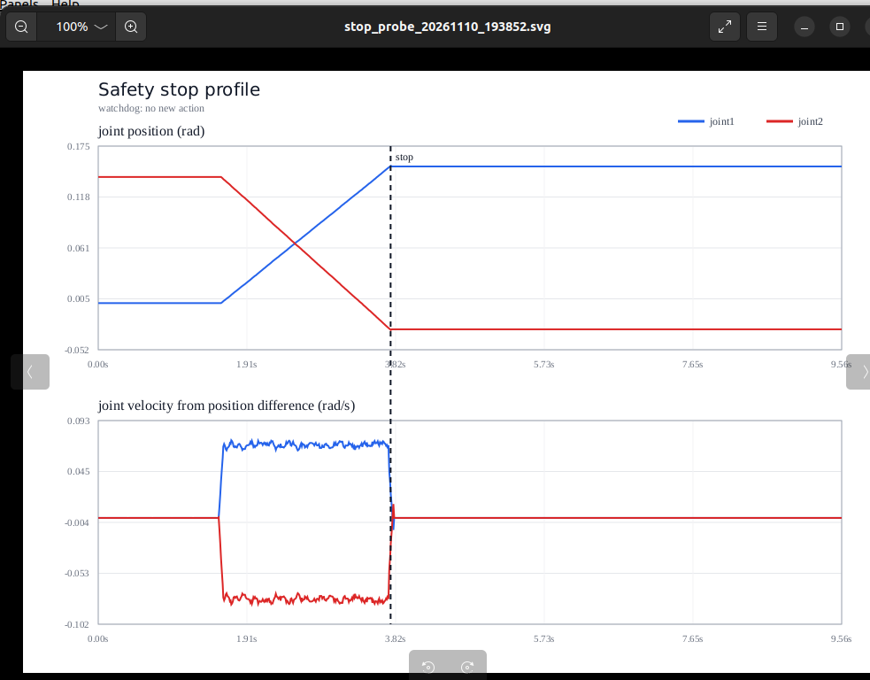

位置曲线在 stop 处是硬拐角。整张图横轴约 9.5 秒，所以 50 ms 的过渡在图上看起来接近垂直。

952 个样本、约 9.5 秒，采样率约 100 Hz，即 10 ms 一个点。  
第一次按“一个采样周期掉到 0”估算：

```text
0.0693 / 0.01 ≈ 6.9 rad/s²
```

但这个估算假设过渡只占一帧。后续用 `analyze_stop.py` 分析完整 CSV，得到：

```text
transition  : 52.5 ms
deceleration: 1.51 rad/s²
stop distance: 0.0007 rad
```

所以 `6.9 rad/s²` 是上界，不是实测值。实测停止约比 `0.5 rad/s²` 的舒适减速激进 3 倍，但不是无限大减速度。

#### 今天学到的

```text
1. cancel_goal_async() 是急停，不是受控减速
2. /joint_states.velocity 不能默认相信，至少要和位置交叉验证
3. 位置差分会引入噪声，但能看出停止处的速度台阶
```

#### 下一步

先不做受控停止，先回答一个设计问题：

```text
真机急停时，应该相信哪个状态源？
编码器位置差分、驱动器速度，还是控制器反馈？
```

如果连速度都不能信，就不能安全地做“按固定减速度停车”。

原始记录：

- [raw.md](learning_journal/2026-11-10-day21/raw.md)
- [reflection.md](learning_journal/2026-11-10-day21/reflection.md)

> 这张图的价值不是“图画得好看”，而是它把“急停”从一个感觉变成了曲线和数字：
> 位置出现硬拐角，速度在约 52.5 ms 内掉到 0。

---

### 2026.11.11 ｜ 第 22 天 · ROS2 周 Day 14：把急停变成数字

昨天看到一条近似垂直的速度线。今天不猜，直接分析 CSV。

#### 先预测

用户猜：

```text
A. 10 ms 左右
```

实际不是。

#### 分析脚本

```text
project16_ros2_vla_bridge/scripts/analyze_stop.py
```

它自动找最新的 `stop_probe_*.csv`，计算：

```text
停止过渡时间
减速度
停止距离
不同减速度下的理想停止时间和距离
```

#### 实测结果

```text
samples        : 952
stop time      : 3.742 s
v before       : 0.0794 rad/s
transition     : 52.5 ms
deceleration   : 1.51 rad/s²
stop distance  : joint1=0.00070 rad, joint2=0.00075 rad
```

| 项目 | 数值 |
| --- | ---: |
| 停止前速度 | 0.0794 rad/s |
| 过渡时间 | 52.5 ms |
| 减速度 | 1.51 rad/s² |
| 停止距离 | 约 0.0007 rad |

和理想减速对比：

| 减速度 | 停止时间 | 停止距离 |
| ---: | ---: | ---: |
| 0.25 rad/s² | 317.5 ms | 0.0126 rad |
| 0.50 rad/s² | 158.8 ms | 0.0063 rad |
| 1.00 rad/s² | 79.4 ms | 0.00315 rad |
| 2.00 rad/s² | 39.7 ms | 0.00158 rad |
| 实测急停 | 52.5 ms | 0.0007 rad |

#### 为什么整张图看起来是垂直的

横轴约 9.5 秒：

```text
52.5 / 9500 ≈ 0.55%
```

50 ms 只占整张图不到 1% 的宽度，肉眼当然像一条竖线。  
放大到 ±0.35 秒后，才看到它是一小段斜坡。

#### 第一次图也是错的

第一次生成的图，下半部分“理想减速曲线”画反了：

```text
错误：从 0 往上升
正确：从 v0 往下降
```

用户要求先检查图对不对，才发现这个绘图方向错误。  
修正后才放进 README。

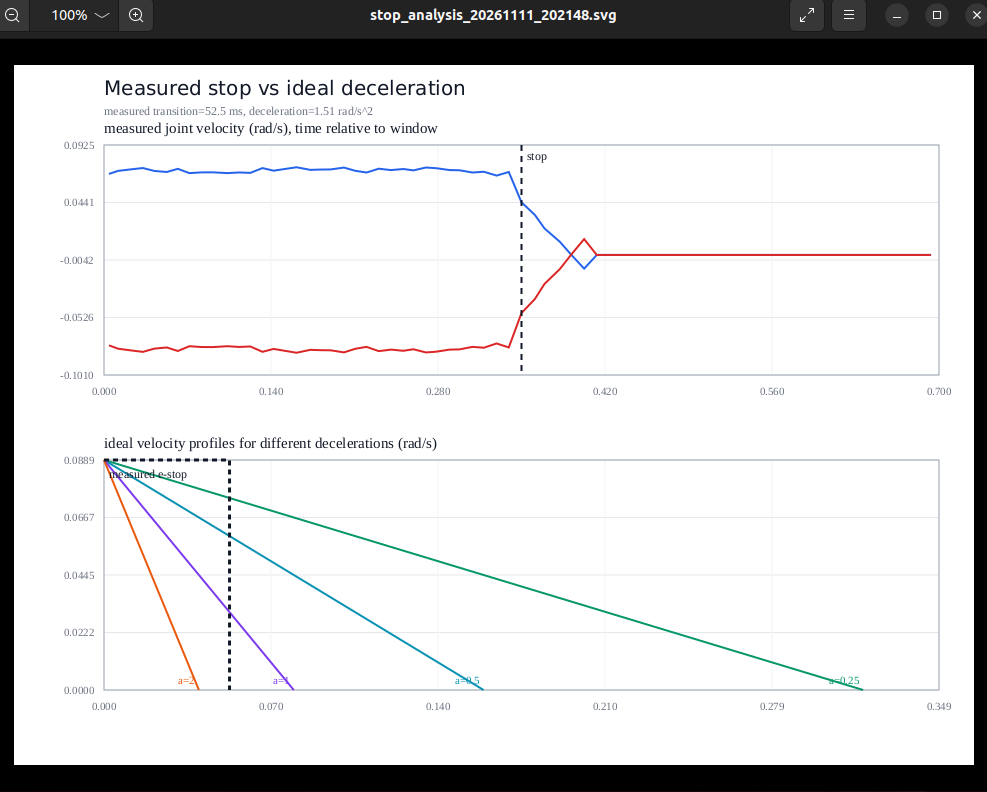

#### 今天学到的

```text
1. 图上的垂直不等于物理上的瞬间
2. 预测 10 ms，实测 52.5 ms，差了 5 倍
3. 当前停止减速度 1.51 rad/s²，约比 0.5 rad/s² 激进 3 倍
4. joint2 停止后速度穿过 0，有轻微回弹，位置幅度只有 0.0007 rad
5. 分析图本身也要验证方向、单位和坐标轴
```

#### 下一步

先不急着写受控停止。先回答：

```text
1. 真机目标减速度取多少？0.5 还是 1.0 rad/s²？
2. 速度更高时，cancel 的停止时间会怎么变？
3. 状态正常时做受控停止；状态失效时是否仍然立刻刹车？
```

原始记录：

- [raw.md](learning_journal/2026-11-11-day22/raw.md)
- [reflection.md](learning_journal/2026-11-11-day22/reflection.md)

---

### 2026.11.12 ｜ 第 23 天 · ROS2 周 Day 15：速度翻倍后，停止时间几乎不变

昨天的低速结果：

```text
v before   : 0.0794 rad/s
transition : 52.5 ms
deceleration: 1.51 rad/s²
```

今天把速度提高到约 3 倍，看停止时间会不会跟着变。

#### 预测

用户猜：

```text
B. transition 变成约 100–130 ms
```

实际是 A。

#### 高速实验

```text
目标位置：joint1=1.2, joint2=-0.8
轨迹时长：5 秒
watchdog：2 秒后取消
```

结果：

```text
v before       : 0.2448 rad/s
transition     : 51.7 ms
deceleration   : 4.74 rad/s²
stop distance  : joint1=0.00245 rad, joint2=0.00181 rad
```

对比：

| 实验 | 速度 before | transition | 减速度 | 停止距离 |
| --- | ---: | ---: | ---: | ---: |
| 低速 | 0.0794 rad/s | 52.5 ms | 1.51 rad/s² | 0.0007 rad |
| 高速 | 0.2448 rad/s | 51.7 ms | 4.74 rad/s² | 0.00245 rad |

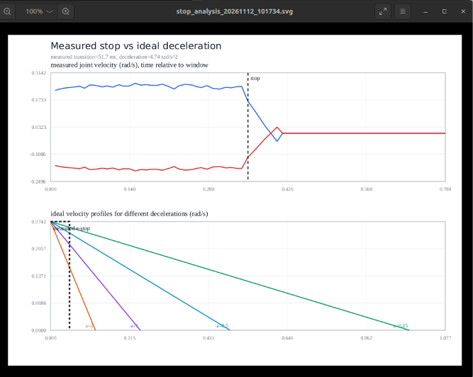

速度变成约 3.1 倍，过渡时间几乎不变，减速度也跟着变成约 3.1 倍。

#### 为什么图看起来一样

两次分析的图看起来都是同一条垂直断崖，因为：

```text
横向：transition 确实还是约 52 ms
纵向：坐标轴自动缩放到新的速度范围
```

所以形状相似，但数字完全不同：

```text
低速：1.51 rad/s²
高速：4.74 rad/s²
```

这正是“图看起来一样”的陷阱：自动缩放会把 3 倍的差异藏起来。

#### 这说明什么

先澄清一个容易误解的点：

```text
这 52 ms 不是 stop_probe 里写死的参数
也不是安全层显式设置的停止时间
```

`stop_probe` 只发一条 5 秒轨迹，然后停止发新动作；watchdog 触发后调用
`cancel_goal_async()`。52 ms 是控制器取消当前轨迹后的实际过渡行为。

更准确的说法是：

```text
在两个速度点上，观测到约 52 ms 的停止过渡
这更像固定时间停车，不是固定减速度
但两次测量只能说明趋势，不能证明控制器内部就是写死 52 ms
```

可能和控制器 100 Hz 更新、取消处理或插值方式有关，但还没有验证。

如果按这个趋势继续外推：

```text
v=0.49 rad/s -> a≈9.5 rad/s²
v=1.0 rad/s  -> a≈19 rad/s²
```

真机高速时，这种减速度很危险。

所以受控停止应该限制的是**最大减速度**，而不是固定停止时间。

#### 下一步

```text
1. 目标减速度取 0.5 还是 1.0 rad/s²？
2. 高速时用受控停止；状态失效时是否仍然立刻刹车？
3. 受控停止需要从当前速度生成减速轨迹，不能再只发一个目标点。
```

原始记录：

- [raw.md](learning_journal/2026-11-12-day23/raw.md)
- [reflection.md](learning_journal/2026-11-12-day23/reflection.md)

---

### 2026.11.12 ｜ 第 23 天 · 延伸：真机接口层第一步，去掉 Gazebo

安全层先收尾，开始做真机接口层。

#### 改了什么

```text
之前：policy → safety → executor → JTC → Gazebo
现在：policy → safety → executor → JTC → mock hardware
```

新增：

```text
arm_mock_description：mock hardware 的 URDF 和控制器配置
vla_bridge/launch/mock_hardware_demo.launch.py
```

`mock_components/GenericSystem` 替代 `gazebo_ros2_control/GazeboSystem`，不启动 Gazebo。

#### 实测日志

一条完整的动作块：

```text
[mock_policy] published action chunk: 5 points
[safe_executor] queued action: 5 points, in_flight=1, pending=1, busy=False
[safe_executor] time aligned: age=0.001s, duration=1.000s
[safe_executor] sending action: 5 points
[joint_trajectory_controller] Received new action goal
[joint_trajectory_controller] Accepted new action goal
[joint_trajectory_controller] Goal reached, success!
[safe_executor] action finished: code=0, message=Goal successfully reached!
[safe_executor] stats: queued=159, executed=159, canceled=0,
               failed=0, dropped=0
```

安全层：

```text
/policy/safety_status: ok: 5 points
```

关节状态频率：

```text
/joint_states: 100.01 Hz
```

#### 这说明什么

```text
1. 执行栈不再依赖 Gazebo
2. 同一个 FollowJointTrajectory 接口仍然工作
3. policy、安全层、队列、JTC、/joint_states 都能复用
4. 159 条动作全部执行，没有丢弃或取消
```

#### 不能说明什么

```text
1. mock hardware 没有物理：没有惯性、重力、碰撞和摩擦
2. 100 Hz 是控制循环频率，不是实时性保证
3. 没有测试真实电机的力矩、噪声、延迟和限位
4. 安全层仍然没有硬件急停和最大减速度
```

这一步证明的是**接口能复用**，不是“已经能上真机”。

#### 下一步

把 mock hardware 的接口合同写清楚：

```text
command interface：position / velocity / effort？
state interface：position / velocity / effort？
单位、限位、更新率、时间戳来源
```

然后才能替换成真实硬件插件。

合同 v0 已写入：

**[project16_ros2_vla_bridge/HARDWARE_CONTRACT.md](project16_ros2_vla_bridge/HARDWARE_CONTRACT.md)**

里面按 Panda 7 关节写清了限位、速度、力矩、接口、频率、停止策略和测试阶梯。

#### Panda 模型替换

把原来的 2 关节“棒子”换成 MoveIt2 的 Panda 模型，仍然不启动 Gazebo。

启动：

```bash
ros2 launch vla_bridge panda_mock_hardware_demo.launch.py
```

另开终端发一条 7 关节轨迹：

```bash
python3 ~/embodied-ai-learning/project16_ros2_vla_bridge/scripts/panda_wave.py
```

实测：

```text
[panda_wave] sending 7-joint trajectory: 2 points over 4.0s
[panda_wave] goal accepted, waiting for result
[panda_wave] result: code=0, message=Goal successfully reached!
```

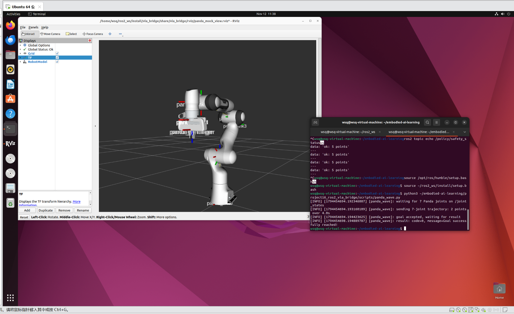

这次验证的是：

```text
Panda 模型能在 RViz 显示
mock hardware 能提供 7 个关节状态
panda_arm_controller 能接收 FollowJointTrajectory
7 关节轨迹能执行完成
```

但注意：

```text
panda_wave.py 直接发给 panda_arm_controller
没有经过 safety_filter 和 safe_executor
safety_filter 目前仍然只认识 joint1/joint2
```

所以这一步只完成“模型和执行接口”，还没有把安全层迁移到 Panda 的 7 关节。

#### 完整 7 关节安全链路

随后把 `safety_filter` 和 `mock_policy` 改成可配置关节：

```text
safety_filter：joint_names + lower/upper/velocity limits
mock_policy：joint_names + home_positions + amplitudes + phase_offsets
safe_executor：action_name 改成 panda_arm_controller
```

启动：

```bash
ros2 launch vla_bridge panda_full_chain_demo.launch.py
```

实测：

```text
safe_executor stats:
queued=69, executed=69, canceled=0, failed=0, dropped=0

/policy/safety_status:
ok: 5 points

safe_executor sending action:
joints=['panda_joint1', ..., 'panda_joint7']

panda_arm_controller:
Accepted new action goal
Goal reached, success!
```

这说明：

```text
mock_policy 能生成 7 关节动作
safety_filter 认识 7 个 Panda 关节
safe_executor 能队列、时间对齐、转发
panda_arm_controller 能执行 7 关节轨迹
Panda 在 RViz 里持续运动
```

但 `/joint_states` 里还有两个 mock hardware 的局限：

```text
velocity 全部是 0.0
effort 全部是 NaN
```

原因是 MoveIt 的 `panda.ros2_control.xacro` 没有打开
`calculate_dynamics`。这不妨碍位置控制，但**不能拿这些 velocity/effort
做安全判断**。真机必须提供真实状态，或者给 mock hardware 打开动力学计算。

---

### 2026.11.14 ｜ 第 24 天 · ROS2 周 Day 16：Panda 进 Gazebo，Day 1

今天目标只有一个：

```text
Panda 在 Gazebo 里站起来
7 个关节能动
夹爪能开合
```

#### 踩过的坑

**1. MoveIt 的 Panda URDF 没有 inertial**

Gazebo 日志：

```text
Skipping joint ... not in the gazebo model
```

检查：

```text
grep -c "<inertial" /tmp/panda.urdf → 0
```

MoveIt 的 Panda 模型是给规划用的，不含质量/惯性；Gazebo 需要 inertial 才能建出完整关节模型。

解决：

```text
PyBullet Panda 的 inertial
+ MoveIt2 的 DAE/STL 网格
+ 自己的 ros2_control/Gazebo 插件
```

**2. `panda_body.urdf` 是 fragment**

xacro 报错：

```text
XML parsing error: junk after document element
```

原因是有多个顶层元素，没有单个 `<robot>` 根节点。补上根节点后解决。

**3. 旧 Gazebo 进程残留**

```text
[gzserver-1]: process has died exit code 255
[spawn_entity]: Spawn status: Entity [panda] already exists.
Controller already loaded
Failed to activate controller
```

旧 `gzserver`/`gzclient`/spawner 没退干净，新的 `spawn_entity` 连到了旧 Gazebo。清掉旧进程后恢复。

**4. 时间源不一致**

`panda_wave.py`：

```text
goal accepted, waiting for result
```

然后一直不结束。

原因：

```text
Gazebo：use_sim_time=True，使用 /clock
脚本：没设置 use_sim_time，使用系统时间
```

JTC 在等一个“未来”的轨迹开始时间。后续改成**零时间戳**：

```python
traj.header.stamp = Time()
```

零时间戳约定是“立即开始”，所以脚本不再依赖 `use_sim_time`。

清掉旧 Gazebo/controller_manager 后实测：

```text
python3 .../panda_wave.py
→ goal accepted
→ 4 秒后 code=0, Goal successfully reached!
```

不加 `use_sim_time` 也能执行。

#### 最终结果

机械臂：

```text
sending 7-joint trajectory: 2 points over 4.0s
goal accepted, waiting for result
result: code=0, message=Goal successfully reached!
```

夹爪：

```text
open:  position=0.040 → code=0
close: position=0.000 → code=0
open again: position=0.040 → code=0
```

用户观察：

```text
两个都动了
```

#### 今天学到的

```text
1. URDF 能规划 ≠ 能被 Gazebo 物理仿真
2. Gazebo 需要 inertial，MoveIt 不需要
3. xacro include 的文件也要有合法根节点
4. 立即执行的测试轨迹用零时间戳，避免绑定 Gazebo 或系统时间源
5. Gazebo 界面“not responding”不一定代表 gzserver 挂了
```

#### Day 2：桌面场景、RGB-D 相机与检测

Gazebo 里加入：

```text
桌子
红 / 绿 / 蓝三个方块
蓝色盒子
固定俯视 RGB-D 相机
```

相机话题：

```text
/camera/image_raw
/camera/depth/image_raw
/camera/camera_info
/camera/points
/vision/debug_image
```

图像频率：

```text
/camera/image_raw ≈ 14.7 Hz
```

检测结果：

```text
红色方块真实位置：x=0.45, y=-0.15, z=0.40
检测输出：       x=0.4526, y=-0.1448, z=0.4000
```

误差约 3–5 mm。

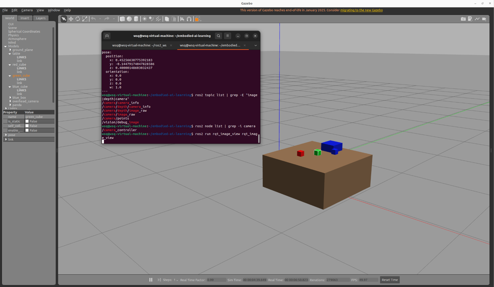

这一步验证了：

```text
Gazebo 桌面场景
RGB-D 相机
camera_optical_frame → panda_link0 TF
HSV 检测
深度反投影
```

Gazebo 里看不到相机本体，因为相机模型只有 `<sensor>`，没有 `<visual>`；
但 `/camera/image_raw` 和目标位姿都正常。

#### MoveIt2 接入 Gazebo

新增：

```text
panda_moveit_gazebo.launch.py
```

它复用官方 Panda 的：

```text
panda.srdf
KDL 运动学
OMPL
moveit_controllers.yaml
```

并把 `robot_description` 换成 Gazebo 版 Panda，控制器直接指向：

```text
panda_arm_controller/follow_joint_trajectory
```

`move_group` 启动日志：

```text
Added FollowJointTrajectory controller for panda_arm_controller
Using planning interface 'OMPL'
Trajectory execution is managing controllers
You can start planning now!
```

#### RViz 为什么不启动

这次卡了很久，根因不是 RViz：

```text
panda_moveit_gazebo 用 start_rviz 控制自己的 RViz
panda_table_demo 也传了 start_rviz=false
同名参数覆盖，父 launch 的 RViz 条件永远为 false
```

修复：

```text
父 launch 改用自己的参数名 start_moveit_rviz
```

另外 MoveIt 默认 RViz 的 Fixed Frame 是 `base_link`，但 Panda 的 TF 根是 `panda_link0`，所以做了一份本地配置：

```text
/home/wsq/panda_moveit_view.rviz
Fixed Frame: panda_link0
```

启动：

```bash
ros2 launch vla_bridge panda_moveit_gazebo.launch.py rviz_config:=/home/wsq/panda_moveit_view.rviz
```

现在 RViz 能启动并显示 MotionPlanning 面板。

MoveIt 还有一个警告：

```text
virtual joint child 'panda_link0' does not match URDF frame 'world'
Assuming fixed joint
```

固定底座暂时可以接受，后面统一 world/panda_link0 的 TF 关系。

#### 下一步

```text
RViz 里先 Plan，再 Execute
验证 MoveIt2 → panda_arm_controller → Gazebo
```

---

### 2026.11.15 ｜ 第 25 天 · ROS2 周 Day 17：MoveIt2 pre-grasp 与初始位姿修复

今天把 MoveIt2 从“能启动”推进到“能执行 pre-grasp”。

#### 1. Gazebo 初始关节全是 0

MoveIt 规划失败：

```text
Starting state is just outside bounds (joint 'panda_joint4')
Start state appears to be in collision
panda_link5 和 panda_link7 接触
OMPL: Skipping invalid start state
```

原因：

```text
panda_joint4 合法范围是 -3.0718 ~ -0.0698
Gazebo 默认所有关节 = 0
```

#### 2. spawn_entity.py 没有 -J

这个 Humble 版本的 `spawn_entity.py` 不支持 `-J`，所以 spawn 直接失败。

改成新增：

```text
panda_home
```

启动后用 `panda_arm_controller` 把 Panda 移到合法初始位姿。

#### 3. MoveGroup action 不是 /move_group

实际 action server 是：

```text
/move_action
```

`panda_move_to_target` 已改为连接 `/move_action`。

#### 4. 桌面进入 planning scene

新增：

```text
panda_scene
```

把桌子、三个方块、蓝盒发布到 `/planning_scene`，MoveIt 才会避障。

#### 5. pre-grasp 成功

`panda_move_to_target` 订阅 `/vision/target_pose`，规划到红方块上方 20 cm：

```text
pre-grasp target: x=0.453, y=-0.145, z=0.600
sending MoveGroup pre-grasp request
pre-grasp execution succeeded
```

#### 6. 为什么姿势看起来别扭

MoveIt 的规划结果：

```text
Panda 是 7 自由度，有冗余
同一末端位姿有多组 IK
OMPL/RRTConnect 只保证可行、无碰撞
不保证肘部朝上、腕部自然、路径短得像人
```

当前只约束了位置和大约朝下，没有 natural posture 约束，所以选了一个合法但奇怪的解。

#### 7. 一键同步脚本

新增：

```text
dev_sync_vla.sh
```

用法：

```bash
source ~/embodied-ai-learning/project16_ros2_vla_bridge/scripts/dev_sync_vla.sh
```

自动完成 `git pull`、同步、build、source。

#### 下一步

```text
grasp pose → 夹爪闭合 → lift → place
```

---

### 2026.11.16 ｜ 第 26 天 · ROS2 周 Day 18：最小抓取流程 `panda_pick`

今天先不做 place，只做“抓起来”。

#### 流程

新增：

```text
panda_pick.py
```

顺序：

```text
1. 等到 /vision/target_pose
2. 张开夹爪 0.04
3. MoveIt 到 pre-grasp（z + 0.20）
4. 下探到 grasp（z + 0.10）
5. 闭合夹爪 0.00
6. 抬起到 lift（z + 0.30）
```

MoveIt 使用：

```text
/move_action
```

夹爪使用：

```text
/panda_gripper_controller/follow_joint_trajectory
```

#### planning scene 处理

红方块现在还是 planning scene 里的障碍物。  
下探前需要先 REMOVE：

```text
red_cube → CollisionObject.REMOVE
```

同时把 `panda_scene` 改成只发布 3 次，避免它不断把红方块重新加回来。

#### 运行

```bash
source ~/embodied-ai-learning/project16_ros2_vla_bridge/scripts/dev_sync_vla.sh
```

```bash
ros2 launch vla_bridge panda_moveit_gazebo.launch.py rviz_config:=/home/wsq/panda_moveit_view.rviz
```

另开终端：

```bash
ros2 run vla_bridge panda_pick
```

#### 实测失败

第一次实跑：

```text
gripper open:  code=0
pre-grasp:     code=1
grasp:         code=1
gripper close: code=0
lift:          code=1
pick sequence finished
```

所有 action 都返回成功，但红方块还在桌上，夹爪抓歪了。

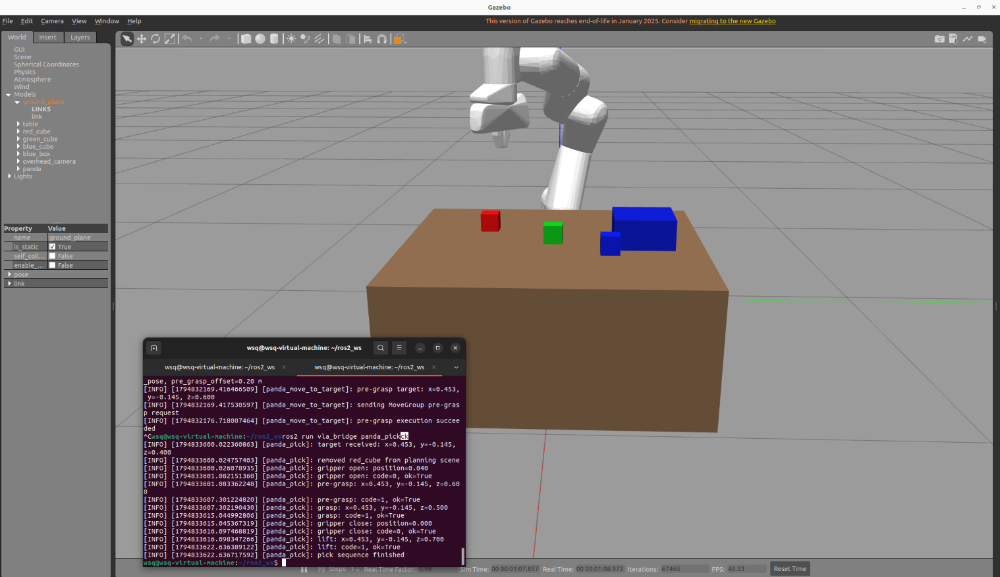

问题：

```text
MoveIt 执行成功 = 轨迹走到了
不等于夹爪真的夹住了物体
```

#### 已加验证

新增两层检查：

```text
1. 夹爪闭合后的手指位置
2. Gazebo 里红方块的 z 高度变化
```

手指：

```text
/joint_states
panda_finger_joint1/2
average > 0.005 才认为夹住了东西
```

物体：

```text
/gazebo/get_model_state
model_name = red_cube
after_z - before_z > 0.05 才认为抬起来了
```

失败时不再打印 `pick sequence finished`，而是：

```text
GRASP FAILED
```

并张开夹爪释放。

#### 当前状态

```text
抓取验证代码已加
VM 重测待补
```

#### 下一步

```text
重跑 panda_pick
根据 finger_gap / cube_dz 调整 grasp z 和姿态
再做 place
```

---

### 2026.11.17 ｜ 第 27 天 · ROS2 周 Day 19：侧向抓取设计与 MoveIt 目标采样失败

> 状态：进行中。侧抓节点已写完，但还没有成功抓起方块；用户反思待补。

#### 为什么从竖直抓取改成侧向抓取

Day 26 的 `panda_pick` 用竖直下爪，夹爪在方块顶部闭合。
下探高度受桌子限制，手指没有真正包住方块两侧，方块容易被推走。

这次保留桌子碰撞对象，不再通过删除桌子绕过问题，只把红方块从 planning scene 移除，改成：

```text
水平夹爪
panda_hand 的 z 轴朝 world +x
手指沿 world y 闭合
从方块侧面夹住
```

#### 新增 `panda_side_pick.py`

初始参数：

```text
pre_x_offset   = 0.20
grasp_x_offset = 0.12
side_z_offset  = 0.02
lift_height    = 0.20
close_position = 0.02
```

对应位姿：

```text
pre-grasp: (0.250, -0.150, 0.395)
grasp:     (0.330, -0.150, 0.395)
```

#### 失败 1：pre-grasp 目标采样失败

节点日志：

```text
side pre-grasp: x=0.250, y=-0.150, z=0.395
side pre-grasp: code=99999, ok=False
```

MoveIt 日志：

```text
More than 80% of the sampled goal states fail to satisfy the constraints
Unable to sample any valid states for goal tree
ParallelPlan::solve(): Unable to find solution ... in 5.009499 seconds
```

`code=99999` 是 MoveIt 的通用 FAILURE，通常只说明规划失败，不说明具体原因。

#### IK 诊断

对 `x=0.250, z=0.395` 做 IK：

```text
error_code.val = 1
panda_joint4 = -3.0717998598841323
```

`panda_joint4` 的软下限是 `-3.0718`，这组解把肘关节压到了极限。
手腕往远离底座的方向移动后：

```text
x=0.37, z=0.395
error_code.val = 1
panda_joint4 = -2.6990
```

说明原来的 pre-grasp 太靠近底座，关节余量很小；随后 goal sampler 也确实失败。

#### 失败 2：上方下探，位置满足但姿态不满足

修改为同一 x 的上方下探：

```text
grasp_x_offset = 0.10
pre_z_offset   = 0.12

pre-grasp: (0.350, -0.150, 0.515)
grasp:     (0.350, -0.150, 0.395)
```

节点日志：

```text
side pre-grasp: x=0.350, y=-0.150, z=0.515
side pre-grasp: code=99999, ok=False
```

MoveIt 日志：

```text
Position constraint satisfied on link 'panda_link8'.
Desired: 0.350000, -0.150000, 0.514801
Current: 0.349167, -0.146951, 0.510227

Orientation constraint violated for link 'panda_hand'.
Quaternion desired: 0.000000 0.707107 0.000000 0.707107
Quaternion actual:  0.879186 -0.466865 -0.056169 -0.076905
error: x=1.713462, y=1.380042, z=0.451822
tolerance: x=0.100000, y=0.100000, z=0.100000
```

结论：

```text
位置能到
采样阶段没有找到满足 panda_hand 姿态约束的状态
这次日志指向姿态约束，不是位置/桌高
是否完全无 IK，还没有单独用 /compute_ik 确认
```

#### 规划场景时序

`panda_side_pick` 会先删除 planning scene 里的红方块，但 `panda_scene` 可能随后再次发布桌子场景，把红方块加回来。

现在的节点会在删除前等 3 秒，确保 `panda_scene` 的 3 次发布结束。
重复运行时可能看到：

```text
Tried to remove world object 'red_cube', but it does not exist in this scene.
```

这是正常的，表示上一次已经删除过。

#### 当前进度和困难

```text
侧抓节点已写
两个 pre 位姿都未规划成功
还没有成功抓起方块
没有新的成功截图
```

主要困难：

1. MoveIt 的 `99999` 不告诉具体原因，必须结合 `move_group` 日志和 `/compute_ik` 才能区分“无 IK”与“碰撞”。
2. IK 有解不代表规划能采样到：`joint4` 到极限时，可行域太窄。
3. 高位侧向姿态不一定更容易：位置约束满足后，`panda_hand` 姿态仍可能无解。
4. 规划场景和 Gazebo 物体需要保持同步，否则会出现“计划删了但又被加回来”。

#### 下一步

不改代码，先用运行时参数降 pre 高度：

```bash
ros2 run vla_bridge panda_side_pick --ros-args -p pre_z_offset:=0.05
```

如果仍失败，再测：

```bash
ros2 run vla_bridge panda_side_pick --ros-args -p pre_z_offset:=0.0
```

#### 原始记录

- [raw.md](learning_journal/2026-11-17-day27/raw.md)
- [reflection.md](learning_journal/2026-11-17-day27/reflection.md)

---

### 2026.11.18 ｜ 第 28 天 · ROS2 周 Day 20：控制变量法、effort 夹爪与摩擦不足

> 状态：未完成。已经能到达抓取位姿，但抬升仍然失败。

#### 今天的收获

用户原话：

> 学到了控制变量法进行调试，当观察到多次抓取每次物块都被挤开考虑到了物理信息如抓夹闭合宽度和box大小，最后控制箱子固定，观察到穿模现象，多次调试数学参数发现没有解决根本问题，于是引入力控概念，最后成功到达目标位置（尚未解决抓取摩擦力过小抓不住问题）

#### 1. 固定方块，隔离变量

给红方块加：

```xml
<static>true</static>
```

目的不是让穿模消失，而是让物块不能被推走，从而只看手指有没有真正被方块挡住。

固定测试结果：

```text
finger positions after close: [0.0251, 0.0241]
average = 0.0246
```

方块半宽是 `0.025`，视觉上手指停在表面，不再明显穿模。

#### 2. 从 position 切到 effort

手指是 prismatic joint，之前只有：

```text
command_interface: position
```

现在改成：

```text
command_interface: effort
effort_controllers/JointGroupEffortController
```

夹紧力：

```text
gripper_effort = 10 N
effort_limit   = 10 N
```

注意手指 joint 的 effort 上限是 `20 N`，所以没有直接使用 30 N。

#### 3. 路径修复

- pre-grasp 时保留 planning scene 里的方块，让长路径绕开
- 到达上方后再删除方块
- 下探和抬升都改用 `/compute_cartesian_path`

最终：

```text
pre-grasp: code=1
cartesian descent: code=0
cartesian lift: code=0
```

路径和末端位置已经不是主要问题。

#### 4. 动态方块抬升仍然失败

关闭固定测试，恢复动态方块，最终日志：

```text
gripper close: effort=-10.00 N
fingers stable: True
finger positions after close: [0.0258, 0.0225]
average = 0.0241

cartesian lift: code=0, ok=True
cube after lift: z = 0.3739997551033577
GRASP FAILED: cube_dz = -0.0008016
```

摩擦参数已经提高到：

```text
红方块: mu=2.0, mu2=1.5
手指:   mu1=2.0, mu2=2.0
```

但方块仍然没有被抬起来。

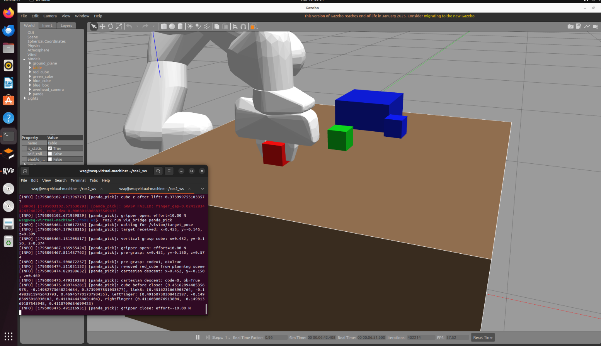

#### 当前结论

```text
路径规划：已解决
垂直下探/抬升：已改为笛卡尔
手指穿模：视觉上已明显改善
夹爪控制：已从 position 切到 effort
抓取抬升：仍然失败
```

现在的主要矛盾已经不是 MoveIt，而是：

```text
法向力是否足够
接触面积是否足够
摩擦模型/接触参数是否合理
手指是否夹在方块有效位置
```

#### 下一步

不继续盲调高度和力。优先做：

1. 记录闭合后的手指位置和方块位姿
2. 检查手指与方块的实际接触面/接触点
3. 评估 ODE 摩擦参数和接触刚度
4. 如果仍然不行，再考虑更换更大的测试物块或使用专门的 grasp fix 插件

#### 原始记录

- [raw.md](learning_journal/2026-11-18-day28/raw.md)
- [reflection.md](learning_journal/2026-11-18-day28/reflection.md)

---

### 2026.11.19 ｜ 第 29 天 · ROS2 周 Day 21：link attach 打通仿真抓取

> 状态：Gazebo 仿真抓取完成。使用 IFRA `gazebo_link_attacher` 固定关节，**不是真机力控**。

#### 流程

```text
pre-grasp
→ 笛卡尔下探
→ effort 闭合并稳定
→ /ATTACHLINK 把红方块固定到 panda_link7
→ 笛卡尔抬升
→ 验证 cube z
```

#### 成功日志

```text
attach link panda_link8: success=False
  message=Failed to find link with name: panda_link8

attach link panda_link7: success=True
  message=ATTACHED: {panda, panda_link7} -- {red_cube, link}

cartesian lift: code=0
actual_link8 z: 0.674
cube z after lift: 0.579
GRASP SUCCESS
```

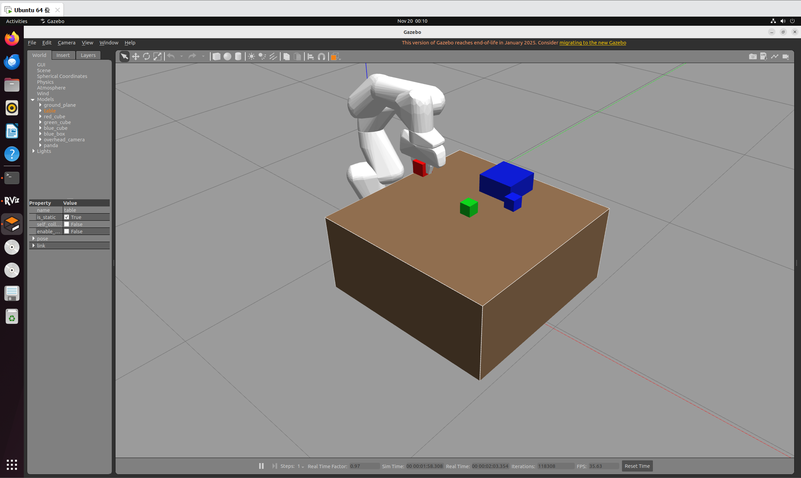

#### 最后这个错误是什么

```text
Failed to find link with name: panda_hand
Failed to find link with name: panda_link8
```

Gazebo Classic 会把固定关节连接的 link 合并。
`panda_hand` 和 `panda_link8` 都通过固定关节连接在 `panda_link7` 后面，Gazebo 实际保留的末端 link 是：

```text
panda_link7
```

通俗地说：Gazebo 把用固定关节“焊死”的零件合并成一个整体；按 `panda_hand`、`panda_link8` 找，找不到；按合并后的 `panda_link7` 找，才成功。

#### 和之前抓不起来有关系吗

没有直接关系。

之前抓不起来是实际接触摩擦不足：

```text
手指闭合、位置正确、接触法向正确
但抬升时方块从手指之间滑脱
```

link attach 是给方块加一个固定关节，等于在 Gazebo 里把方块“粘”到 `panda_link7`：

```text
物理摩擦夹不住 → 用 attach 固定关节绕过摩擦
```

所以：

```text
panda_hand 名字错误 → 只会让 attach 补丁失效，节点停在原地
之前抓不起来 → 是摩擦/接触问题，不是名字问题
```

#### 结论

```text
Gazebo 仿真抓取：完成
物理摩擦抓取：仍未解决
真机：未开始
place：未做
```

这次成功可以用于演示“感知 → 规划 → 下探 → 夹取 → 抬升”的完整软件链路，但不能直接说明真实 Panda 夹爪在 10 N / 当前摩擦下能抓起这个 5 cm 方块。

#### 原始记录

- [raw.md](learning_journal/2026-11-19-day29/raw.md)
- [reflection.md](learning_journal/2026-11-19-day29/reflection.md)

---

### 2026.11.20 ｜ 第 30 天 · ROS2 周 Day 22：视觉抓放闭环

> 状态：抓取 → 搬移 → 下放 → 释放 → 校验完成。
> 抬升仍依赖 Gazebo link attach（固定关节），不是物理摩擦抓取。

#### 阶段 A 完成度

```text
A1 视觉去真值      ✅ 5 帧中值，误差 6.3 mm
A2 place 完整回路   ✅ 搬移/下放/detach/张爪/抬离/校验
A3 20 次成功率统计   ❌ 未做
A4 空抓检测/重试    ✅ 已实现，重试未实测
```

#### 流程

```text
/vision/target_pose ×5 → 中值
→ pre-grasp（OMPL，方块仍在 planning scene）
→ 删除方块碰撞体
→ 分段垂直下探（每段 2 cm）
→ effort 闭合 + 空抓检测
→ link attach 到 panda_link7
→ 分段垂直抬升
→ 保持高度水平搬移
→ 分段垂直下放
→ detach → 张爪 → 分段抬离
→ 方块位置校验
```

#### 成功日志

```text
vision vs truth: err_xy=6.3 mm, err_z=0.0 mm
vertical grasp cube: x=0.454, y=-0.145, z=0.374 (source=vision)
cartesian descent: chunks=6, 每段 code=0
finger positions after close: [0.0205, 0.0277]
attach link panda_link7: success=True
cube after lift: z=0.5790
GRASP SUCCESS
place descent: chunks=11, 每段 code=0
detach link panda_link7: success=True
cube after place: (0.3964, 0.0752, 0.3741)
place error: xy=6.0 mm, z=0.9 mm
PLACE SUCCESS
```

#### 今天卡住的三件事

**1. 抓起后不放下**

```text
place descent: cartesian failed, code=1, fraction=0.364
```

放置点 `(0.45, 0.15)` 贴着 `blue_box` 的角（`blue_box` 占
`x ∈ [0.47, 0.63]`、`y ∈ [0.16, 0.32]`、`z ∈ [0.33, 0.43]`），
左手指下探时碰到它，路径被碰撞检查截断。改成 `(0.40, 0.08)`，
并先水平搬移、再垂直下放。

**2. 下爪画弧线**

实质是实际轨迹只有 7 个点（`max_step=0.0699 rad`），
控制器在稀疏点之间按关节空间插值。改成每 2 cm 一段逐段执行后，
每段只有 3~4 个点、`max_step≈0.019~0.030 rad`，末端贴直线走。

**3. Gazebo 崩溃 + 程序永久卡住**

```text
process has died ... gzserver ... exit code -11
```

`-11` 是段错误。窗口里机械臂消失，而 `panda_pick` 卡在没有超时的
attach 服务调用上。修复：attach/detach 加 3 s 超时；
attach 先试已知存在的 `panda_link7`；崩溃后整场重启，
不能只重跑 `panda_pick`。

#### 视觉到底在哪

相机是固定俯视 eye-to-hand：

```text
panda_link0 → camera_link:  (0.55, 0, 1.15), pitch +90°
camera_link → camera_optical_frame: roll -90°, yaw -90°
```

抓取 x/y/z 来自 `/vision/target_pose` 的 5 帧中值；
真值 `/model_states` 只用于打印误差、抬升校验、放置校验和重试判断。
用户“感觉不到视觉”的原因是方块一直没动（视觉与真值只差 6.3 mm），
且放置点是固定参数、运动中没有第二次视觉反馈。

#### 用户反思（原话）

> 今天从固定位置到视觉抓取，了解到固定插值可能也会导致插值中间不以直线执行，同时不能光依靠视觉来判断抓取是否成功，而是需要通过数据如物块的xyz，抓夹间距

#### 结论与下一步

```text
Gazebo 仿真抓放闭环：完成（link attach）
物理摩擦抓取：仍未解决
A3 成功率统计：未做
真机：未开始
```

下一步：eye-in-hand 相机 + 手眼标定，把“看一次就闭眼执行”
变成“接近过程中持续修正”；再做 A3 的随机位置成功率统计。

#### 原始记录

- [raw.md](learning_journal/2026-11-20-day30/raw.md)
- [reflection.md](learning_journal/2026-11-20-day30/reflection.md)

---

### 2026.11.21 ｜ 第 31 天 · ROS2 周 Day 23：A3 与视觉误差缩小

> 状态：A3 20/20；视觉误差从 6.1 mm 降到 4.4 mm（生产检测器）。
> 剩余约 4 mm 是径向比例误差，下一步做相机内参标定。

#### 31.1 A3：20 次随机位置抓放

```text
范围      x ∈ [0.42, 0.48]，y ∈ [-0.18, -0.12]，±3 cm
放置点    (0.40, 0.08, 0.375)
全链路    20/20
视觉误差  mean 6.1 mm, max 7.5 mm
放置误差  mean 5.9 mm, max 7.3 mm
相关系数  r = 0.995
```

第 5 次命令位置 `(0.4486, -0.1450)`，实际 `(0.4570, -0.1610)`，
偏约 18 mm；机器人仍成功，因为视觉跟随的是实际方块。
这说明命令位置和实际位置必须分开记录。

报告：

- [experiments/a3/20261121_201637/report.md](project16_ros2_vla_bridge/experiments/a3/20261121_201637/report.md)

#### 31.2 试验报告自动化

```text
panda_pick_trials.py   → 传送方块、复位、独立校验、写 CSV
publish_experiment.py  → 生成 report.md，git commit + push
experiments/a3/        → 报告索引和每次运行
```

以后一条命令：

```bash
python3 project16_ros2_vla_bridge/scripts/panda_pick_trials.py \
  --trials 20 --seed 0 --publish
```

第一次推送失败，因为 GitHub 不支持账号密码；
改用 Personal Access Token（Contents: Read and write）后成功。

#### 31.3 bbox 误差是什么

bbox = bounding box，红色像素的外接矩形。旧方法用矩形中心当方块中心。

相机不在方块正上方，红色 mask 除了顶面还包括朝向相机的两个侧面；
矩形中心被侧面拉向图像中心，形成约 6 mm 的径向偏差。

```text
旧方法 A：整个红色轮廓的 bbox 中心 + 深度中值
新方法 B：只取最靠近相机的顶面像素，反投影后求 3D 质心
```

通俗地说：**不再量整个外轮廓，只量朝上的那张“脸”**。

#### 31.4 三种估计方法的静态对比

不动机器人，把方块传送到 10 个位置，与 `/model_states` 真值比较：

```text
A  bbox 中心          mean 6.45 mm
B  顶面 3D 质心       mean 4.18 mm   ← 降 35%
C  轮廓矩质心         mean 8.31 mm
```

B 明显更好，但剩余误差仍然几乎全是径向的（4.10/4.18 mm）。

#### 31.5 顶面阈值扫描与径向缩放

对 B 再测 1/2/4/8 mm 阈值，并给每种方法拟合一个径向缩放 `s`：

```text
          原始误差      缩放 s     校正后
A         6.45 mm       1.0388     0.71 mm
B1 (1mm)  4.08 mm       1.0236     0.97 mm
B2 (2mm)  4.08 mm       1.0236     0.97 mm
B4 (4mm)  4.18 mm       1.0243     0.85 mm
B8 (8mm)  4.38 mm       1.0250     1.06 mm
C         8.31 mm       1.0502     1.07 mm
```

结论：

- 1 mm 和 2 mm 结果相同，阈值不是主因；
- 乘一个 ~1.02–1.04 的径向缩放后，所有方法都降到 ~1 mm；
- 剩余误差是**纯径向比例误差**（内参/投影），不是随机噪声；
- 0.7–1.1 mm 已小于 1 像素（320×240 下约 2.7 mm/px）。

#### 31.6 生产检测器落地

`panda_color_detector.py` 默认改为：

```text
estimator = top
top_depth_margin = 0.002 m
min_top_points = 20
```

debug 图中红方块的黄点 = 顶面中心；`-p estimator:=bbox` 可切回旧方法。

次日（11-22）跑 3 次 A3 回归：

```text
3/3 全链路成功
视觉误差 mean 4.4 mm, max 4.6 mm
放置误差 mean 4.2 mm, max 4.4 mm
```

和静态对比 B 的 4.08 mm 一致，说明新方法在真实链路中生效。

#### 31.7 相机窗口

`panda_moveit_gazebo.launch.py` 现在自动开两个 RViz：

```text
MoveIt RViz   → MotionPlanning、碰撞体、轨迹
Camera RViz   → 相机原图、debug 图、目标 marker、TF
```

不是重复：一个负责规划，一个负责图像。
不需要相机窗口时加 `start_camera_view:=false`。

#### 31.8 用户反思（原话）

> 继续缩减视觉误差，减小了bbox误差带来的影响，重新标定中心。
> 进行20次批量实验确保成功抓取。

#### 31.9 结论与下一步

```text
bbox 侧面污染：已解决（A→B）
剩余 ~4.4 mm：径向比例误差，属于内参/投影
手眼标定：解决不了这个比例误差
下一步：相机内参标定 → 再把误差压到 ~1 mm
再下一步：eye-in-hand，解决遮挡和闭环修正
```

#### 31.10 原始记录

- [raw.md](learning_journal/2026-11-21-day31/raw.md)
- [reflection.md](learning_journal/2026-11-21-day31/reflection.md)
- [notes.md](learning_journal/2026-11-21-day31/notes.md)：反投影、`fx/fy/cx/cy`、内参外参学习笔记

---

### 2026.11.22 ｜ 第 32 天 · ROS2 周 Day 24：腕部相机与手眼标定条件

> 状态：生产检测器顶面方法已验证；腕部相机可用；
> 手眼标定暂缓，先补目标可见性和非对称目标。

#### 32.1 顶面检测器的真实链路回归

生产检测器从 bbox 中心改成顶面 3D 质心后，跑 3 次 A3：

```text
3/3 全链路成功
vision mean 4.4 mm, max 4.6 mm
place  mean 4.2 mm, max 4.4 mm
```

对比改前：

```text
vision 6.1 → 4.4 mm
place  5.9 → 4.2 mm
```

和静态对比的 4.08 mm 一致，说明不是只在实验脚本里有效。

#### 32.2 K 检查：内参没有问题

RGB 和深度相机的 `camera_info` 一致：

```text
fx = fy = 277.127
cx = 160.5, cy = 120.5
```

理论值也是 `(320/2)/tan(1.047198/2) ≈ 277.127`。

所以之前“乘 1.024 后误差降到 1 mm”只是单侧小区的过拟合，
**剩余误差不是内参比例**。

#### 32.3 另一侧静态对比

```text
        原区域 x<0.55       新区域 x>0.55
A       6.45 mm, +6.42      2.48 mm, +2.17
B2      4.08 mm, +3.99      3.57 mm, -0.56
C       8.31 mm, +8.24      3.60 mm, +1.74
```

- B 的径向误差符号翻转，缩放校正失效；
- 方法排名变化：原区域 B 最好，新区域 A 最好；
- 误差随视角变化，320×240 下 1 像素≈2.7 mm，
  2.5–4 mm 已接近像素/分割下限。

结论：剩余误差是**视角/分割/分辨率**，不是相机标定。

#### 32.4 腕部相机

新增 `wrist_camera_link`、固定关节、RGB-D 相机、静态光学 TF 和 RViz 显示；
用 `preserveFixedJoint` 防止 Gazebo 合并 link。

```text
/wrist_camera/image_raw ≈ 5.7 Hz
pre-grasp 能看到完整红方块
```

安装位置迭代：

| 尝试 | 结果 |
|---|---|
| x=0.06, z=-0.04 | 顶面贴上边缘，translation 3.72 mm，normal 151.85° |
| 上仰 17° | 方块居中，但深度带只取到窄带（564 px²），PnP 失效 |
| x=0.045, z=-0.04 | 2.57 mm，但手上沿切掉一条，normal 102.30° |
| x=0.06, z=-0.06 | 19.81 mm；这次手臂仍由俯视视觉定位，目标偏 23 mm |

得到两条硬约束：

```text
1. ±2 mm 深度带要求相机不倾斜
2. 腕部相机不能被手挡；俯视相机也不能被抬高的手臂挡
```

#### 32.5 手眼标定为什么暂缓

1. **方形顶面有 90° 旋转对称**：PnP 的 yaw 不可观测，
   完整旋转标定需要 ArUco/棋盘格或不对称标记；
2. **目标可见性**：当前安装下顶面容易被手或图像边缘切掉；
3. **真值边界**：用真值选姿态可以，真值进入求解不行。

今天的 `wrist_hand_eye_translation.py` 在求解里用了 `target_base` 真值，
属于 known-target 平移诊断，不是纯 AX=XB，不能当作手眼结论。

#### 32.6 下一步

```text
1. 保证标定姿态里目标完整可见
2. 加非对称目标：ArUco/棋盘格，或给方块顶面加标记
3. 用 cv2.calibrateHandEye 做纯 AX=XB
4. 再做腕部检测和接近过程闭环
```

#### 32.7 用户反思（原话）

> 今天学习了投影与反投影，将相机安装到手上（eye-in-hand），
> 但是还面临视角不理想、受到遮挡的问题，明天解决。

#### 32.8 原始记录

- [raw.md](learning_journal/2026-11-22-day32/raw.md)
- [reflection.md](learning_journal/2026-11-22-day32/reflection.md)

---

### 2026.11.23 ｜ 第 33 天 · ROS2 周 Day 25：ChArUco 手眼标定准备

> 状态：标定板、640×480 腕部相机、纹理修复、瞄准式姿态采样已完成；
> 15/15 姿态都是 17 markers / 24 corners，下一步纯 AX=XB。

#### 33.1 标定板接入的三个坑

**坑 1：纹理不显示。** Gazebo 里是黄黑斜条纹，检测报 `no ArUco markers`。
`model.sdf` 只注册了 `.material` 脚本，没有注册 `materials/textures` 目录。
同时注册两个目录后，必须重启 Gazebo 清 OGRE 材质缓存。

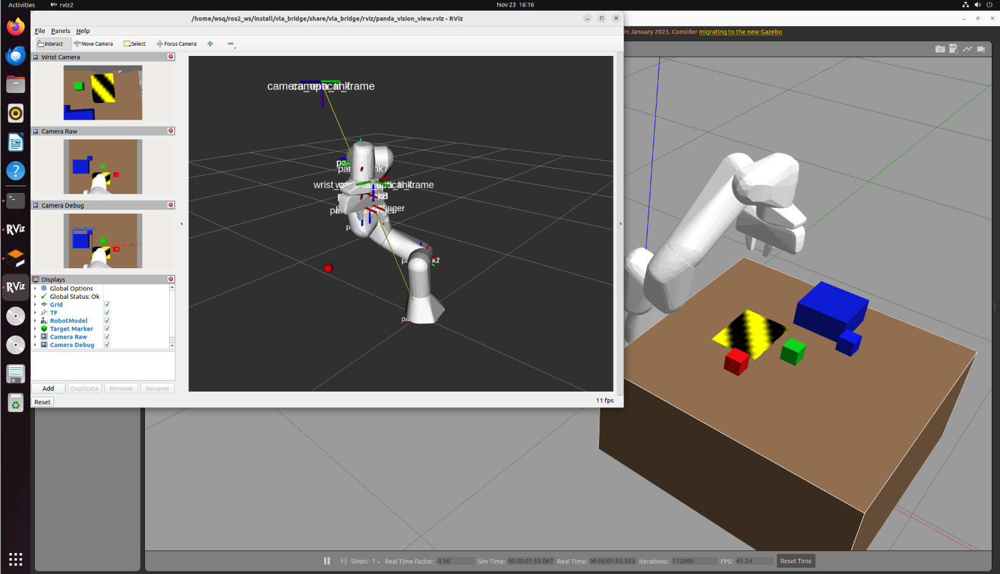

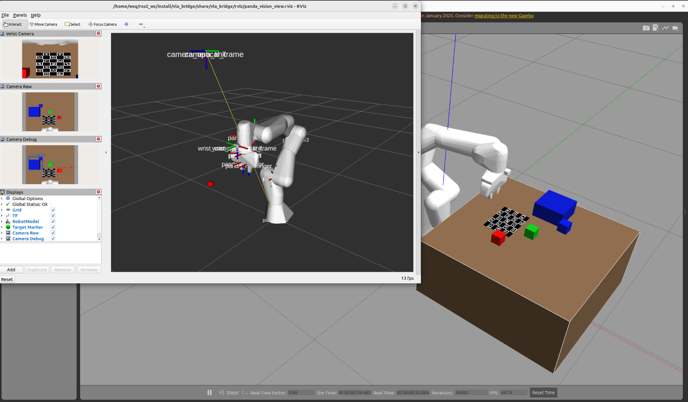

**坑 2：320×240 下 marker 太小。** 只检出 10/17 markers、9/24 corners；
每个 ArUco 数据位约 2.7 px。腕部相机提到 640×480 后：

```text
fx = fy = 554.255
cx = 320.5, cy = 240.5
17/17 markers, 24/24 corners
```

**坑 3：PnP 8.3 px。** 所有角点都检出，但两组 IPPE 解都是 8.3–8.5 px。
raw 图里 marker 中心排成 **7 列 × 5 行**，列距约 26 px、行距约 51 px：
Gazebo 把纹理贴到 box 顶面时旋转了 90° 并拉伸成 2:1。
纹理旋转 90°（840×600）后，重投影降到 **0.330 px**，法向回到 `-z`。

#### 33.2 IPPE 双解的隐患

用户问：“IPPE双解会有隐患吗？”

有。平面板近正视时两组解几乎重合，噪声可能让分支翻转；倾斜姿态下两组解才明显分开。

处理：

```text
两组解都记录 reproj / normal / tvec
gap < 0.1 px 标记 ambiguous
求解时用静态板 T_base_target 一致性兜底
```

full 15 姿态的 gap 规律很干净：

```text
近正视/纯滚转：0.02–0.05 px  → ambiguous
横向平移：      0.35–0.75 px
±10° 倾斜：     1.35–1.48 px  → 分支清楚
```

#### 33.3 瞄准法：让板子始终在画面中心

固定手位时，手一换高度或一倾斜，板子就在画面里跑偏，20° 倾斜只剩 7–11 个 marker。
根因是相机不在手的正下方，固定手位没有补偿安装偏置。

改成先决定“从哪个方向看板子”，再反推手的位置：

```text
axis   = R_hand · R_hand→cam · [0,0,1]   相机镜头朝哪
p_cam  = p_board - d · axis              相机退到板中心后方 d 米
p_hand = p_cam - R_hand · t_hand→cam     减掉相机相对手的安装平移
```

通俗说：

```text
以前：人站死在原地，歪着手机拍桌子上的纸，纸容易跑出取景框
现在：先决定从哪个角度看纸，再走到能让镜头对准纸中心的位置
```

`d` 取 0.46–0.54 m，板子半高角约 11–13°，10° 倾斜后仍在垂直半 FOV 23.4° 内。
名义安装变换只用于**选姿态**，不进入 AX=XB 求解。

#### 33.4 full 15 姿态报告

每个姿态采 3 帧，取重投影最小的一帧：

```text
pose        d(m)  tilt/roll  markers  corners  reproj(px)  gap(px)  ambiguous
d46         0.46  -          17       24       0.115       0.023    yes
d50         0.50  -          17       24       0.157       0.034    yes
d54         0.54  -          17       24       0.109       0.051    yes
x_plus      0.50  -          17       24       0.084       0.364    no
x_minus     0.50  -          17       24       0.096       0.345    no
y_plus      0.50  -          17       24       0.088       0.626    no
y_minus     0.50  -          17       24       0.104       0.556    no
xy_plus     0.50  -          17       24       0.085       0.695    no
xy_minus    0.50  -          17       24       0.087       0.747    no
tilt_xp10   0.52  +10° x     17       24       0.086       1.355    no
tilt_xm10   0.52  -10° x     17       24       0.079       1.482    no
tilt_yp10   0.52  +10° y     17       24       0.075       1.408    no
tilt_ym10   0.52  -10° y     17       24       0.096       1.395    no
roll_zp30   0.50  +30° z     17       24       0.066       0.033    yes
roll_zm30   0.50  -30° z     17       24       0.043       0.039    yes

accepted 15/15
```

#### 33.5 第一次纯 AX=XB 结果

15 姿态、四种方法：

```text
all/DANIILIDIS   truth 3.06 mm / 0.303°
all/PARK         truth 3.26 mm / 0.309°
all/HORAUD       truth 3.26 mm / 0.308°
all/TSAI         truth 3.21 mm / 0.876°
```

只用 gap >= 0.1 px 的 10 个姿态：

```text
nonamb/PARK      truth 4.04 mm / 0.443°
target consistency 0.55 mm / 0.225°
```

静态板一致性：

```text
all      1.81 mm / 1.218°
nonamb   0.55 mm / 0.225°
```

IPPE 分支搜索：5 个 ambiguous 姿态全部保持 solution 0，没有翻转。
说明这组数据里 chosen solution 0 全局一致，双解风险由一致性检查兜住。

首次估计（all/PARK）与真值：

```text
平移误差 x 1.4 mm, y 2.1 mm, z 2.0 mm，3D 3.26 mm
旋转误差 0.309°
```

完整结果见
[hand_eye/day33/report.md](project16_ros2_vla_bridge/experiments/hand_eye/day33/report.md)。

#### 33.6 下一步

```text
1. 增加旋转多样性：更小标定板或更大垂直 FOV
2. 对 X 做非线性静态板一致性优化
3. 近正视/模糊姿态做加权，不作主约束
```

#### 33.7 用户原话

> IPPE双解会有隐患吗

> 今天解决那个始终让板保持在中心的解决方法挺有意思，
> 可以简单通俗易懂解释一下并且放进日志。然后这是报告也可以放。

#### 33.8 原始记录

- [raw.md](learning_journal/2026-11-23-day33/raw.md)
- [notes.md](learning_journal/2026-11-23-day33/notes.md)

---

### 2026.11.24 ｜ 第 34 天 · ROS2 周 Day 26：腕部相机闭环接近与视觉抓放

> 状态：手眼标定冻结；腕部方块检测 2.90 mm；
> PBVS 5/5 收敛，对真值 mean/max 2.41/2.61 mm；
> 腕部视觉抓放 5/5，放置 xy 误差 mean/max 1.0/1.6 mm。

#### 34.1 Step 0：冻结手眼标定

all/PARK 结果写入 `config/wrist_hand_eye.json`：

```text
对 URDF 真值：3.26 mm / 0.309°
板中心绝对验证：mean 2.07 mm，max 2.31 mm
```

感知组合：

```text
T_base_cam = T_base_link8 · T_link8_cam_calib
```

URDF 相机安装不改，标定只在软件里用。

#### 34.2 Step 1：腕部相机检测红方块

```text
HSV 红色分割
+ 深度反投影
+ 红色点云 RANSAC 顶面平面
+ 顶面质心 - 2.5 cm · 法向
```

测试位姿用 `/model_states` 真值选（只选姿态），
方块坐标由腕部相机 + 手眼标定计算。

```text
3 帧 mean 2.90 mm, max 2.91 mm
```

#### 34.3 Step 2：PBVS 第一版失败

0.20 m、alpha 0.6、2 mm 容差：

```text
converged 1/5
truth error mean/max 6.02/10.09 mm
```

原因：

- IK 分支变化导致相机视角变化，方块被切，平面内点从 11k 掉到 7k；
- 坏检测把闭环带偏；
- 一次 MoveIt 修正失败；
- 2 mm 容差小于检测/控制噪声。

修复：

```text
1. 质量门：inliers/red >= 85%，red >= 3000，
   normal_z >= 0.98，cube z 0.36–0.39
2. 起点 0.20 → 0.30 m
3. 容差 2.0 → 2.5 mm
4. alpha 0.6 → 0.7
5. MoveIt 失败 +5 mm z 重试一次
```

#### 34.4 首次接受结果

```text
converged 5/5
iterations [2, 3, 3, 3, 3]
truth error mean/max 2.41/2.61 mm
```

| start | 起点偏移 | 迭代 | hand_err | 对真值 |
|---|---|---|---|---|
| 0 | (0,0) | 2 | 1.89 mm | 2.61 mm |
| 1 | (+2,0) cm | 3 | 2.24 mm | 2.39 mm |
| 2 | (-2,0) cm | 3 | 2.11 mm | 2.33 mm |
| 3 | (0,+2) cm | 3 | 1.32 mm | 2.47 mm |
| 4 | (0,-2) cm | 3 | 2.28 mm | 2.28 mm |

闭环收敛的是视觉目标，所以对真值仍保留 Step 1 的约 2.4 mm 系统偏差。
以下 2.41/2.61 mm 是首次接受结果；2026-11-24 demo 复现结果见 34.7。

#### 34.5 方法

```text
手眼变换组合：T_base_cam = T_base_link8 · T_link8_cam
深度反投影 + 相机内参
HSV + 红色点云 RANSAC 平面
PBVS：e = p_desired - p_current，
      p_target = p_current + 0.7 · e
质量门 + MoveIt 重试
真值只用于选起点和最终评估
```

#### 34.6 Demo 建议

值得录，但不需要完整 15 姿态。建议 60–90 秒：

```text
1. 腕部相机看板，机械臂走 5–8 个标定姿态（8x 加速）
2. 15/15、PARK 3.26 mm / 0.309°
3. 腕部检测红方块 + 5/5 闭环
4. truth mean/max 2.41/2.61 mm
```

标注“姿态采样已加速”，不要拼接不同次结果。

#### 34.7 Demo 视频与复现结果

视频（未剪辑，直接上传 B 站）：

- [Day 34 腕部相机闭环 demo](https://www.bilibili.com/video/BV1Qgyfz1EJd/)

本次 demo 只录了单帧 ChArUco 检测 + Day 33 已有标定结果 + PBVS，
**没有重跑 15 姿态 AX=XB**；展示的是“标定冻结后的系统验证”。

复现结果：

```text
converged 5/5
truth error mean/max 3.41/6.11 mm
iterations [2, 3, 4, 2, 4]
```

和首次接受结果的区别：

```text
首次：5/5，2.41/2.61 mm，[2, 3, 3, 3, 3]
Demo：5/5，3.41/6.11 mm，[2, 3, 4, 2, 4]
```

start 3 的平面内点掉到 4740，顶面被部分切掉，但 `inliers/red` 仍过 85%，
比例门放行，闭环锁到偏掉的视觉目标，对真值 6.11 mm。
说明质量门还缺绝对 inlier 下限或时间一致性检查。

Demo 没有修改代码、标定或 `config/wrist_hand_eye.json`；
精度结论仍以 34.4 的首次接受结果为准。

#### 34.8 原始记录

- [raw.md](learning_journal/2026-11-24-day34/raw.md)
- [notes.md](learning_journal/2026-11-24-day34/notes.md)

#### 34.9 Step 3：腕部视觉抓放 5/5

流程：

```text
0.30 m PBVS 修正 x/y
→ 0.20 m 只做一致性校验
→ 保持 0.30 m 的 x/y
→ 下降到抓取位、夹取、attach、抬升、放置
```

5 次随机起点：

```text
full success 5/5
grasp 5/5
place 5/5
approach err mean/max 1.46 / 2.00 mm
0.20 m verify diff mean/max 0.55 / 1.24 mm
place err xy mean/max 1.0 / 1.6 mm
```

两个关键修复：

```text
1. 0.20 m 检测前先张开夹爪，避免手指挡住方块
2. panda_home 改成 MoveIt 规划；
   零位自碰撞时用直接关节轨迹做一次 bootstrap 恢复
```

原 `panda_home` 直接发关节轨迹，绕过 MoveIt，会穿桌子但返回成功；
修复后从放置点回 home 使用 MoveIt，`moveit_code=1`，没有再穿模。

产物：

```text
output/a3_20261124_233909/summary.csv
output/a3_20261124_233909/trial_01.log ... trial_05.log
```

---

### 2026.11.25 ｜ 第 35 天 · ROS2 周 Day 27：腕部视觉抓放鲁棒性 20/20

> 状态：扩大随机范围后 20/20 成功；
> approach mean/max 1.99/2.46 mm，place xy mean/max 1.1/2.4 mm。

#### 35.1 测试范围

```text
x: 0.40–0.50
y: -0.20–-0.10
z: 0.375
```

命令：

```bash
python3 scripts/panda_pick_trials.py --wrist --trials 20 --seed 0 \
  --x-min 0.40 --x-max 0.50 \
  --y-min -0.20 --y-max -0.10
```

#### 35.2 结果

```text
full success 20/20
grasp 20/20
place 20/20
approach err mean/max 1.99 / 2.46 mm
0.20 m verify diff mean/max 0.39 / 1.20 mm
place err xy mean/max 1.1 / 2.4 mm
```

#### 35.3 0.20 m 低质量兜底

trial 1、3、4 的 0.20 m 检测 `cube_z ≈ 0.338`，
低于质量门 0.36–0.39，没有用于修正 x/y；

```text
0.30 m 负责定位
0.20 m 只检查一致性
0.20 m 不可信时保持 0.30 m 目标
```

3 次最终都抓取和放置成功。

#### 35.4 边界

20/20 只覆盖当前范围、方块、光照和视角，不等于普遍鲁棒。
下一步扩大边界找第一个失败点，并复现 0.20 m `cube_z` 偏低。
真机迁移仍待做。

#### 35.5 原始记录

- [raw.md](learning_journal/2026-11-25-day35/raw.md)
- [notes.md](learning_journal/2026-11-25-day35/notes.md)
- [reflection.md](learning_journal/2026-11-25-day35/reflection.md)（待用户填写）

---

## 面试理论补充

以下不是“背定义”，而是以后做真机和 VLA 会反复遇到的基础。

### 1. 什么是 SLAM？未来会在哪用到？

**SLAM = Simultaneous Localization and Mapping，同时定位与建图。**

机器人在未知环境里一边移动，一边：

```text
用传感器估计自己在哪（定位）
同时把周围环境建成地图（建图）
```

典型输入：LiDAR、相机、IMU、轮式里程计。  
典型输出：机器人位姿轨迹 + 环境地图。

**未来用在哪：**

- 移动机器人/AGV 在未知室内导航；
- 移动机械臂的底盘定位；
- 无人机、AR/VR、巡检机器人；
- 移动 VLA：需要全局地图和空间记忆时。

**注意：** 固定底座的 Panda 做桌面抓取，通常**不需要 SLAM**。  
你需要的是手眼标定 + TF + 目标检测；SLAM 主要解决“机器人在环境里的全局位姿”。

简单学习路径：

1. ROS2 的 TF2、坐标系、URDF；
2. 轮式里程计/IMU 基础；
3. 2D LiDAR SLAM：`slam_toolbox` + Gazebo；
4. 视觉 SLAM：RTAB-Map / ORB-SLAM3；
5. 后端优化、回环检测、EKF/因子图融合；
6. 真机标定和多传感器时间同步。

### 2. 相机装在机械臂上，怎么确认相机的运动轨迹？

核心公式：

```text
T_base_cam = T_base_ee(q) * T_ee_cam
```

- `T_ee_cam`：相机相对末端的安装变换，通过**手眼标定**得到；
- `T_base_ee(q)`：由关节角 + 正运动学得到；
- 两者相乘，就是相机在世界/基座坐标下的位姿。

所以相机轨迹不需要靠 SLAM 猜，机械臂本身就是一条高精度的“编码器轨迹”。  
具体做法：

- `joint_states` 发布关节角；
- `robot_state_publisher` + URDF 计算末端位姿；
- TF2 查询 `base_link → camera_link`；
- 用棋盘格/AprilTag 验证标定；
- 注意图像和关节角的时间戳同步。

VLA 里，检测到的目标在相机坐标系；要先用这个变换转到机器人坐标系，才能给 MoveIt2 或控制器。

### 3. 两个传感器频率不一致怎么处理？比如 1000 Hz 和 60 Hz

**不要强行让 1000 Hz 的控制循环等 60 Hz 的相机。**

常见做法：

- 高频控制（1000 Hz）在自己的循环里跑，使用“最新可用”的相机结果；
- 慢传感器（60 Hz）用回调更新共享缓存；
- 每条消息带时间戳；
- 对需要配对的相机+IMU，用 `message_filters` 的近似时间同步；
- 控制端对慢数据做零阶保持或插值；
- 用 EKF/UKF/因子图做多传感器融合；
- 监控延迟、队列和丢帧，避免控制被慢节点阻塞。

VLA 也是类似结构：策略可能 5~10 Hz 输出动作块，底层控制器仍然高频执行；中间需要安全层和动作缓冲。

### 4. 正逆运动学学习路径，掌握到什么程度够用？

建议按这个顺序：

1. 旋转矩阵、四元数、齐次变换；
2. 连杆、关节、URDF、DH 参数/指数积；
3. 二连杆 FK，再推到 Panda 的串联链；
4. 雅可比矩阵：关节速度 → 末端速度；
5. 数值 IK：牛顿法、伪逆、阻尼最小二乘；
6. 奇异位形、关节限位、冗余和多解；
7. 用 PyBullet/KDL/MoveIt2 做工程实现，并验证残差。

**“基础够用”的标准：**

- 能手推简单二/三连杆的正运动学；
- 能解释 Jacobian 和奇异位形；
- 能实现或调用数值 IK，并检查位置/姿态误差；
- 能处理关节限位、多解和局部收敛；
- 不需要背 Panda 的闭式解，但要知道库的假设和失败模式。

理论每天补 15~20 分钟即可，最好用你现在的 Panda 仿真做例子，而不是只看公式。

---

## 彩蛋：键盘遥控抓娃娃机

`抓娃娃机.py` 是一个纯娱乐脚本：用键盘实时遥控 Panda 机械臂，去夹场地里的橙色方块。

| 按键 | 动作 |
| --- | --- |
| `W` / `↑` | 向前 |
| `S` / `↓` | 向后 |
| `A` / `←` | 向左 |
| `D` / `→` | 向右 |
| `E` / `PageUp` | 上升 |
| `Q` / `PageDown` | 下降 |
| `空格` | 夹紧 / 松开 |
| `R` | 重新随机放一个方块 |

玩法：把夹爪移到方块正上方，降到约 `z=0.05~0.06`，按空格夹紧，抬起后再按空格松开。运行前先点一下 PyBullet 窗口让它获得键盘焦点。

实现上，每一帧读取键盘状态、更新末端目标点，再通过 IK 和位置控制驱动机械臂，属于最简单的遥操作（teleoperation），没有视觉感知。

## 备注

- 仿真模型来自 `pybullet_data` 的内置资源：`plane.urdf`、`franka_panda/panda.urdf`、`cube_small.urdf`。
- 代码中的中文注释与文件名保持一致，便于回顾学习过程。
