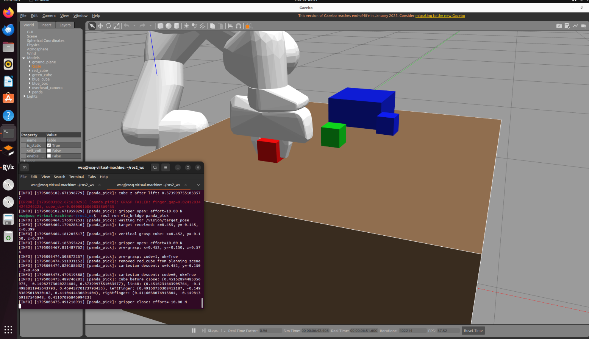

# 2026-11-18 Day 28 原始记录

## 今天的目标

- 继续解决 Panda 抓取后抬升失败的问题。
- 先固定方块，隔离位置误差和路径问题。
- 再恢复动态方块，验证夹持和抬升。
- 今天结束前备份整个 `abandon` 目录，并整理到 GitHub。

## 用户今天的收获（原话）

> 学到了控制变量法进行调试，当观察到多次抓取每次物块都被挤开考虑到了物理信息如抓夹闭合宽度和box大小，最后控制箱子固定，观察到穿模现象，多次调试数学参数发现没有解决根本问题，于是引入力控概念，最后成功到达目标位置（尚未解决抓取摩擦力过小抓不住问题）

## 实验路线

### 1. 固定方块

在 `panda_table.world` 给红方块加：

```xml
<static>true</static>
```

目的：物块不会被推走，只观察夹爪是否真正停在物块表面。

### 2. 位置控制阶段

手指原本只有：

```yaml
command_interfaces:
  - position
```

现象：

```text
手指闭合到 0.0
物块固定不动
视觉上手指穿进物块
```

结论：

```text
position 命令直接设置关节位置
没有真正让接触力阻止手指
```

### 3. 手指 collision 修正

读取 `finger.stl` 包围盒：

```text
min:    [-0.010479, -0.000133, 0.000132]
max:    [ 0.010495,  0.026403, 0.053849]
size:   [ 0.020974,  0.026536, 0.053717]
center: [ 0.000008,  0.013135, 0.026990]
```

把左右手指 collision 改成匹配包围盒的 box，并镜像右手的 y 偏移。视觉穿模明显改善，但还不够。

### 4. 引入 effort 控制

控制器从：

```text
forward_command_controller/ForwardCommandController
```

切换到：

```text
effort_controllers/JointGroupEffortController
```

手指改成 effort 命令接口：

```xml
<command_interface name="effort"/>
```

`panda_pick` 改为：

```text
open:  +10 N
close: -10 N
```

注意：手指是 prismatic joint，effort 单位是 N，不是 Nm。URDF 手指 effort 上限为 20 N。

### 5. 固定方块接触测试

命令：

```bash
ros2 run vla_bridge panda_pick
```

关键日志：

```text
cartesian descent: x=0.450, y=-0.150, z=0.471
cartesian descent: code=0, ok=True
cube before close: (0.45, -0.15, 0.376)
link8: (0.449998, -0.150013, 0.470977)
leftfinger: (0.489998, -0.150012, 0.412577)
rightfinger: (0.409998, -0.150012, 0.412577)
gripper close: effort=-1.00 Nm
fingers stable: True
finger positions after close: [0.025127, 0.024132], average=0.024629
```

视觉上不再穿模；手指停在方块半宽 `0.025` 附近。

### 6. 恢复动态方块

移除 `<static>true</static>`，恢复可动红方块。

固定测试默认关闭：

```text
fixed_cube_test = False
```

最终测试：

```text
pre-grasp: code=1
removed red_cube from planning scene
cartesian descent: code=0
gripper close: -10 N
fingers stable: True
finger positions after close: [0.025764, 0.022493], average=0.024128
cartesian lift: code=0, ok=True
cube after lift: z=0.3739997551033577
GRASP FAILED: cube_dz=-0.0008016
```

方块没有被抬起来，仍然停在桌面附近。

### 7. 摩擦参数调整

红方块：

```text
mu  = 2.0
mu2 = 1.5
```

左右手指：

```text
mu1 = 2.0
mu2 = 2.0
```

修改后最终日志仍然是：

```text
gripper close: effort=-10.00 N
fingers stable: True
finger positions after close: [0.025764, 0.022493], average=0.024128
cartesian lift: code=0, ok=True
cube after lift: z=0.3739997551033577
GRASP FAILED: cube_dz=-0.0008016
```

结论：提高摩擦和 10 N 夹紧力后仍然滑脱，问题还没有解决。

## 当前状态

```text
路径规划：已解决
垂直下探/抬升：已改为笛卡尔路径
手指穿模：视觉上已明显改善
夹爪控制：已从 position 切到 effort
抓取抬升：仍然失败
方块 z 高度没有增加
```

## 今天确认的事情

- 物块固定不是穿模的原因；固定只是让穿模更容易观察。
- 位置控制不能可靠处理手指与物块的接触。
- effort 控制器能产生接触，但当前 10 N 和摩擦参数仍不足以稳定抬升。
- 抬升路径已改成笛卡尔直线，横向摆动问题解决。
- 下一步不应该继续盲调高度，需要检查接触法向、接触面积、摩擦模型或夹爪与物块的相对位姿。

## 代码提交

```text
7f6cef2 feat: use JointGroupEffortController with stall check
665ad35 test: restore dynamic cube and fix contact gap check
92acc3b fix: increase gripper force and use cartesian lift
b4ba3d3 fix: increase cube and finger friction
```

## 备份

```text
C:\Users\28400\Desktop\abandon_backup_2026-11-18.zip
```

## 截图



最终测试仍然是 `GRASP FAILED`。
