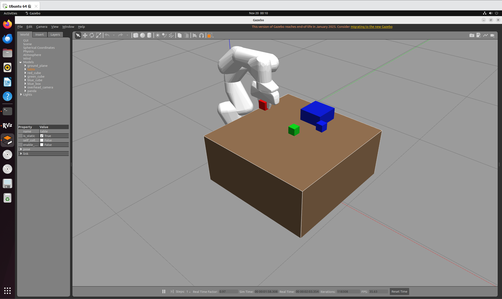

# 2026-11-19 Day 29 原始记录

## 今天的目标

- 用 Gazebo 的 link attach 插件把红方块固定到 Panda 手部，先看到完整的“下降 → 闭合 → 附着 → 抬升”。
- 记录清楚最后一个 `attach` 错误，以及它和之前“抓不起来”的关系。

## 成功日志

关键部分：

```text
detach link panda_link8: success=False ...
detach link panda_link7: success=False ...
detach link panda_hand: success=False ...

pre-grasp: code=1, ok=True
cartesian descent: code=0, ok=True
gripper close: effort=-10.00 N
fingers stable: True

attach link panda_link8: success=False,
  message=Failed to find link with name: panda_link8

attach link panda_link7: success=True,
  message=ATTACHED: {MODEL , LINK} ->
  {panda , panda_link7} -- {red_cube , link}.

cartesian lift: code=0, ok=True,
  actual_link8=(0.4500, -0.1500, 0.6740)

fingers after lift:
  {'panda_finger_joint1': 0.024289,
   'panda_finger_joint2': 0.023967}

cube after lift pose:
  (0.4502, -0.1499, 0.5790)

cube z after lift: 0.5789621069407617
GRASP SUCCESS
```

截图：



## 最后这个错误是什么

```text
Failed to find link with name: panda_hand
Failed to find link with name: panda_link8
```

Gazebo Classic 会把由**固定关节**连接的 link 合并成一个整体。  
`panda_hand` 和 `panda_link8` 都是固定连接在 `panda_link7` 后面的，所以 Gazebo 里实际存在的末端 link 是：

```text
panda_link7
```

服务按名字找 `panda_hand` / `panda_link8`，找不到；换到 `panda_link7` 就成功。

通俗地说：

```text
Gazebo 把用固定关节“焊死”的零件合并成一个整体
名字还挂在图纸上，但 Gazebo 内部只保留合并后的 link7
所以按 hand/link8 去找，找不到人
```

## 和之前抓不起来有关系吗

没有直接关系。

之前抓不起来是**实际接触摩擦不足**：

```text
夹爪闭合了
手指停在方块两侧
但抬升时手指继续闭合，方块滑脱
```

今天的 `attach` 是给方块和 `panda_link7` 创建一个固定关节，相当于在 Gazebo 里把方块“粘”到手上：

```text
物理摩擦夹不住
→ 用 attach 固定关节绕过摩擦
```

所以：

```text
panda_hand 名字错误 → 只会让这个 attach 补丁失效，节点停在原地
之前抓不起来 → 是摩擦/接触问题，不是名字问题
```

如果一开始 attach 就用 `panda_link7`，今天会更早成功；但那是仿真附着，不是真正的力控抓取。

## 今天修过的其他问题

1. `linkattacher_msgs` 没在运行终端里 source：
   ```text
   ModuleNotFoundError: No module named 'linkattacher_msgs'
   ```
2. `use_link_attacher` 在 `declare_parameter` 之前读取：
   ```text
   ParameterNotDeclaredException
   ```
3. Gazebo 插件路径没有显式传给 launch：
   - launch 中设置 `GAZEBO_PLUGIN_PATH`
4. Gazebo 固定关节合并：
   - 尝试 `panda_link8`、`panda_link7`、`panda_hand`
   - 最终 `panda_link7` 成功

## 当前状态

```text
Gazebo 仿真抓取：完成（使用 link attach）
物理摩擦抓取：仍未解决
真机：未开始
place：未做
```

## 说明

今天的成功是**仿真 link attach**，不是真机力控。  
这个结果可以用于演示完整流程，但不能直接说明真实 Panda 夹爪在 10 N / 当前摩擦下能抓起这个 5 cm 方块。
