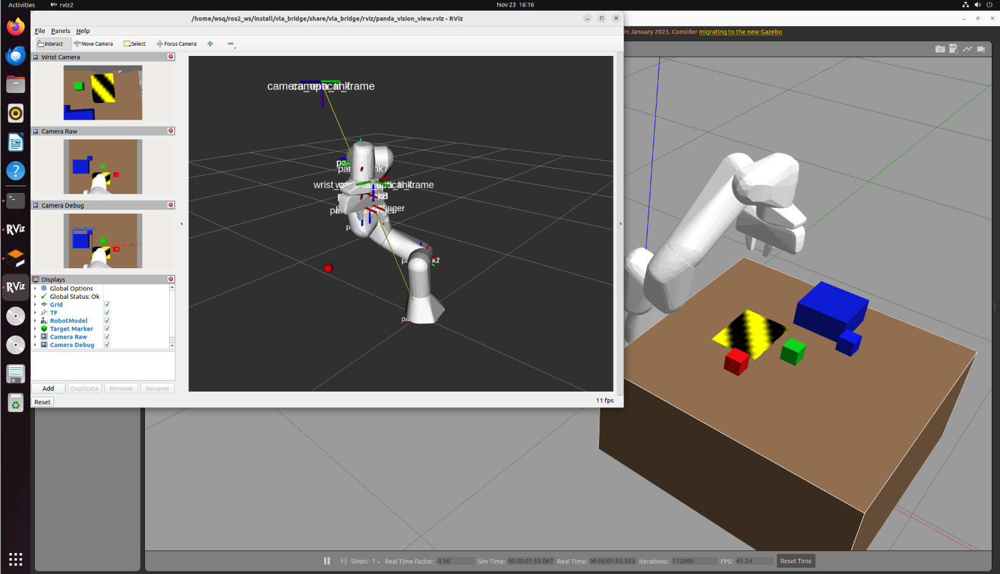
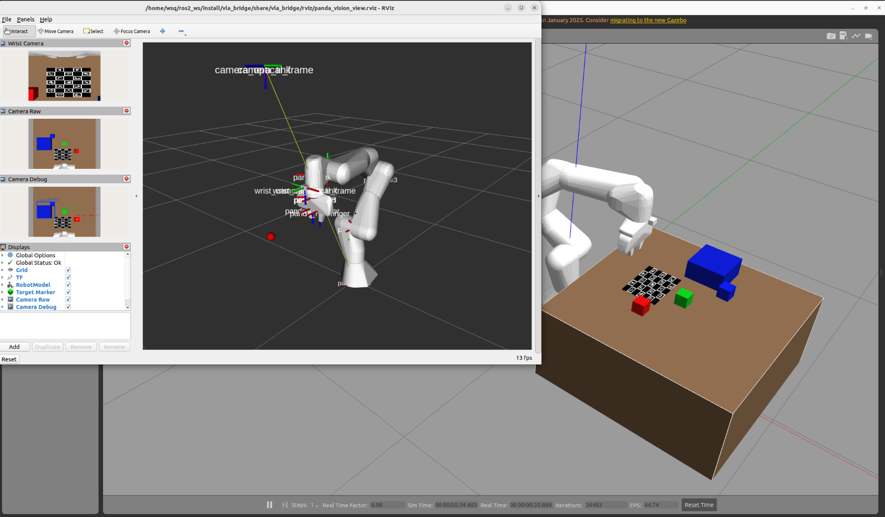

# 2026-11-23 Day 33 原始记录

## 今天的目标

- 把 ChArUco 标定板接进腕部相机。
- 完成单帧检测，让 PnP 位姿可信。
- 采 12–15 个手眼标定姿态。
- 如果顺利，开始纯 AX=XB 手眼标定。

## 今天解决的五个问题

### 1. 标定板纹理不显示

第一次 spawn 后 Gazebo 里是黄黑斜条纹，检测报 `no ArUco markers`。

原因：`model.sdf` 只注册了 `.material` 脚本，没有注册 `materials/textures` 目录。

修复：同时注册 scripts 和 textures 两个目录，并重启 Gazebo 清 OGRE 材质缓存。

### 2. 320×240 下 marker 解不稳

板子只检测到 10/17 个 marker、9/24 个角点。

原因：每个 ArUco 数据位只有约 2.7 px。

修复：腕部相机从 320×240 提到 640×480，K 自动变成：

```text
fx = fy = 554.255
cx = 320.5, cy = 240.5
```

改后 17/17 markers、24/24 corners。

### 3. PnP 重投影 8.3 px

所有 marker 和角点都检出了，但两组 IPPE 解的重投影都是 8.3–8.5 px，法向约 62°。

原因：Gazebo 把纹理贴到 box 顶面时**旋转了 90° 并拉伸成 2:1**。raw 图里 marker 中心排成 7 列 × 5 行，列间距约 26 px、行间距约 51 px。

修复：把纹理旋转 90°，变成 840×600，让 840 px 边对应 0.21 m、600 px 边对应 0.15 m。

修复后：

```text
solution 0: reproj 0.330 px
solution 1: reproj 0.377 px
normal ~ (0, 0, -1)
```

### 4. IPPE 双解有隐患

用户问：“IPPE双解会有隐患吗？”

结论：有。平面板近正视时两组解几乎重合，噪声可能让分支翻转；
但倾斜姿态下两组解会明显分开。

处理：

- 两组解都记录 reproj / normal / tvec；
- `gap < 0.1 px` 标记为 ambiguous；
- 求解时用静态板一致性检查，而不是盲信单帧最小误差。

### 5. 固定手位导致板子被切

pilot 里 20° 倾斜时只剩 7–11 个 marker。

原因：固定手部 x/y/z，没有跟着相机安装偏置和倾斜走；板子中心偏离光轴，垂直半 FOV 只有约 23.4°，上沿被切。

修复：改成“瞄准板中心”生成手位，见 [notes.md](notes.md)。

## 瞄准法一句话

先决定相机从哪个方向看板子，再反推手要站在哪，使相机光轴正好穿过板中心并保持距离 `d`。

```text
axis   = R_hand · R_hand→cam · [0,0,1]
p_cam  = p_board - d · axis
p_hand = p_cam - R_hand · t_hand→cam
```

名义安装变换只用于选姿态，不进入 AX=XB。

## full 15 姿态报告

每个姿态采 3 帧，取重投影最小的一帧。数据来自本地 full 15 姿态运行。

```text
pose        d(m)  tilt/roll  markers  corners  reproj(px)  gap(px)  ambiguous
d46         0.46  -          17       24       0.115       0.023    yes
d50         0.50  -          17       24       0.157       0.034    yes
d54         0.54  -          17       24       0.109       0.051    yes
x_plus      0.50  -          17       24       0.084       0.364    no
x_minus     0.50  -          17       24       0.096       0.345    no
y_plus      0.50  -          17       24       0.088       0.626    no
y_minus     0.50  -          17       24       0.104       0.556    no
xy_plus     0.50  -          17       24       0.085       0.695    no
xy_minus    0.50  -          17       24       0.087       0.747    no
tilt_xp10   0.52  +10° x     17       24       0.086       1.355    no
tilt_xm10   0.52  -10° x     17       24       0.079       1.482    no
tilt_yp10   0.52  +10° y     17       24       0.075       1.408    no
tilt_ym10   0.52  -10° y     17       24       0.096       1.395    no
roll_zp30   0.50  +30° z     17       24       0.066       0.033    yes
roll_zm30   0.50  -30° z     17       24       0.043       0.039    yes

accepted 15/15
```

## 从报告里读出的规律

- 近正视（d46/d50/d54）和纯滚转：gap 0.02–0.05 px，分支模糊；
- 横向平移：gap 0.35–0.75 px，开始可分；
- ±10° 倾斜：gap 1.35–1.48 px，分支非常清楚。

所以后续求解不能只看“重投影最小”，还要看 gap 和姿态多样性。
倾斜姿态是主力，近正视姿态用于一致性检查或加权。

## 截图





## 下一步

- 上传 `poses.json` / `poses.csv`；
- 写 `hand_eye_calibrate.py`：
  - `cv2.calibrateHandEye` 四种方法；
  - gap 过滤；
  - 静态板 `T_base_target` 一致性；
  - 留出姿态验证；
  - 与 URDF 真值比较。

## 用户原话

> IPPE双解会有隐患吗

> 今天解决那个始终让板保持在中心的解决方法挺有意思，
> 可以简单通俗易懂解释一下并且放进日志。然后这是报告也可以放。
