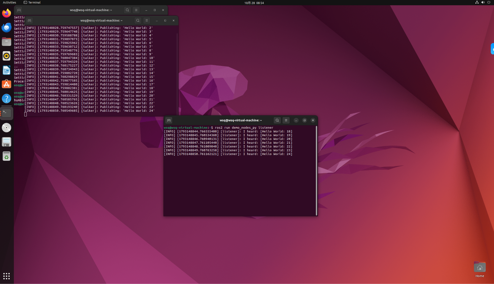
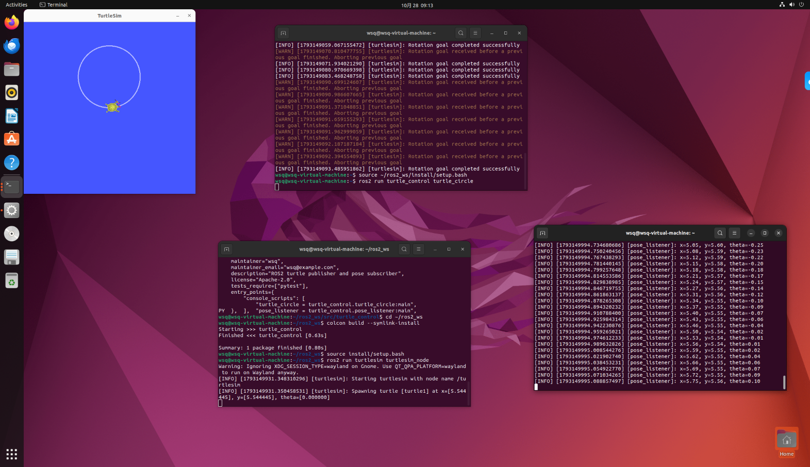

# 项目 10：ROS2 Humble 入门与第一个发布/订阅节点

> 状态：✅ 已跑通。  
> 时间线：第 7 天完成环境选型、VM/Ubuntu 方案和包骨架；第 8 天完成安装与验证。  
> Ubuntu 22.04、ROS2 Humble、talker/listener、turtlesim，以及自己的
> `turtle_control` 发布/订阅节点都已在 VMware 虚拟机中验证。
>
> 虚拟机实际配置：Ubuntu 22.04.5 LTS、7.7 GB 内存、4 核 CPU、59 GB 磁盘（剩余约 45 GB）。

## 为什么先学 ROS2，而不是 π0？

这两个不是同一个层级的东西：

```text
ROS2 = 机器人的操作系统 + 通信骨架
π0   = 一个视觉-语言-动作（VLA）策略模型
```

- **ROS2**：节点、话题、服务、Action、TF、RViz、Gazebo、ros2_control、MoveIt2……  
  负责把相机、机械臂、控制器和算法接起来；
- **π0 / OpenPI**：输入图像、语言和机器人状态，输出动作序列。  
  它不是入门框架，需要机器人数据、动作空间对齐、推理服务和 ROS2 桥接。

所以学习路线是：

```text
ROS2 基础 → 仿真/控制 → MoveIt2 → 再玩 π0/VLA
```

## 环境选择

| 项目 | 选择 |
| --- | --- |
| 虚拟机 | VMware Workstation |
| 操作系统 | Ubuntu 22.04 LTS Desktop |
| ROS 版本 | ROS2 Humble |
| 建议内存 | 8 GB；主机 32 GB 时可用 12~16 GB |
| CPU | 4 核；主机核心多可用 6 核 |
| 磁盘 | 60 GB |
| 显示 | 开启 3D 加速，显存 2 GB |
| 网络 | NAT |

Kali 虚拟机保留，不用于 ROS2；新建一台 Ubuntu 虚拟机。

## 当前进度

- [x] 确定 ROS2 优先于 π0 的路线；
- [x] 选择 Ubuntu 22.04 + ROS2 Humble；
- [x] 准备 VMware 虚拟机配置和安装步骤；
- [x] 完成 Ubuntu 安装；
- [x] 安装 VMware Tools、更新系统、打快照；
- [x] 安装 ROS2 Humble；
- [x] 跑通 talker/listener；
- [x] 跑通 turtlesim；
- [x] 运行自己的 `turtle_control` 发布/订阅节点。

## 实际验证结果

### 1. 官方 talker / listener

两个终端分别运行 `demo_nodes_cpp talker` 和 `demo_nodes_py listener`，
listener 持续打印 `I heard: [Hello World: ...]`，说明 ROS2 安装与 DDS 通信正常。



### 2. turtlesim + 自己的节点

- `turtle_control/turtle_circle` 发布 `/turtle1/cmd_vel`；
- 海龟持续画圆；
- `turtle_control/pose_listener` 订阅 `/turtle1/pose`，持续打印 `x/y/theta`。



## 踩过的坑

### 1. raw.githubusercontent.com 被拒绝

最开始按官方命令下载 ROS 密钥时报：

```text
curl: (7) Failed to connect to raw.githubusercontent.com port 443
Connection refused
```

解决方式：

- 从 `keyserver.ubuntu.com` 获取 ROS 公钥；
- 使用清华大学的 ROS2 apt 镜像：

```text
https://mirrors.tuna.tsinghua.edu.cn/ros2/ubuntu
```

然后 `sudo apt update` 和 `sudo apt install ros-humble-desktop` 正常完成。

### 2. 海龟键盘遥操作按太快会刷警告

快速按方向键时，turtlesim 会打印：

```text
Rotation goal received before a previous goal finished. Aborting previous goal
```

这是 turtlesim 在上一个旋转目标还没完成时收到新目标，主动取消旧目标；
不是程序崩溃。慢一点按键即可，或者让自定义节点用固定频率发布速度。

### 3. Wayland 警告

启动 turtlesim 时可能看到：

```text
Warning: Ignoring XDG_SESSION_TYPE=wayland on Gnome.
```

这是 Qt 在 Wayland 下的提示，不影响海龟和 ROS2 话题通信。

## 第一个 ROS2 节点目标

在 turtlesim 里：

```text
发布 /turtle1/cmd_vel  →  海龟画圆
订阅 /turtle1/pose     →  打印 x/y/theta
```

这对应 ROS2 最核心的模型：

```text
Node（节点）
  ├── Publisher  → Topic /turtle1/cmd_vel  →  turtlesim
  └── Subscriber ← Topic /turtle1/pose
```

## 代码结构

```text
project10_ros2/
└── ros2_ws/
    └── src/
        └── turtle_control/
            ├── package.xml
            ├── setup.py
            ├── setup.cfg
            ├── resource/turtle_control
            └── turtle_control/
                ├── __init__.py
                ├── turtle_circle.py
                └── pose_listener.py
```

- `turtle_circle.py`：发布 `geometry_msgs/Twist`；
- `pose_listener.py`：订阅 `turtlesim/Pose`；
- `setup.py`：注册两个命令行入口。

## 复现步骤（ROS2 装好后）

```bash
# 1. 安装 turtlesim
sudo apt install -y ros-humble-turtlesim

# 2. 编译工作空间
cd project10_ros2/ros2_ws
source /opt/ros/humble/setup.bash
colcon build --symlink-install
source install/setup.bash

# 3. 终端 1：海龟窗口
ros2 run turtlesim turtlesim_node

# 4. 终端 2：发布速度
ros2 run turtle_control turtle_circle

# 5. 终端 3：订阅位姿
ros2 run turtle_control pose_listener
```

## 完成标准

- 海龟持续画圆；
- `pose_listener` 持续打印 `x/y/theta`；
- `ros2 node list` 和 `ros2 topic list` 能看到节点和话题；
- 能解释发布者、订阅者、消息类型和 ROS2 节点图。

## 后续

ROS2 基础跑通后，再继续：

1. 自定义消息接口；
2. launch 文件与参数；
3. TF2 / URDF / RViz；
4. Gazebo + ros2_control；
5. MoveIt2 机械臂抓取；
6. 最后再考虑 π0/OpenPI 这类 VLA 模型。
