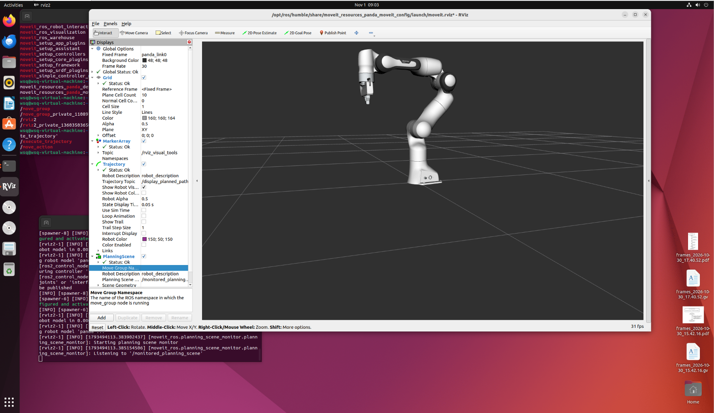
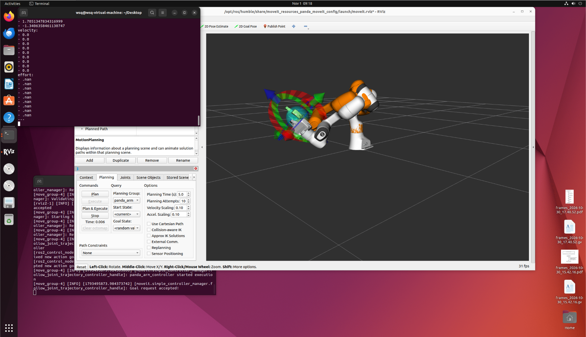
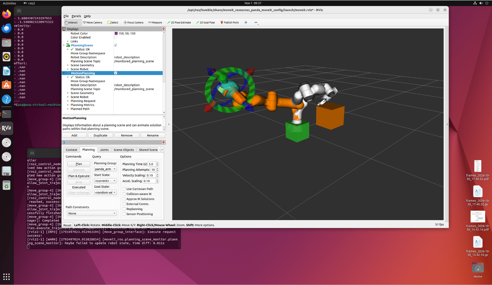

# 项目 13：MoveIt2 运动规划与避障

> 状态：✅ 已跑通。
>
> 时间：2026.11.01 ｜ 第 12 天 ｜ ROS2 周 Day 4
>
> 环境：Ubuntu 22.04.5 + ROS2 Humble + MoveIt2 2.5.10
>
> 目标：从“控制器执行给定轨迹”推进到“MoveIt2 规划一条无碰撞轨迹”。

第 11 天解决的是：

```text
给定一条关节轨迹，怎么让 Gazebo 里的关节执行
```

今天解决的是：

```text
给定一个目标，机器人应该走哪条轨迹才安全、不碰撞、关节不超限
```

---

## 1. MoveIt2 是什么

可以用开车来类比：

| 层 | 对应 |
| --- | --- |
| IK | 知道“我要去哪个停车位” |
| MoveIt2 | 导航软件：规划一条不撞墙、不逆行的路线 |
| `joint_trajectory_controller` | 自动驾驶执行层：按路线控制方向盘和油门 |
| Gazebo / 真机 | 真实道路和车辆 |

所以：

```text
MoveIt2 不是控制器
MoveIt2 是运动规划框架
```

它负责：

- 读取机器人模型和 SRDF；
- 管理规划组；
- 维护 PlanningScene；
- 检查碰撞；
- 规划一条从当前状态到目标状态的轨迹；
- 把轨迹交给控制器执行。

---

## 2. 今天的数据流

```text
目标位姿 / 目标关节角
        ↓
MoveIt2（move_group）
        ↓ 规划、避障、检查关节限位
FollowJointTrajectory
        ↓
joint_trajectory_controller
        ↓
ros2_control
        ↓
Gazebo / 真机
```

今天使用的是 MoveIt2 官方 Panda demo：

```text
机器人：Panda
规划组：panda_arm
执行器：MoveIt demo 自带的 fake controller
```

因此今天机械臂只在 RViz 里动，没有接 Gazebo 物理仿真。MoveIt2 的规划概念和接口是一样的，后面再把执行层换成 Gazebo 或真机即可。

---

## 3. 环境与启动

### 3.1 安装

```bash
sudo apt install -y ros-humble-moveit ros-humble-moveit-resources-panda-moveit-config
```

### 3.2 启动 Panda demo

```bash
source /opt/ros/humble/setup.bash
```

```bash
ros2 launch moveit_resources_panda_moveit_config demo.launch.py
```

### 3.3 显示 MotionPlanning

**注意：在 Humble 的这版 MoveIt2 里，MotionPlanning 是 Display，不是 Panel。**

XML 里的注册信息：

```text
name="moveit_rviz_plugin/MotionPlanning"
type="moveit_rviz_plugin::MotionPlanningDisplay"
base_class_type="rviz_common::Display"
```

所以添加位置是：

```text
Displays → Add → MotionPlanning
```

不是在：

```text
Panels → Add New Panel
```

`Panels → Add New Panel` 里只有 `rviz_common` 的面板，找不到 MotionPlanning 是正常的。

---

## 4. 第一次 Plan + Execute

在 MotionPlanning 界面里：

```text
Planning Group: panda_arm
Start State: Current
Goal State: <random valid>
```

操作顺序：

1. 点 `Plan`：只计算轨迹，显示半透明路径；
2. 检查路径；
3. 点 `Execute`：把轨迹交给控制器执行。

区别：

| 按钮 | 作用 |
| --- | --- |
| `Plan` | 只计算并预览轨迹 |
| `Execute` | 执行已经规划好的轨迹 |
| `Plan & Execute` | 计算后立即执行 |
| `Stop` | 停止执行 |



---

## 5. 加入障碍物

在 MotionPlanning 界面里找到：

```text
Scene Objects
```

添加一个 `Box`，例如：

```text
名称：obstacle_box
尺寸：0.15 × 0.20 × 0.30 m
位置：x ≈ 0.50, y ≈ 0.00, z ≈ 0.30
```

如果 `Start State` 变红，说明盒子压到了当前机械臂，把盒子移远一点。

盒子加入后，MoveIt2 会把它作为 `Collision Object` 放进 PlanningScene。之后规划会绕开它。



---

## 6. 避障结果

在场景里放两个盒子，再设置一个会经过障碍物附近的目标：

```text
Planning Group: panda_arm
Start State: Current
Goal State: <random valid>
```

点 `Plan`，观察轨迹是否绕开盒子；确认后点 `Execute`。



截图里：

- 绿色和橙色盒子是 Collision Objects；
- Panda 的轨迹绕开了它们；
- 终端输出 `Execute request success`；
- 有一条警告：

```text
Maybe failed to update robot state, time diff 0.011s
```

这是 RViz 的时序警告，不是执行失败。

---

## 7. 为什么路径看起来扭曲

默认 MoveIt2 常用 OMPL 的采样规划器，例如 RRTConnect。它的目标不是“路径好看”，而是：

```text
找到一条无碰撞、满足关节限位的可行路径
```

原因：

1. **Panda 是 7 自由度冗余机械臂**
   同一个末端位姿可能有很多组关节角，规划器只挑一组可行的。

2. **它在关节空间里规划**
   关节空间里的直线，末端在笛卡尔空间里可能是一条曲线，看起来会绕来绕去。

3. **默认先找到可行解，不一定最优**
   RRTConnect 找到一条可行路径就返回，不会继续优化路径长度或平滑度。

所以：

```text
路径扭曲 ≠ 规划失败
路径穿模 / 撞到盒子 = 规划失败
```

如果想让路径更自然，可以尝试：

- RRT* / PRM；
- 增加 planning time / attempts；
- `Use Cartesian Path`；
- CHOMP / STOMP；
- Pilz PTP / LIN / CIRC；
- 给末端加姿态约束。

---

## 8. 接口

### 8.1 Actions

```bash
ros2 action list -t
```

| Action | 类型 | 作用 |
| --- | --- | --- |
| `/move_action` | `moveit_msgs/action/MoveGroup` | MoveIt 规划并执行 |
| `/execute_trajectory` | `moveit_msgs/action/ExecuteTrajectory` | 执行已有轨迹 |
| `/panda_arm_controller/follow_joint_trajectory` | `control_msgs/action/FollowJointTrajectory` | 控制器执行关节轨迹 |
| `/panda_hand_controller/gripper_cmd` | `control_msgs/action/GripperCommand` | 夹爪开合 |

`ros2 action info /move_action` 输出：

```text
Action clients: /rviz2
Action servers: /move_group
```

含义：

```text
RViz 发 goal
move_group 负责规划/执行
```

完整链路：

```text
RViz → /move_action → move_group
        ↓
move_group → /panda_arm_controller/follow_joint_trajectory
        ↓
控制器执行
```

> 在当前的 ROS2 CLI 里，`ros2 action info` 只显示 client/server，不显示 action type；类型用 `ros2 action list -t` 看。

### 8.2 Services

```bash
ros2 service list | grep -E 'compute_ik|planning_scene'
```

| Service | 作用 |
| --- | --- |
| `/compute_ik` | 输入末端位姿，求关节角 |
| `/apply_planning_scene` | 添加/删除障碍物 |
| `/get_planning_scene` | 获取当前规划场景 |

在 RViz 的 Scene Objects 里加盒子，底层就是通过 `/apply_planning_scene` 把障碍物送进 MoveIt。

### 8.3 Topics

```bash
ros2 topic list | grep -E 'planning_scene|joint_states|robot_description'
```

| Topic | 作用 |
| --- | --- |
| `/monitored_planning_scene` | MoveIt 监控的当前场景，RViz 的 PlanningScene 显示它 |
| `/planning_scene` | 完整规划场景 |
| `/planning_scene_world` | 世界中的障碍物几何 |
| `/joint_states` | 标准关节状态，RSP/TF 使用 |
| `/dynamic_joint_states` | ros2_control 的通用状态格式 |
| `/robot_description` | URDF |

### 8.4 完整接口链路

```text
RViz 加障碍物
        ↓
/apply_planning_scene
        ↓
move_group 更新 PlanningScene
        ↓
/monitored_planning_scene
        ↓
碰撞检测 + 规划

RViz 点 Plan
        ↓
/move_action
        ↓
move_group 规划
        ↓
/panda_arm_controller/follow_joint_trajectory
        ↓
控制器执行
```

---

## 9. 踩过的坑

### 9.1 MotionPlanning 找不到

它不是 Panel，是 Display。正确入口：

```text
Displays → Add → MotionPlanning
```

### 9.2 `ros2 action info` 没有 Action type

当前 CLI 只显示 client/server；类型用：

```bash
ros2 action list -t
```

### 9.3 规划失败

常见原因：

```text
Start State 和障碍物碰撞
目标在障碍物内部
目标不可达
关节限位
```

先把障碍物移开，再试 `<random valid>`。

### 9.4 路径诡异但没碰撞

采样规划器 + 7 自由度冗余，属于正常现象。需要更自然的路径时换 planner 或加约束。

### 9.5 这个 demo 没有物理

MoveIt demo 使用 fake controller，只在 RViz 里动；Gazebo 接入是后续工作。

---

## 10. 和真机、VLA 的关系

| 今天学的 | 真机/VLA 中的用途 |
| --- | --- |
| `move_group` | 真机运动规划服务 |
| PlanningScene | 感知系统添加障碍物 |
| `/move_action` | 高层任务发送目标 |
| `/execute_trajectory` | 执行规划好的轨迹 |
| `/compute_ik` | 目标位姿求关节角 |
| `/apply_planning_scene` | 动态更新障碍物 |
| `follow_joint_trajectory` | 真机底层控制器接口 |

VLA 输出的是高层动作或目标，最终仍然要经过：

```text
VLA 目标 → MoveIt2 规划 → 轨迹 → 控制器 → 真机
```

---

## 11. 下一步

今天的 MoveIt2 还在 RViz + fake controller 里。

下一步：

```text
把 MoveIt2 接到 Gazebo / ros2_control
        ↓
加入感知（相机 / YOLO / 点云）
        ↓
做感知 → 规划 → 抓取的闭环
```
