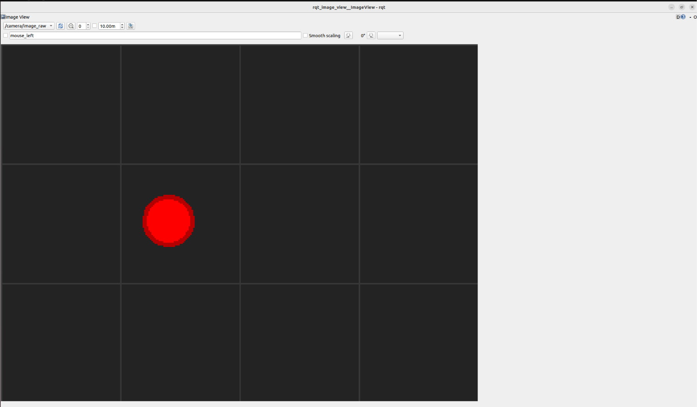
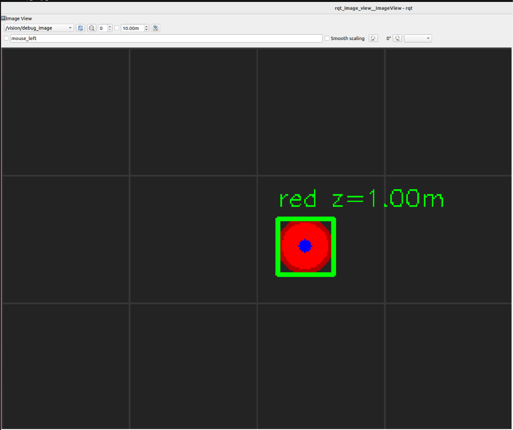
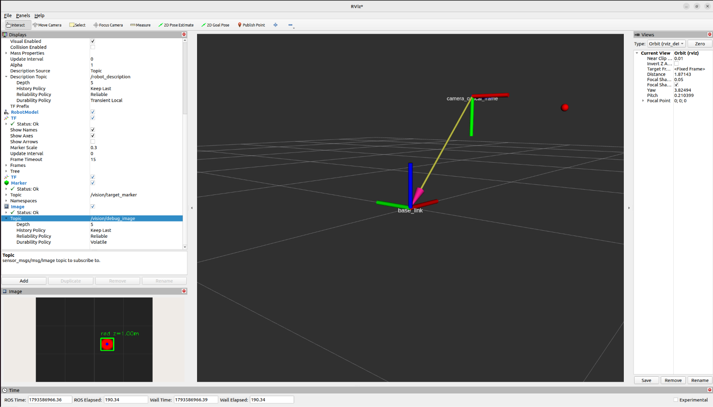

# 项目 14：ROS2 感知接入与视觉检测

> 状态：✅ 已跑通。
>
> 时间：2026.11.02 ｜ 第 13 天 ｜ ROS2 周 Day 5
>
> 环境：Ubuntu 22.04.5 + ROS2 Humble + OpenCV 4.5.4
>
> 目标：从“MoveIt2 能规划”推进到“感知能提供目标位置”。

第 12 天解决的是：

```text
给定目标，MoveIt2 规划并执行
```

今天解决的是：

```text
目标从哪来？
```

答案是：

```text
相机图像 + 深度 → 检测 → 三维坐标 → 转进 base_link
```

---

## 1. 今天的数据流

```text
虚拟 RGB-D 相机
  ├── /camera/image_raw
  ├── /camera/depth/image_raw
  └── /camera/camera_info
            ↓
     message_filters 时间同步
            ↓
     cv_bridge 转 OpenCV
            ↓
     HSV 检测红色目标
            ↓
     深度反投影 → 相机坐标 (X, Y, Z)
            ↓
     vision_msgs/Detection3DArray
            ↓
     TF: camera_optical_frame → base_link
            ↓
     /vision/target_pose + /vision/target_marker
```

---

## 2. 为什么先用虚拟相机

今天没有真实相机，也没有 Gazebo 相机，而是用代码合成 RGB-D 数据。

这不是“伪造结果”，而是给感知链路做一套**带 ground truth 的测试夹具**：

```text
已知目标真值
        ↓
合成 RGB + 深度
        ↓
检测 / 反投影 / TF / 发布
        ↓
检测结果与真值对比
        ↓
确认链路正确后，再替换成真实相机
```

虚拟相机里目标的位置是我们自己设的：

```text
x = 0.15 * sin(t)
y = 0.04 * cos(t)
z = 1.0
```

因此可以检查：

- 检测框是否框住红点；
- 深度是否约为 1.0 m；
- 反投影得到的 X/Y 是否接近设定值；
- TF 后 base_link 下的位置是否符合相机安装关系。

好处是问题定位很清楚：

| 现象 | 优先怀疑 |
| --- | --- |
| 没有图像 | 话题、QoS、驱动 |
| 检测不到 | HSV/模型、编码、预处理 |
| 3D 坐标不对 | 内参、深度编码、反投影 |
| 坐标对但机器人位置不对 | TF、坐标系方向、时间同步 |

---

## 3. 代码结构

```text
project14_ros2_perception/
├── README.md
├── assets/
│   ├── camera_image.png
│   ├── debug_detection.png
│   └── rviz_target.png
└── ros2_ws/
    └── src/
        └── vision_demo/
            ├── package.xml
            ├── setup.py
            ├── setup.cfg
            ├── resource/vision_demo
            └── vision_demo/
                ├── __init__.py
                ├── synthetic_camera.py
                └── detector_node.py
```

| 文件 | 作用 |
| --- | --- |
| `synthetic_camera.py` | 生成 RGB、深度、CameraInfo |
| `detector_node.py` | 同步图像、检测红色目标、反投影、TF、发布结果 |
| `package.xml` | ROS2 依赖 |
| `setup.py` | 注册两个节点 |

---

## 4. 复现步骤

### 4.1 安装依赖

```bash
sudo apt install -y ros-humble-cv-bridge ros-humble-image-transport ros-humble-vision-msgs ros-humble-message-filters ros-humble-tf2-geometry-msgs ros-humble-visualization-msgs python3-opencv
```

### 4.2 把包放进工作空间

```bash
mkdir -p ~/ros2_ws/src/vision_demo
```

```bash
cp -r project14_ros2_perception/ros2_ws/src/vision_demo/. ~/ros2_ws/src/vision_demo/
```

### 4.3 编译

```bash
cd ~/ros2_ws
```

```bash
source /opt/ros/humble/setup.bash
```

```bash
colcon build --symlink-install --packages-select vision_demo
```

```bash
source install/setup.bash
```

### 4.4 启动虚拟相机

```bash
ros2 run vision_demo synthetic_camera
```

### 4.5 启动检测节点

新开终端。

```bash
source /opt/ros/humble/setup.bash
```

```bash
source ~/ros2_ws/install/setup.bash
```

```bash
ros2 run vision_demo detector_node
```

### 4.6 发布静态 TF

新开终端。

```bash
ros2 run tf2_ros static_transform_publisher --x 0.5 --y 0.0 --z 0.5 --roll -1.5708 --pitch 0.0 --yaw -1.5708 --frame-id base_link --child-frame-id camera_optical_frame
```

这表示相机位于 base_link 前方 0.5 m、上方 0.5 m，并使用相机光学坐标系方向。

### 4.7 看图像

```bash
ros2 run rqt_image_view rqt_image_view /camera/image_raw
```

```bash
ros2 run rqt_image_view rqt_image_view /vision/debug_image
```

### 4.8 看 3D 目标

```bash
ros2 run rviz2 rviz2
```

RViz 设置：

```text
Fixed Frame: base_link
Add → TF
Add → Marker
Marker Topic: /vision/target_marker
Add → Image
Image Topic: /vision/debug_image
```

---

## 5. 实验结果

### 5.1 虚拟相机图像



`/camera/image_raw`：

- 320×240；
- 10 Hz；
- 深灰背景 + 网格；
- 红色目标缓慢移动。

### 5.2 检测结果



`/vision/debug_image`：

- 绿色检测框；
- 蓝色中心点；
- `red z=1.00m`。

对应的标准检测消息发布到：

```text
/vision/detections
```

### 5.3 base_link 下的 3D 目标



RViz 里：

- `base_link` 在原点；
- `camera_optical_frame` 在相机安装位置；
- 红色球是检测目标变换到 base_link 后的位置；
- 左下角 Image 显示 debug 图像。

---

## 6. 关键话题和消息

| 话题/服务 | 作用 |
| --- | --- |
| `/camera/image_raw` | RGB 图像，`sensor_msgs/Image`，编码 `bgr8` |
| `/camera/depth/image_raw` | 深度图，`sensor_msgs/Image`，编码 `32FC1`，单位米 |
| `/camera/camera_info` | 相机内参，`sensor_msgs/CameraInfo` |
| `/vision/debug_image` | 带检测框的图像 |
| `/vision/detections` | `vision_msgs/Detection3DArray` |
| `/vision/target_pose` | base_link 下的 `geometry_msgs/PoseStamped` |
| `/vision/target_marker` | RViz 红色球，`visualization_msgs/Marker` |

---

## 7. 踩过的坑

### 7.1 640×480 图像掉帧

开始时 `image_raw` 只有约 1 Hz，而 `camera_info` 是 10 Hz。

原因：大图像消息在 VM/DDS 路径上出现明显背压。

降到 320×240 后恢复：

```text
image_raw ≈ 10 Hz
depth ≈ 10 Hz
```

### 7.2 `vision_msgs` 字段名

Humble 的 `ObjectHypothesis` 使用：

```text
class_id
```

不是：

```text
id
```

写错会在回调里报：

```text
AttributeError: 'ObjectHypothesis' object has no attribute 'id'
```

### 7.3 rqt_image_view 下拉框为空

rqt 的话题下拉框有时不会自动刷新。

可以直接指定话题：

```bash
ros2 run rqt_image_view rqt_image_view /camera/image_raw
```

### 7.4 深度图看起来不正常

深度图编码是：

```text
32FC1
```

单位是米，不是普通 8 位灰度图。`rqt_image_view` 的显示效果可能不明显；可以看数值或用 RViz/自定义色图。

### 7.5 没有 TF 时无法转到 base_link

检测节点需要：

```text
base_link → camera_optical_frame
```

这里用 `static_transform_publisher` 模拟相机安装位置。真实系统中这个变换来自 URDF 或手眼标定。

### 7.6 相机内参要完整看

`CameraInfo` 不只有 `K`，还包含：

```text
D、R、P、distortion_model、roi、binning
```

单目无畸变相机常见设置：

```text
D = 0
R = 单位矩阵
P = 3×4 投影矩阵
```

---

## 8. 关于视觉学习

这次还有一个很个人的收获：

> 找到适合自己的学习方式，感觉真是太棒了。视觉型学习者需要看到图片才能更好理解，所以我把这一点写进 memory，让后续任务尽量用 GUI、图像和 RViz 来验证，而不是只看命令行数字。

这次先看到虚拟相机拍出的图，再看到检测框，最后看到 RViz 里的 3D 目标，整条链路就变得很直观。

---

## 9. 下一步

感知已经能输出：

```text
/vision/target_pose
```

下一步把它交给 MoveIt2：

```text
检测目标
    ↓
target_pose
    ↓
MoveIt2 规划
    ↓
轨迹
    ↓
joint_trajectory_controller
    ↓
Gazebo / 真机
```

这就是感知 → 规划 → 抓取的闭环。

> 第 14 天已完成感知 → MoveIt2 的软件闭环，见 [`../project15_ros2_closed_loop/README.md`](../project15_ros2_closed_loop/README.md)。
