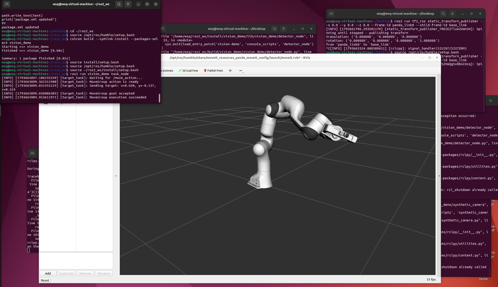

# 项目 15：感知 → MoveIt2 → 执行闭环

> 状态：✅ 已跑通。
>
> 时间：2026.11.03 ｜ 第 14 天 ｜ ROS2 周 Day 6
>
> 环境：Ubuntu 22.04.5 + ROS2 Humble + MoveIt2 + Gazebo 工具链
>
> 目标：把第 13 天的感知结果接进 MoveIt2，完成一条软件闭环。

---

## 1. 今天的数据流

```text
虚拟 RGB-D 相机
        ↓
/camera/image_raw + /camera/depth/image_raw
        ↓
detector_node
        ↓
/vision/target_pose（base_link）
        ↓
task_node
        ↓
/move_action（moveit_msgs/action/MoveGroup）
        ↓
move_group 规划
        ↓
Panda fake controller
        ↓
RViz 中 Panda 执行到目标
```

今天使用的是 MoveIt2 官方 Panda demo：

```text
机器人：Panda
规划组：panda_arm
末端 link：panda_link8
执行器：fake controller
```

所以今天验证的是**软件闭环**，还没有接 Gazebo 物理抓取。

---

## 2. 闭环结果

目标来自视觉检测，大约为：

```text
x ≈ 0.650 m
y ≈ -0.137 m
z ≈ 0.525 m
```

`task_node` 发出的 MoveGroup goal 被接受并执行成功：

```text
Sending target: x=0.650, y=-0.137, z=0.525
MoveGroup goal accepted
MoveGroup execution succeeded
```



这张图同时包含：

- `task_node` 的发送/接受/成功日志；
- MoveIt2 RViz 中的 Panda；
- Panda 已经执行到视觉目标对应的位置。

---

## 3. 代码结构

```text
project15_ros2_closed_loop/
├── README.md
├── assets/
│   └── movegroup_success.png
└── ros2_ws/
    └── src/
        └── vision_demo/
            ├── package.xml
            ├── setup.py
            ├── setup.cfg
            ├── resource/vision_demo
            ├── launch/
            │   └── perception_task.launch.py
            └── vision_demo/
                ├── __init__.py
                ├── synthetic_camera.py
                ├── detector_node.py
                └── task_node.py
```

| 文件 | 作用 |
| --- | --- |
| `synthetic_camera.py` | 发布 RGB、深度、CameraInfo；目标深度 0.35 m |
| `detector_node.py` | 检测红色目标，发布 3D 检测、TF 后的 target pose 和 marker |
| `task_node.py` | 订阅 target pose，发送 MoveGroup action |
| `perception_task.launch.py` | 一次启动 TF、相机、检测和任务节点 |
| `package.xml` / `setup.py` | 依赖、入口和 launch 安装 |

---

## 4. 复现步骤

### 4.1 启动 MoveIt2 demo

```bash
source /opt/ros/humble/setup.bash
```

```bash
ros2 launch moveit_resources_panda_moveit_config demo.launch.py
```

保持这个终端运行。

### 4.2 编译感知项目

```bash
cd project15_ros2_closed_loop/ros2_ws
```

```bash
source /opt/ros/humble/setup.bash
```

```bash
colcon build --symlink-install --packages-select vision_demo
```

```bash
source install/setup.bash
```

### 4.3 一条 launch 启动闭环

```bash
ros2 launch vision_demo perception_task.launch.py
```

它会启动：

```text
static TF: base_link → camera_optical_frame
static TF: panda_link0 → base_link
synthetic_camera
detector_node
task_node
```

MoveIt2 demo 需要提前启动，因为 `task_node` 等待 `/move_action`。

### 4.4 看终端日志

`task_node` 正常输出：

```text
Waiting for /move_action...
MoveGroup action is ready
Sending target: x=0.650, ...
MoveGroup goal accepted
MoveGroup execution succeeded
```

实测 launch 一次启动了 5 个进程：

```text
camera_mount_tf
panda_base_tf
synthetic_camera
color_detector
target_task
```

并且 `target_task` 在 launch 环境下完成了一次 MoveGroup 执行。

### 4.5 录制 rosbag

另开终端：

```bash
mkdir -p ~/bags
```

```bash
source /opt/ros/humble/setup.bash
```

```bash
ros2 bag record -o ~/bags/closed_loop /camera/image_raw /camera/depth/image_raw /vision/detections /vision/target_pose /tf /tf_static /joint_states
```

等 Panda 完成一次运动后按 `Ctrl+C`。

检查：

```bash
ros2 bag info ~/bags/closed_loop
```

实测一次录制结果：

```text
Bag size: 289.7 MiB
Duration: 253.84 s
Messages: 32027

/camera/image_raw       528
/camera/depth/image_raw 528
/vision/detections      525
/vision/target_pose     525
/joint_states           25366
/tf                     4552
/tf_static              3
```

rosbag 不建议直接提交到 Git 仓库，保存在本机即可。

---

## 5. 今天解决的几个问题

### 5.1 目标不可达

一开始目标在 base_link 下约为：

```text
x ≈ 1.5 m
```

Panda 可达范围只有约 0.85 m。

调整：

```text
相机安装：x=0.3, z=0.5
目标深度：0.35 m
```

目标变成：

```text
x ≈ 0.65 m
```

才进入 Panda 工作空间。

### 5.2 深度图像素值硬编码

`z` 改成 0.35 后目标还是 x=1.3。

原因是虚拟相机里还有一行：

```python
cv2.circle(depth, (u, v), radius, 1.0, -1)
```

它把深度图里的目标直接写成 1.0，而检测节点读的是深度图，不是 `z`。

改成：

```python
cv2.circle(depth, (u, v), radius, z, -1)
```

之后目标才变成 0.65。

### 5.3 TF 启动顺序

如果 detector 比 static TF 先启动，会先打印：

```text
base_link does not exist
camera_optical_frame does not exist
```

等 TF 节点起来后会自动恢复，或者先启动 TF 再启动 detector。

### 5.4 `moveit_commander` 缺失

系统没有 `ros-humble-moveit-commander`。

没有硬装，而是直接使用：

```text
/move_action
moveit_msgs/action/MoveGroup
```

这也是更底层的接口。

### 5.5 位置约束

`task_node` 目前只给位置约束：

```text
target point: (x, y, z)
tolerance: 0.03 m
```

没有指定末端姿态，因此 MoveIt 可以自由选择可行的末端方向。

---

## 6. 和真机、VLA 的关系

今天的闭环抽象是：

```text
感知：目标在 base_link 下的位置
        ↓
任务层：构造 MoveGroup goal
        ↓
MoveIt2：规划 + 执行
        ↓
控制器 / 真机
```

以后换真机时：

```text
视觉目标仍来自相机 + TF
MoveGroup goal 仍是同一套接口
只把 fake controller 换成真机 ros2_control
```

VLA 的高层动作也可以复用这条链路：

```text
VLA 输出目标
        ↓
MoveGroup 规划
        ↓
轨迹 / 控制器
        ↓
真机执行
```

---

## 7. 下一步

今天完成的是软件闭环，还没有抓取物体。

下一步：

```text
接 Gazebo 物理环境
        ↓
Panda / simple_arm 抓取
        ↓
加入夹爪控制
        ↓
完成检测 → 规划 → 抓取
```
