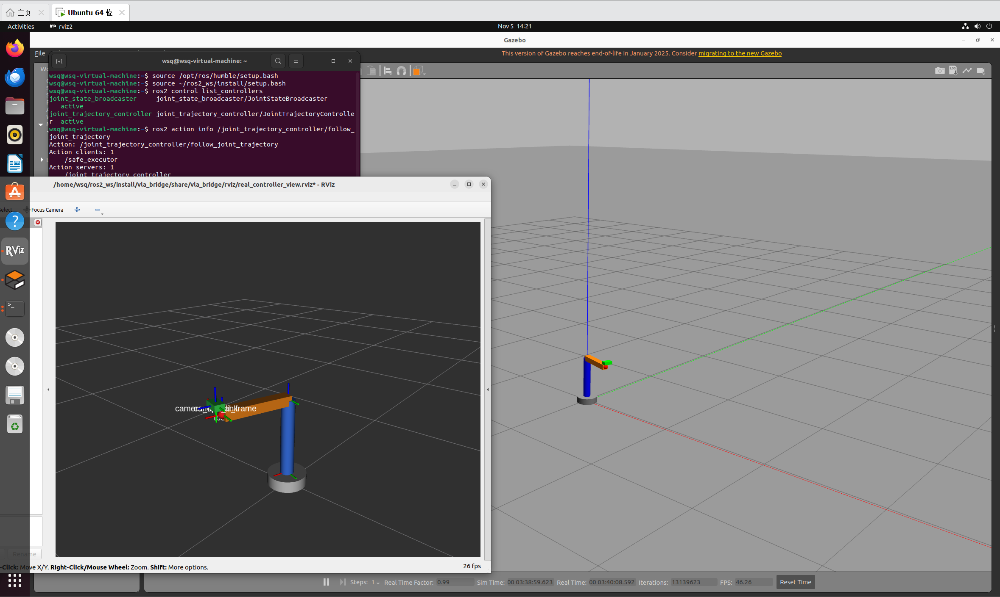
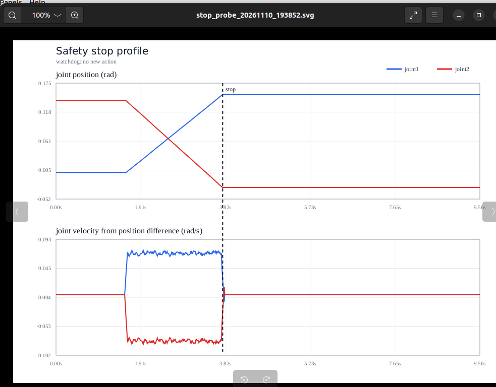

# 项目 16：VLA / 真机桥接与真控制器

> 状态：✅ 已在 VM 中跑通。Gazebo 关节由真控制器实际驱动。
>
> 时间：2026.11.05 ｜ 第 16 天 ｜ ROS2 周 Day 8
>
> 环境：Ubuntu 22.04.5 + ROS2 Humble + Gazebo Classic + ros2_control
>
> 目标：把第 15 天的 mock action server 替换成 Gazebo 里真正的
> `joint_trajectory_controller`，让策略动作真正驱动关节。

---

## 1. 今天换的是什么

第 15 天的执行链最后一段是模拟的：

```text
Mock Policy
    ↓ /policy/action_raw
Safety Filter
    ↓ /policy/action_safe
Safe Executor
    ↓ /task/execute_trajectory
Mock Trajectory Server
```

`mock_trajectory_server` 收到轨迹后只打印日志并返回成功，关节不会动，
`/joint_states` 也不会变化。

今天把最后一段换成：

```text
Safe Executor
    ↓ /joint_trajectory_controller/follow_joint_trajectory
joint_trajectory_controller
    ↓ ros2_control
Gazebo 关节
    ↓
/joint_states → TF → RViz
```

### mock 和真控制器的区别

| 对比项 | mock action server | joint_trajectory_controller |
| --- | --- | --- |
| 接收轨迹 | ✅ | ✅ |
| 驱动关节 | ❌ | ✅ |
| 返回成功 | 立刻返回假成功 | 执行完成后返回 |
| 真实关节状态 | ❌ | ✅ `/joint_states` 更新 |
| 上真机时 | 不能直接复用 | 换硬件接口即可复用 |

注意：

```text
今天换的是“Gazebo 里的真控制器”
不是“物理机械臂”
```

真机链路里，控制器仍然是 `joint_trajectory_controller`，只需要把
`gazebo_ros2_control/GazeboSystem` 换成厂商的 ros2_control 硬件插件。

---

## 2. 今天的数据流

```text
mock_policy
    ↓ /policy/action_raw（1 秒 5 点动作块）
safety_filter
    ↓ 位置限位 + 速度时间缩放
    ↓ /policy/action_safe
safe_executor
    ↓ FollowJointTrajectory action
joint_trajectory_controller
    ↓ 插值 + 位置命令
ros2_control / GazeboSystem
    ↓
Gazebo 关节真实运动
    ↓
joint_state_broadcaster
    ↓ /joint_states
robot_state_publisher
    ↓ /tf
RViz
```

## 2.1 实测结果



截图同时包含：

```text
Gazebo 中的 simple_arm
RViz 中的同姿态模型
joint_state_broadcaster active
joint_trajectory_controller active
action client /safe_executor
action server /joint_trajectory_controller
```

控制器日志确认轨迹真的执行完成：

```text
[joint_trajectory_controller]: Received new action goal
[joint_trajectory_controller]: Accepted new action goal
[safe_executor]: action goal accepted
[joint_trajectory_controller]: Goal reached, success!
[safe_executor]: action finished: code=0, message=Goal successfully reached!
```

安全层持续输出：

```text
data: 'ok: 5 points'
```

观测到 Gazebo 和 RViz 中的手臂都在持续摆动，`/joint_states` 同步变化。

---

## 3. 代码结构

```text
project16_ros2_vla_bridge/
├── README.md
├── CODE_WALKTHROUGH.md
├── QUEUE_DAY19.md
├── REAL_ROBOT_ROADMAP.md
├── assets/
│   ├── action_chain_logs.png
│   └── real_controller.png
├── scripts/
│   └── test_state_timeout.sh
└── ros2_ws/
    └── src/
        └── vla_bridge/
            ├── package.xml
            ├── setup.py
            ├── setup.cfg
            ├── resource/vla_bridge
            ├── launch/
            │   └── real_controller_demo.launch.py
            ├── rviz/
            │   └── real_controller_view.rviz
            └── vla_bridge/
                ├── __init__.py
                ├── mock_policy.py
                ├── safety_filter.py
                ├── safe_executor.py
                ├── queue_probe.py
                └── mock_trajectory_server.py
```

| 文件 | 作用 |
| --- | --- |
| `mock_policy.py` | 模拟 VLA 输出动作块 |
| `safety_filter.py` | 关节名校验、位置 clamp、速度时间缩放、watchdog |
| `safe_executor.py` | 把安全动作发给可配置的 action server |
| `mock_trajectory_server.py` | 第 15 天的假执行器，保留作对照 |
| `real_controller_demo.launch.py` | 启动 Gazebo、控制器、桥接节点和 RViz |
| `real_controller_view.rviz` | 默认显示 RobotModel、TF 和 Grid |

---

## 4. 今天的关键改动

### 4.1 `safe_executor` 可切换执行器

`safe_executor` 新增参数：

```text
action_name
```

默认值：

```text
/joint_trajectory_controller/follow_joint_trajectory
```

所以默认就连真控制器。

想回到第 15 天的 mock 版本时，不需要改代码：

```bash
ros2 run vla_bridge safe_executor --ros-args -p action_name:=/task/execute_trajectory
```

### 4.2 mock policy 的动作块变短

原来的动作块是 5 点、跨 2 秒，而执行器每 1 秒发一次，容易重叠。

现在改成：

```text
5 个点，点间隔 0.2 秒，总长 1 秒
每 1.2 秒发一次
```

给控制器留 0.2 秒收尾时间，Gazebo 里运动更连续。

### 4.3 launch 自动串联启动顺序

`real_controller_demo.launch.py` 按顺序启动：

```text
Gazebo
→ robot_state_publisher
→ spawn_entity
→ joint_state_broadcaster
→ joint_trajectory_controller
→ safety_filter
→ mock_policy
→ safe_executor
→ RViz
```

控制器没有 active 之前，执行器不会发动作。

### 4.4 默认可视化

RViz 配置文件已经包含：

```text
RobotModel
TF
Grid
Fixed Frame: base_link
```

不需要手动 Add display。

---

## 5. 在虚拟机中同步代码

推荐用 Git，不要直接在 hgfs 共享目录里编译。

如果虚拟机还没有仓库：

```bash
git clone https://github.com/matoudeshutiao/embodied-ai-learning.git ~/embodied-ai-learning
```

如果已经有仓库：

```bash
cd ~/embodied-ai-learning
```

```bash
git pull
```

然后把包复制到 ROS2 工作空间：

```bash
mkdir -p ~/ros2_ws/src/vla_bridge
```

```bash
cp -r ~/embodied-ai-learning/project16_ros2_vla_bridge/ros2_ws/src/vla_bridge/. ~/ros2_ws/src/vla_bridge/
```

如果 `~/ros2_ws/src` 里还没有 `arm_description`：

```bash
mkdir -p ~/ros2_ws/src/arm_description
```

```bash
cp -r ~/embodied-ai-learning/project12_ros2_gazebo/ros2_ws/src/arm_description/. ~/ros2_ws/src/arm_description/
```

---

## 6. 编译

```bash
cd ~/ros2_ws
```

```bash
source /opt/ros/humble/setup.bash
```

```bash
colcon build --symlink-install --packages-select arm_description vla_bridge
```

```bash
source install/setup.bash
```

---

## 7. 启动

```bash
ros2 launch vla_bridge real_controller_demo.launch.py
```

这个终端保持运行。

预期看到：

```text
Gazebo 打开并生成 simple_arm
RViz 自动打开并显示模型
joint_trajectory_controller active
机械臂缓慢摆动
```

---

## 8. 验证

另开终端：

```bash
source /opt/ros/humble/setup.bash
```

```bash
source ~/ros2_ws/install/setup.bash
```

查看控制器：

```bash
ros2 control list_controllers
```

期望：

```text
joint_state_broadcaster      active
joint_trajectory_controller  active
```

查看 action：

```bash
ros2 action info /joint_trajectory_controller/follow_joint_trajectory
```

期望 client：

```text
/safe_executor
```

查看关节状态：

```bash
ros2 topic echo /joint_states --once
```

多次执行，`joint1`、`joint2` 应该变化。

`safe_executor` 终端应出现：

```text
action goal accepted
action finished: code=0
```

---

## 9. 常见问题

### 9.1 `Package 'vla_bridge' not found`

新终端没有 source：

```bash
source /opt/ros/humble/setup.bash
```

```bash
source ~/ros2_ws/install/setup.bash
```

### 9.2 控制器不是 active

先确认 Gazebo 已经生成模型，再检查：

```bash
ros2 control list_controllers
```

必要时重启 launch。

### 9.3 机械臂不动

检查：

```text
/joint_trajectory_controller/follow_joint_trajectory 是否存在
safe_executor 是否连的是这个 action
安全层是否在发 /policy/action_safe
```

### 9.4 RViz 里没有模型

检查 RobotModel 的 Topic 是否为：

```text
/robot_description
```

Durability Policy 是否为：

```text
Transient Local
```

---

## 10. 今天的局限

```text
驱动的是 Gazebo 仿真关节，不是物理机械臂
policy 仍然是 mock，不读取图像
没有执行反馈回到 policy
safe_executor 执行期间会丢弃新动作，还没有动作队列
watchdog 目前只报警，不会自动保持位置
```

所以今天完成的是：

```text
从 mock 执行器 → 真 ros2_control 控制器
```

还不是完整 VLA 闭环。

---

## 11. 下一步

```text
1. 给 safe_executor 加动作队列/最新动作策略
2. 让 watchdog 在策略断流时发送保持位置轨迹
3. 把 mock_policy 换成读取图像的策略服务
4. 用真实相机和真机硬件接口替换 Gazebo
5. 采集 image + state + action，形成训练数据
```

---

## 12. 代码逐段解析

今天的关键代码、每段的作用、以及和第 15 天的逐项对比，见：

**[CODE_WALKTHROUGH.md](CODE_WALKTHROUGH.md)**

包含：

```text
safe_executor.py 的 action 参数与回调
mock_policy.py 的动作块
safety_filter.py 的限位/速度缩放/watchdog
real_controller_demo.launch.py 的启动顺序
第 15 天 vs 第 16 天对比
```

---

## 13. 真机准备周路线

第 17 天的 ROS2 接口盘点、仿真/真机替换表、一周学习路径见：

**[REAL_ROBOT_ROADMAP.md](REAL_ROBOT_ROADMAP.md)**

---

## 14. 第 18 天：动作队列

> 状态：✅ 第 18–21 天完成。
>
> 已完成：队列、隔离测试、时间对齐、A/B 对比、状态超时、watchdog 取消与恢复。
>
> 第 18 节保留最初 pending-only 版本的演进过程；当前实现见 14.10。

### 14.1 为什么要队列

原来的 `safe_executor`：

```text
正在执行一条轨迹
    ↓
新动作到来
    ↓
busy=True → 直接 return
```

结果是：

```text
动作被丢弃
策略发得越快，丢得越多
真机上可能出现动作不连续
```

### 14.2 队列语义（Day 18 初版）

```text
当前正在执行的块：不打断
还没执行的块：放进 pending 队列
队列满：丢掉最旧的 pending 块
当前块执行完：从队列取下一块
```

Day 18 初版参数：

```text
max_queue_size = 2   # 只限制 pending
```

第 19 天已改为总在途限制：

```text
max_in_flight = 2
```

当前实现见 14.10。

### 14.3 关键代码（Day 18 初版）

```python
from collections import deque

self.declare_parameter("max_queue_size", 2)
self.max_queue_size = max(
    1,
    int(self.get_parameter("max_queue_size").value),
)

self.pending = deque()
self.busy = False
```

收到新动作：

```python
if len(self.pending) >= self.max_queue_size:
    dropped = self.pending.popleft()
    self.dropped_count += 1
    self.get_logger().warn(
        f"queue full, dropped oldest pending action "
        f"({len(dropped.points)} points)"
    )

self.pending.append(msg)
self.queued_count += 1
self.get_logger().info(
    f"queued action: {len(msg.points)} points, "
    f"pending={len(self.pending)}, busy={self.busy}"
)
self.start_next()
```

取下一个执行：

```python
def start_next(self):
    if self.busy or not self.pending:
        return

    msg = self.pending.popleft()
    self.busy = True
    goal = FollowJointTrajectory.Goal()
    goal.trajectory = msg
```

执行结束后：

```python
self.busy = False
self.start_next()
```

### 14.4 关键设计

```text
只丢“未执行”的旧动作
不取消正在执行的轨迹
```

术语要分清：

```text
pending     = 还没开始执行的动作块
active      = 当前正在执行的那一条
Day 18 初版的 max_queue_size 只限制 pending，不包含 active
第 19 天已改为 max_in_flight = active + pending
```

所以“完整重规划时清空 pending”指的是：

```text
清空还没开始执行的旧计划
```

它不包含 active。  
如果连 active 也要放弃，必须另做“取消当前 goal / 受控停止”，不能只靠 `pending.clear()`。

因为当前动作块是顺序拼接的：

```text
chunk 1 → chunk 2 → chunk 3
```

如果直接取消正在执行的轨迹并切换，会造成：

```text
速度突变
跟踪误差
保护性停机
碰撞风险
```

以后接真正 VLA 的“完整重规划”时，再增加：

```text
清空 pending 队列，执行最新计划
```

### 14.5 实测日志（✅）

压力测试时实际看到：

```text
[mock_policy]: published action chunk: 5 points
[safe_executor]: queued action: 5 points, pending=2, busy=True

[mock_policy]: published action chunk: 5 points
[safe_executor]: queue full, dropped oldest pending action (5 points)
[safe_executor]: queued action: 5 points, pending=2, busy=True

[joint_trajectory_controller]: Goal reached, success!
[safe_executor]: action finished: code=0, message=Goal successfully reached!

[safe_executor]: stats: queued=741, executed=724, dropped=14
```

这组日志同时证明了四件事：

```text
1. 当前有一条轨迹正在执行：busy=True
2. 队列已经存了 2 条：pending=2
3. 队列满后丢弃的是最旧的未执行块
4. 控制器真实执行完成：Goal reached + code=0
```

### 14.6 统计数字怎么读

```text
queued   = 741
executed = 724
dropped  = 14
```

看起来少了一部分：

```text
741 - 724 - 14 = 3
```

这 3 条就是日志打印时仍然在途的动作：

```text
1 条正在执行
2 条还在 pending 队列
```

所以：

```text
queued = executed + dropped + in_flight
```

数字是自节点启动以来的累计值，不是这一次压力测试的 5 条。

### 14.7 真机启示：队列会带来延迟

Day 18 初版 `max_queue_size=2` 意味着最坏情况下：

```text
1 条正在执行
+ 2 条等待执行
```

第 19 天改成 `max_in_flight=2` 后，最坏变成：

```text
1 条正在执行
+ 1 条等待执行
```

如果每条动作块约 1 秒，真机仍可能执行约 1～2 秒前的计划。

仿真里只是“卡一下”，真机上可能是：

```text
对移动目标反应变慢
避障不及时
动作和当前画面不一致
```

所以真机不能只看“队列不丢动作”，还要看：

```text
队列深度
动作年龄
观测到执行的总延迟
```

后续已增加：

```text
动作时间戳/年龄检查
capacity_dropped / age_dropped 分类
状态超时
watchdog 取消与恢复
```

必要时可把 `max_in_flight` 降到 1。

### 14.8 Day 18 当时的局限与后续结果

Day 18 当时：

```text
没有动作时间戳/年龄检查
没有状态反馈监控
watchdog 仍然只报警
没有完整重规划清空队列模式
```

后续已完成：

```text
动作年龄检查 + 时间重对齐
/joint_states 状态超时
watchdog 取消 active
安全阻塞与恢复
```

仍未完成：

```text
完整重规划时清空 pending 的模式
真机硬件接口替换
```

### 14.9 隔离队列测试

之前的压力测试同时有 `mock_policy` 和测试 publisher 发动作，结果不干净。

现在 launch 支持关闭 `mock_policy`：

```bash
ros2 launch vla_bridge real_controller_demo.launch.py start_mock_policy:=false
```

另开终端，只运行一个测试发布者：

```bash
ros2 run vla_bridge queue_probe
```

`queue_probe` 会：

```text
每 0.25 秒发一条短轨迹
每条轨迹目标不同
每条轨迹时长 0.6 秒
共发 8 条
```

这样观察：

```text
robot 是否连续向不同目标运动
safe_executor 是否出现 queued/dropped
队列满时是否丢弃未执行的旧块
```

预期日志：

```text
queued action: 1 points, pending=...
queue full, dropped oldest pending action (1 points)
stats: queued=..., executed=..., dropped=...
```

隔离测试的意义：

```text
只有一个动作源
目标会变化
能区分“队列卡顿”和“目标原地保持”
```

### 14.10 容量语义：pending-only vs in-flight

第 18 天先实现了 pending-only；第 19 天改成总在途可配置。

#### A：pending-only

```text
active 不计入容量
max_pending = 2
总在途最多 1 active + 2 pending = 3
```

优点：

```text
正常负载下丢动作少
保留更多未来计划
轨迹连续性更好
```

缺点：

```text
最坏排队延迟多一段动作
header.stamp 更旧
更容易执行几秒前的计划
```

适合：

```text
静态目标
变化很慢的环境
对连续性要求高的任务
```

#### B：total in-flight

```text
active + pending 都计入容量
max_in_flight = 2
总在途最多 1 active + 1 pending = 2
```

优点：

```text
最坏延迟更短
动作更新鲜
动作时间被队列压缩得更少
```

缺点：

```text
压力大时丢动作更多
未来计划更短
连续轨迹更容易被截断
```

适合：

```text
移动目标
动态障碍
真机遥操作
需要快速响应新观测的任务
```

#### 8 条动作对比

```text
到达间隔 0.25 秒
每条执行 0.6 秒
```

| 容量定义 | 执行 | 丢弃 |
| --- | --- | --- |
| A：pending 最多 2 | 1, 2, 4, 7, 8 | 3, 5, 6 |
| B：总在途最多 2 | 1, 3, 5, 8 | 2, 4, 6, 7 |

#### 为什么真机推荐 B

不是“丢包越少越好”，而是：

```text
丢一个旧动作
比执行一个过期动作更安全
```

B 丢得更多，但丢的是尚未执行的旧计划；  
A 丢得少，但它可能把旧计划执行到更晚。

真机首先要保证：

```text
动作新鲜
延迟可控
场景变化后能尽快响应
```

#### 当前实现

`safe_executor` 已改为：

```python
def in_flight(self):
    return len(self.pending) + (1 if self.busy else 0)

if self.in_flight() >= self.max_in_flight:
    ...
```

参数：

```text
max_in_flight = 2   # 默认 B
max_in_flight = 3   # 近似 A 的总在途上限
```

launch 参数：

```text
max_in_flight:=2
max_in_flight:=3
```

### 14.11 隔离测试发现：队列延迟会“吃掉”轨迹时间

隔离测试结果：

```text
queued=8, executed=8, dropped=0
```

没有丢动作，但出现了更关键的问题。

对比“入队时间、开始执行时间、执行耗时”：

| 动作 | 排队延迟 | 实际执行 | 两者之和 |
| --- | ---: | ---: | ---: |
| #2 | 0.451 s | 0.155 s | 0.606 s |
| #3 | 0.455 s | 0.153 s | 0.608 s |
| #4 | 0.358 s | 0.252 s | 0.610 s |
| #5 | 0.458 s | 0.153 s | 0.611 s |

每条动作设定的 `time_from_start` 都是 0.6 秒。  
但实际执行时间变成了：

```text
0.6 秒 - 排队延迟
```

原因是 `queue_probe` 在发布时写入了 `header.stamp`，安全层原样转发，
`joint_trajectory_controller` 把轨迹时间戳当作起点。

排队 0.45 秒后，控制器认为这条 0.6 秒轨迹已经过去了 0.45 秒，
只剩约 0.15 秒可以执行，于是动作被压缩。

这解释了两件事：

```text
1. 为什么 dropped=0：
   执行被压缩，队列排空得比预期快。

2. 为什么真机更危险：
   同样的路径被压缩到更短时间内，实际速度会高于规划值。
```

安全层之前检查的是原始 0.6 秒轨迹，不知道队列已经消耗了时间。

所以下一步不是继续调队列长度，而是做：

```text
动作时间对齐
```

需要区分：

```text
header.stamp      = 动作产生/观测的时间
time_from_start   = 相对轨迹起点的时长
```

入队后要计算：

```text
age = now - header.stamp
```

然后决定：

```text
age 太大 → 丢弃过期动作
剩余时间足够 → 发送前重新对齐时间
剩余时间不足 → 保持位置或重新规划
```

---

## 15. 第 19 天（2026-11-08）：队列容量与动作时间对齐

第 19 天把两个遗留规则整理成文档：

```text
pending-only vs total in-flight
动作过期后执行剩余时间还是丢弃
```

完整对比、8 条动作时间线和题目解答见：

**[QUEUE_DAY19.md](QUEUE_DAY19.md)**

### 14.12 时间对齐实现

`safe_executor` 出队时新增：

```python
age = now - msg.header.stamp
total_duration = msg.points[-1].time_from_start
```

处理规则：

```text
age >= total_duration → 动作已过期，丢弃
age > max_action_age   → 动作太旧，丢弃
否则                   → header.stamp = now，再发送
```

关键代码：

```python
def prepare_for_execution(self, msg):
    now = self.get_clock().now()
    stamp = msg.header.stamp
    stamp_sec = stamp.sec + stamp.nanosec * 1e-9
    now_sec = now.nanoseconds * 1e-9
    age = max(0.0, now_sec - stamp_sec)

    total_duration = self.duration_to_sec(
        msg.points[-1].time_from_start
    )

    if total_duration <= 0.0 or age >= total_duration:
        return False

    if age > self.max_action_age:
        return False

    # 让控制器从当前时刻开始执行完整轨迹。
    msg.header.stamp = now.to_msg()
    return True
```

新增参数：

```text
max_action_age = 0.5 秒（默认）
```

launch 参数：

```text
max_action_age:=0.5
max_in_flight:=2
```

这样：

```text
旧时间戳不会再把轨迹压缩
过期动作会被丢弃
安全层仍负责位置/速度限制
```

### 14.13 时间对齐实测

启动参数：

```text
max_in_flight=2
max_action_age=0.5
```

日志出现：

```text
time aligned: age=0.200s, duration=0.600s
time aligned: age=0.100s, duration=0.600s
```

动作执行时间：

| 动作 | 发送 | 到达 | 实际耗时 |
| --- | ---: | ---: | ---: |
| #1 | 9664.176 | 9664.782 | 0.606 s |
| #3 | 9664.831 | 9665.391 | 0.560 s |
| #6 | 9665.436 | 9665.993 | 0.557 s |
| #8 | 9666.041 | 9666.601 | 0.560 s |

动作已经接近完整的 0.6 秒，不再被压缩成 0.15 秒。

最终统计：

```text
queued=8, executed=4, dropped=4
8 = 4 + 4 + 0
```

这正好符合 B 的理想结果：

```text
执行：4 条
丢弃：4 条
```

之前执行 5 条，是因为控制器把旧时间戳当作起点，动作被加速执行；现在时间对齐后，容量限制才真正体现出来。

### 14.14 丢弃原因分类

为了比较 A/B，`safe_executor` 现在把丢弃原因分开统计：

```text
capacity_dropped = 队列达到 max_in_flight，丢掉最旧 pending
age_dropped      = 动作等待太久，超过 max_action_age 或轨迹总时长
dropped          = 两者之和
```

统计日志：

```text
stats: queued=..., executed=..., dropped=...,
       capacity_dropped=..., age_dropped=...
```

判断关系：

```text
queued = executed + dropped + in_flight
dropped = capacity_dropped + age_dropped
```

这样对比 A/B 时，就不会把“容量丢包”和“动作过期”混在一起。

### 14.15 A/B 实测对比

相同条件：

```text
max_action_age=0.5
queue_probe 发 8 条
每条 duration=0.6
```

| 指标 | B：max_in_flight=2 | A：max_in_flight=3 |
| --- | ---: | ---: |
| queued | 8 | 8 |
| executed | 4 | 4 |
| capacity_dropped | 4 | 3 |
| age_dropped | 0 | 1 |
| dropped 总数 | 4 | 4 |
| 观测 age | 0～0.1 s | 0.3～0.7 s |

A 的最后一次 stats 是：

```text
queued=8, executed=4, dropped=3,
capacity_dropped=3, age_dropped=0
```

紧接着：

```text
expired action: age=0.700s, duration=0.600s, drop
```

所以 A 的最终结果要加上这次年龄丢弃：

```text
dropped=4
capacity_dropped=3
age_dropped=1
```

结论：

```text
A 多存一条，但没有多执行一条
多出来的那条因为 age=0.7s 超过 duration=0.6s 被丢弃
```

A 只是把一次容量丢包换成了过期丢包，同时动作整体更旧：

```text
B：动作年龄 0～0.1 秒
A：动作年龄 0.3～0.7 秒
```

因此：

```text
当前 max_action_age=0.5 下，B 更好
执行数量一样
动作更新鲜
延迟更低
```

如果放宽 `max_action_age`，A 可能多执行一条，但执行的是更旧的计划，这是“新鲜度 vs 连续性”的取舍。

### 14.16 术语：动作年龄

动作年龄不是“机械臂年龄”，也不是“动作执行了多久”。

```text
age = now - header.stamp
```

它表示：

```text
动作从生成出来，到现在已经等了多久
```

包括：

```text
队列等待
传输延迟
回调调度
```

和动作时长区分：

```text
duration：这条轨迹设计走多久
age：这条动作已经等了多久
```

例子：

```text
duration = 0.6 秒
age      = 0.7 秒
```

说明动作还没开始执行，就已经等了 0.7 秒，超过轨迹总时长，已经过期。

本次 A/B 对比中：

```text
B 的 age：0.0～0.1 秒  → 动作新鲜
A 的 age：0.3～0.7 秒  → 动作更旧
```

A 多存的一条最终：

```text
age=0.7s > duration=0.6s
→ 被过期规则丢弃
```

所以动作年龄衡量的是：

```text
动作的新鲜度
```

不是执行时间。

### 14.17 状态超时

`joint_state_broadcaster` 停止后，`/joint_states` 不再更新。  
如果安全层继续使用最后一次关节位置，就会拿旧状态做速度校验。

`safety_filter` 新增：

```text
state_timeout = 0.5 秒
```

逻辑：

```text
/joint_states 超时
→ 状态无效
→ 拒绝新动作
→ /policy/safety_status 发布 drop: stale state
```

关键代码：

```python
def state_is_fresh(self):
    if self.last_state_time is None:
        return False
    age = (self.get_clock().now() - self.last_state_time).nanoseconds / 1e9
    return age <= self.state_timeout
```

收到动作时：

```python
if not self.state_is_fresh():
    self.publish_status("drop: stale state")
    return
```

launch 参数：

```text
state_timeout:=0.5
```

测试方法：

```text
正常启动后停掉 joint_state_broadcaster
观察 safety_filter 是否拒绝动作
再恢复 broadcaster，观察是否恢复
```

### 14.18 Watchdog 与故障取消

之前 watchdog 只报警：

```text
watchdog: no new action
```

现在 `safe_executor` 订阅 `/policy/safety_status`，收到故障状态后：

```text
清空 pending
取消正在执行的 active goal
阻止新的动作进入
```

三种安全机制要区分：

| 机制 | 触发条件 | 日志 | 结果 |
| --- | --- | --- | --- |
| 动作危险 | 位置越界、速度超限 | `clamped` / `time scaled` | 修改或丢弃动作 |
| 状态超时 | `/joint_states` 不更新 | `drop: stale state` | 拒绝动作、取消当前轨迹 |
| 策略断流 | 2 秒没有新动作 | `watchdog: no new action` | 取消当前轨迹 |

测试 1 的 5 秒长轨迹由“策略断流”取消：

```text
动作本身没有越界
/joint_states 也没有过期
只是 2 秒内没有新的动作到达
```

如果要执行长动作，应该：

```text
增大 watchdog 超时
或
让策略持续发送动作块/心跳
```

故障状态：

```text
watchdog: no new action
drop: stale state
```

恢复状态：

```text
watchdog reset
state: ok
```

只有 `state_ok` 和 `policy_ok` 都恢复后，才重新接受动作。

关键代码：

```python
def enter_safety_stop(self, reason):
    if self.safety_blocked:
        return

    self.safety_blocked = True
    self.pending.clear()
    self.get_logger().warn(
        f"SAFETY STOP: {reason}, clear pending"
    )
    self.cancel_active()
```

取消 active：

```python
def cancel_active(self):
    if self.active_goal_handle is None:
        return
    if self.cancel_requested:
        return

    self.cancel_requested = True
    self.active_goal_handle.cancel_goal_async()
```

恢复：

```python
if self.safety_blocked and self.state_ok and self.policy_ok:
    self.safety_blocked = False
```

测试策略断流：

```text
发一条 5 秒的长轨迹
之后不再发新动作
2 秒后 watchdog 触发
→ 清空队列
→ 取消 active
```

实测日志：

```text
[watchdog] watchdog: no new action
[safe_executor] SAFETY STOP: policy watchdog, clear pending
[safe_executor] cancel active trajectory
[joint_trajectory_controller] Got request to cancel goal
[joint_trajectory_controller] Canceling active action goal
```

控制器取消成功时返回：

```text
action finished: code=0, message=
```

注意：这个 `code=0` 不是“轨迹正常走完”，而是“取消成功”。  
因此统计拆成：

```text
executed = 正常完成
canceled = 被安全取消
failed   = 失败
```

测试状态断流：

```text
停掉 joint_state_broadcaster
→ drop: stale state
→ 清空队列并取消 active
恢复 broadcaster
→ state: ok
→ 重新接受动作
```

注意：如果保持默认 `watchdog_timeout=2.0`，5 秒长轨迹会先被 policy watchdog 取消，状态超时测试会被污染。

做状态超时测试时应隔离变量：

```text
watchdog_timeout=10.0
state_timeout=0.5
```

这样策略断流不会先触发，只有 `/joint_states` 断流会触发安全停止。

```bash
ros2 launch vla_bridge real_controller_demo.launch.py start_mock_policy:=false max_in_flight:=2 max_action_age:=0.5 state_timeout:=0.5 watchdog_timeout:=30.0
```

再发长轨迹并停掉 broadcaster：

```bash
ros2 control switch_controllers --deactivate joint_state_broadcaster
```

预期：

```text
joint state stale or missing
drop: stale state
SAFETY STOP: state stale, clear pending
cancel active trajectory
```

实测已经看到：

```text
SAFETY STOP: state stale, clear pending
cancel active trajectory
Canceling active action goal
action canceled by safety stop
stats: canceled=1
```

恢复后：

```text
joint state restored
safety recovered, accepting actions again
```

恢复动作能重新执行，说明恢复链路通了。  
隔离测试不再用 `queue_probe`：它属于队列压力测试，不能拿来验证状态恢复。

早期 `queue_probe` 被脚本里的 `timeout` 杀掉时会打印
`ExternalShutdownException`；现在节点发完 8 条后会主动退出，
不再依赖外部 timeout，也不会打印这个异常。

启动阶段新增 `startup_grace=2.0s`：

```text
刚启动时 /joint_states 还没上线
→ 先等待，不误报 stale
```

如果 watchdog 也因为长时间没有新动作触发，恢复需要同时满足：

```text
state: ok
watchdog reset
```

还有一个时序问题：`watchdog reset` 可能比恢复动作晚到。  
所以 `safe_executor` 现在规定：

```text
状态正常时
只要收到新动作
就认为策略恢复
→ 解除 safety_blocked
```

否则第一个恢复动作可能先被丢掉，看起来永远不恢复。

#### 自动化测试（不需要抢时间）

脚本：

```text
scripts/test_state_timeout.sh
```

它自己控制时序：

```text
发一条慢速 20 秒轨迹
等 5 秒
停 broadcaster
等 5 秒
恢复 broadcaster
等 3 秒
发一条短恢复轨迹
```

这个脚本故意不使用 `queue_probe`：

```text
queue_probe 是上一关的队列压力测试
状态中断/恢复测试只需要一条动作
```

先做命令顺序检查：

```bash
DRY_RUN=1 bash ~/embodied-ai-learning/project16_ros2_vla_bridge/scripts/test_state_timeout.sh
```

再启动：

```bash
ros2 launch vla_bridge real_controller_demo.launch.py start_mock_policy:=false max_in_flight:=2 max_action_age:=0.5 state_timeout:=0.5 watchdog_timeout:=60.0
```

等 `safe_executor` 显示 ready 后，另开终端运行：

```bash
bash ~/embodied-ai-learning/project16_ros2_vla_bridge/scripts/test_state_timeout.sh
```

不需要人工卡秒数。

---

## 16. 第 20 天（2026-11-09）：状态超时与恢复实验

第 19 天做队列容量和时间对齐；第 20 天只做安全层的中断与恢复。

目标：

```text
状态断流 → 中断当前动作
状态恢复 → 重新接受动作
```

队列压力测试不属于这个实验。

### 16.1 隔离变量

默认 `watchdog_timeout=2.0` 会先取消 20 秒慢轨迹，污染“状态超时”实验。  
所以启动参数固定为：

```text
start_mock_policy:=false
state_timeout:=0.5
watchdog_timeout:=60.0
max_in_flight:=2
max_action_age:=0.5
```

`watchdog_timeout` 拉长到 60 秒，保证只有 `/joint_states` 断流会触发停止。

启动命令：

```bash
ros2 launch vla_bridge real_controller_demo.launch.py start_mock_policy:=false max_in_flight:=2 max_action_age:=0.5 state_timeout:=0.5 watchdog_timeout:=60.0
```

### 16.2 测试脚本

脚本：

```text
scripts/test_state_timeout.sh
```

执行顺序：

```text
1. 发一条 20 秒慢速轨迹
2. 等 5 秒
3. 停 joint_state_broadcaster
4. 等 5 秒
5. 恢复 broadcaster
6. 等 3 秒
7. 发一条 2 秒短恢复轨迹
```

它不使用 `queue_probe`。  
`queue_probe` 是 8 条动作的队列压力测试；混入后会同时改变队列深度、
动作年龄和故障时序，无法单独归因。

先检查命令顺序：

```bash
DRY_RUN=1 bash ~/embodied-ai-learning/project16_ros2_vla_bridge/scripts/test_state_timeout.sh
```

当前状态：

```text
bash -n       已通过
DRY_RUN=1     已通过
VM 正式实跑   待执行
```

旧测试已经观察到取消/恢复日志，但旧脚本混入了队列压力测试，
所以重写后的隔离脚本还要在 VM 里重新跑一遍。

### 16.3 已观察到的日志

中断：

```text
[safety_filter] joint state stale or missing
[safety_filter] drop: stale state
[safe_executor] SAFETY STOP: state stale, clear pending
[safe_executor] cancel active trajectory
[joint_trajectory_controller] Got request to cancel goal
[joint_trajectory_controller] Canceling active action goal
[safe_executor] action canceled by safety stop
[safe_executor] stats: ... canceled=1
```

恢复：

```text
[safety_filter] joint state restored
[safety_filter] state: ok
[safe_executor] safety recovered, accepting actions again
```

状态机：

```text
state stale
→ 拒绝新动作
→ 清空 pending
→ 取消 active goal
→ state ok
→ 解除 safety_blocked
```

### 16.4 预测与实际的差异

| 预测 | 实际 | 原因 |
| --- | --- | --- |
| 安全停止会缓慢减速到安全位置 | 视觉上瞬间停住 | `cancel_goal_async()` 是取消，不是减速轨迹 |
| 动作会一直执行到我主动停止 | 我还没操作就停了 | 状态超时自动触发 |
| 恢复后的动作会很平缓 | 恢复后的运动仍然很剧烈 | 旧测试恢复后又跑了 `queue_probe`，不是缓启动 |
| 时间戳会自动处理排队时间 | 排队越久，剩余执行时间越短 | `header.stamp` 被当作绝对起点 |

### 16.5 停止策略要按状态可信度分开

状态超时意味着：

```text
/joint_states 超过 state_timeout 没有更新
```

系统不知道当前关节位置和速度。  
此时如果“移动到安全位置”，就是拿过期状态重新规划，起点本身不可信。

| 故障 | 状态可信 | 当前做法 | 更合理的真机策略 |
| --- | --- | --- | --- |
| 状态超时 | 否 | 取消 active，原地停 | 立即刹车/硬件急停，不盲目移动 |
| 策略 watchdog | 通常是 | 取消 active，原地停 | 用最后可信状态受控减速/保持 |
| 用户主动停止 | 通常是 | 取消 active | 受控减速到零 |
| 硬件急停 | 不一定 | 无 | 断使能/抱闸，软件不参与 |

当前 `safe_executor` 只有“取消”这一种停止方式，所以四种故障看起来都像急停。

### 16.6 还没解决的问题

```text
状态超时时，能不能用最后一份可信状态做短时减速？
策略断流但状态正常时，能不能保持当前位置，而不是取消？
“安全位置”由谁定义：策略、操作员，还是预设 home 位？
```

原始记录：

- [raw.md](../learning_journal/2026-11-09-day20/raw.md)
- [reflection.md](../learning_journal/2026-11-09-day20/reflection.md)

> 结论：当前安全层能中断，但不能受控停止；  
> 状态失效时，原地停比移动到“安全位置”更可信。

---

## 17. 第 21 天（2026-11-10）：安全停止体检

目标不是修改安全层，而是测量：

```text
watchdog 取消动作时，速度是慢慢降到 0，还是直接掉到 0
```

### 17.1 实验脚本

```text
scripts/stop_probe.py
```

流程：

```text
等 /joint_states
发一条 5 秒慢轨迹
不再发新动作
默认 watchdog 2 秒后取消
继续记录 3 秒
输出 CSV 和 SVG
```

它只用一条动作，不使用 `queue_probe`。

运行前提：

```text
start_mock_policy:=false
state_timeout:=0.5
watchdog_timeout:=2.0
```

### 17.2 第一版：直接画 velocity 是错的

第一版读取：

```python
velocities = dict(zip(msg.name, msg.velocity))
```

直接画 `/joint_states.velocity`，结果速度线全程几乎不变。

实测发现：

```text
joint1 原始 velocity：全程 0.0000 rad/s
joint1 位置：0 → 0.16 rad
```

位置明明在动，速度却是 0，说明这个字段不能直接用来判断停止。

### 17.3 第二版：位置差分

保留原始字段做对照，同时用中心差分计算速度：

```python
lo = max(0, i - 3)
hi = min(n - 1, i + 3)
dt = samples[hi]["t"] - samples[lo]["t"]
v = (samples[hi]["pos"] - samples[lo]["pos"]) / dt
```

输出 CSV 同时包含：

```text
j1_vel_raw / j2_vel_raw   原始 /joint_states.velocity
j1_vel_calc / j2_vel_calc 位置差分速度
```

### 17.4 实测结果

```text
samples      : 952
stop time    : 3.759 s
stop reason  : watchdog: no new action

joint1 calc : v_before=+0.0693 rad/s, v_after=-0.0000 rad/s
joint2 calc : v_before=-0.0772 rad/s, v_after=+0.0000 rad/s

joint1 raw  : flat at +0.0000 rad/s;
              position difference is used instead
```



位置曲线在 stop 处是硬拐角。整张图横轴约 9.5 秒，所以 50 ms 的过渡在图上看起来接近垂直。

采样率约 100 Hz，即 10 ms 一个点。  
第一次按“一个采样周期掉到 0”估算：

```text
减速度 ≈ 0.0693 / 0.01 ≈ 6.9 rad/s²
```

后续用 `analyze_stop.py` 分析完整 CSV，修正为：

```text
transition  : 52.5 ms
deceleration: 1.51 rad/s²
stop distance: 0.0007 rad
```

`6.9 rad/s²` 是上界，不是实测值。实测停止约比 `0.5 rad/s²` 的舒适减速激进 3 倍。

### 17.5 结论

```text
cancel_goal_async() 是急停，不是受控减速
/joint_states.velocity 不能默认相信
位置差分会引入噪声，但能看出停止处的速度台阶
```

下一步不是立刻写受控停止，而是先确认真机应该相信哪个状态源：

```text
编码器位置差分
驱动器速度
控制器反馈
```

如果速度都不可信，就不能安全地按固定减速度停车。

原始记录：

- [raw.md](../learning_journal/2026-11-10-day21/raw.md)
- [reflection.md](../learning_journal/2026-11-10-day21/reflection.md)

---

## 附录：第 15 天的 mock 链路

第 15 天的完整日志仍保留在：

```text
assets/action_chain_logs.png
```

当时的链路：

```text
mock_policy → safety_filter → safe_executor
→ mock_trajectory_server
```

今天保留 `mock_trajectory_server.py`，用于对照和回归测试。
