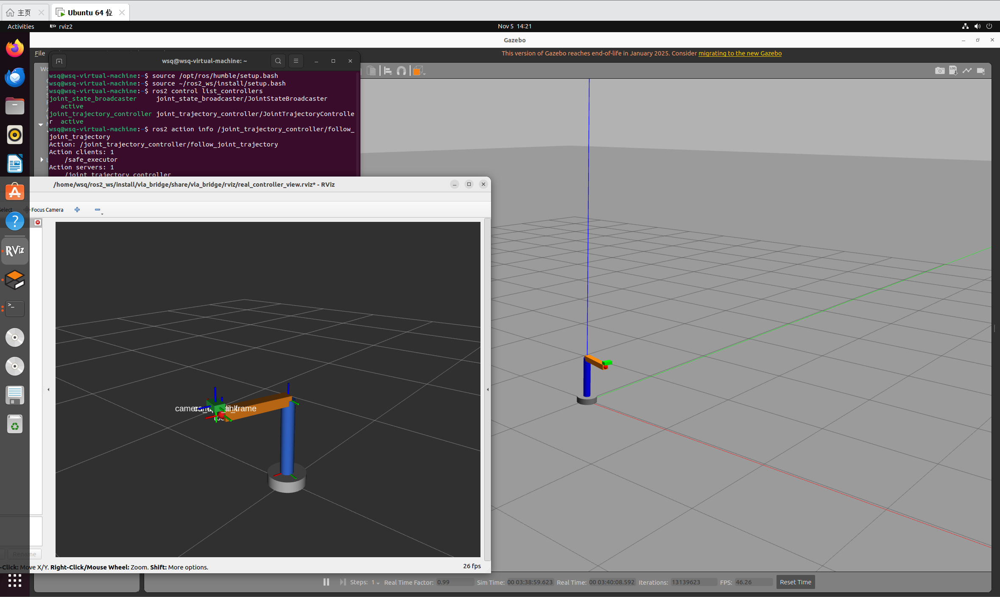
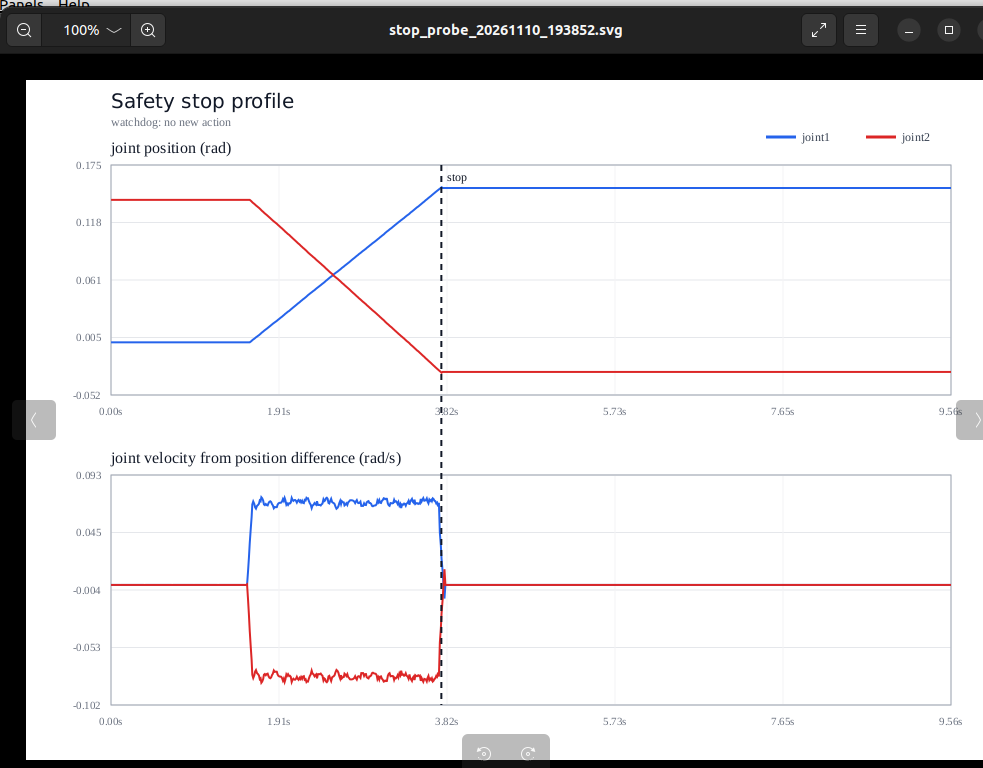
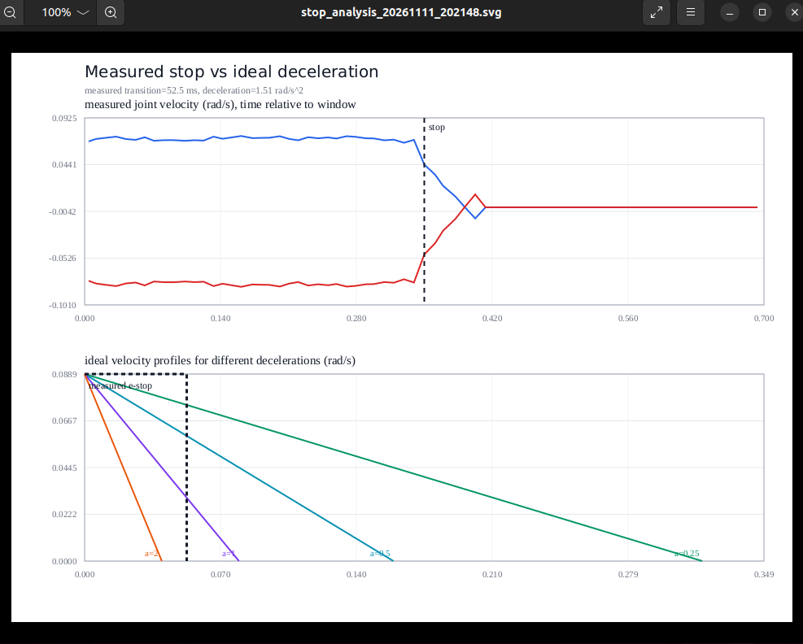
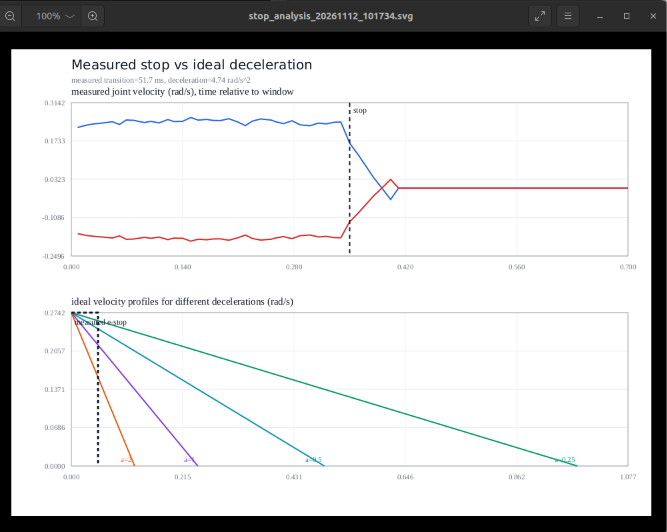
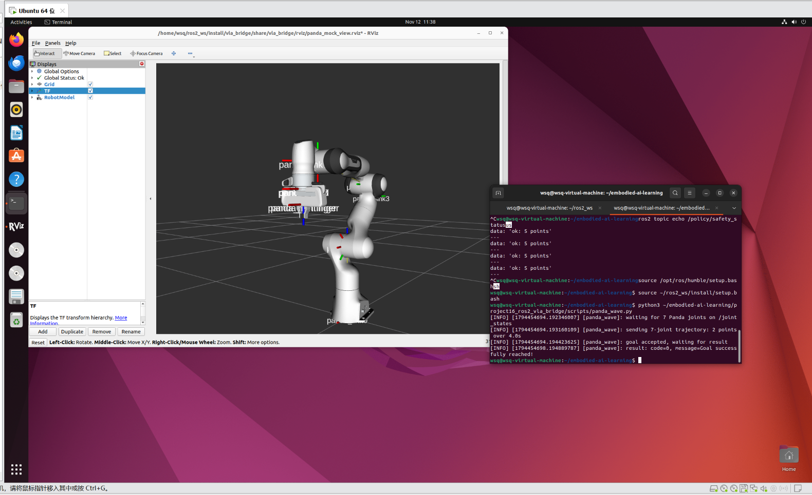
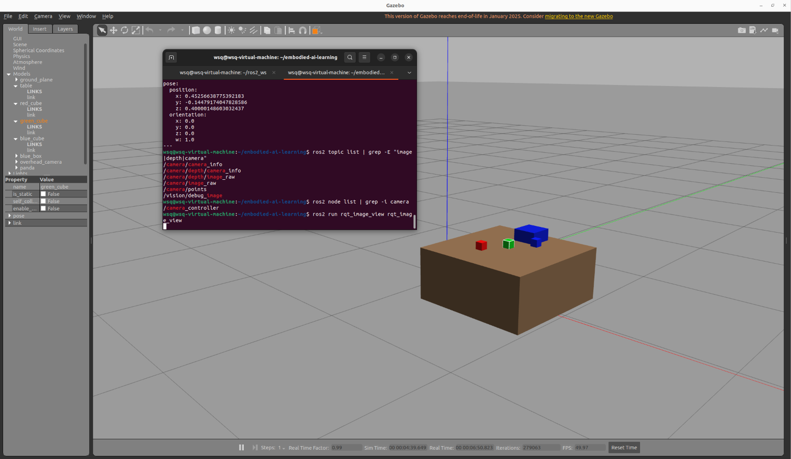
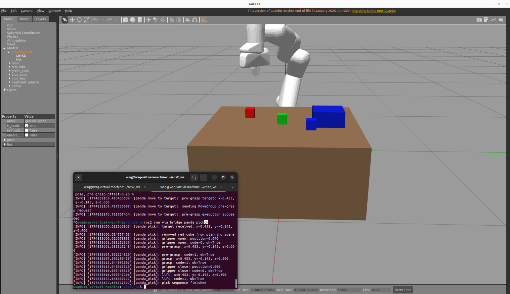
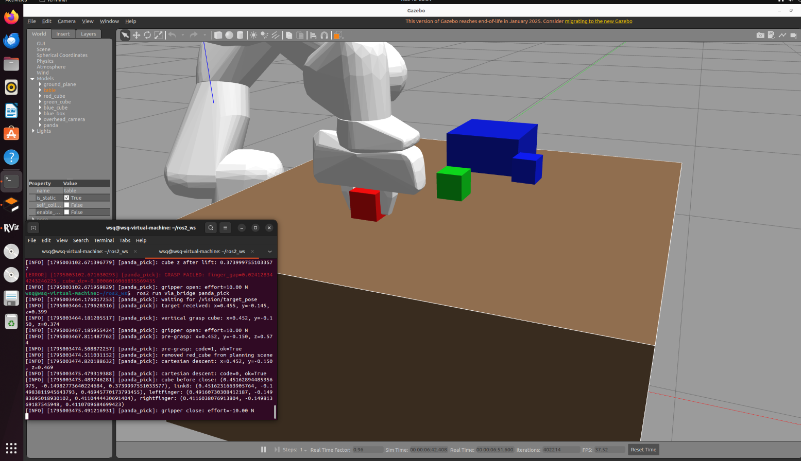
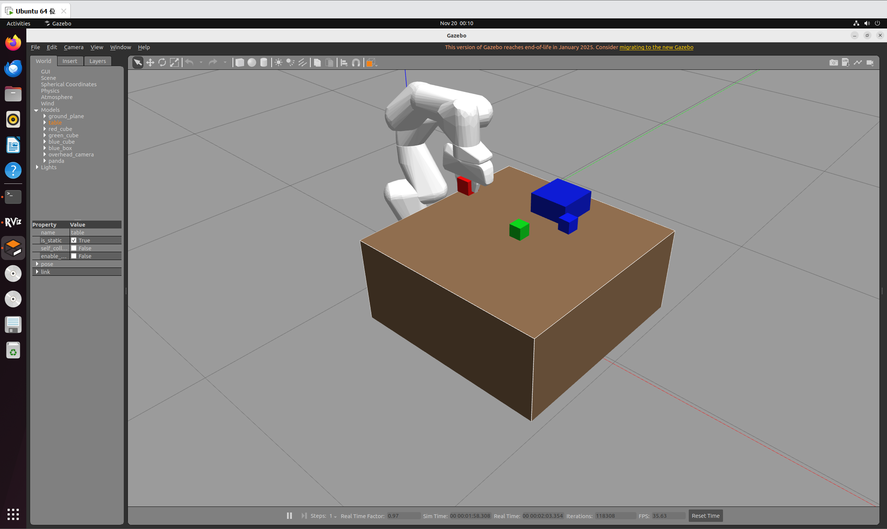

# 项目 16：VLA / 真机桥接与真控制器

> 状态：✅ 已在 VM 中跑通。Gazebo 关节由真控制器实际驱动。
>
> 时间：2026.11.05 ｜ 第 16 天 ｜ ROS2 周 Day 8
>
> 环境：Ubuntu 22.04.5 + ROS2 Humble + Gazebo Classic + ros2_control
>
> 目标：把第 15 天的 mock action server 替换成 Gazebo 里真正的
> `joint_trajectory_controller`，让策略动作真正驱动关节。

---

## 1. 今天换的是什么

第 15 天的执行链最后一段是模拟的：

```text
Mock Policy
    ↓ /policy/action_raw
Safety Filter
    ↓ /policy/action_safe
Safe Executor
    ↓ /task/execute_trajectory
Mock Trajectory Server
```

`mock_trajectory_server` 收到轨迹后只打印日志并返回成功，关节不会动，
`/joint_states` 也不会变化。

今天把最后一段换成：

```text
Safe Executor
    ↓ /joint_trajectory_controller/follow_joint_trajectory
joint_trajectory_controller
    ↓ ros2_control
Gazebo 关节
    ↓
/joint_states → TF → RViz
```

### mock 和真控制器的区别

| 对比项 | mock action server | joint_trajectory_controller |
| --- | --- | --- |
| 接收轨迹 | ✅ | ✅ |
| 驱动关节 | ❌ | ✅ |
| 返回成功 | 立刻返回假成功 | 执行完成后返回 |
| 真实关节状态 | ❌ | ✅ `/joint_states` 更新 |
| 上真机时 | 不能直接复用 | 换硬件接口即可复用 |

注意：

```text
今天换的是“Gazebo 里的真控制器”
不是“物理机械臂”
```

真机链路里，控制器仍然是 `joint_trajectory_controller`，只需要把
`gazebo_ros2_control/GazeboSystem` 换成厂商的 ros2_control 硬件插件。

---

## 2. 今天的数据流

```text
mock_policy
    ↓ /policy/action_raw（1 秒 5 点动作块）
safety_filter
    ↓ 位置限位 + 速度时间缩放
    ↓ /policy/action_safe
safe_executor
    ↓ FollowJointTrajectory action
joint_trajectory_controller
    ↓ 插值 + 位置命令
ros2_control / GazeboSystem
    ↓
Gazebo 关节真实运动
    ↓
joint_state_broadcaster
    ↓ /joint_states
robot_state_publisher
    ↓ /tf
RViz
```

## 2.1 实测结果



截图同时包含：

```text
Gazebo 中的 simple_arm
RViz 中的同姿态模型
joint_state_broadcaster active
joint_trajectory_controller active
action client /safe_executor
action server /joint_trajectory_controller
```

控制器日志确认轨迹真的执行完成：

```text
[joint_trajectory_controller]: Received new action goal
[joint_trajectory_controller]: Accepted new action goal
[safe_executor]: action goal accepted
[joint_trajectory_controller]: Goal reached, success!
[safe_executor]: action finished: code=0, message=Goal successfully reached!
```

安全层持续输出：

```text
data: 'ok: 5 points'
```

观测到 Gazebo 和 RViz 中的手臂都在持续摆动，`/joint_states` 同步变化。

---

## 3. 代码结构

```text
project16_ros2_vla_bridge/
├── README.md
├── CODE_WALKTHROUGH.md
├── QUEUE_DAY19.md
├── REAL_ROBOT_ROADMAP.md
├── HARDWARE_CONTRACT.md
├── assets/
│   ├── action_chain_logs.png
│   ├── real_controller.png
│   ├── stop_profile.png
│   ├── stop_analysis.png
│   ├── stop_analysis_high_speed.png
│   └── panda_mock_hardware.png
├── experiments/
│   ├── README.md
│   └── a3/                      # 自动推送的 A3 试验报告
├── scripts/
│   ├── test_state_timeout.sh
│   ├── stop_probe.py
│   ├── analyze_stop.py
│   ├── panda_wave.py
│   ├── panda_gripper_test.py
│   ├── panda_pick_trials.py
│   ├── publish_experiment.py
│   ├── vision_estimator_compare.py
│   └── dev_sync_vla.sh
└── ros2_ws/
    └── src/
        ├── arm_mock_description/
        │   ├── CMakeLists.txt
        │   ├── package.xml
        │   ├── config/controllers.yaml
        │   └── urdf/simple_arm_mock.urdf.xacro
        ├── panda_gazebo_description/
        │   ├── CMakeLists.txt
        │   ├── package.xml
        │   ├── config/controllers.yaml
        │   ├── worlds/panda_table.world
        │   ├── urdf/panda_body.urdf
        │   └── urdf/panda_gazebo.urdf.xacro
        └── vla_bridge/
            ├── package.xml
            ├── setup.py
            ├── setup.cfg
            ├── resource/vla_bridge
            ├── launch/
            │   ├── real_controller_demo.launch.py
            │   ├── mock_hardware_demo.launch.py
            │   ├── panda_mock_hardware_demo.launch.py
            │   ├── panda_full_chain_demo.launch.py
            │   ├── panda_gazebo_demo.launch.py
            │   ├── panda_table_demo.launch.py
            │   └── panda_moveit_gazebo.launch.py
            ├── rviz/
            │   ├── real_controller_view.rviz
            │   ├── panda_mock_view.rviz
            │   └── panda_vision_view.rviz
            └── vla_bridge/
                ├── __init__.py
                ├── mock_policy.py
                ├── safety_filter.py
                ├── safe_executor.py
                ├── queue_probe.py
                ├── panda_color_detector.py
                ├── panda_home.py
                ├── panda_scene.py
                ├── panda_move_to_target.py
                ├── panda_pick.py
                └── mock_trajectory_server.py
```

| 文件 | 作用 |
| --- | --- |
| `mock_policy.py` | 模拟 VLA 输出动作块 |
| `safety_filter.py` | 关节名校验、位置 clamp、速度时间缩放、watchdog |
| `safe_executor.py` | 把安全动作发给可配置的 action server |
| `mock_trajectory_server.py` | 第 15 天的假执行器，保留作对照 |
| `real_controller_demo.launch.py` | 启动 Gazebo、控制器、桥接节点和 RViz |
| `mock_hardware_demo.launch.py` | 不启动 Gazebo，用 mock hardware 跑同一套控制链 |
| `panda_mock_hardware_demo.launch.py` | Panda + mock hardware + RViz，7 关节 JTC |
| `panda_full_chain_demo.launch.py` | Panda + safety_filter + safe_executor + mock_policy 完整链路 |
| `panda_gazebo_demo.launch.py` | Panda + Gazebo Classic + 7 关节 + 夹爪 |
| `panda_table_demo.launch.py` | 桌面场景 + RGB-D 相机 + HSV 检测 + RViz |
| `panda_moveit_gazebo.launch.py` | Gazebo + MoveIt2 move_group + MoveIt RViz + 相机 RViz |
| `panda_wave.py` | 直接给 `panda_arm_controller` 发一条 7 关节轨迹 |
| `panda_gripper_test.py` | 测试 Gazebo 夹爪开合 |
| `panda_color_detector.py` | HSV 检测 + 深度反投影到 `panda_link0` |
| `panda_home.py` | 启动后把 Panda 移到合法初始位姿 |
| `panda_scene.py` | 把桌面/方块/盒子发布到 MoveIt planning scene |
| `panda_move_to_target.py` | 目标上方 pre-grasp 的 MoveGroup 客户端 |
| `panda_pick.py` | 视觉定位 → pre-grasp → 分段下探 → 闭合 → attach → 抬升 → 搬移 → 下放 → 释放 → 校验 |
| `dev_sync_vla.sh` | 一键 pull/同步/build/source |
| `stop_probe.py` | 发一条慢轨迹并记录 watchdog 停止前后的关节状态 |
| `analyze_stop.py` | 分析停止 CSV，计算过渡时间、减速度和理想减速对比 |
| `panda_pick_trials.py` | A3 随机位置试验：传送方块、复位、独立校验、写 CSV |
| `publish_experiment.py` | 把试验结果生成 `experiments/` 报告并提交/推送 GitHub |
| `vision_estimator_compare.py` | 静态对比 bbox 中心 / 顶面 3D 质心 / 矩质心三种估计 |
| `arm_mock_description/` | mock hardware 的 URDF 和控制器配置 |
| `HARDWARE_CONTRACT.md` | Panda 真机接口合同 v0 |
| `real_controller_view.rviz` | 默认显示 RobotModel、TF 和 Grid |

---

## 4. 今天的关键改动

### 4.1 `safe_executor` 可切换执行器

`safe_executor` 新增参数：

```text
action_name
```

默认值：

```text
/joint_trajectory_controller/follow_joint_trajectory
```

所以默认就连真控制器。

想回到第 15 天的 mock 版本时，不需要改代码：

```bash
ros2 run vla_bridge safe_executor --ros-args -p action_name:=/task/execute_trajectory
```

### 4.2 mock policy 的动作块变短

原来的动作块是 5 点、跨 2 秒，而执行器每 1 秒发一次，容易重叠。

现在改成：

```text
5 个点，点间隔 0.2 秒，总长 1 秒
每 1.2 秒发一次
```

给控制器留 0.2 秒收尾时间，Gazebo 里运动更连续。

### 4.3 launch 自动串联启动顺序

`real_controller_demo.launch.py` 按顺序启动：

```text
Gazebo
→ robot_state_publisher
→ spawn_entity
→ joint_state_broadcaster
→ joint_trajectory_controller
→ safety_filter
→ mock_policy
→ safe_executor
→ RViz
```

控制器没有 active 之前，执行器不会发动作。

### 4.4 默认可视化

RViz 配置文件已经包含：

```text
RobotModel
TF
Grid
Fixed Frame: base_link
```

不需要手动 Add display。

---

## 5. 在虚拟机中同步代码

推荐用 Git，不要直接在 hgfs 共享目录里编译。

如果虚拟机还没有仓库：

```bash
git clone https://github.com/matoudeshutiao/embodied-ai-learning.git ~/embodied-ai-learning
```

如果已经有仓库：

```bash
cd ~/embodied-ai-learning
```

```bash
git pull
```

然后把包复制到 ROS2 工作空间：

```bash
mkdir -p ~/ros2_ws/src/vla_bridge
```

```bash
cp -r ~/embodied-ai-learning/project16_ros2_vla_bridge/ros2_ws/src/vla_bridge/. ~/ros2_ws/src/vla_bridge/
```

如果 `~/ros2_ws/src` 里还没有 `arm_description`：

```bash
mkdir -p ~/ros2_ws/src/arm_description
```

```bash
cp -r ~/embodied-ai-learning/project12_ros2_gazebo/ros2_ws/src/arm_description/. ~/ros2_ws/src/arm_description/
```

---

## 6. 编译

```bash
cd ~/ros2_ws
```

```bash
source /opt/ros/humble/setup.bash
```

```bash
colcon build --symlink-install --packages-select arm_description vla_bridge
```

```bash
source install/setup.bash
```

---

## 7. 启动

```bash
ros2 launch vla_bridge real_controller_demo.launch.py
```

这个终端保持运行。

预期看到：

```text
Gazebo 打开并生成 simple_arm
RViz 自动打开并显示模型
joint_trajectory_controller active
机械臂缓慢摆动
```

---

## 8. 验证

另开终端：

```bash
source /opt/ros/humble/setup.bash
```

```bash
source ~/ros2_ws/install/setup.bash
```

查看控制器：

```bash
ros2 control list_controllers
```

期望：

```text
joint_state_broadcaster      active
joint_trajectory_controller  active
```

查看 action：

```bash
ros2 action info /joint_trajectory_controller/follow_joint_trajectory
```

期望 client：

```text
/safe_executor
```

查看关节状态：

```bash
ros2 topic echo /joint_states --once
```

多次执行，`joint1`、`joint2` 应该变化。

`safe_executor` 终端应出现：

```text
action goal accepted
action finished: code=0
```

---

## 9. 常见问题

### 9.1 `Package 'vla_bridge' not found`

新终端没有 source：

```bash
source /opt/ros/humble/setup.bash
```

```bash
source ~/ros2_ws/install/setup.bash
```

### 9.2 控制器不是 active

先确认 Gazebo 已经生成模型，再检查：

```bash
ros2 control list_controllers
```

必要时重启 launch。

### 9.3 机械臂不动

检查：

```text
/joint_trajectory_controller/follow_joint_trajectory 是否存在
safe_executor 是否连的是这个 action
安全层是否在发 /policy/action_safe
```

### 9.4 RViz 里没有模型

检查 RobotModel 的 Topic 是否为：

```text
/robot_description
```

Durability Policy 是否为：

```text
Transient Local
```

---

## 10. 今天的局限

```text
驱动的是 Gazebo 仿真关节，不是物理机械臂
policy 仍然是 mock，不读取图像
没有执行反馈回到 policy
safe_executor 执行期间会丢弃新动作，还没有动作队列
watchdog 目前只报警，不会自动保持位置
```

所以今天完成的是：

```text
从 mock 执行器 → 真 ros2_control 控制器
```

还不是完整 VLA 闭环。

---

## 11. 下一步

```text
1. 给 safe_executor 加动作队列/最新动作策略
2. 让 watchdog 在策略断流时发送保持位置轨迹
3. 把 mock_policy 换成读取图像的策略服务
4. 用真实相机和真机硬件接口替换 Gazebo
5. 采集 image + state + action，形成训练数据
```

---

## 12. 代码逐段解析

今天的关键代码、每段的作用、以及和第 15 天的逐项对比，见：

**[CODE_WALKTHROUGH.md](CODE_WALKTHROUGH.md)**

包含：

```text
safe_executor.py 的 action 参数与回调
mock_policy.py 的动作块
safety_filter.py 的限位/速度缩放/watchdog
real_controller_demo.launch.py 的启动顺序
第 15 天 vs 第 16 天对比
```

---

## 13. 真机准备周路线

第 17 天的 ROS2 接口盘点、仿真/真机替换表、一周学习路径见：

**[REAL_ROBOT_ROADMAP.md](REAL_ROBOT_ROADMAP.md)**

---

## 14. 第 18 天：动作队列

> 状态：✅ 第 18–25 天完成；第 26 天 `panda_pick` 实测抓空，已加夹爪/物体双重验证；第 27 天侧抓调试中；第 28 天 effort 夹爪已到达抓取位姿但摩擦不足；第 29 天用 Gazebo link attach 完成仿真抓取；第 30 天用视觉定位 + 分段笛卡尔完成抓放闭环（`PLACE SUCCESS`，放置误差 6.0 mm / 0.9 mm）。
>
> 已完成：队列、隔离测试、时间对齐、A/B 对比、状态超时、watchdog 取消与恢复。
>
> 第 18 节保留最初 pending-only 版本的演进过程；当前实现见 14.10。

### 14.1 为什么要队列

原来的 `safe_executor`：

```text
正在执行一条轨迹
    ↓
新动作到来
    ↓
busy=True → 直接 return
```

结果是：

```text
动作被丢弃
策略发得越快，丢得越多
真机上可能出现动作不连续
```

### 14.2 队列语义（Day 18 初版）

```text
当前正在执行的块：不打断
还没执行的块：放进 pending 队列
队列满：丢掉最旧的 pending 块
当前块执行完：从队列取下一块
```

Day 18 初版参数：

```text
max_queue_size = 2   # 只限制 pending
```

第 19 天已改为总在途限制：

```text
max_in_flight = 2
```

当前实现见 14.10。

### 14.3 关键代码（Day 18 初版）

```python
from collections import deque

self.declare_parameter("max_queue_size", 2)
self.max_queue_size = max(
    1,
    int(self.get_parameter("max_queue_size").value),
)

self.pending = deque()
self.busy = False
```

收到新动作：

```python
if len(self.pending) >= self.max_queue_size:
    dropped = self.pending.popleft()
    self.dropped_count += 1
    self.get_logger().warn(
        f"queue full, dropped oldest pending action "
        f"({len(dropped.points)} points)"
    )

self.pending.append(msg)
self.queued_count += 1
self.get_logger().info(
    f"queued action: {len(msg.points)} points, "
    f"pending={len(self.pending)}, busy={self.busy}"
)
self.start_next()
```

取下一个执行：

```python
def start_next(self):
    if self.busy or not self.pending:
        return

    msg = self.pending.popleft()
    self.busy = True
    goal = FollowJointTrajectory.Goal()
    goal.trajectory = msg
```

执行结束后：

```python
self.busy = False
self.start_next()
```

### 14.4 关键设计

```text
只丢“未执行”的旧动作
不取消正在执行的轨迹
```

术语要分清：

```text
pending     = 还没开始执行的动作块
active      = 当前正在执行的那一条
Day 18 初版的 max_queue_size 只限制 pending，不包含 active
第 19 天已改为 max_in_flight = active + pending
```

所以“完整重规划时清空 pending”指的是：

```text
清空还没开始执行的旧计划
```

它不包含 active。  
如果连 active 也要放弃，必须另做“取消当前 goal / 受控停止”，不能只靠 `pending.clear()`。

因为当前动作块是顺序拼接的：

```text
chunk 1 → chunk 2 → chunk 3
```

如果直接取消正在执行的轨迹并切换，会造成：

```text
速度突变
跟踪误差
保护性停机
碰撞风险
```

以后接真正 VLA 的“完整重规划”时，再增加：

```text
清空 pending 队列，执行最新计划
```

### 14.5 实测日志（✅）

压力测试时实际看到：

```text
[mock_policy]: published action chunk: 5 points
[safe_executor]: queued action: 5 points, pending=2, busy=True

[mock_policy]: published action chunk: 5 points
[safe_executor]: queue full, dropped oldest pending action (5 points)
[safe_executor]: queued action: 5 points, pending=2, busy=True

[joint_trajectory_controller]: Goal reached, success!
[safe_executor]: action finished: code=0, message=Goal successfully reached!

[safe_executor]: stats: queued=741, executed=724, dropped=14
```

这组日志同时证明了四件事：

```text
1. 当前有一条轨迹正在执行：busy=True
2. 队列已经存了 2 条：pending=2
3. 队列满后丢弃的是最旧的未执行块
4. 控制器真实执行完成：Goal reached + code=0
```

### 14.6 统计数字怎么读

```text
queued   = 741
executed = 724
dropped  = 14
```

看起来少了一部分：

```text
741 - 724 - 14 = 3
```

这 3 条就是日志打印时仍然在途的动作：

```text
1 条正在执行
2 条还在 pending 队列
```

所以：

```text
queued = executed + dropped + in_flight
```

数字是自节点启动以来的累计值，不是这一次压力测试的 5 条。

### 14.7 真机启示：队列会带来延迟

Day 18 初版 `max_queue_size=2` 意味着最坏情况下：

```text
1 条正在执行
+ 2 条等待执行
```

第 19 天改成 `max_in_flight=2` 后，最坏变成：

```text
1 条正在执行
+ 1 条等待执行
```

如果每条动作块约 1 秒，真机仍可能执行约 1～2 秒前的计划。

仿真里只是“卡一下”，真机上可能是：

```text
对移动目标反应变慢
避障不及时
动作和当前画面不一致
```

所以真机不能只看“队列不丢动作”，还要看：

```text
队列深度
动作年龄
观测到执行的总延迟
```

后续已增加：

```text
动作时间戳/年龄检查
capacity_dropped / age_dropped 分类
状态超时
watchdog 取消与恢复
```

必要时可把 `max_in_flight` 降到 1。

### 14.8 Day 18 当时的局限与后续结果

Day 18 当时：

```text
没有动作时间戳/年龄检查
没有状态反馈监控
watchdog 仍然只报警
没有完整重规划清空队列模式
```

后续已完成：

```text
动作年龄检查 + 时间重对齐
/joint_states 状态超时
watchdog 取消 active
安全阻塞与恢复
```

仍未完成：

```text
完整重规划时清空 pending 的模式
真机硬件接口替换
```

### 14.9 隔离队列测试

之前的压力测试同时有 `mock_policy` 和测试 publisher 发动作，结果不干净。

现在 launch 支持关闭 `mock_policy`：

```bash
ros2 launch vla_bridge real_controller_demo.launch.py start_mock_policy:=false
```

另开终端，只运行一个测试发布者：

```bash
ros2 run vla_bridge queue_probe
```

`queue_probe` 会：

```text
每 0.25 秒发一条短轨迹
每条轨迹目标不同
每条轨迹时长 0.6 秒
共发 8 条
```

这样观察：

```text
robot 是否连续向不同目标运动
safe_executor 是否出现 queued/dropped
队列满时是否丢弃未执行的旧块
```

预期日志：

```text
queued action: 1 points, pending=...
queue full, dropped oldest pending action (1 points)
stats: queued=..., executed=..., dropped=...
```

隔离测试的意义：

```text
只有一个动作源
目标会变化
能区分“队列卡顿”和“目标原地保持”
```

### 14.10 容量语义：pending-only vs in-flight

第 18 天先实现了 pending-only；第 19 天改成总在途可配置。

#### A：pending-only

```text
active 不计入容量
max_pending = 2
总在途最多 1 active + 2 pending = 3
```

优点：

```text
正常负载下丢动作少
保留更多未来计划
轨迹连续性更好
```

缺点：

```text
最坏排队延迟多一段动作
header.stamp 更旧
更容易执行几秒前的计划
```

适合：

```text
静态目标
变化很慢的环境
对连续性要求高的任务
```

#### B：total in-flight

```text
active + pending 都计入容量
max_in_flight = 2
总在途最多 1 active + 1 pending = 2
```

优点：

```text
最坏延迟更短
动作更新鲜
动作时间被队列压缩得更少
```

缺点：

```text
压力大时丢动作更多
未来计划更短
连续轨迹更容易被截断
```

适合：

```text
移动目标
动态障碍
真机遥操作
需要快速响应新观测的任务
```

#### 8 条动作对比

```text
到达间隔 0.25 秒
每条执行 0.6 秒
```

| 容量定义 | 执行 | 丢弃 |
| --- | --- | --- |
| A：pending 最多 2 | 1, 2, 4, 7, 8 | 3, 5, 6 |
| B：总在途最多 2 | 1, 3, 5, 8 | 2, 4, 6, 7 |

#### 为什么真机推荐 B

不是“丢包越少越好”，而是：

```text
丢一个旧动作
比执行一个过期动作更安全
```

B 丢得更多，但丢的是尚未执行的旧计划；  
A 丢得少，但它可能把旧计划执行到更晚。

真机首先要保证：

```text
动作新鲜
延迟可控
场景变化后能尽快响应
```

#### 当前实现

`safe_executor` 已改为：

```python
def in_flight(self):
    return len(self.pending) + (1 if self.busy else 0)

if self.in_flight() >= self.max_in_flight:
    ...
```

参数：

```text
max_in_flight = 2   # 默认 B
max_in_flight = 3   # 近似 A 的总在途上限
```

launch 参数：

```text
max_in_flight:=2
max_in_flight:=3
```

### 14.11 隔离测试发现：队列延迟会“吃掉”轨迹时间

隔离测试结果：

```text
queued=8, executed=8, dropped=0
```

没有丢动作，但出现了更关键的问题。

对比“入队时间、开始执行时间、执行耗时”：

| 动作 | 排队延迟 | 实际执行 | 两者之和 |
| --- | ---: | ---: | ---: |
| #2 | 0.451 s | 0.155 s | 0.606 s |
| #3 | 0.455 s | 0.153 s | 0.608 s |
| #4 | 0.358 s | 0.252 s | 0.610 s |
| #5 | 0.458 s | 0.153 s | 0.611 s |

每条动作设定的 `time_from_start` 都是 0.6 秒。  
但实际执行时间变成了：

```text
0.6 秒 - 排队延迟
```

原因是 `queue_probe` 在发布时写入了 `header.stamp`，安全层原样转发，
`joint_trajectory_controller` 把轨迹时间戳当作起点。

排队 0.45 秒后，控制器认为这条 0.6 秒轨迹已经过去了 0.45 秒，
只剩约 0.15 秒可以执行，于是动作被压缩。

这解释了两件事：

```text
1. 为什么 dropped=0：
   执行被压缩，队列排空得比预期快。

2. 为什么真机更危险：
   同样的路径被压缩到更短时间内，实际速度会高于规划值。
```

安全层之前检查的是原始 0.6 秒轨迹，不知道队列已经消耗了时间。

所以下一步不是继续调队列长度，而是做：

```text
动作时间对齐
```

需要区分：

```text
header.stamp      = 动作产生/观测的时间
time_from_start   = 相对轨迹起点的时长
```

入队后要计算：

```text
age = now - header.stamp
```

然后决定：

```text
age 太大 → 丢弃过期动作
剩余时间足够 → 发送前重新对齐时间
剩余时间不足 → 保持位置或重新规划
```

---

## 15. 第 19 天（2026-11-08）：队列容量与动作时间对齐

第 19 天把两个遗留规则整理成文档：

```text
pending-only vs total in-flight
动作过期后执行剩余时间还是丢弃
```

完整对比、8 条动作时间线和题目解答见：

**[QUEUE_DAY19.md](QUEUE_DAY19.md)**

### 14.12 时间对齐实现

`safe_executor` 出队时新增：

```python
age = now - msg.header.stamp
total_duration = msg.points[-1].time_from_start
```

处理规则：

```text
age >= total_duration → 动作已过期，丢弃
age > max_action_age   → 动作太旧，丢弃
否则                   → header.stamp = now，再发送
```

关键代码：

```python
def prepare_for_execution(self, msg):
    now = self.get_clock().now()
    stamp = msg.header.stamp
    stamp_sec = stamp.sec + stamp.nanosec * 1e-9
    now_sec = now.nanoseconds * 1e-9
    age = max(0.0, now_sec - stamp_sec)

    total_duration = self.duration_to_sec(
        msg.points[-1].time_from_start
    )

    if total_duration <= 0.0 or age >= total_duration:
        return False

    if age > self.max_action_age:
        return False

    # 让控制器从当前时刻开始执行完整轨迹。
    msg.header.stamp = now.to_msg()
    return True
```

新增参数：

```text
max_action_age = 0.5 秒（默认）
```

launch 参数：

```text
max_action_age:=0.5
max_in_flight:=2
```

这样：

```text
旧时间戳不会再把轨迹压缩
过期动作会被丢弃
安全层仍负责位置/速度限制
```

### 14.13 时间对齐实测

启动参数：

```text
max_in_flight=2
max_action_age=0.5
```

日志出现：

```text
time aligned: age=0.200s, duration=0.600s
time aligned: age=0.100s, duration=0.600s
```

动作执行时间：

| 动作 | 发送 | 到达 | 实际耗时 |
| --- | ---: | ---: | ---: |
| #1 | 9664.176 | 9664.782 | 0.606 s |
| #3 | 9664.831 | 9665.391 | 0.560 s |
| #6 | 9665.436 | 9665.993 | 0.557 s |
| #8 | 9666.041 | 9666.601 | 0.560 s |

动作已经接近完整的 0.6 秒，不再被压缩成 0.15 秒。

最终统计：

```text
queued=8, executed=4, dropped=4
8 = 4 + 4 + 0
```

这正好符合 B 的理想结果：

```text
执行：4 条
丢弃：4 条
```

之前执行 5 条，是因为控制器把旧时间戳当作起点，动作被加速执行；现在时间对齐后，容量限制才真正体现出来。

### 14.14 丢弃原因分类

为了比较 A/B，`safe_executor` 现在把丢弃原因分开统计：

```text
capacity_dropped = 队列达到 max_in_flight，丢掉最旧 pending
age_dropped      = 动作等待太久，超过 max_action_age 或轨迹总时长
dropped          = 两者之和
```

统计日志：

```text
stats: queued=..., executed=..., dropped=...,
       capacity_dropped=..., age_dropped=...
```

判断关系：

```text
queued = executed + dropped + in_flight
dropped = capacity_dropped + age_dropped
```

这样对比 A/B 时，就不会把“容量丢包”和“动作过期”混在一起。

### 14.15 A/B 实测对比

相同条件：

```text
max_action_age=0.5
queue_probe 发 8 条
每条 duration=0.6
```

| 指标 | B：max_in_flight=2 | A：max_in_flight=3 |
| --- | ---: | ---: |
| queued | 8 | 8 |
| executed | 4 | 4 |
| capacity_dropped | 4 | 3 |
| age_dropped | 0 | 1 |
| dropped 总数 | 4 | 4 |
| 观测 age | 0～0.1 s | 0.3～0.7 s |

A 的最后一次 stats 是：

```text
queued=8, executed=4, dropped=3,
capacity_dropped=3, age_dropped=0
```

紧接着：

```text
expired action: age=0.700s, duration=0.600s, drop
```

所以 A 的最终结果要加上这次年龄丢弃：

```text
dropped=4
capacity_dropped=3
age_dropped=1
```

结论：

```text
A 多存一条，但没有多执行一条
多出来的那条因为 age=0.7s 超过 duration=0.6s 被丢弃
```

A 只是把一次容量丢包换成了过期丢包，同时动作整体更旧：

```text
B：动作年龄 0～0.1 秒
A：动作年龄 0.3～0.7 秒
```

因此：

```text
当前 max_action_age=0.5 下，B 更好
执行数量一样
动作更新鲜
延迟更低
```

如果放宽 `max_action_age`，A 可能多执行一条，但执行的是更旧的计划，这是“新鲜度 vs 连续性”的取舍。

### 14.16 术语：动作年龄

动作年龄不是“机械臂年龄”，也不是“动作执行了多久”。

```text
age = now - header.stamp
```

它表示：

```text
动作从生成出来，到现在已经等了多久
```

包括：

```text
队列等待
传输延迟
回调调度
```

和动作时长区分：

```text
duration：这条轨迹设计走多久
age：这条动作已经等了多久
```

例子：

```text
duration = 0.6 秒
age      = 0.7 秒
```

说明动作还没开始执行，就已经等了 0.7 秒，超过轨迹总时长，已经过期。

本次 A/B 对比中：

```text
B 的 age：0.0～0.1 秒  → 动作新鲜
A 的 age：0.3～0.7 秒  → 动作更旧
```

A 多存的一条最终：

```text
age=0.7s > duration=0.6s
→ 被过期规则丢弃
```

所以动作年龄衡量的是：

```text
动作的新鲜度
```

不是执行时间。

### 14.17 状态超时

`joint_state_broadcaster` 停止后，`/joint_states` 不再更新。  
如果安全层继续使用最后一次关节位置，就会拿旧状态做速度校验。

`safety_filter` 新增：

```text
state_timeout = 0.5 秒
```

逻辑：

```text
/joint_states 超时
→ 状态无效
→ 拒绝新动作
→ /policy/safety_status 发布 drop: stale state
```

关键代码：

```python
def state_is_fresh(self):
    if self.last_state_time is None:
        return False
    age = (self.get_clock().now() - self.last_state_time).nanoseconds / 1e9
    return age <= self.state_timeout
```

收到动作时：

```python
if not self.state_is_fresh():
    self.publish_status("drop: stale state")
    return
```

launch 参数：

```text
state_timeout:=0.5
```

测试方法：

```text
正常启动后停掉 joint_state_broadcaster
观察 safety_filter 是否拒绝动作
再恢复 broadcaster，观察是否恢复
```

### 14.18 Watchdog 与故障取消

之前 watchdog 只报警：

```text
watchdog: no new action
```

现在 `safe_executor` 订阅 `/policy/safety_status`，收到故障状态后：

```text
清空 pending
取消正在执行的 active goal
阻止新的动作进入
```

三种安全机制要区分：

| 机制 | 触发条件 | 日志 | 结果 |
| --- | --- | --- | --- |
| 动作危险 | 位置越界、速度超限 | `clamped` / `time scaled` | 修改或丢弃动作 |
| 状态超时 | `/joint_states` 不更新 | `drop: stale state` | 拒绝动作、取消当前轨迹 |
| 策略断流 | 2 秒没有新动作 | `watchdog: no new action` | 取消当前轨迹 |

测试 1 的 5 秒长轨迹由“策略断流”取消：

```text
动作本身没有越界
/joint_states 也没有过期
只是 2 秒内没有新的动作到达
```

如果要执行长动作，应该：

```text
增大 watchdog 超时
或
让策略持续发送动作块/心跳
```

故障状态：

```text
watchdog: no new action
drop: stale state
```

恢复状态：

```text
watchdog reset
state: ok
```

只有 `state_ok` 和 `policy_ok` 都恢复后，才重新接受动作。

关键代码：

```python
def enter_safety_stop(self, reason):
    if self.safety_blocked:
        return

    self.safety_blocked = True
    self.pending.clear()
    self.get_logger().warn(
        f"SAFETY STOP: {reason}, clear pending"
    )
    self.cancel_active()
```

取消 active：

```python
def cancel_active(self):
    if self.active_goal_handle is None:
        return
    if self.cancel_requested:
        return

    self.cancel_requested = True
    self.active_goal_handle.cancel_goal_async()
```

恢复：

```python
if self.safety_blocked and self.state_ok and self.policy_ok:
    self.safety_blocked = False
```

测试策略断流：

```text
发一条 5 秒的长轨迹
之后不再发新动作
2 秒后 watchdog 触发
→ 清空队列
→ 取消 active
```

实测日志：

```text
[watchdog] watchdog: no new action
[safe_executor] SAFETY STOP: policy watchdog, clear pending
[safe_executor] cancel active trajectory
[joint_trajectory_controller] Got request to cancel goal
[joint_trajectory_controller] Canceling active action goal
```

控制器取消成功时返回：

```text
action finished: code=0, message=
```

注意：这个 `code=0` 不是“轨迹正常走完”，而是“取消成功”。  
因此统计拆成：

```text
executed = 正常完成
canceled = 被安全取消
failed   = 失败
```

测试状态断流：

```text
停掉 joint_state_broadcaster
→ drop: stale state
→ 清空队列并取消 active
恢复 broadcaster
→ state: ok
→ 重新接受动作
```

注意：如果保持默认 `watchdog_timeout=2.0`，5 秒长轨迹会先被 policy watchdog 取消，状态超时测试会被污染。

做状态超时测试时应隔离变量：

```text
watchdog_timeout=10.0
state_timeout=0.5
```

这样策略断流不会先触发，只有 `/joint_states` 断流会触发安全停止。

```bash
ros2 launch vla_bridge real_controller_demo.launch.py start_mock_policy:=false max_in_flight:=2 max_action_age:=0.5 state_timeout:=0.5 watchdog_timeout:=30.0
```

再发长轨迹并停掉 broadcaster：

```bash
ros2 control switch_controllers --deactivate joint_state_broadcaster
```

预期：

```text
joint state stale or missing
drop: stale state
SAFETY STOP: state stale, clear pending
cancel active trajectory
```

实测已经看到：

```text
SAFETY STOP: state stale, clear pending
cancel active trajectory
Canceling active action goal
action canceled by safety stop
stats: canceled=1
```

恢复后：

```text
joint state restored
safety recovered, accepting actions again
```

恢复动作能重新执行，说明恢复链路通了。  
隔离测试不再用 `queue_probe`：它属于队列压力测试，不能拿来验证状态恢复。

早期 `queue_probe` 被脚本里的 `timeout` 杀掉时会打印
`ExternalShutdownException`；现在节点发完 8 条后会主动退出，
不再依赖外部 timeout，也不会打印这个异常。

启动阶段新增 `startup_grace=2.0s`：

```text
刚启动时 /joint_states 还没上线
→ 先等待，不误报 stale
```

如果 watchdog 也因为长时间没有新动作触发，恢复需要同时满足：

```text
state: ok
watchdog reset
```

还有一个时序问题：`watchdog reset` 可能比恢复动作晚到。  
所以 `safe_executor` 现在规定：

```text
状态正常时
只要收到新动作
就认为策略恢复
→ 解除 safety_blocked
```

否则第一个恢复动作可能先被丢掉，看起来永远不恢复。

#### 自动化测试（不需要抢时间）

脚本：

```text
scripts/test_state_timeout.sh
```

它自己控制时序：

```text
发一条慢速 20 秒轨迹
等 5 秒
停 broadcaster
等 5 秒
恢复 broadcaster
等 3 秒
发一条短恢复轨迹
```

这个脚本故意不使用 `queue_probe`：

```text
queue_probe 是上一关的队列压力测试
状态中断/恢复测试只需要一条动作
```

先做命令顺序检查：

```bash
DRY_RUN=1 bash ~/embodied-ai-learning/project16_ros2_vla_bridge/scripts/test_state_timeout.sh
```

再启动：

```bash
ros2 launch vla_bridge real_controller_demo.launch.py start_mock_policy:=false max_in_flight:=2 max_action_age:=0.5 state_timeout:=0.5 watchdog_timeout:=60.0
```

等 `safe_executor` 显示 ready 后，另开终端运行：

```bash
bash ~/embodied-ai-learning/project16_ros2_vla_bridge/scripts/test_state_timeout.sh
```

不需要人工卡秒数。

---

## 16. 第 20 天（2026-11-09）：状态超时与恢复实验

第 19 天做队列容量和时间对齐；第 20 天只做安全层的中断与恢复。

目标：

```text
状态断流 → 中断当前动作
状态恢复 → 重新接受动作
```

队列压力测试不属于这个实验。

### 16.1 隔离变量

默认 `watchdog_timeout=2.0` 会先取消 20 秒慢轨迹，污染“状态超时”实验。  
所以启动参数固定为：

```text
start_mock_policy:=false
state_timeout:=0.5
watchdog_timeout:=60.0
max_in_flight:=2
max_action_age:=0.5
```

`watchdog_timeout` 拉长到 60 秒，保证只有 `/joint_states` 断流会触发停止。

启动命令：

```bash
ros2 launch vla_bridge real_controller_demo.launch.py start_mock_policy:=false max_in_flight:=2 max_action_age:=0.5 state_timeout:=0.5 watchdog_timeout:=60.0
```

### 16.2 测试脚本

脚本：

```text
scripts/test_state_timeout.sh
```

执行顺序：

```text
1. 发一条 20 秒慢速轨迹
2. 等 5 秒
3. 停 joint_state_broadcaster
4. 等 5 秒
5. 恢复 broadcaster
6. 等 3 秒
7. 发一条 2 秒短恢复轨迹
```

它不使用 `queue_probe`。  
`queue_probe` 是 8 条动作的队列压力测试；混入后会同时改变队列深度、
动作年龄和故障时序，无法单独归因。

先检查命令顺序：

```bash
DRY_RUN=1 bash ~/embodied-ai-learning/project16_ros2_vla_bridge/scripts/test_state_timeout.sh
```

当前状态：

```text
bash -n       已通过
DRY_RUN=1     已通过
VM 正式实跑   待执行
```

旧测试已经观察到取消/恢复日志，但旧脚本混入了队列压力测试，
所以重写后的隔离脚本还要在 VM 里重新跑一遍。

### 16.3 已观察到的日志

中断：

```text
[safety_filter] joint state stale or missing
[safety_filter] drop: stale state
[safe_executor] SAFETY STOP: state stale, clear pending
[safe_executor] cancel active trajectory
[joint_trajectory_controller] Got request to cancel goal
[joint_trajectory_controller] Canceling active action goal
[safe_executor] action canceled by safety stop
[safe_executor] stats: ... canceled=1
```

恢复：

```text
[safety_filter] joint state restored
[safety_filter] state: ok
[safe_executor] safety recovered, accepting actions again
```

状态机：

```text
state stale
→ 拒绝新动作
→ 清空 pending
→ 取消 active goal
→ state ok
→ 解除 safety_blocked
```

### 16.4 预测与实际的差异

| 预测 | 实际 | 原因 |
| --- | --- | --- |
| 安全停止会缓慢减速到安全位置 | 视觉上瞬间停住 | `cancel_goal_async()` 是取消，不是减速轨迹 |
| 动作会一直执行到我主动停止 | 我还没操作就停了 | 状态超时自动触发 |
| 恢复后的动作会很平缓 | 恢复后的运动仍然很剧烈 | 旧测试恢复后又跑了 `queue_probe`，不是缓启动 |
| 时间戳会自动处理排队时间 | 排队越久，剩余执行时间越短 | `header.stamp` 被当作绝对起点 |

### 16.5 停止策略要按状态可信度分开

状态超时意味着：

```text
/joint_states 超过 state_timeout 没有更新
```

系统不知道当前关节位置和速度。  
此时如果“移动到安全位置”，就是拿过期状态重新规划，起点本身不可信。

| 故障 | 状态可信 | 当前做法 | 更合理的真机策略 |
| --- | --- | --- | --- |
| 状态超时 | 否 | 取消 active，原地停 | 立即刹车/硬件急停，不盲目移动 |
| 策略 watchdog | 通常是 | 取消 active，原地停 | 用最后可信状态受控减速/保持 |
| 用户主动停止 | 通常是 | 取消 active | 受控减速到零 |
| 硬件急停 | 不一定 | 无 | 断使能/抱闸，软件不参与 |

当前 `safe_executor` 只有“取消”这一种停止方式，所以四种故障看起来都像急停。

### 16.6 还没解决的问题

```text
状态超时时，能不能用最后一份可信状态做短时减速？
策略断流但状态正常时，能不能保持当前位置，而不是取消？
“安全位置”由谁定义：策略、操作员，还是预设 home 位？
```

原始记录：

- [raw.md](../learning_journal/2026-11-09-day20/raw.md)
- [reflection.md](../learning_journal/2026-11-09-day20/reflection.md)

> 结论：当前安全层能中断，但不能受控停止；  
> 状态失效时，原地停比移动到“安全位置”更可信。

---

## 17. 第 21 天（2026-11-10）：安全停止体检

目标不是修改安全层，而是测量：

```text
watchdog 取消动作时，速度是慢慢降到 0，还是直接掉到 0
```

### 17.1 实验脚本

```text
scripts/stop_probe.py
```

流程：

```text
等 /joint_states
发一条 5 秒慢轨迹
不再发新动作
默认 watchdog 2 秒后取消
继续记录 3 秒
输出 CSV 和 SVG
```

它只用一条动作，不使用 `queue_probe`。

运行前提：

```text
start_mock_policy:=false
state_timeout:=0.5
watchdog_timeout:=2.0
```

### 17.2 第一版：直接画 velocity 是错的

第一版读取：

```python
velocities = dict(zip(msg.name, msg.velocity))
```

直接画 `/joint_states.velocity`，结果速度线全程几乎不变。

实测发现：

```text
joint1 原始 velocity：全程 0.0000 rad/s
joint1 位置：0 → 0.16 rad
```

位置明明在动，速度却是 0，说明这个字段不能直接用来判断停止。

### 17.3 第二版：位置差分

保留原始字段做对照，同时用中心差分计算速度：

```python
lo = max(0, i - 3)
hi = min(n - 1, i + 3)
dt = samples[hi]["t"] - samples[lo]["t"]
v = (samples[hi]["pos"] - samples[lo]["pos"]) / dt
```

输出 CSV 同时包含：

```text
j1_vel_raw / j2_vel_raw   原始 /joint_states.velocity
j1_vel_calc / j2_vel_calc 位置差分速度
```

### 17.4 实测结果

```text
samples      : 952
stop time    : 3.759 s
stop reason  : watchdog: no new action

joint1 calc : v_before=+0.0693 rad/s, v_after=-0.0000 rad/s
joint2 calc : v_before=-0.0772 rad/s, v_after=+0.0000 rad/s

joint1 raw  : flat at +0.0000 rad/s;
              position difference is used instead
```



位置曲线在 stop 处是硬拐角。整张图横轴约 9.5 秒，所以 50 ms 的过渡在图上看起来接近垂直。

采样率约 100 Hz，即 10 ms 一个点。  
第一次按“一个采样周期掉到 0”估算：

```text
减速度 ≈ 0.0693 / 0.01 ≈ 6.9 rad/s²
```

后续用 `analyze_stop.py` 分析完整 CSV，修正为：

```text
transition  : 52.5 ms
deceleration: 1.51 rad/s²
stop distance: 0.0007 rad
```

`6.9 rad/s²` 是上界，不是实测值。实测停止约比 `0.5 rad/s²` 的舒适减速激进 3 倍。

### 17.5 结论

```text
cancel_goal_async() 是急停，不是受控减速
/joint_states.velocity 不能默认相信
位置差分会引入噪声，但能看出停止处的速度台阶
```

下一步不是立刻写受控停止，而是先确认真机应该相信哪个状态源：

```text
编码器位置差分
驱动器速度
控制器反馈
```

如果速度都不可信，就不能安全地按固定减速度停车。

原始记录：

- [raw.md](../learning_journal/2026-11-10-day21/raw.md)
- [reflection.md](../learning_journal/2026-11-10-day21/reflection.md)

---

## 18. 第 22 天（2026-11-11）：停止过程量化

第 21 天只看到“很像垂直”的速度曲线。第 22 天用 CSV 算出真实过渡。

### 18.1 分析脚本

```text
scripts/analyze_stop.py
```

默认读取最新的：

```text
output/stop_probe_*.csv
```

输出：

```text
停止过渡时间
减速度
停止距离
不同减速度下的理想停止时间和距离
```

### 18.2 停止检测

直接用原始速度找最大落差：

```python
index = max(
    range(1, len(speeds)),
    key=lambda i: speeds[i - 1] - speeds[i],
)
```

以停止前 0.25 秒的平均速度作为 `v0`，  
以速度降到 `v0` 的 10% 以下作为停止阈值。

### 18.3 实测结果

```text
samples        : 952
stop time      : 3.742 s
v before       : 0.0794 rad/s
transition     : 52.5 ms
deceleration   : 1.51 rad/s²
stop distance  : joint1=0.00070 rad, joint2=0.00075 rad
```

| 减速度 | 停止时间 | 停止距离 |
| ---: | ---: | ---: |
| 0.25 rad/s² | 317.5 ms | 0.0126 rad |
| 0.50 rad/s² | 158.8 ms | 0.0063 rad |
| 1.00 rad/s² | 79.4 ms | 0.00315 rad |
| 2.00 rad/s² | 39.7 ms | 0.00158 rad |
| 实测急停 | 52.5 ms | 0.0007 rad |



### 18.4 为什么图上是垂直的

整张图横轴约 9.5 秒：

```text
52.5 / 9500 ≈ 0.55%
```

50 ms 不到整张图 1% 的宽度，所以看起来像竖线。  
只有放大到 ±0.35 秒，才能看到约 52.5 ms 的斜坡。

### 18.5 绘图方向错误

第一次生成的图里，理想减速曲线画成了从 `0` 往上升。  
正确方向应该是从 `v0` 往下降。

这个错误说明：

```text
分析图本身也要验证方向、单位和坐标轴
```

修正后才把图放进 README。

### 18.6 观察

```text
当前 cancel 停止约 52.5 ms、1.51 rad/s²
比 0.5 rad/s² 的舒适减速激进约 3 倍
但不是无限大减速度
joint2 停止后速度穿过 0，有轻微回弹
回弹对应的位置幅度只有约 0.0007 rad
```

### 18.7 下一步

```text
1. 真机目标减速度取 0.5 还是 1.0 rad/s²？
2. 速度更高时，cancel 的停止时间会怎么变？
3. 状态正常时做受控停止；状态失效时是否仍然立刻刹车？
```

原始记录：

- [raw.md](../learning_journal/2026-11-11-day22/raw.md)
- [reflection.md](../learning_journal/2026-11-11-day22/reflection.md)

---

## 19. 第 23 天（2026-11-12）：停止时间是否随速度变化

第 22 天只测了低速。第 23 天把速度提高约 3 倍，检查：

```text
transition 会保持约 52 ms，还是也变成约 3 倍？
```

### 19.1 实验

低速基线：

```text
v before   : 0.0794 rad/s
transition : 52.5 ms
deceleration: 1.51 rad/s²
```

高速实验：

```text
target1=1.2, target2=-0.8
trajectory duration=5 s
watchdog=2 s
```

命令：

```bash
python3 project16_ros2_vla_bridge/scripts/stop_probe.py --ros-args -p target1:=1.2 -p target2:=-0.8
```

### 19.2 结果

```text
v before       : 0.2448 rad/s
transition     : 51.7 ms
deceleration   : 4.74 rad/s²
stop distance  : joint1=0.00245 rad, joint2=0.00181 rad
```

| 实验 | v before | transition | deceleration | stop distance |
| --- | ---: | ---: | ---: | ---: |
| 低速 | 0.0794 rad/s | 52.5 ms | 1.51 rad/s² | 0.0007 rad |
| 高速 | 0.2448 rad/s | 51.7 ms | 4.74 rad/s² | 0.00245 rad |



速度约 3.1 倍，过渡时间几乎不变，减速度约 3.1 倍。

### 19.3 图为什么看起来一样

两次图都是近乎垂直的断崖，因为：

```text
横向 transition 仍约 52 ms
纵向坐标轴自动缩放到新的速度范围
```

自动缩放把 3 倍的纵向差异藏起来了。  
只看形状会以为“没变化”，看数字才知道减速度从 1.51 变成了 4.74。

### 19.4 结论

先澄清：

```text
52 ms 不是 stop_probe 写死的参数
也不是安全层显式设置的停止时间
```

`stop_probe` 只发一条 5 秒轨迹并停止发新动作；watchdog 触发后
`safe_executor` 调用 `cancel_goal_async()`。  
52 ms 是控制器取消当前轨迹后的实际过渡行为，不是我们配置的常数。

两个速度点的观测：

```text
低速 52.5 ms
高速 51.7 ms
```

这更像固定时间停车，不是固定减速度；但两次测量只能说明趋势，
不能证明控制器内部写死了 52 ms。可能和 100 Hz 更新、取消处理或插值有关，尚未验证。

按趋势外推：

```text
v=0.49 rad/s -> a≈9.5 rad/s²
v=1.0 rad/s  -> a≈19 rad/s²
```

真机高速时不能接受这种减速度。  
受控停止应该限制最大减速度，而不是固定停止时间。

### 19.5 下一步

```text
1. 选择目标减速度：0.5 或 1.0 rad/s²
2. 从当前速度和位置生成减速轨迹
3. 状态正常时受控停止；状态失效时仍然立刻刹车
4. 在多个速度点重复测试
```

原始记录：

- [raw.md](../learning_journal/2026-11-12-day23/raw.md)
- [reflection.md](../learning_journal/2026-11-12-day23/reflection.md)

---

## 20. 真机接口层第一步（2026-11-12）：mock hardware 去 Gazebo

目标：

```text
不启动 Gazebo
用 ros2_control mock hardware 跑同一套控制器
```

链路：

```text
mock_policy → safety_filter → safe_executor
→ joint_trajectory_controller
→ mock_components/GenericSystem
```

### 20.1 新增文件

```text
ros2_ws/src/arm_mock_description/
├── CMakeLists.txt
├── package.xml
├── config/controllers.yaml
└── urdf/simple_arm_mock.urdf.xacro
```

```text
ros2_ws/src/vla_bridge/launch/mock_hardware_demo.launch.py
```

`simple_arm_mock.urdf.xacro` 去掉了所有 Gazebo 标签，把：

```text
gazebo_ros2_control/GazeboSystem
```

换成：

```text
mock_components/GenericSystem
```

并打开：

```xml
<param name="calculate_dynamics">true</param>
```

### 20.2 启动

```bash
ros2 launch vla_bridge mock_hardware_demo.launch.py
```

启动顺序：

```text
ros2_control_node
robot_state_publisher
joint_state_broadcaster
joint_trajectory_controller
safety_filter
safe_executor
mock_policy
RViz
```

没有 Gazebo、没有 `spawn_entity`、没有 `/clock`。

### 20.3 实测日志

```text
[mock_policy] published action chunk: 5 points
[safe_executor] queued action: 5 points, in_flight=1, pending=1, busy=False
[safe_executor] time aligned: age=0.001s, duration=1.000s
[safe_executor] sending action: 5 points
[joint_trajectory_controller] Received new action goal
[joint_trajectory_controller] Accepted new action goal
[joint_trajectory_controller] Goal reached, success!
[safe_executor] action finished: code=0, message=Goal successfully reached!
[safe_executor] stats: queued=159, executed=159, canceled=0,
               failed=0, dropped=0
```

安全层：

```text
/policy/safety_status: ok: 5 points
```

关节状态：

```text
/joint_states: 100.01 Hz
```

### 20.4 结论

```text
执行栈不再依赖 Gazebo
同一个 FollowJointTrajectory 接口仍然工作
policy、安全层、队列、JTC、/joint_states 都能复用
159 条动作全部执行，没有丢弃或取消
```

局限：

```text
mock hardware 没有惯性、重力、碰撞和摩擦
100 Hz 是控制循环频率，不是实时性保证
没有测试真实电机的力矩、噪声、延迟和限位
安全层仍然没有硬件急停和最大减速度
```

这一步证明的是接口可复用，不是“已经能上真机”。

### 20.5 下一步

真机接口合同 v0 已写入：

**[HARDWARE_CONTRACT.md](HARDWARE_CONTRACT.md)**

合同覆盖：

```text
Panda 7 关节限位/速度/力矩
夹爪接口
command/state interface
控制器 action
仿真参数 vs 真机目标参数
停止策略与故障语义
启动/关闭顺序
测试阶梯
```

下一步按合同实现 fake hardware plugin，再加入延迟、噪声、限位和故障注入。

---

## 21. Panda mock hardware（2026-11-12 同日延伸）

目标：

```text
把 2 关节 simple_arm 换成 MoveIt2 的 Panda 7 关节模型
仍然不启动 Gazebo
```

### 21.1 使用的现成包

```text
moveit_resources_panda_description
moveit_resources_panda_moveit_config
```

关键文件：

```text
panda.urdf.xacro
panda.ros2_control.xacro
ros2_controllers.yaml
initial_positions.yaml
```

MoveIt 的 `panda.ros2_control.xacro` 已经支持：

```xml
<plugin>mock_components/GenericSystem</plugin>
```

所以不需要自己补 Panda 的 mock hardware。

### 21.2 启动

```bash
ros2 launch vla_bridge panda_mock_hardware_demo.launch.py
```

启动链：

```text
ros2_control_node
robot_state_publisher
joint_state_broadcaster
panda_arm_controller
RViz
```

没有 Gazebo、没有 `spawn_entity`、没有 `/clock`。

### 21.3 发一条 7 关节轨迹

另开终端：

```bash
python3 ~/embodied-ai-learning/project16_ros2_vla_bridge/scripts/panda_wave.py
```

脚本行为：

```text
读取当前 panda_joint1..7
2 秒走到目标位姿
4 秒回到起始位姿
直接发给 panda_arm_controller
```

实测：

```text
[panda_wave] sending 7-joint trajectory: 2 points over 4.0s
[panda_wave] goal accepted, waiting for result
[panda_wave] result: code=0, message=Goal successfully reached!
```



### 21.4 这次验证了什么

```text
Panda 模型能在 RViz 显示
mock hardware 提供 7 个关节状态
panda_arm_controller 能接收 FollowJointTrajectory
7 关节轨迹能执行完成
```

没有验证：

```text
safety_filter 还不认识 panda_joint1..7
safe_executor 没有参与这条链路
没有物理、碰撞、重力、力矩
```

`panda_wave.py` 是直接发给 `panda_arm_controller` 的，故意绕过了
`safety_filter` 和 `safe_executor`，只用于验证模型和 action 接口。

### 21.5 完整 7 关节安全链路

`23 日` 随后把安全层和 policy 改成可配置关节：

```text
safety_filter:
  joint_names / lower_limits / upper_limits / velocity_limits

mock_policy:
  joint_names / home_positions / amplitudes / phase_offsets

safe_executor:
  action_name = /panda_arm_controller/follow_joint_trajectory
```

启动：

```bash
ros2 launch vla_bridge panda_full_chain_demo.launch.py
```

实测：

```text
stats: queued=69, executed=69, canceled=0,
       failed=0, dropped=0

/policy/safety_status: ok: 5 points

safe_executor sending action:
joints=['panda_joint1', 'panda_joint2', 'panda_joint3',
        'panda_joint4', 'panda_joint5', 'panda_joint6',
        'panda_joint7']

panda_arm_controller:
Accepted new action goal
Goal reached, success!
```

这证明：

```text
mock_policy 能生成 7 关节动作
safety_filter 认识 7 个 Panda 关节
safe_executor 队列/时间对齐/转发正常
panda_arm_controller 能执行 7 关节轨迹
Panda 在 RViz 里持续运动
```

### 21.6 mock hardware 的状态局限

`/joint_states` 实测：

```text
name:
  panda_finger_joint1
  panda_joint1 ... panda_joint7
  panda_finger_joint2

velocity: 全部 0.0
effort:   全部 NaN
```

原因是 MoveIt 的 `panda.ros2_control.xacro` 没有打开
`calculate_dynamics`：

```xml
<plugin>mock_components/GenericSystem</plugin>
```

所以：

```text
位置控制正常
速度状态不可信
力矩状态不可用
```

这不妨碍当前的位置控制链路，但**不能拿 mock 的 velocity/effort
做安全判断**。真机必须提供真实 state interface，或者给 mock hardware
打开动力学计算。

### 21.7 下一步

```text
1. 给 Panda mock hardware 打开 calculate_dynamics
   或用自定义 fake hardware plugin 提供 velocity
2. 在 7 关节上重新测状态超时、watchdog、停止策略
3. 再考虑接入感知/世界模型
```

---

## 22. 第 24 天（2026-11-14）：Panda 进 Gazebo，Day 1

目标：

```text
Panda 在 Gazebo 里站立
7 个关节能动
夹爪能开合
```

不接相机、MoveIt2、抓取。

### 22.1 新增包

```text
panda_gazebo_description/
├── config/controllers.yaml
├── urdf/panda_body.urdf
└── urdf/panda_gazebo.urdf.xacro
```

```text
vla_bridge/launch/panda_gazebo_demo.launch.py
scripts/panda_gripper_test.py
```

`panda_body.urdf` 由 PyBullet Panda 生成：

```text
PyBullet 的 inertial
+ MoveIt2 的 DAE/STL 网格
- panda_grasptarget
- mimic joint
```

`panda_gazebo.urdf.xacro` 再补：

```text
world link + fixed joint
Gazebo ros2_control 插件
7 个臂关节 + 2 个手指接口
```

### 22.2 启动

```bash
ros2 launch vla_bridge panda_gazebo_demo.launch.py
```

控制器：

```text
joint_state_broadcaster
panda_arm_controller
panda_gripper_controller
```

### 22.3 踩坑记录

**MoveIt URDF 没有 inertial**

```text
grep -c "<inertial" → 0
```

Gazebo 无法建出关节，日志：

```text
Skipping joint ... not in the gazebo model
```

**xacro fragment 没有根节点**

```text
XML parsing error: junk after document element
```

**旧 Gazebo 进程残留**

```text
gzserver exit code 255
Entity [panda] already exists
Controller already loaded
Failed to activate
```

**时间源不一致**

```text
goal accepted, waiting for result
```

脚本使用系统时间，JTC 使用 Gazebo 的 `/clock`，一直等不到轨迹开始时间。

后续改成零时间戳：

```python
trajectory.header.stamp = Time()
```

JTC 约定零时间戳表示“立即开始”，脚本不再依赖 `use_sim_time`。

清掉旧 Gazebo/controller_manager 后实测：

```text
python3 .../panda_wave.py
→ goal accepted
→ 4 秒后 code=0, Goal successfully reached!
```

不加 `use_sim_time` 也能执行。

### 22.4 实测

机械臂：

```text
[panda_wave] sending 7-joint trajectory: 2 points over 4.0s
[panda_wave] result: code=0, message=Goal successfully reached!
```

夹爪：

```text
open:  position=0.040 → code=0
close: position=0.000 → code=0
open again: position=0.040 → code=0
```

用户观察：

```text
两个都动了
```

### 22.5 重要修正

现在测试脚本使用零时间戳，不需要再手动加参数：

```bash
python3 .../panda_wave.py
```

```bash
python3 .../panda_gripper_test.py
```

如果以后要发送**定时轨迹**（指定未来开始时间），才需要正确设置
`use_sim_time` 或使用 Gazebo 时间。

Gazebo 界面显示 “not responding” 时，`gzserver` 可能仍在正常运行；
可以先点 Wait，或者 Force Quit `gzclient`，用 RViz 观察。

### 22.6 下一步

```text
Day 2：桌子、方块、盒子、相机、TF、目标检测
```

---

## 23. Panda Gazebo Day 2：桌面场景与 RGB-D 检测

### 23.1 场景

新增：

```text
panda_gazebo_description/worlds/panda_table.world
vla_bridge/launch/panda_table_demo.launch.py
vla_bridge/vla_bridge/panda_color_detector.py
vla_bridge/rviz/panda_vision_view.rviz
```

场景内容：

```text
桌子
红 / 绿 / 蓝三个方块
蓝色盒子
固定俯视 RGB-D 相机
```

### 23.2 相机

话题：

```text
/camera/image_raw
/camera/depth/image_raw
/camera/camera_info
/camera/points
/vision/debug_image
```

频率：

```text
/camera/image_raw ≈ 14.7 Hz
```

相机在 Gazebo 里不可见，因为模型只有 `<sensor>`，没有 `<visual>`；
但传感器和话题正常。

### 23.3 检测

检测节点：

```text
panda_color_detector
```

输出：

```text
/vision/debug_image
/vision/target_pose
/vision/target_marker
```

红色方块：

```text
真实位置：x=0.45, y=-0.15, z=0.40
检测输出：x=0.4526, y=-0.1448, z=0.4000
```

误差约 3–5 mm。



### 23.4 验证链路

```text
Gazebo RGB-D
→ camera_optical_frame
→ TF
→ panda_link0
→ HSV 检测
→ 深度反投影
→ /vision/target_pose
```

### 23.5 下一步

```text
MoveIt2：pre-grasp → grasp → lift → place
```

---

## 24. MoveIt2 接入 Gazebo（2026-11-14）

### 24.1 新增 launch

```text
vla_bridge/launch/panda_moveit_gazebo.launch.py
```

结构：

```text
Gazebo + Panda + panda_arm_controller
+ move_group
+ MoveIt RViz
```

MoveIt 配置复用：

```text
panda.srdf
KDL 运动学
OMPL
moveit_controllers.yaml
```

其中 `moveit_controllers.yaml` 已经指向：

```text
panda_arm_controller/follow_joint_trajectory
```

`robot_description` 换成：

```text
panda_gazebo.urdf.xacro
```

### 24.2 move_group 日志

```text
Added FollowJointTrajectory controller for panda_arm_controller
Using planning interface 'OMPL'
Trajectory execution is managing controllers
You can start planning now!
```

### 24.3 RViz 参数冲突

RViz 一开始完全不启动，日志里没有 `rviz2` 行。

原因：

```text
panda_moveit_gazebo 用 start_rviz 控制 MoveIt RViz
panda_table_demo 也传 start_rviz=false
同名 launch 参数覆盖，MoveIt RViz 条件一直为 false
```

修复：

```text
父 launch 参数改为 start_moveit_rviz
```

### 24.4 RViz 配置

MoveIt 默认 `moveit.rviz` 的 Fixed Frame 是 `base_link`，  
但我们的 TF 根是 `panda_link0`。

本地配置：

```text
/home/wsq/panda_moveit_view.rviz
Fixed Frame: panda_link0
```

启动：

```bash
ros2 launch vla_bridge panda_moveit_gazebo.launch.py rviz_config:=/home/wsq/panda_moveit_view.rviz
```

现在 RViz 能启动，MotionPlanning 面板可见。

### 24.5 已知警告

```text
virtual joint child 'panda_link0' does not match URDF frame 'world'
Assuming fixed joint
```

固定底座暂时可接受，后面统一 world/panda_link0 的 TF 关系。

### 24.6 下一步

```text
RViz 里先 Plan，再 Execute
验证 MoveIt2 → panda_arm_controller → Gazebo
```

---

## 25. 第 25 天（2026-11-15）：MoveIt2 pre-grasp

### 25.1 初始位姿问题

MoveIt 报：

```text
Starting state is just outside bounds (joint 'panda_joint4')
Start state appears to be in collision
panda_link5 和 panda_link7 接触
OMPL: Skipping invalid start state
```

原因：

```text
panda_joint4 合法范围 -3.0718 ~ -0.0698
Gazebo 默认关节全为 0
```

Humble 的 `spawn_entity.py` 不支持 `-J`，所以不能靠 spawn 参数设初值。

新增 `panda_home`：

```text
启动后通过 panda_arm_controller 移动到合法初始位姿
```

### 25.2 桌面 collision scene

新增 `panda_scene`，发布到 `/planning_scene`：

```text
table
red_cube
green_cube
blue_cube
blue_box
```

### 25.3 MoveGroup action

MoveIt2 实际 action 是：

```text
/move_action
```

不是 `/move_group`。

### 25.4 pre-grasp

新增 `panda_move_to_target`：

```text
订阅 /vision/target_pose
目标 z + 0.20 m
MoveGroup /move_action
位置 + 朝下姿态约束
```

实测：

```text
pre-grasp target: x=0.453, y=-0.145, z=0.600
sending MoveGroup pre-grasp request
pre-grasp execution succeeded
```

### 25.5 姿势为什么不自然

```text
Panda 7 自由度冗余
多组 IK 都满足位置/朝向
OMPL RRTConnect 只保证可行、无碰撞
没有肘部/腕部 natural posture 约束
```

### 25.6 一键同步

```text
scripts/dev_sync_vla.sh
```

```bash
source ~/embodied-ai-learning/project16_ros2_vla_bridge/scripts/dev_sync_vla.sh
```

### 25.7 下一步

```text
grasp pose → 夹爪闭合 → lift → place
```

---

## 26. 第 26 天（2026-11-16）：最小抓取流程 `panda_pick`

### 26.1 状态机

```text
WAIT_TARGET
→ OPEN_GRIPPER
→ PRE_GRASP
→ GRASP
→ CLOSE_GRIPPER
→ LIFT
```

### 26.2 关键动作

MoveIt：

```text
/move_action
panda_arm
panda_link8
位置 + 朝下姿态约束
```

夹爪：

```text
/panda_gripper_controller/follow_joint_trajectory
panda_finger_joint1/2
0.04 张开
0.00 闭合
```

### 26.3 planning scene

下探前删除红方块：

```text
red_cube → CollisionObject.REMOVE
```

`panda_scene` 改为只发布 3 次，避免把红方块重新加回来。

### 26.4 第一次实跑：抓空

日志：

```text
gripper open:  code=0
pre-grasp:     code=1
grasp:         code=1
gripper close: code=0
lift:          code=1
pick sequence finished
```

所有 action 都成功，但红方块还在桌上，夹爪抓歪了。



根因：

```text
MoveIt code=1 只说明轨迹执行到了
不说明夹爪真的夹住物体
```

### 26.5 抓取验证

新增两个检查：

```text
1. 夹爪闭合后的手指位置
2. Gazebo 中 red_cube 的 z 高度变化
```

手指：

```text
/joint_states
average(panda_finger_joint1, panda_finger_joint2) > 0.005
```

物体：

```text
/gazebo/get_model_state
after_z - before_z > 0.05
```

失败时输出：

```text
GRASP FAILED
```

并张开夹爪释放。

### 26.6 当前状态

```text
验证代码已加
VM 重测待补
```

### 26.7 下一步

```text
重跑 panda_pick
看 finger_gap 和 cube_dz
调 grasp z / 姿态
再做 place
```

---

## 27. 第 27 天（2026-11-17）：侧向抓取与目标采样失败

> 状态：进行中。`panda_side_pick` 已写完，但还没有成功抓起方块；用户反思待补。
>
> 调试从 11-17 延续到 11-18 凌晨。

### 27.1 为什么改侧抓

Day 26 的竖直下爪受桌子高度限制，夹爪没有真正包住方块两侧，闭合时容易把方块推走。

这次保留桌子碰撞对象，不删桌子，只把红方块从 planning scene 移除，改成：

```text
panda_hand 的 z 轴朝 world +x
手指沿 world y 闭合
手腕从方块侧面接近
```

### 27.2 初始侧抓参数

新增：

```text
vla_bridge/panda_side_pick.py
```

初始参数：

```text
pre_x_offset   = 0.20
grasp_x_offset = 0.12
side_z_offset  = 0.02
lift_height    = 0.20
close_position = 0.02
```

位姿：

```text
pre-grasp: (0.250, -0.150, 0.395)
grasp:     (0.330, -0.150, 0.395)
```

第一次提交：

```text
cbbdbcb feat: add side grasp node
```

### 27.3 失败 1：pre-grasp 目标采样失败

节点日志：

```text
side pre-grasp: x=0.250, y=-0.150, z=0.395
side pre-grasp: code=99999, ok=False
```

从规划请求到失败约 5.13 秒，接近 `allowed_planning_time=5.0`。

move_group：

```text
More than 80% of the sampled goal states fail to satisfy the constraints
Unable to sample any valid states for goal tree
ParallelPlan::solve(): Unable to find solution ... in 5.009499 seconds
```

`99999` 是通用 FAILURE，不是具体原因。

### 27.4 IK 诊断：joint4 到极限

`x=0.25, z=0.395`：

```text
error_code.val = 1
panda_joint4 = -3.0717998598841323
```

`panda_joint4` 的软下限：

```text
-3.0718
```

`x=0.37, z=0.395`：

```text
error_code.val = 1
panda_joint4 = -2.69902739960677
```

结论：

```text
pre-grasp 太靠近底座
IK 虽有解，但肘关节在极限，可能使 goal sampler 很难采到
```

### 27.5 失败 2：上方下探，位置满足但姿态失败

修改：

```text
grasp_x_offset: 0.12 → 0.10
新增 pre_z_offset = 0.12
pre-grasp 和 grasp 使用同一个 x
```

新位姿：

```text
pre-grasp: (0.350, -0.150, 0.515)
grasp:     (0.350, -0.150, 0.395)
```

提交：

```text
2c8e89c fix: approach side grasp from above
```

节点日志：

```text
side pre-grasp: x=0.350, y=-0.150, z=0.515
side pre-grasp: code=99999, ok=False
```

move_group：

```text
Position constraint satisfied on link 'panda_link8'.
Desired: 0.350000, -0.150000, 0.514801
Current: 0.349167, -0.146951, 0.510227

Orientation constraint violated for link 'panda_hand'.
Quaternion desired: 0.000000 0.707107 0.000000 0.707107
Quaternion actual:  0.879186 -0.466865 -0.056169 -0.076905
error: x=1.713462, y=1.380042, z=0.451822
tolerance: x=0.100000, y=0.100000, z=0.100000
```

结论：

```text
位置约束满足
采样阶段没有找到满足 panda_hand 姿态约束的状态
这次日志指向姿态约束，不是位置/桌高
是否完全无 IK，还没有单独用 /compute_ik 确认
```

### 27.6 规划场景时序

`panda_side_pick` 删除红方块后，`panda_scene` 可能再次发布场景，把红方块加回来。

节点在删除前等待 3 秒，确保 `panda_scene` 的 3 次发布结束。
重复运行会出现：

```text
Tried to remove world object 'red_cube', but it does not exist in this scene.
```

这是上一次已经删除过的正常现象。

### 27.7 当前状态

```text
侧抓节点已写
两个 pre 位姿都未规划成功
还没有成功抓起方块
没有新的成功截图
```

当前准备测试：

```bash
ros2 run vla_bridge panda_side_pick --ros-args -p pre_z_offset:=0.05
```

如果仍失败，再测：

```bash
ros2 run vla_bridge panda_side_pick --ros-args -p pre_z_offset:=0.0
```

### 27.8 原始记录

- [raw.md](../learning_journal/2026-11-17-day27/raw.md)
- [reflection.md](../learning_journal/2026-11-17-day27/reflection.md)

---

## 28. 第 28 天（2026-11-18）：控制变量、effort 夹爪与摩擦不足

> 状态：未完成。已经能到达抓取位姿，但抬升仍然失败。
>
> 用户原话：“学到了控制变量法进行调试……最后成功到达目标位置（尚未解决抓取摩擦力过小抓不住问题）”。

### 28.1 固定方块，隔离变量

在 `panda_table.world` 给红方块加：

```xml
<static>true</static>
```

目的不是消除穿模，而是让物块不能被推走，单独观察手指是否停在物块表面。

固定测试：

```text
finger positions after close: [0.0251, 0.0241]
average = 0.0246
```

方块半宽 `0.025`，手指停在这个位置，视觉上明显穿模减少。

### 28.2 手指从 position 改 effort

原来的手指：

```yaml
command_interfaces:
  - position
```

现在：

```xml
<command_interface name="effort"/>
```

控制器：

```yaml
panda_gripper_effort_controller:
  type: effort_controllers/JointGroupEffortController
```

`panda_pick`：

```text
gripper_effort = 10 N
effort_limit   = 10 N
```

手指是 prismatic joint，effort 单位是 N，不是 Nm。URDF 上限是 20 N。

### 28.3 笛卡尔下降和抬升

流程：

```text
保留方块规划 pre-grasp
→ 到上方后删除 planning scene 方块
→ /compute_cartesian_path 垂直下探
→ effort 闭合
→ /compute_cartesian_path 垂直抬升
```

日志：

```text
pre-grasp: code=1
cartesian descent: code=0
cartesian lift: code=0
```

路径和末端位置已不是主要问题。

### 28.4 动态方块仍然滑脱

恢复动态方块后：

```text
gripper close: effort=-10.00 N
fingers stable: True
finger positions after close: [0.0258, 0.0225]
average = 0.0241

cartesian lift: code=0, ok=True
cube after lift: z = 0.3739997551033577
GRASP FAILED: cube_dz = -0.0008016
```

摩擦参数：

```text
红方块: mu=2.0, mu2=1.5
手指:   mu1=2.0, mu2=2.0
```

仍然没有抬起来。



### 28.5 当前状态

```text
路径规划：已解决
垂直下探/抬升：已改为笛卡尔
手指穿模：视觉上已明显改善
夹爪控制：已从 position 切到 effort
抓取抬升：仍然失败
```

现在的主要问题不是 MoveIt，而是接触力能否形成足够的切向摩擦：

```text
法向力
接触面积/接触点
ODE 摩擦与接触参数
手指是否夹在方块有效位置
```

### 28.6 下一步

不继续盲调高度和力。先记录闭合后的手指位置、方块位姿和实际接触点，再评估 ODE 摩擦参数；如果仍不行，再考虑更大的测试物块或专门的 grasp fix 插件。

### 28.7 原始记录

- [raw.md](../learning_journal/2026-11-18-day28/raw.md)
- [reflection.md](../learning_journal/2026-11-18-day28/reflection.md)

---

## 29. 第 29 天（2026-11-19）：link attach 打通仿真抓取

> 状态：Gazebo 仿真抓取完成。使用 IFRA `gazebo_link_attacher` 固定关节，不是真机力控。

### 29.1 为什么用 link attach

第 28 天的 effort 夹爪能形成接触，但抬升时方块仍然滑脱。为了今晚先看到完整流程，使用：

```text
IFRA-Cranfield/IFRA_LinkAttacher
```

流程：

```text
pre-grasp
→ cartesian descent
→ effort close + stable
→ /ATTACHLINK 固定 red_cube 到 panda_link7
→ cartesian lift
```

### 29.2 集成时遇到的问题

1. 运行终端没有 source `linkattacher_msgs`：

```text
ModuleNotFoundError: No module named 'linkattacher_msgs'
```

2. `use_link_attacher` 在声明前读取：

```text
ParameterNotDeclaredException
```

3. Gazebo 没有加载插件：

```text
/ATTACHLINK、/DETACHLINK 不存在
```

在 launch 中显式设置 `GAZEBO_PLUGIN_PATH` 后解决。

4. 固定关节合并：

```text
Failed to find link with name: panda_hand
Failed to find link with name: panda_link8
```

Gazebo Classic 把固定关节连接的 link 合并，实际可用的末端 link 是：

```text
panda_link7
```

### 29.3 成功日志

```text
attach link panda_link8: success=False
attach link panda_link7: success=True
  message=ATTACHED: {panda, panda_link7} -- {red_cube, link}
cartesian lift: code=0
cube after lift z: 0.5789621069407617
GRASP SUCCESS
```



### 29.4 和之前抓不起来的关系

两者不是同一个问题：

```text
link attach 名字错误
→ 只让固定关节补丁失效，节点停在原地

之前抓不起来
→ 实际接触摩擦不足，方块从手指间滑脱
```

link attach 是用固定关节绕过 Gazebo 摩擦，不是修复了物理夹持。
因此这次成功可以证明“感知 → 规划 → 下探 → 闭合 → 抬升”的软件链路完整，但不能证明真实夹爪抓得住。

### 29.5 当前状态

```text
Gazebo 仿真抓取：完成
物理摩擦抓取：仍未解决
真机：未开始
place：未做
```

下一步如果要继续物理方向，应回到接触力/摩擦模型，或者接真机 `franka_gripper` 的 `Grasp(force=...)` 接口。

### 29.6 原始记录

- [raw.md](../learning_journal/2026-11-19-day29/raw.md)
- [reflection.md](../learning_journal/2026-11-19-day29/reflection.md)

---

## 30. 第 30 天（2026-11-20）：视觉抓放闭环

> 状态：`GRASP SUCCESS` → `PLACE SUCCESS`。
> 抓取位置来自视觉；抬升仍依赖 link attach，物理摩擦抓取未解决。

### 30.1 阶段 A 的四个目标

```text
A1 视觉去真值      ✅ 多帧中值，视觉误差 6.3 mm
A2 place 完整回路   ✅ 搬移 → 下放 → detach → 张爪 → 抬离 → 校验
A3 20 次成功率统计   ❌ 未做
A4 空抓检测/重试    ✅ 已实现，重试未实测
```

### 30.2 从抓取到放置

```text
/vision/target_pose ×5 → 中值
→ pre-grasp（OMPL，保留方块碰撞体）
→ 删除红方块碰撞体
→ 分段垂直下探（chunk=2 cm）
→ effort 闭合 + 空抓检测
→ attach 到 panda_link7
→ 分段垂直抬升
→ 保持高度水平搬移
→ 分段垂直下放
→ detach → 张爪 → 分段抬离
→ 方块位置校验
```

关键代码：

```python
vx, vy, vz_top = vision
vz = vz_top - half          # 顶面 → 中心
x, y, z = vx, vy, vz        # 抓取坐标来自视觉
```

真值 `/model_states` 只用于打印视觉误差、抬升基线、放置校验和重试判断。

### 30.3 三个阻塞

**放置点碰撞**：原来的 `(0.45, 0.15)` 贴着 `blue_box` 的角，
`place descent` 只走 36% 就被截断，机械臂一直抓着。
改为 `(0.40, 0.08)`，先水平搬移再垂直下放。

**稀疏轨迹弧线**：实际执行的下降轨迹只有 7 个点
（`max_step=0.0699 rad`），关节插值导致末端画弧。
改为每 2 cm 一段逐段执行，每段 3~4 个点、
`max_step≈0.019~0.030 rad`。

**Gazebo 崩溃与卡死**：`gzserver` 段错误（exit -11）后窗口里机械臂消失；
`panda_pick` 卡在没有超时的 attach 服务调用上。
修复为 3 s 超时，attach 顺序改为 `panda_link7 → panda_link8 → panda_hand`，
崩溃后必须 `pkill` 并整场重启。

### 30.4 成功日志

```text
vision vs truth: err_xy=6.3 mm, err_z=0.0 mm
vertical grasp cube: x=0.454, y=-0.145, z=0.374 (source=vision)
attach link panda_link7: success=True
cube after lift: z=0.5790
GRASP SUCCESS

place target: x=0.400, y=0.080, z=0.375
place traverse: 12 段
place descent: 11 段
detach link panda_link7: success=True
cube after place: (0.3964, 0.0752, 0.3741)
place error: xy=6.0 mm, z=0.9 mm
PLACE SUCCESS
```

### 30.5 视觉为什么“感觉不到”

方块从未移动，视觉值与真值只差 6.3 mm，运动轨迹看起来和之前一样；
放置点是固定参数；运动过程中没有第二次视觉反馈。
想亲眼确认视觉在控制，可先在 Gazebo 里把红方块拖动 3–5 cm，
再运行 `panda_pick`，观察 `vertical grasp cube` 的 x/y 是否跟着变化。

注意：`panda_scene` 的红方块碰撞体仍写死在旧位置，
拖太远会在 MoveIt 里留下“幽灵障碍”；这也是 A3 之前要补的地方。

用户反思（原话）：

> 今天从固定位置到视觉抓取，了解到固定插值可能也会导致插值中间不以直线执行，同时不能光依靠视觉来判断抓取是否成功，而是需要通过数据如物块的xyz，抓夹间距

### 30.6 当前状态与下一步

```text
Gazebo 仿真抓放闭环：完成（link attach）
物理摩擦抓取：仍未解决
成功率统计：未做
真机：未开始
```

下一步：

```text
eye-in-hand 相机 + 手眼标定
→ 接近过程中持续看目标并修正
A3：随机位置 20 次成功率统计
→ 先让 planning scene 跟随真实方块位姿
```

### 30.7 原始记录

- [raw.md](../learning_journal/2026-11-20-day30/raw.md)
- [reflection.md](../learning_journal/2026-11-20-day30/reflection.md)

---

## 31. 实验报告自动化（A3）

> 状态：A3 ±3 cm 已完成 20/20；报告自动推送到 `experiments/`。
> 抬升仍依赖 link attach，不是物理摩擦抓取。

### 31.1 目录

```text
project16_ros2_vla_bridge/
├── scripts/
│   ├── panda_pick_trials.py    # 试验执行
│   └── publish_experiment.py   # 报告生成 + git commit/push
├── experiments/
│   ├── README.md               # 运行索引
│   └── a3/<run_id>/
│       ├── report.md
│       ├── summary.csv
│       ├── meta.json
│       └── logs/               # 默认只放失败轮次
└── output/                     # 原始输出，已被 .gitignore 排除
```

### 31.2 运行方式

一轮试验同时发布报告：

```bash
python3 project16_ros2_vla_bridge/scripts/panda_pick_trials.py \
  --trials 20 --seed 0 --publish
```

已完成但没发布的试验，可以补发最新一轮：

```bash
python3 project16_ros2_vla_bridge/scripts/publish_experiment.py
```

指定某一轮：

```bash
python3 project16_ros2_vla_bridge/scripts/publish_experiment.py \
  --run-dir project16_ros2_vla_bridge/output/a3_20261121_201637
```

`--skip-push` 只生成并提交到本地，适合先检查报告。

### 31.3 报告内容

```text
试验参数（来自 meta.json）
汇总：全链路/抓取成功、失败阶段、视觉误差、放置误差、相关系数
逐轮表：命令位置、实际位置、实际偏差、视觉误差、抓取/放置/校验
观察：视觉径向偏差、命令与实际位置偏差 >5 mm 的轮次
```

独立校验来自 `/model_states`，不只看节点自己打印的 `PLACE SUCCESS`。

### 31.4 首次 20 次结果

```text
全链路成功     20/20
视觉误差       mean 6.1 mm, max 7.5 mm
放置误差 xy    mean 5.9 mm, max 7.3 mm
视觉-放置相关  r≈0.995
```

一次异常：第 5 次命令 `(0.4486, -0.1450)`，实际 `(0.4570, -0.1610)`，
偏约 18 mm；机器人仍然成功，因为视觉跟随的是实际方块。
这说明命令位置必须和实际位置分开记录。

### 31.5 注意

- 成功率是“视觉 + 规划 + link attach + 放置校验”的软件链路成功率，
  不能当作真实夹爪的抓取成功率。
- `experiments/` 只放 Markdown/CSV/JSON 和小日志；
  完整输出仍在 `output/`，不进入仓库。

---

## 32. 静态视觉估计器对比

> 启动 `panda_moveit_gazebo.launch.py` 时会自动打开第二个 RViz：
> 左侧显示相机原图，右侧显示 `/vision/debug_image`。
> 不需要时加 `start_camera_view:=false`。

A3 的 20 次数据显示：视觉误差几乎完全是**向图像中心的径向收缩**
（6.1 mm，角度偏差 0.2°），而不是随机噪声或外参误差。
这个脚本在不动机器人的情况下量化误差来源：

```text
A  整个红色轮廓的 bbox 中心 + 深度中值（当前 panda_pick 使用）
B  顶面深度过滤后的 3D 质心（阈值 1/2/4/8 mm）
C  整个轮廓的矩质心 + 深度中值
```

summary 还会对每种方法拟合一个纯径向缩放系数 `s`，
输出缩放后的残差。如果缩放后残差接近 0，说明剩余误差是内参/投影比例问题；
如果缩到 1–2 mm 阈值后误差才下降，说明仍是侧面污染。

10 个静态位置的实测：

```text
A  mean 6.45 mm, max 7.69 mm, 径向 6.42 mm
B  mean 4.18 mm, max 4.84 mm, 径向 4.10 mm
C  mean 8.31 mm, max 9.54 mm, 径向 8.24 mm
```

B 比 A 下降约 35%，说明“轮廓包含侧面”确实是 A 的一部分误差；
但 B 剩余误差仍几乎全是径向的（4.10/4.18 mm）。

运行前机械臂必须在 home，且不要同时运行 `panda_pick`：

```bash
ros2 run vla_bridge panda_home
```

```bash
python3 ~/embodied-ai-learning/project16_ros2_vla_bridge/scripts/vision_estimator_compare.py \
  --trials 10 --seed 0
```

脚本会自动把红方块传送到 10 个位置，输出：

```text
output/vision_compare_<时间>/
  summary.csv        # 三种方法的 x/y/z 与 xy 误差、径向收缩
  trial_XX.png       # 轮廓、A/B/C 中心、真值投影十字
```

如果 B 的误差明显小于 A，就说明 6.1 mm 主要来自
“轮廓包含侧面 + 离轴 bbox”，而不是相机标定。
这条结论会决定 eye-in-hand 是直接接标定，还是先改检测器。

---

## 附录：第 15 天的 mock 链路

第 15 天的完整日志仍保留在：

```text
assets/action_chain_logs.png
```

当时的链路：

```text
mock_policy → safety_filter → safe_executor
→ mock_trajectory_server
```

今天保留 `mock_trajectory_server.py`，用于对照和回归测试。
