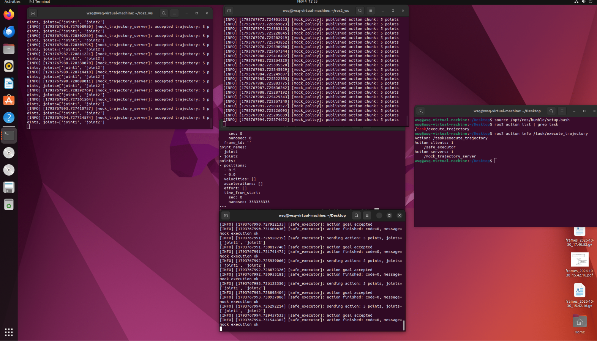

# 项目 16：VLA / 真机桥接骨架

> 状态：✅ 软件骨架已跑通（mock policy + mock action server）。
>
> 时间：2026.11.04 ｜ 第 15 天 ｜ ROS2 周 Day 7
>
> 环境：Ubuntu 22.04.5 + ROS2 Humble
>
> 目标：在“感知/规划”与“真实执行/VLA”之间，搭出安全层、动作接口和策略服务骨架。

---

## 1. 今天到底搭了什么

前 14 天的重点在仿真闭环：

```text
TF → Gazebo → ros2_control → MoveIt2 → 感知 → 规划 → 执行
```

今天补的是中间层：

```text
Mock Policy
    ↓ /policy/action_raw
Safety Filter
    ↓ /policy/action_safe
Safe Executor
    ↓ /task/execute_trajectory（FollowJointTrajectory action）
Mock Trajectory Server
```



这张截图里同时包含：

- `mock_policy` 持续发布 5 点动作块；
- `safety_filter` 输出安全动作；
- `safe_executor` 把安全动作发给 action server；
- `mock_trajectory_server` 接受 5 点轨迹；
- `safe_executor` 收到 `code=0, message=mock execution ok`；
- `ros2 action info` 显示 client/server。

---

## 2. 神经系统的类比

你的类比很贴切，但要区分“通路”和“闭环”。

```text
Day 13/14：感知 → 中枢
相机检测 → target_pose → MoveIt2 规划

Day 15：中枢 → 外周
策略动作 → 安全层 → 动作接口 → 执行器
```

所以今天更像是补上了**下行/传出通路**：

```text
中枢/策略
    ↓
安全闸门
    ↓
运动指令
    ↓
执行器
```

安全层可以类比为：

```text
脊髓反射 / 保护性抑制
```

它不让越界或过快的动作直接进入执行器。

但它**还不是完整的神经闭环**，因为：

```text
policy 是 mock，不读真实图像
executor 后面是 mock action server
没有真实关节执行
没有执行后的传感器反馈回到 policy
```

完整闭环应该是：

```text
感知 → 策略 → 安全 → 执行 → 传感器反馈 → 策略
```

今天只完成了其中“中枢到外周”的软件命令链。

---

## 3. 代码结构

```text
project16_ros2_vla_bridge/
├── README.md
├── assets/
│   └── action_chain_logs.png
└── ros2_ws/
    └── src/
        └── vla_bridge/
            ├── package.xml
            ├── setup.py
            ├── setup.cfg
            ├── resource/vla_bridge
            └── vla_bridge/
                ├── __init__.py
                ├── mock_policy.py
                ├── safety_filter.py
                ├── mock_trajectory_server.py
                └── safe_executor.py
```

| 文件 | 作用 |
| --- | --- |
| `mock_policy.py` | 模拟 VLA 输出 action chunk |
| `safety_filter.py` | 关节名、长度、位置限位、速度缩放、watchdog |
| `safe_executor.py` | 订阅安全动作，发送 FollowJointTrajectory action |
| `mock_trajectory_server.py` | 模拟执行器，接受 action 并返回成功 |

---

## 4. 重要环境规则：新终端必须 source

每次新开终端，都要执行：

```bash
source /opt/ros/humble/setup.bash
```

```bash
source ~/ros2_ws/install/setup.bash
```

每次重新编译后，也要在用于启动节点的终端重新：

```bash
source ~/ros2_ws/install/setup.bash
```

注意：

```text
source 只更新当前终端的环境
不会重启已经运行的节点
```

所以：

- 新终端 → 必须 source；
- 重新编译后 → 重新 source；
- 已经运行的旧节点 → 必须重启，才会使用新代码；
- 如果只改了一个节点，不需要关掉不相干的节点。

---

## 5. 复现步骤

### 5.1 编译

```bash
cd project16_ros2_vla_bridge/ros2_ws
```

```bash
source /opt/ros/humble/setup.bash
```

```bash
colcon build --symlink-install --packages-select vla_bridge
```

```bash
source install/setup.bash
```

### 5.2 四个终端

终端 1：

```bash
source /opt/ros/humble/setup.bash
```

```bash
source ~/ros2_ws/install/setup.bash
```

```bash
ros2 run vla_bridge mock_trajectory_server
```

终端 2：

```bash
ros2 run vla_bridge mock_policy
```

终端 3：

```bash
ros2 run vla_bridge safety_filter
```

终端 4：

```bash
ros2 run vla_bridge safe_executor
```

每个新终端都要先 source，不要再出现 `Package 'vla_bridge' not found`。

---

## 6. 动作块示例

`mock_policy` 发布：

```text
/policy/action_raw
Type: trajectory_msgs/msg/JointTrajectory
```

示例结构：

```text
joint_names: [joint1, joint2]
points:
- positions: [-0.2239, 0.1331]
  velocities: [0.0, 0.0]
  time_from_start: {sec: 0, nanosec: 400000000}
- positions: [-0.2840, 0.0645]
  time_from_start: {sec: 0, nanosec: 800000000}
- ...
```

这代表“一次策略推理输出未来 2 秒内的 5 个动作点”。

---

## 7. 安全层验证

### 7.1 位置限位

手动发布越界动作：

```bash
ros2 topic pub --once /policy/action_raw trajectory_msgs/msg/JointTrajectory "{joint_names: [joint1, joint2], points: [{positions: [5.0, -8.0], time_from_start: {sec: 1, nanosec: 0}}]}"
```

安全层输出：

```text
positions: [2.967, -2.0]
```

### 7.2 速度限制

安全层根据：

```text
v = Δposition / Δt
```

计算速度。如果超过 1.5 rad/s，就对整条轨迹做时间缩放。

测试：

```bash
ros2 topic pub --once /policy/action_raw trajectory_msgs/msg/JointTrajectory "{joint_names: [joint1, joint2], points: [{positions: [0.5, 0.0], time_from_start: {sec: 0, nanosec: 100000000}}]}"
```

原来速度：

```text
0.5 rad / 0.1 s = 5 rad/s
```

安全输出：

```text
time_from_start: 0.333333333 s
safety_status: ok: 1 points, time scaled x3.33
```

### 7.3 watchdog

停止 mock policy 后：

```text
watchdog: no new action
```

再次收到动作：

```text
watchdog reset
```

---

## 8. 动作接口验证

```bash
ros2 action list | grep task
```

输出：

```text
/task/execute_trajectory
```

```bash
ros2 action info /task/execute_trajectory
```

输出：

```text
Action clients: /safe_executor
Action servers: /mock_trajectory_server
```

`safe_executor` 日志：

```text
sending action: 5 points, joints=[joint1, joint2]
action goal accepted
action finished: code=0, message=mock execution ok
```

---

## 9. 今天解决了什么

- 把策略输出转换为 ROS2 action chunk；
- 在动作进入执行器前加安全过滤；
- 实现关节位置 clamp；
- 实现基于时间缩放的速度限制；
- 实现 watchdog；
- 用标准 `FollowJointTrajectory` action 建立动作接口；
- 让动作从策略端贯穿到 mock action server。

---

## 10. 局限性

今天还不是“完整 VLA + 真机”：

```text
mock_policy 不读取图像
mock_trajectory_server 不驱动真实关节
没有执行反馈
没有动作队列和时间对齐
没有真正接 VLA 模型
```

所以准确说法是：

```text
VLA/真机桥接骨架
安全层 + 动作接口 + mock 执行链
```

不是：

```text
完整具身智能闭环
真实 VLA 部署
```

---

## 11. 下一步

```text
1. 把 mock_trajectory_server 换成真实 joint_trajectory_controller
2. 给 safe_executor 加动作队列和最新动作策略
3. 用真实相机/图像输入替换 mock policy
4. 接 VLA 推理服务，输出 action chunk
5. 采集 image + state + action，形成训练数据
```
