# 第 5 天：机械臂轨迹、时间参数化与奇异位形

前四天解决的主要是“让机械臂看见、过去、抓住”。  
第 5 天换了一个问题：

> **同样是从 A 走到 B，为什么有的轨迹又快又稳，有的会抖、会滞后、甚至会让关节速度爆掉？**

这一天按五个小项目逐步拆开：

```text
项目 1：把指令轨迹和实际轨迹记录下来
项目 2：决定“什么时候走到哪”——时间参数化
项目 2.5：检查轨迹是否可执行——速度、加速度、jerk
项目 3：决定“关节怎么配合”——Cartesian vs joint-space
项目 4：检查“这个姿势安不安全”——Jacobian、奇异值、可操作度
项目 5：真的接近奇异时怎么办——阻尼最小二乘 DLS
```

一句话主线：

```text
末端任务路径
→ 时间规划
→ 关节空间实现
→ 当前构型的 Jacobian / 可操作度
→ 速度、加速度、力矩、jerk 限制
→ 真正执行
```

---

## 项目 1：把指令轨迹和实际轨迹记录下来

### 我想回答什么

前面抓取时经常只看“最后有没有抓到”。  
但机械臂在运动过程中到底跟得准不准？指令点和实际点差多少？

### 做法

让末端沿一条 39 cm 的直线运动，总时间 2.5 s，每一步记录：

- 指令位置；
- 实际末端位置；
- 7 个关节角；
- 7 个关节角速度。

用红线画实际轨迹，用绿色虚线画指令轨迹。

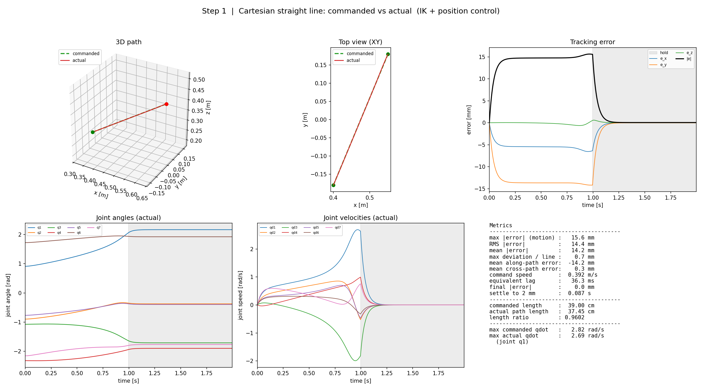

### 结果

| 指标 | 数值 |
| --- | ---: |
| 最大跟踪误差 | 6.3 mm |
| RMS 误差 | 5.9 mm |
| 实际路线偏离直线的最大距离 | 0.4 mm |
| 沿路径方向的平均滞后 | 5.8 mm |
| 等效时间滞后 | 37.3 ms |
| 到终点停稳后的误差 | 0.0 mm |

### 我学到的

- **指令 ≠ 实际**。位置控制器像带阻尼的弹簧，追一个移动目标时必然有滞后。
- 误差几乎全在“沿路径方向”，垂直方向只有 0.1 mm；所以轨迹看起来贴着直线，其实整体落后了约 37 ms。
- **静态精度 ≠ 动态精度**：停下后误差可以到 0，但运动中的误差是 6 mm 级别。
- 末端走匀速，关节速度却不是匀速。IK 和机械臂几何是非线性的。

---

## 项目 2：时间参数化——什么时候走到哪

### 先做速度对比：600 步 vs 240 步

同样 39 cm：

| 步数 | 时间 | 最大误差 | 等效滞后 | q1 最大速度 |
| ---: | ---: | ---: | ---: | ---: |
| 600 | 2.5 s | 6.3 mm | 37.3 ms | 1.11 rad/s |
| 240 | 1.0 s | 15.6 mm | 36.3 ms | **2.69 rad/s** |

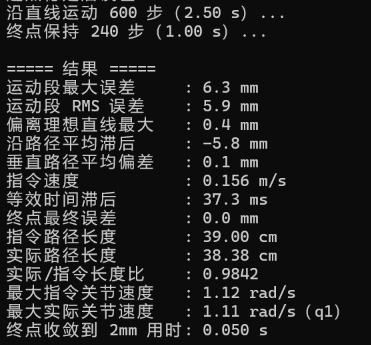
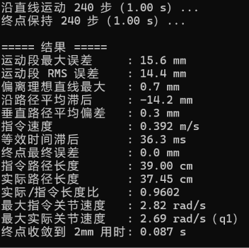

关键规律：

```text
误差 ≈ 速度 × 滞后时间
```

速度变成 2.5 倍，误差也变成约 2.5 倍，但滞后时间仍然是 36~37 ms。  
而且 240 步时 q1 已经超过 Panda 的 2.175 rad/s 标称上限，所以“能跑”不等于“真机安全”。

### 三种速度曲线

同一路径、同一总时间 2.5 s，比较：

- **constant**：匀速，起停瞬间完成；
- **trapezoid**：加速 → 匀速 → 减速；
- **min-jerk**：五次多项式，加速度连续、jerk 最小。

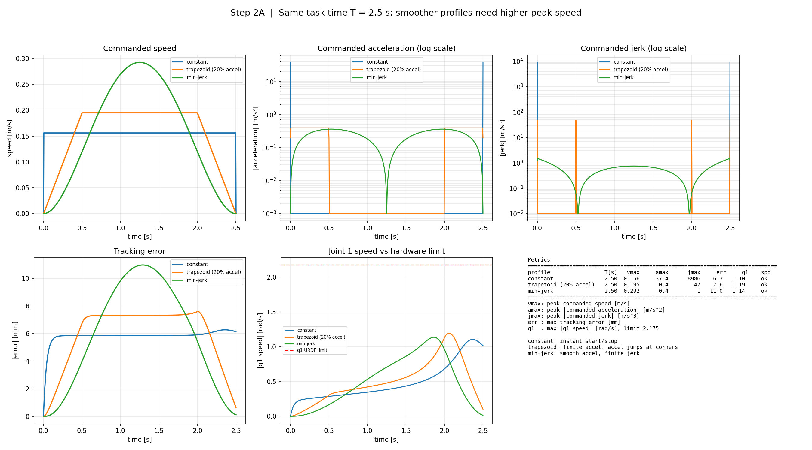
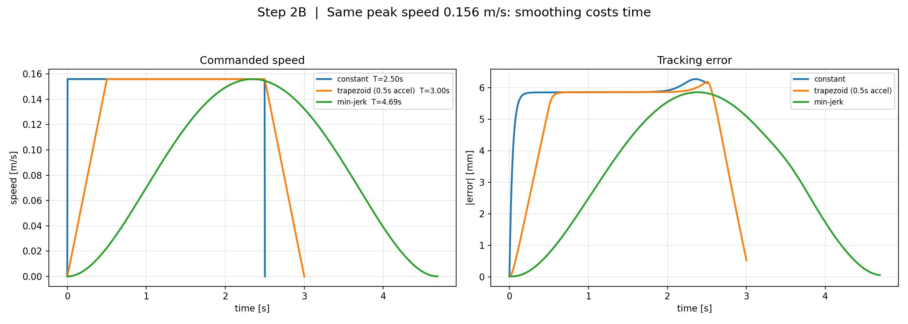

| 方式 | 峰值速度 | 最大加速度 | 最大 jerk | 最大误差 |
| --- | ---: | ---: | ---: | ---: |
| constant | 0.156 m/s | 37.4 m/s² | 8986 m/s³ | 6.3 mm |
| trapezoid | 0.195 m/s | 0.39 m/s² | 47 m/s³ | 7.6 mm |
| min-jerk | 0.292 m/s | 0.36 m/s² | 1.47 m/s³ | 11.0 mm |

### 我学到的

- **constant 的速度是矩形**，意味着起停时速度阶跃，加速度在连续意义上无穷大；仿真里只是把它离散成一个尖峰。
- **trapezoid 的加速度是矩形**，拐角处加速度跳变，所以 jerk 仍有尖峰。
- **min-jerk** 的加速度连续，jerk 有界；但总时间固定时，它的峰值速度更高，所以最大跟踪误差反而更大。
- **平滑不是免费的**：固定总时间时，平滑要用更高峰值速度换；固定峰值速度时，平滑要花更多时间。
- 最大误差主要跟随**峰值速度**，不是平均速度。

---

## 项目 2.5：给轨迹加可执行性门槛

只检查关节速度是不够的。constant 的速度没有超限，但加速度/jerk 完全不可执行。  
于是给轨迹加三项检查：

```text
关节速度 / URDF 上限
末端加速度 / a_max
末端 jerk / j_max
```

示例限制：`a_max = 0.5 m/s²`，`j_max = 2.0 m/s³`。这些是教学示例，不是 Franka 官方参数。

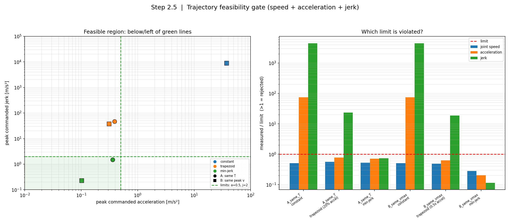
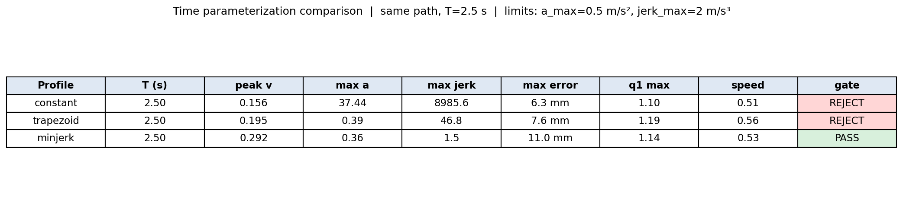

| 曲线 | 加速度/限制 | jerk/限制 | 结果 |
| --- | ---: | ---: | --- |
| constant | 74.9× | 4493× | 拒绝：加速度、jerk |
| trapezoid | 0.78× | 23.4× | 拒绝：jerk |
| min-jerk | 0.72× | 0.74× | 通过 |

### 我学到的

- **速度 OK ≠ 安全**。constant 的关节速度没超，但加速度/jerk 在真机上不可接受。
- 可执行性是相对于你设定的限制而言的；限制变了，PASS/REJECT 也会变。
- 真实机器人还要检查关节空间加速度/jerk、力矩、关节限位和碰撞，不能只看末端三项。

---

## 项目 3：Cartesian 插值 vs joint-space 插值

### 我想回答什么

同样从 A 点到 B 点：

- 让**末端位置**沿直线插值，每帧解 IK；
- 还是让**7 个关节角**直接线性插值？

末端路径和姿态会一样吗？

### 结果

两者使用相同的起点、终点、姿态和 min-jerk 时间曲线。

| 指标 | Cartesian | joint-space |
| --- | ---: | ---: |
| 最大路径偏差 | **0.4 mm** | **47.7 mm** |
| 最大姿态误差 | **0.04°** | **6.4°** |
| q1 最大速度 | 1.14 rad/s | 0.94 rad/s |
| 实际路径长度 | 38.99 cm | 40.51 cm |
| 终点误差 | 0.04 mm | 0.09 mm |

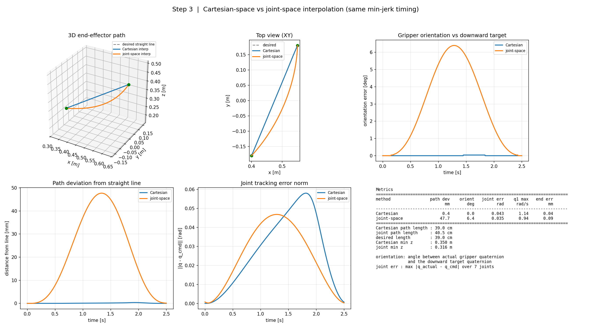
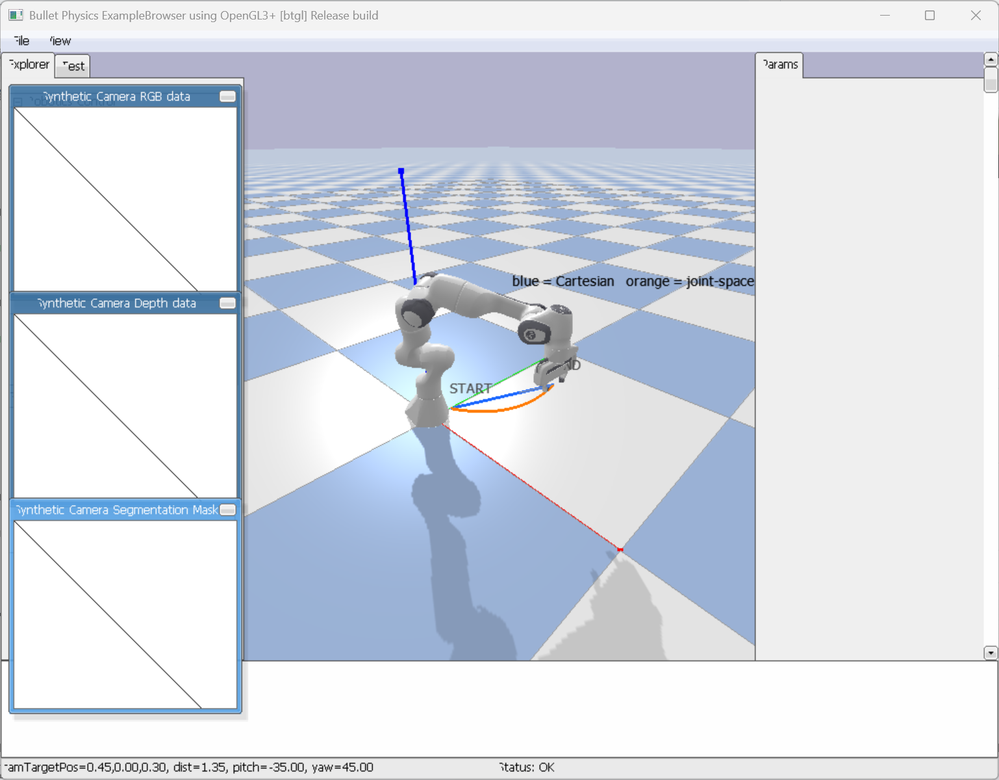

### 一个关键调试

一开始我直接从起点对终点解一次 IK 得到 `q_end`，结果 joint-space 插值到了终点，末端还差 **24 mm**。

原因还是：IK 是局部数值解，单次求解可能收敛到“差一点”的局部解，而且不报错。  
后来改成：

1. 先让 Cartesian 路径真正走到终点；
2. 读取到达终点时的实际关节角；
3. 用它作为 joint-space 的终点。

终点误差从 24 mm 降到 **0.09 mm**。

### 我学到的

- **关节空间走直线 ≠ 末端走直线**。非线性正运动会把关节直线映射成弯曲的末端路径。
- joint-space 不约束姿态，中间夹爪会倾斜；Cartesian 才能保持“朝下”。
- joint-space 的关节速度更低，但路径不可预测，遇到障碍物可能撞上。
- 任务要直线/固定姿态 → Cartesian；只关心起终点、空间空旷 → joint-space 往往更简单。

---

## 项目 4：奇异位形、Jacobian 与可操作度

### 通俗解释

- **Jacobian（雅可比）**：当前姿势下的“速度翻译表”，把 7 个关节速度翻译成末端的 6 维速度（3 线速度 + 3 角速度）。
- **奇异位形**：某些姿势下，这张翻译表在某个方向上失效；末端想动，但关节速度需求趋向无穷大。
- **可操作度**：给关节单位速度，末端能到达的速度范围是一个椭球；椭球越扁，某个方向越弱。

```text
x_dot = J(q) * q_dot
```

对 J 做 SVD 得到奇异值 `sigma_1 ... sigma_6`：

- 椭球的轴长就是这些奇异值；
- `sigma_min` 是最弱方向的余量；
- 乘积是椭球体积，但体积大不代表最弱方向安全。

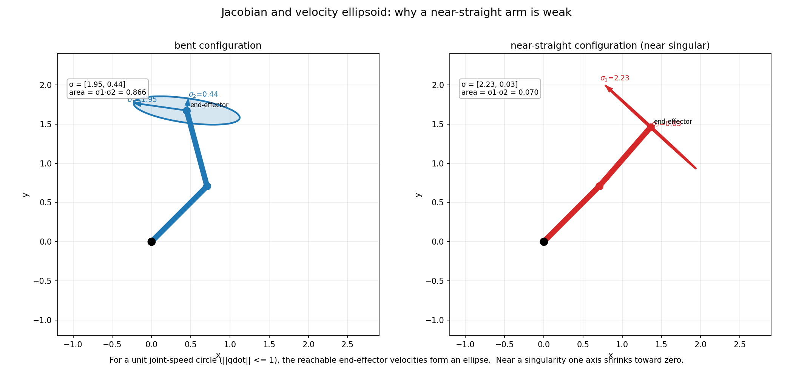
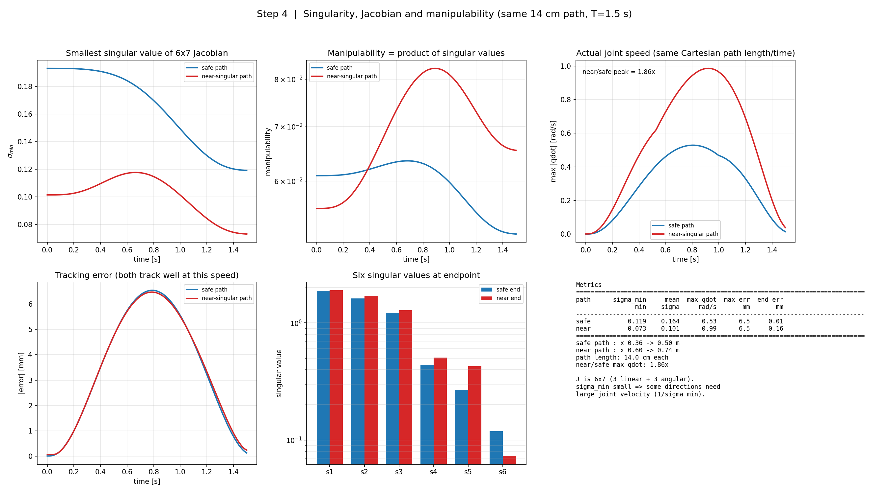
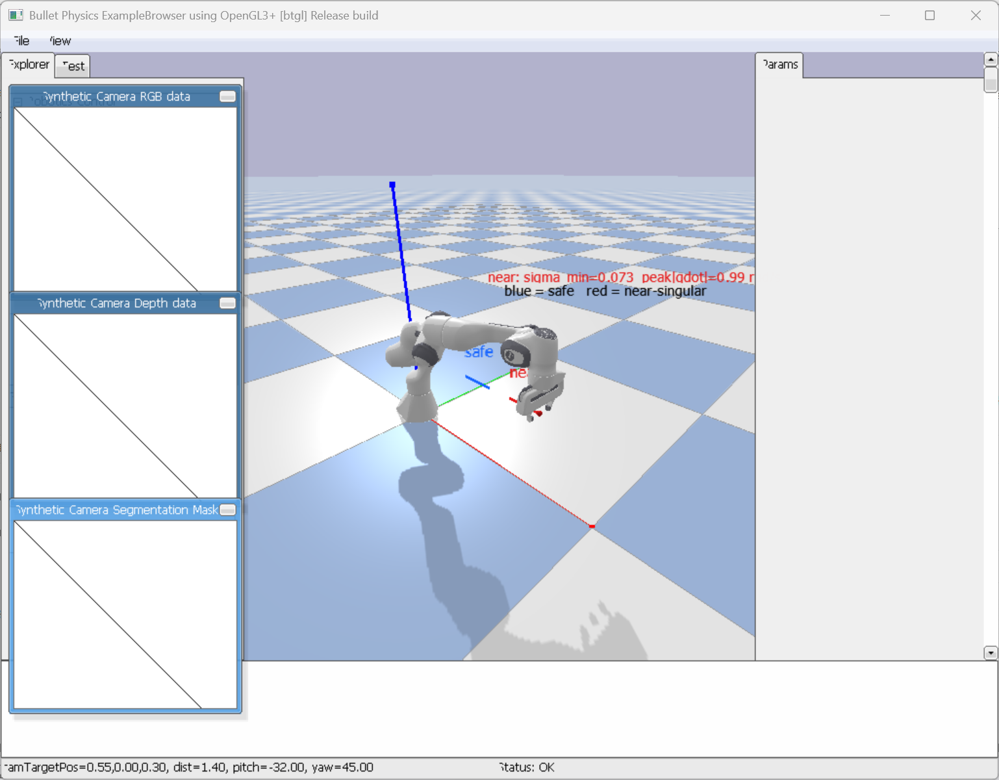

### 实验

两条路径长度、时间、速度曲线一样，但位置不同：

```text
safe: x = 0.36 → 0.50
near: x = 0.60 → 0.74
```

注意：两条路径的**起点和终点不同**，这是故意的；相同的是路径长度、时间和姿态。

| 指标 | safe | near |
| --- | ---: | ---: |
| sigma_min 最小 | 0.119 | **0.073** |
| 最大关节速度 | 0.53 rad/s | **0.99 rad/s** |
| 最大跟踪误差 | 6.5 mm | 6.5 mm |

### 我学到的

- 同样 14 cm、同样 1.5 s，near 路径的关节速度接近翻倍，因为机械臂更伸展、更接近奇异。
- **跟踪误差一样，不代表运动能力一样**；危险藏在关节速度和安全余量里。
- 乘积可操作度可能更高但 `sigma_min` 更低——体积会掩盖最弱方向，安全判断要看 `sigma_min`。
- 不是所有实验都必须显式限制 jerk；但发给真机的轨迹应该做速度/加速度/jerk/力矩的可行性检查。

---

## 项目 5：标准伪逆 vs 阻尼最小二乘 DLS

### 问题

在更接近奇异的路径 `x = 0.66 → 0.80` 上，标准伪逆会要求多大的关节速度？

标准伪逆：

```text
qdot = J^T * (J * J^T)^(-1) * twist
```

DLS：

```text
qdot = J^T * (J * J^T + lambda^2 * I)^(-1) * twist
```

`lambda` 是阻尼/正则化系数：它决定对弱方向的“让步程度”。  
`lambda` 越大，越不愿意为了弱方向使用巨大的关节速度，但末端跟踪误差会变大。

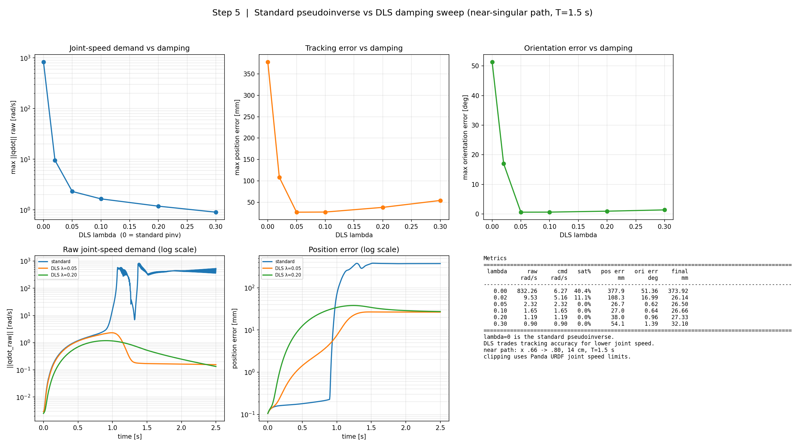
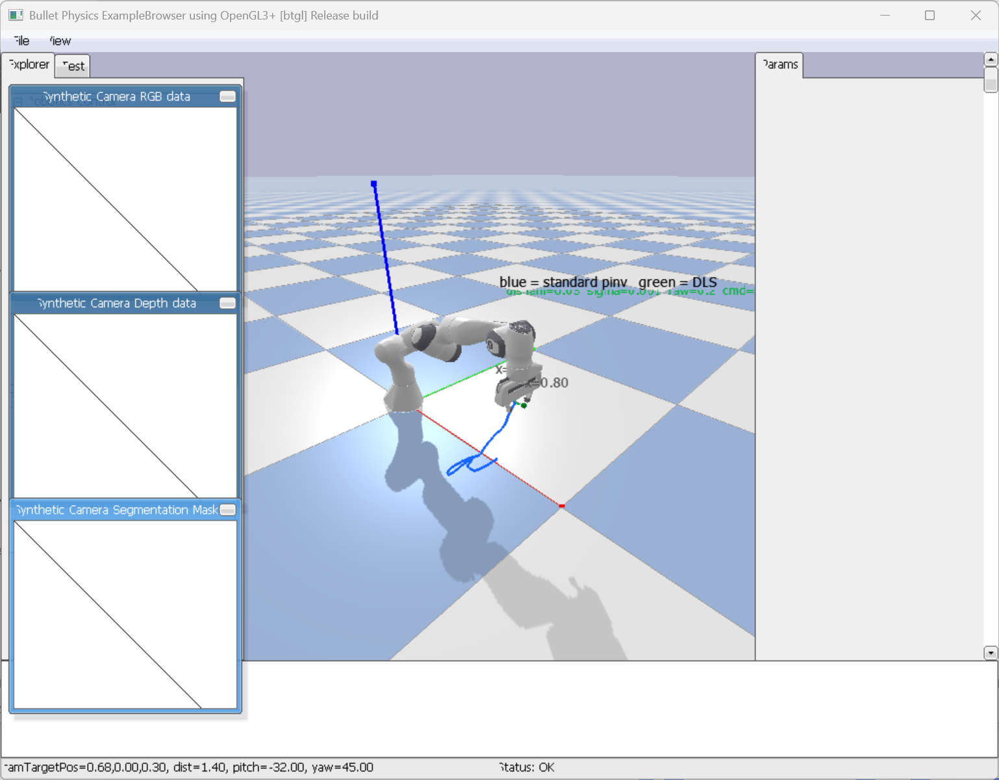

### 结果

| 控制器 | 最大原始关节速度 | 限幅比例 | 最大位置误差 | 最大姿态误差 |
| --- | ---: | ---: | ---: | ---: |
| 标准伪逆 | **832 rad/s** | **40.4%** | **377.9 mm** | **51.36°** |
| DLS λ=0.02 | 9.53 rad/s | 11.1% | 108.3 mm | 16.99° |
| **DLS λ=0.05** | **2.32 rad/s** | **0%** | **26.7 mm** | **0.62°** |
| **DLS λ=0.10** | **1.65 rad/s** | **0%** | **27.0 mm** | **0.64°** |
| DLS λ=0.20 | 1.19 rad/s | 0% | 38.0 mm | 0.96° |
| DLS λ=0.30 | 0.90 rad/s | 0% | 54.1 mm | 1.39° |

### 我学到的

- 标准伪逆在真正接近奇异时会失效：指令关节速度远超硬件限制，实际根本跟不上。
- DLS 主动放弃一点精度，换取可执行的关节速度和稳定姿态。
- λ 不是越大越好：太小仍然超速，太大又会过度保守、误差变大。
- 实用原则：**选择能满足速度/力矩限制的最小 λ**；远离奇异时可以接近 0，靠近奇异时自动增大。
- 实际控制里还应该做**自适应 λ**，而不是固定一个值。

---

## 第 5 天总结

### 一条主线

```text
任务路径：末端去哪
→ 时间参数化：多快、加速度/jerk 多大
→ 关节实现：Cartesian 还是 joint-space
→ 构型检查：Jacobian、sigma_min、可操作度
→ 硬件检查：速度、加速度、力矩、jerk
→ 必要时用 DLS 做奇异鲁棒控制
```

### 名词速查

| 名词 | 通俗理解 |
| --- | --- |
| 路径 vs 轨迹 | 路径只管“走哪条线”；轨迹还包含“什么时候到哪” |
| 跟踪误差 | 指令位置和实际位置的差；运动中和停稳后是两个问题 |
| 时间参数化 | 决定速度、加速度、jerk 的时间曲线 |
| jerk | 加速度的变化率；jerk 尖峰会让运动产生冲击和振动 |
| 可执行性检查 | 速度、加速度、jerk、力矩等是否超过限制 |
| Cartesian 插值 | 末端走直线，每帧解 IK，能保持姿态 |
| joint-space 插值 | 直接插值 7 个关节角，关节简单但末端会走弯 |
| Jacobian | 把关节速度翻译成末端速度的矩阵 |
| 奇异值 | 速度椭球的轴长；描述各方向的传动能力 |
| sigma_min | 最弱方向的余量，最接近奇异的指标 |
| 可操作度 | 奇异值的乘积/椭球体积；不能只看体积 |
| 奇异位形 | 某个方向失去运动能力的构型；标准伪逆会要求无穷大关节速度 |
| DLS / lambda | 阻尼最小二乘；用一点精度换关节速度和稳定性 |

### 我今天最重要的收获

1. **不要只看“最后有没有抓到”**：要记录指令、实际、误差和关节速度。
2. **时间规划本身就会改变误差**：速度越快，动态滞后越大；平滑和节拍要取舍。
3. **速度没超限不等于安全**：加速度、jerk、力矩和奇异余量都要检查。
4. **末端轨迹一样，关节实现可能完全不同**：Cartesian 和 joint-space 各有适用场景。
5. **奇异位形不是“位置错了”，而是“这个姿势下某个方向没有余量”**；DLS 是在余量不足时的安全阀，不是万能解。

---

## 复现

```bash
# 项目 1：轨迹记录与误差图
python project8_trajectory/step1_trace.py --gui

# 项目 2：三种速度曲线与速度对比
python project8_trajectory/step2_profiles.py

# 项目 2.5：读取 step2 的结果做可执行性筛选
python project8_trajectory/step2_5_limits.py

# 项目 2 的 GUI 演示
python project8_trajectory/step2_visual_compare.py

# 项目 3：Cartesian vs joint-space（默认 GUI）
python project8_trajectory/step3_interpolation.py

# 项目 4：奇异位形与可操作度（默认 GUI）
python project8_trajectory/step4_singularity.py
python project8_trajectory/step4_ellipsoid_concept.py

# 项目 5：标准伪逆 vs DLS（默认 GUI；--headless 跑完整 lambda 扫描）
python project8_trajectory/step5_dls.py
```

> 每次运行的 CSV 和原始图片在 `project8_trajectory/output/`，不提交到仓库；  
> 本页使用的精选图片在 `project8_trajectory/assets/`。
