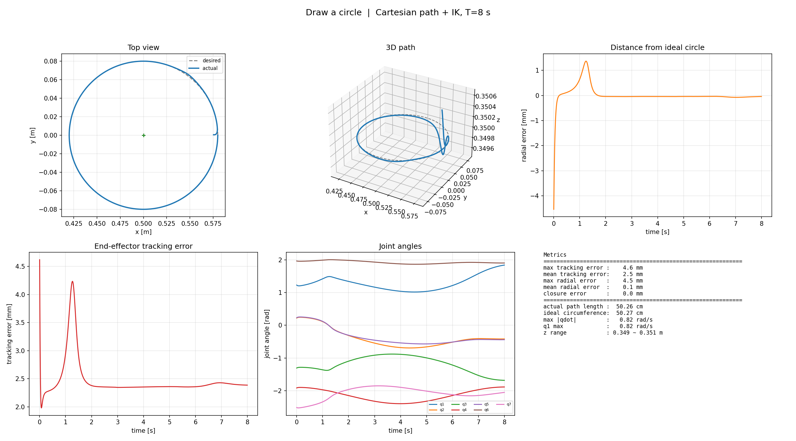
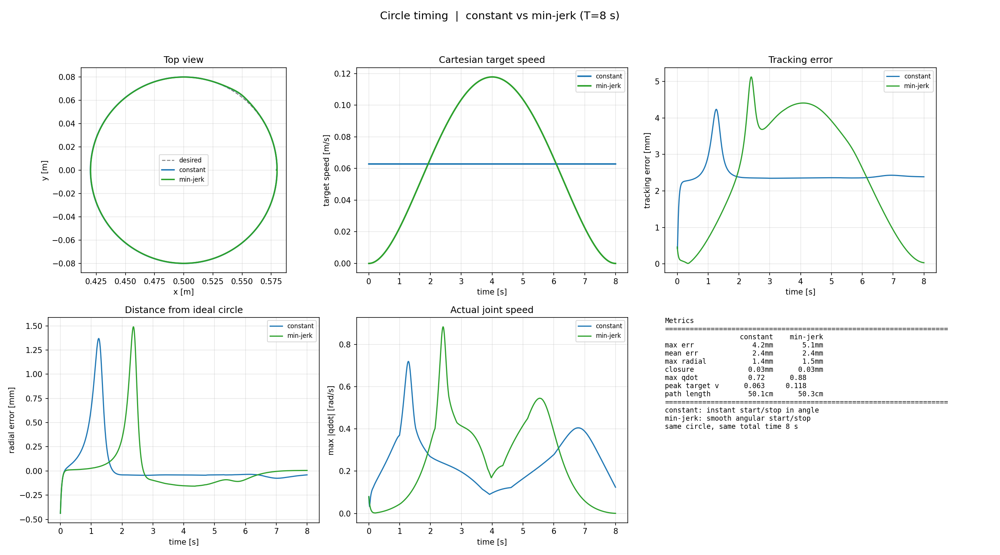
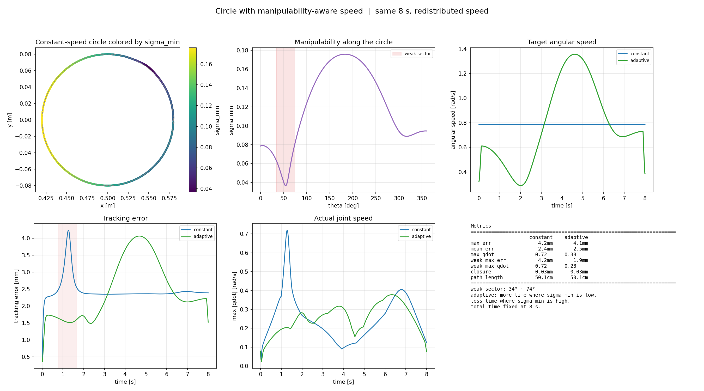
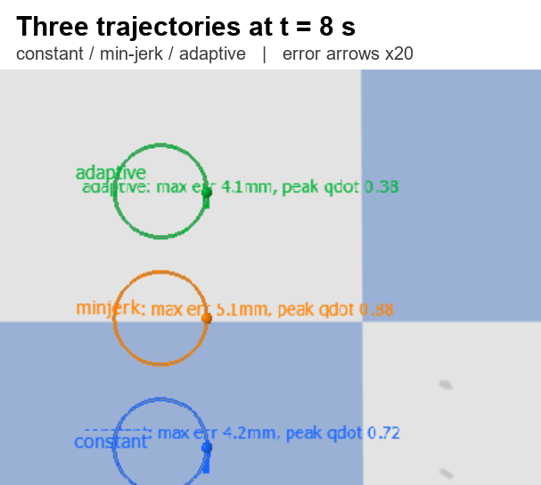

# 第 6 天：一小时小项目——机械臂画圆与可操作度调速

今天没有继续啃新公式，而是用一小时把前几天学到的东西串成一个小项目：

> **让 Panda 在空间里画一个圆，并比较三种速度分配：匀速、min-jerk、可操作度自适应。**

三种走法的总时间都是 **8 s**，都会在 **t = 8.0 s** 回到起点。  
差别在于中间怎么分配速度。

---

## 项目 1：先画出第一版圆

### 设置

```text
圆心： (0.50, 0, 0.35)
半径： 8 cm
姿态： 夹爪朝下
时间： 8 s
速度： 恒定角速度
```



### 结果

| 指标 | 数值 |
| --- | ---: |
| 最大跟踪误差 | 4.6 mm |
| 平均跟踪误差 | 2.5 mm |
| 最大径向误差 | 4.5 mm |
| 闭合误差 | 0.03 mm |
| 实际路径长度 | 50.26 cm |
| 最大关节速度 | 0.82 rad/s |

圆画得很圆，闭合误差几乎为 0；但起步和收尾附近有动态误差尖峰。

---

## 项目 2：constant vs min-jerk

### 设置

同一个圆、同样 8 s：

- **constant**：角度匀速变化；
- **min-jerk**：角度按五次多项式变化，起停更平滑。



### 结果

| 指标 | constant | min-jerk |
| --- | ---: | ---: |
| 最大跟踪误差 | 4.2 mm | 5.1 mm |
| 平均跟踪误差 | 2.4 mm | 2.4 mm |
| 最大关节速度 | 0.72 rad/s | 0.88 rad/s |
| 峰值末端速度 | 0.063 m/s | 0.118 m/s |

### 一个容易误解的点

min-jerk **中段看起来最快**，但不是提前到达。

| 圆的进度 | constant | min-jerk |
| ---: | ---: | ---: |
| 25% | 2.00 s | 2.88 s |
| 50% | 4.00 s | 4.00 s |
| 75% | 6.00 s | **5.13 s** |
| 90% | 7.20 s | **6.03 s** |
| 99% | 7.92 s | **7.16 s** |
| 100% | 8.00 s | 8.00 s |

min-jerk 前段慢、中段快、最后非常慢；所以它在中后段领先，但最后还是 8.0 s 才到终点。

---

## 项目 3：沿圆看 `sigma_min`，让弱区自动降速

沿 constant 圆计算完整 6×7 雅可比的最小奇异值：

```text
弱扇区中心：θ ≈ 54°
弱扇区范围：约 34° ~ 74°
最低 sigma_min：0.037
```



### 做法

- 先匀速跑一圈，记录 `sigma_min(theta)`；
- 用 `1 / sigma_min` 作为时间权重：弱区多花时间，强区少花时间；
- 总时间仍然固定为 8 s。

### 结果

| 指标 | constant | adaptive |
| --- | ---: | ---: |
| 最大跟踪误差 | 4.2 mm | 4.1 mm |
| 平均跟踪误差 | 2.4 mm | 2.5 mm |
| 最大关节速度 | 0.72 rad/s | **0.38 rad/s** |
| 弱区最大误差 | 4.2 mm | **1.9 mm** |
| 弱区最大关节速度 | 0.72 rad/s | **0.28 rad/s** |

自适应版把弱区的关节速度从 0.72 降到 0.28 rad/s，跟踪误差从 4.2 mm 降到 1.9 mm；代价是强区被加速，误差转移到强区。

---

## 三种方法的最终对比

| 方法 | 最大误差 | 平均误差 | 最大关节速度 | 弱区最大误差 | 弱区最大关节速度 |
| --- | ---: | ---: | ---: | ---: | ---: |
| constant | 4.23 mm | 2.45 mm | 0.72 rad/s | 4.23 mm | 0.72 rad/s |
| min-jerk | 5.12 mm | 2.45 mm | 0.88 rad/s | 5.12 mm | 0.88 rad/s |
| adaptive | 4.06 mm | 2.45 mm | **0.38 rad/s** | **1.94 mm** | **0.28 rad/s** |



> 截图说明：这是简化后的**无机械臂**动态对比。  
> 三个圆分别对应 constant / min-jerk / adaptive；彩色箭头是误差方向，长度放大 20 倍。  
> 真实误差只有几毫米，看文字数字，不要把箭头长度当成真实位移。

---

## 这个项目串起了什么

```text
IK：把圆上的目标点变成关节角
→ 轨迹：决定什么时候走到哪
→ Jacobian / sigma_min：知道哪里吃力
→ 自适应时间分配：弱区慢、强区快
→ 关节速度 / 跟踪误差：验证是否真的更好
```

### 最重要的几个结论

1. **同时到达 ≠ 每一刻速度相同**：三者的总时间都是 8 s，但速度曲线完全不同。
2. **min-jerk 中段最快，最后最慢**：它覆盖了大部分角度后，最后 1% 会花更长时间。
3. **可操作度地图可以直接指导调速**：弱区慢下来，弱区关节速度几乎减半。
4. **调速不是免费的**：总时间固定时，弱区的安全余量是用强区加速换来的。
5. **误差 1~5 mm 肉眼很难看见**：所以要用放大箭头、数值读数和误差曲线。

---

## 复现

```bash
# 项目 1：第一版圆
python project9_draw_circle/step1_circle.py --gui

# 项目 2：constant vs min-jerk
python project9_draw_circle/step2_circle_timing.py

# 项目 3：可操作度着色 + 自适应调速
python project9_draw_circle/step3_adaptive_circle.py

# 三机械臂 GUI 对比
python project9_draw_circle/step5_three_arms_gui.py

# 简化版：只显示三条动态轨迹
python project9_draw_circle/step6_trails_only_gui.py
```

原始输出在 `project9_draw_circle/output/`，不提交到仓库；本页使用 `assets/` 里的精选图片。
